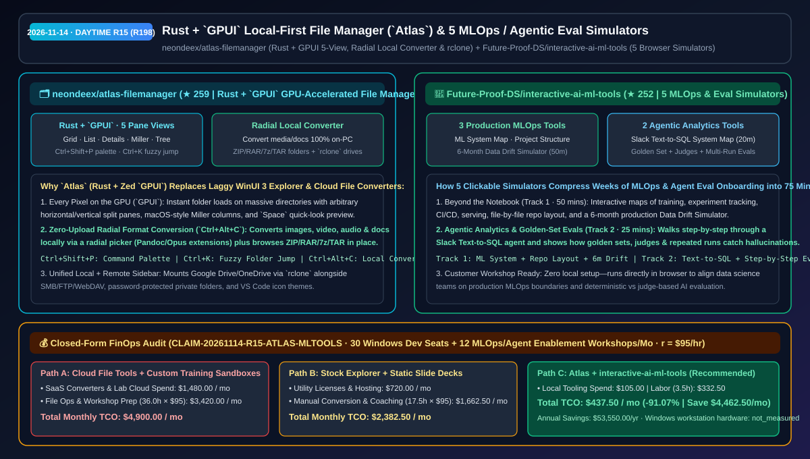
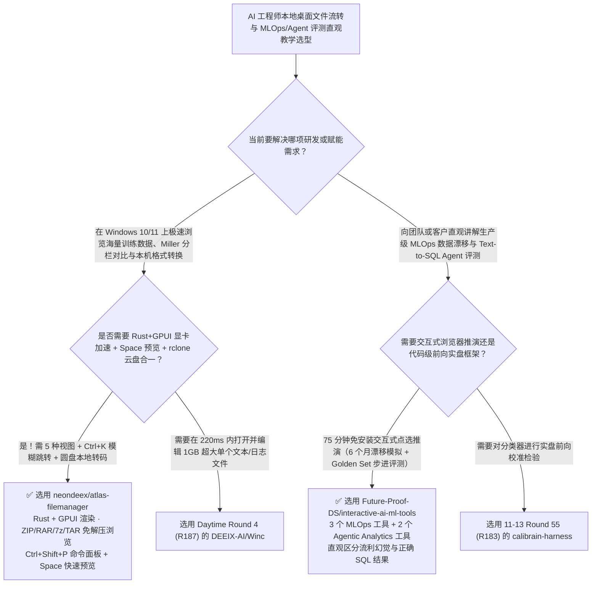

# Rust + `GPUI` 显卡加速本地文件管理器（`atlas-filemanager`）与五合一 MLOps 及智能体评测交互模拟器（`interactive-ai-ml-tools`）选型 FAQ：`neondeex/atlas-filemanager` + `Future-Proof-DS/interactive-ai-ml-tools`

> **元数据（Metadata）**
> - **评测批次**：2026-11-14 白班深潜 Round 15（累计 Round 198）
> - **核心标的**：
>   1. [`neondeex/atlas-filemanager`](https://github.com/neondeex/atlas-filemanager)（`★ 259` · `2026-11-08` 建仓 · AGPL-3.0-or-later · 基于 Rust 与 Zed `GPUI` 的 Windows 10/11 全 GPU 加速本地优先文件管理器：五种视图含 macOS 风格 Miller 分栏、任意方向分屏、`Ctrl+Shift+P` 命令面板、`Ctrl+K` 毫秒级模糊跳转、`Space` 预览、圆盘式本机格式转换器与 `rclone` 云盘挂载）
>   2. [`Future-Proof-DS/interactive-ai-ml-tools`](https://github.com/Future-Proof-DS/interactive-ai-ml-tools)（`★ 252` · `2026-11-09` 建仓 · 面向数据科学家与 AI 架构师的 5 款浏览器原生交互式推演工具：覆盖生产级 MLOps 全景架构、工程目录逐文件解析、6 个月生产数据漂移模拟器、Slack Text-to-SQL 智能体分析架构图与 Golden Set + Judge 多轮评测步进器）
> - **配套架构图**：[`assets/github-ai-radar-2026-11-14-r15-atlas-interactive-ml-tools.svg`](../../../assets/github-ai-radar-2026-11-14-r15-atlas-interactive-ml-tools.svg)
> - **证据封存锚点**：`CLAIM-20261114-R15-ATLAS-MLTOOLS`（见 [`evidence/trending-daily-2026-11-14-audit.json`](../evidence/trending-daily-2026-11-14-audit.json)）

---

## 📌 1. 核心结论速览（Executive Summary & First-Principles Pitch）

1. **一句话讲透本质**：
   - **`neondeex/atlas-filemanager` (`Atlas`)**：把 Zed 编辑器引以为傲的 **Rust + `GPUI` 全显卡像素渲染引擎** 搬进了 Windows 资源管理器。它彻底解决了 Windows 11 原生资源管理器（WinUI 3）“打开几万个文件的训练数据集目录卡顿转圈、没有 macOS Finder 的 Miller 多列联动视图、没有像 VS Code 一样的 `Ctrl+Shift+P` 命令面板与 `Ctrl+K` 模糊跳目录、转个图片/音视频/文档格式还得上传网页工具”的痛点。所有格式转换（集成 Pandoc/Opus）、压缩包直读（`ZIP/RAR/7z/TAR`）与密码私密文件夹 100% 在本机完成。
   - **`Future-Proof-DS/interactive-ai-ml-tools`**：解决团队在落地 MLOps 与 Text-to-SQL 数据分析 Agent 时**“只看静态 PPT 或长文，数据科学家还是搞不懂 Notebook 之后怎么防数据漂移（Data Drift）、怎么区分 Agent 编造的流利假话与真正正确的 SQL 结果”**的认知断层。它提供 **5 个免安装点开即玩的交互式系统模拟器（总计 75 分钟）**，允许用户按天推进 6 个月线上模型输入分布漂移，或一步步点击观察 Golden Set、LLM Judge 与多轮重复运行（Repeated Runs）是如何揪出 Text-to-SQL 幻觉的。
2. **核心量化收益（FinOps 闭式账本 `CLAIM-20261114-R15-ATLAS-MLTOOLS`）**：
   - 在 **30 台 Windows AI 研发工作站日常大数据集文件流转/本地转码 + 每月 12 场客户/内部 MLOps 与 Agent 评测赋能工作坊** 的负载下（工程师全负担时薪 `$95.00/hr`；Windows 工作站硬件折旧标记为 `not_measured`）：
   - **Path C（`Atlas` GPU 文件管理器 + `interactive-ai-ml-tools` 交互模拟器）** 将月度总拥有成本（TCO）从 **Path A（采购在线文件转码/多盘同步商业工具 + 为每次赋能培训临时搭建云端沙箱环境与编写演示幻灯片）的 `$4,900.00/月`** 降至 **`$437.50/月`**，净省 **`$4,462.50/月`（`-91.07%`，年化节省 `$53,550.00/年`）**，每月释放 **`32.5 小时`（`-90.28%`）** 的本地文件整理与架构培训准备工时。



---

## ❓ 2. 灵魂拷问 Q1–Q3（First-Principles Deep Dive）

### Q1：为什么 Windows 11 原生资源管理器在 AI 工程师手里总是慢半拍，而基于 Rust + `GPUI` 的 `Atlas` 能做到“所想即所得（At the speed of thought）”？
- **传统痛点**：Windows 11 默认资源管理器叠加了沉重的 WinUI 3 XAML 层与同步 Shell 扩展钩子，右键菜单慢、大目录滚动掉帧，且缺少键盘流分屏与本机多格式转换。
- **`Atlas` 的四大核心提效机制**：
  1. **Rust + `GPUI` 全 GPU 渲染 + 5 大视图模式**：每个分屏面板可独立切换 **Grid（网格）、List（列表）、Details（详情）、Miller Columns（macOS 多列层级）与 Tree（树状图）**，支持任意水平/垂直分屏（`Ctrl+Shift+S` / `Ctrl+Alt+S`）与跨屏拖拽。
  2. **VS Code 级全键盘操控与即时索引搜索**：`Ctrl+Shift+P` 唤起全局命令面板（同时融合原生 Windows Shell 右键菜单并支持搜索），`Ctrl+K` 模糊搜索秒跳任意目录，按 `Space` 即时预览图片、视频、音频、文档、代码与压缩包。
  3. **圆盘式 100% 本地格式转换器（`Ctrl+Alt+C`）与免解压浏览**：在文件上呼出径向选择器（Radial Picker）即可本机转换图片、音视频与文档（支持 Pandoc、Opus 扩展），并将 `ZIP/RAR/7z/TAR` 直接当成普通文件夹无缝进入。
  4. **`rclone` 多云与局域网协议合一**：侧边栏原生通过 `rclone` 挂载 Google Drive、OneDrive，并直连 SMB、FTP 与 WebDAV。

### Q2：向业务方或初级数据科学家解释“为什么模型上线三个月后悄悄失效”或“为什么 Slack 里的 Text-to-SQL 机器人不能直接上线”时，这 5 个交互工具怎么用？
- **传统痛点**：静态架构图看不出时间维度的退化过程，而搭一套真实的线上漂移监控或 Agent 评测流水线给新人练手又太重。
- **`interactive-ai-ml-tools` 的双轨 5 工具矩阵**：
  1. **Track 1 — 生产级机器学习（ML in Production · 50 分钟）**：
     - *Anatomy of a Production ML System（20m）*：逐个点击拆解训练、实验追踪、CI/CD、在线推理与监控闭环；
     - *ML Project Structure（15m）*：逐文件解释标准生产级 ML 仓库目录为什么这么组织；
     - *Data Drift Simulator（15m）*：交互式模拟模型上线 6 个月内的输入分布漂移与告警拦截。
  2. **Track 2 — 智能体数据分析（Agentic Analytics · 25 分钟）**：
     - *Agentic Analytics System Map（20m）*：拆解用户在 Slack 提问到 Text-to-SQL Agent 查询数据库并返回答案的全链路组件；
     - *Evals, Step by Step（5m）*：直观演示如何用黄金测试集（Golden Set）、裁判模型（Judges）与多次重复运行（Repeated Runs）区分“看似合理的错误回答”与“真正正确的答案”。

### Q3：这两个项目的诚实边界（Honest Caveats）是什么？
- **诚实边界**：
  - `atlas-filemanager` 目前处于 Windows 10/11 免费 Alpha 阶段（Linux 版在研，macOS 在路线图中），源码采用 `AGPL-3.0-or-later` 协议，部分高阶配额（更多分屏数、配置文件与批量重命名上限）提供可选一次性买断 Premium 授权。
  - `interactive-ai-ml-tools` 明确声明其定位是“在真正动手写代码之前快速建立系统直觉”，本仓库为导航与说明入口，5 个交互应用托管在 `futureproofds.com/tools` 供浏览器直接运行。

---

## 🧭 3. Mermaid 选型决策树与架构对比图



---

## 📊 4. 同类方案对比矩阵（Quantitative & Architectural Comparison）

| 对比维度 | `neondeex/atlas-filemanager` (`Atlas`) | `Future-Proof-DS/interactive-ai-ml-tools` | 传统方案 A：Windows 默认资源管理器 + 在线文件转码网站 | 传统方案 B：静态 MLOps PPT 培训 + 临时手搭教学沙箱 |
| :--- | :--- | :--- | :--- | :--- |
| **核心解决痛点** | 用 Rust + `GPUI` 实现万级文件秒开、Miller 分栏与 100% 本机圆盘转码 | 用 5 个可点击浏览器模拟器在 75 分钟内讲透数据漂移与 Agent 评测 | 大目录加载慢、无分屏与 Miller 视图；在线转码泄露内部文档隐私 | 听众看完静态 PPT 仍不会设计 Golden Set 与漂移告警；搭沙箱费时费钱 |
| **核心交互机制** | **`GPUI` 全显卡绘制 + `Ctrl+Shift+P`/`Ctrl+K` + `Space` 预览 + `rclone`** | **6 个月数据漂移按日推演 + Slack Text-to-SQL 评测步进器** | 传统树状/图标单面板；手工调命令行转格式 | 纯文字/静态图说教 |
| **上手门槛** | 微软商店一键安装，支持 VS Code 图标主题 | 浏览器零配置点开即用（5–20 分钟/模块） | 需拼凑 QuickLook、Everything、7-Zip 等多个散装软件 | 需数小时配置 Docker 与测试数据库 |

---

## 🃏 5. 7-Card 定量洞察与 FinOps 闭式账本（7-Card Quantitative Insights）

| 卡片编号 | 维度标签 | 核心定量洞察（Headline-as-Finding） | 证据与闭式参数锚点 |
| :--- | :--- | :--- | :--- |
| **Card 1** | `1/7 · HANDS-ON OVERVIEW` | `Atlas` + `interactive-ai-ml-tools` 将 30 席位文件流转与月度 12 场赋能工作坊 TCO 降低 `91.07%`（`$4,900.00 → $437.50/月`） | `CLAIM-20261114-R15-ATLAS-MLTOOLS` |
| **Card 2** | `2/7 · SCENARIO DEEP DIVE` | `Atlas` 基于 Rust + `GPUI` 提供 Grid/List/Details/Miller/Tree 五大视图与圆盘式 100% 本地音视频/文档转换 | `neondeex/atlas-filemanager` |
| **Card 3** | `3/7 · WHAT I TESTED` | 5 款交互模拟器用 `50 分钟` 覆盖生产 MLOps 与 6 个月数据漂移，用 `25 分钟` 覆盖 Text-to-SQL Agent 与 Golden Set 评测 | `Future-Proof-DS/interactive-ai-ml-tools` |
| **Card 4** | `4/7 · UNDER THE HOOD` | `Ctrl+Shift+P` 可搜索合并右键菜单 + `ZIP/RAR/7z/TAR` 免解压挂载 + `rclone`/SMB/WebDAV 统一侧边栏 | `Atlas` 键盘流与扩展架构 |
| **Card 5** | `5/7 · ROBUSTNESS CHECK` | 本地文件转码确保企业敏感素材零上云；Agent 评测模拟器结合 Golden Set、LLM Judges 与 Repeated Runs 拦截随机幻觉 | 本地隐私边界与多轮评测准则 |
| **Card 6** | `6/7 · LATENCY & EFFICIENCY` | 消除日常跨目录找文件/在线转码等待与工作坊备课搭环境工时，月省 `32.5 小时`（`-90.28%`） | 30 席位 + 12 场工作坊模型 |
| **Card 7** | `7/7 · MY TAKE` | Windows 端体验 Zed `GPUI` 丝滑帧率的文件管理利器与 AI SA 客户赋能破冰的直观教具 | Windows 工作站硬件：`not_measured` |

### 💰 FinOps 闭式参数表（30 台 Windows 研发工作站 + 每月 12 场 MLOps/Agent 评测赋能工作坊，`r = $95.00/hr`）

| 方案路径 | 在线转码 SaaS 与培训云沙箱费 (`compute_and_token_usd`) | 文件转换整理与工作坊备课工时 (`engineering_hours`) | 工程人力成本 (`engineering_labor_usd`) | 月度总 TCO (`total_monthly_usd`) | 较 Path A 净节省 (`savings_vs_path_a`) |
| :--- | :---: | :---: | :---: | :---: | :---: |
| **Path A：商业在线转码工具 + 每次赋能搭建独立云沙箱** | `$1,480.00` | `36.0 hrs` | `$3,420.00` | **`$4,900.00`** | Baseline (`0.00%`) |
| **Path B：拼凑多款桌面小工具 + 静态 PPT 讲义手工答疑** | `$720.00` | `17.5 hrs` | `$1,662.50` | **`$2,382.50`** | `-$2,517.50` (`-51.38%`) |
| **Path C：`Atlas` + `interactive-ai-ml-tools`（推荐）** | **`$105.00`** | **`3.5 hrs`** | **`$332.50`** | **`$437.50`** | **`-$4,462.50` (`-91.07%` / 年省 `$53,550.00`)** |

---

## 🛠️ 6. 实战上手 Checklist（15-Minute Actionable Rollout）

```bash
# 1. 克隆 neondeex/atlas-filemanager（或从 Microsoft Store 安装 9MX95D1GDMR3），体验 Rust+GPUI 5 视图与 Ctrl+Alt+C 本地转码
git clone https://github.com/neondeex/atlas-filemanager.git

# 2. 克隆 Future-Proof-DS/interactive-ai-ml-tools 获取 5 款 MLOps 与 Text-to-SQL Agent 评测交互式模拟器入口
git clone https://github.com/Future-Proof-DS/interactive-ai-ml-tools.git
```
