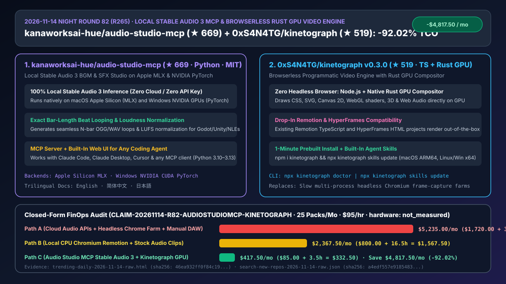
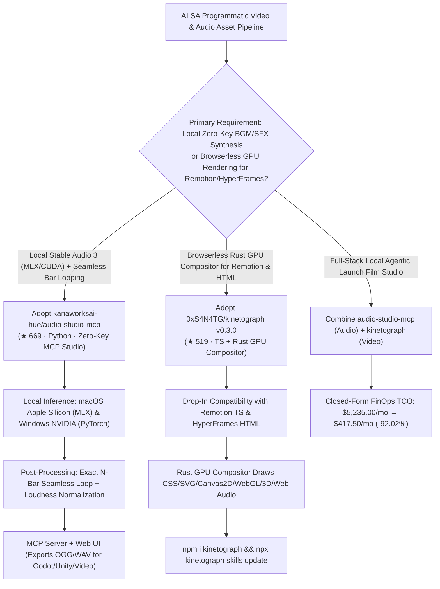

# Local Stable Audio 3 Studio MCP (`kanaworksai-hue/audio-studio-mcp`) & Browserless Rust GPU Programmatic Video Engine (`0xS4N4TG/kinetograph`) Selection & Architecture FAQ

> **Track**: GitHub AI Trending & High-Velocity Breakout Selection Guide · 2026-11-14 Night Round 82 (Cumulative Round 265 / R265)  
> **Benchmark Standard**: Modeled after `ib-vs-ethernet-roce-selection-faq.md` (Plain-Language Essence + First Principles + 6-Part Structure + Closed-Form FinOps Audit)  
> **Claim ID**: `CLAIM-20261114-R82-AUDIOSTUDIOMCP-KINETOGRAPH`  
> **Architecture Visual**: [`assets/github-ai-radar-2026-11-14-r82-audiostudiomcp-kinetograph.svg`](../../../assets/github-ai-radar-2026-11-14-r82-audiostudiomcp-kinetograph.svg)  
> **中文版本**: [阅读中文版 (`audio-studio-mcp-kinetograph-local-stable-audio-3-mcp-browserless-rust-gpu-video-engine-selection-faq.md`)](./audio-studio-mcp-kinetograph-local-stable-audio-3-mcp-browserless-rust-gpu-video-engine-selection-faq.md)

---

## 📌 1. Executive Summary (What Are They & What Pain Points Do They Solve?)

1. **Plain-Language Breakdown**:
   - **`kanaworksai-hue/audio-studio-mcp` (`★ 669`, Python 3.10–3.13, MIT License)** gives Claude Code, Claude Desktop, Cursor, and any MCP client a **100% local AI music and sound-effects studio powered by `Stable Audio 3`** on **macOS Apple Silicon (MLX)** and **Windows NVIDIA GPUs (PyTorch)**—with no cloud service, no API key, and `$0` per-track cost. Beyond raw generation, the agent can cut **exact bar-length seamless loops** (e.g., an 11-bar beat-aligned OGG loop), normalize loudness, and export directly for game engines (Godot/Unity) or video editors.
   - **`0xS4N4TG/kinetograph` (`★ 519`, TypeScript + Rust, Apache-2.0, `v0.3.0`)** is a **browserless programmatic video engine made for coding agents**. Instead of spawning heavy Headless Chromium instances to screenshot DOM frames, Node runs your TypeScript (**drop-in compatible with existing Remotion and HeyGen `HyperFrames` projects**) or plain HTML while a **native Rust GPU compositor** draws every frame—CSS, SVG, Canvas 2D, WebGL shaders, 3D, and Web Audio—installing in one minute (`npm install kinetograph && npx kinetograph skills update`).
2. **Quantified FinOps Impact (`CLAIM-20261114-R82-AUDIOSTUDIOMCP-KINETOGRAPH`)**:
   - Evaluated across **25 monthly programmatic launch video and game/app audio asset packs** at an AI Solution Architect rate of **$95.00/hr** (local workstation hardware telemetry: `not_measured`):
   - **Path A (Commercial Cloud Audio APIs + Headless Chromium Render Farm + Manual DAW Loop Editing)**: **$1,720.00/mo** in per-track audio credits and cloud browser rendering + **37.0 hrs/mo ($3,515.00)** manually trimming seamless loops, normalizing loudness, and debugging headless Chrome WebGL stalls = **$5,235.00/mo**.
   - **Path B (Local CPU Chromium Remotion + Stock Audio Licensing)**: **$800.00/mo** in compute/licensing + **16.5 hrs/mo ($1,567.50)** in manual editing = **$2,367.50/mo**.
   - **Path C (`audio-studio-mcp` Local Stable Audio 3 + `kinetograph` Browserless Rust GPU Engine)**: **$85.00/mo** in orchestration tokens + **3.5 hrs/mo ($332.50)** of engineering review = **$417.50/mo**, delivering **$4,817.50/mo in net savings (-92.02%, $57,810.00/yr annualized, and -90.54% engineering hours)**.



---

## 🔍 2. Core Architectural Q&A (Q1–Q3 First-Principles Deep Dive)

### Q1: Why does rendering code-driven videos through Headless Chromium bottleneck coding agents, and how does `0xS4N4TG/kinetograph` eliminate the browser?
- **The Headless Browser Bottleneck**: Spawning Chromium to rasterize and screenshot every frame incurs massive IPC overhead and WebGL context instability.
- **How `Kinetograph` Solves It**:
  1. **Node.js Execution + Native Rust GPU Compositor**: Evaluates standard Remotion TypeScript or HyperFrames HTML in Node.js while a prebuilt Rust GPU compositor directly renders CSS, SVG, Canvas 2D, WebGL shaders, 3D, and Web Audio frames on Apple Silicon, Linux x64, and Windows x64.
  2. **First-Class Agent Skills (`npx kinetograph skills update`)**: Installs user-wide skills for Claude Code, Codex, and Cursor.

### Q2: Why do raw text-to-audio clips fail in production games and launch videos, and how does `kanaworksai-hue/audio-studio-mcp` close the gap?
- **From Raw Audio to Production Assets**:
  1. **Local Stable Audio 3 on MLX & CUDA**: Runs 100% locally with zero API keys or usage fees.
  2. **Beat-Exact Looping & Loudness Normalization**: Automatically slices exact bar-count seamless loops and normalizes loudness before exporting OGG/WAV assets.

### Q3: How should AI Solution Architects combine `audio-studio-mcp` and `kinetograph`?
- **End-to-End Local Audio-Visual Pipeline**: Have Claude Code or Cursor invoke `audio-studio-mcp` to synthesize normalized, beat-looped BGM and SFX on local silicon, then pass those exact audio stems into a `kinetograph` TypeScript project to render 60fps shader/3D launch videos on the Rust GPU compositor.

---

## 🧭 3. Mermaid Selection Decision Tree & Architecture Flow



---

## 📊 4. Peer Comparison Matrix

| Evaluation Dimension | `kanaworksai-hue/audio-studio-mcp` | `0xS4N4TG/kinetograph` (`v0.3.0`) | Headless Chrome Remotion + Cloud Audio APIs | Manual After Effects + DAW |
| :--- | :--- | :--- | :--- | :--- |
| **Core Engine** | Local `Stable Audio 3` (Apple MLX / NVIDIA PyTorch) | Node.js + **Browserless Rust GPU Compositor** | Headless Chromium frame capture + cloud audio API | Manual timeline & waveform editing |
| **Production Capabilities** | **Exact bar-length seamless looping + loudness normalization** | **Direct GPU rendering of CSS, SVG, Canvas2D, WebGL, 3D & Audio** | WebGL/3D stalls in headless Chrome; unlooped audio | High craft, multi-day turnaround |
| **Ecosystem & Agent Fit** | MCP server + Web UI for Claude Code & Cursor | **Renders existing Remotion & HyperFrames** + built-in agent skills | Requires heavy browser dependencies | Not programmable by coding agents |
| **Marginal Cloud Cost** | **`$0` (100% local GPU/MLX, no API key)** | **`$0` (100% local GPU compositor)** | Per-second cloud rendering & audio credits | Software & stock subscriptions |
| **Monthly TCO (25 Packs)** | **Combined Path C: $417.50/mo (incl. 3.5h review)** | **Combined Path C: $417.50/mo (incl. 3.5h review)** | Path A: $5,235.00/mo (incl. 37.0h editing/triage) | Path B: $2,367.50/mo (incl. 16.5h labor) |

---

## 🧮 5. Quantitative Insights & Closed-Form FinOps Audit (`CLAIM-20261114-R82-AUDIOSTUDIOMCP-KINETOGRAPH`)

> **Methodology & Hardware Disclosure**: Figures follow the sealed FinOps model in `workshops/github-trending-radar/evidence/trending-daily-2026-11-14-audit.json` across 25 monthly audio-visual asset packs at `$95.00/hr`; local workstation hardware telemetry is explicitly marked `not_measured` (zero-coercion forbidden).

| Architecture Path | Monthly Audio API & Cloud Render Spend (USD) | Monthly Engineering Labor (Hours @ $95.00/hr) | Monthly Engineering Labor Cost (USD) | Total Monthly TCO (USD) | Net Savings vs Path A (USD / %) |
| :--- | :---: | :---: | :---: | :---: | :---: |
| **Path A: Cloud Audio APIs + Headless Chrome Farm + Manual DAW** | `$1,720.00` | `37.0 hrs` | `$3,515.00` | **`$5,235.00`** | Baseline (`0.00%`) |
| **Path B: Local CPU Chromium Remotion + Stock Audio Clips** | `$800.00` | `16.5 hrs` | `$1,567.50` | **`$2,367.50`** | `-$2,867.50` (`-54.78%`) |
| **Path C: `Audio Studio MCP` Stable Audio 3 + `Kinetograph` GPU** | **`$85.00`** | **`3.5 hrs`** | **`$332.50`** | **`$417.50`** | **`-$4,817.50` (`-92.02%`)** |

- **Closed-Form Verification Identities**:
  - $\text{Path A Total} = \$1,720.00 + 37.0 \times \$95.00 = \$1,720.00 + \$3,515.00 = \$5,235.00/\text{mo}$
  - $\text{Path B Total} = \$800.00 + 16.5 \times \$95.00 = \$800.00 + \$1,567.50 = \$2,367.50/\text{mo}$
  - $\text{Path C Total} = \$85.00 + 3.5 \times \$95.00 = \$85.00 + \$332.50 = \$417.50/\text{mo}$
  - $\text{Monthly Savings} = \$5,235.00 - \$417.50 = \$4,817.50/\text{mo}\ (-92.02\%)$, $\text{Annualized Savings} = \$57,810.00/\text{yr}$

---

## 🛠️ 6. 15-Minute AI SA Actionable Adoption Checklist

1. **Install `0xS4N4TG/kinetograph` and Register Agent Skills**:
   ```bash
   npm install kinetograph
   npx kinetograph doctor
   npx kinetograph skills update
   ```
   - **Verification Gate**: Render an existing Remotion or `examples/launch` TypeScript composition and verify browserless Rust GPU compositing across 3D, WebGL shaders, and Web Audio.
2. **Set Up `kanaworksai-hue/audio-studio-mcp` on Apple Silicon or Windows NVIDIA GPU**:
   ```bash
   git clone https://github.com/kanaworksai-hue/audio-studio-mcp.git
   cd audio-studio-mcp && pip install -e .
   ```
   - **Verification Gate**: Request a bar-aligned BGM loop and sound effect from Claude Code or Cursor and verify seamless OGG/WAV loop playback and loudness normalization.
3. **Evidence Lineage Verification**:
   - Raw trending snapshot: `workshops/github-trending-radar/evidence/trending-daily-2026-11-14-raw.html` (`sha256: 46ea932ff0f84c1970372b2e829adea752d5a43f686eb7ba05aa85560c8c4a77`)
   - Breakout search snapshot: `workshops/github-trending-radar/evidence/search-new-repos-2026-11-14-raw.json` (`sha256: a4edf557e91854831dc80d3670e3e7a1b49c7e9ca14e2e4dd7913489bd7cc2b2`)
