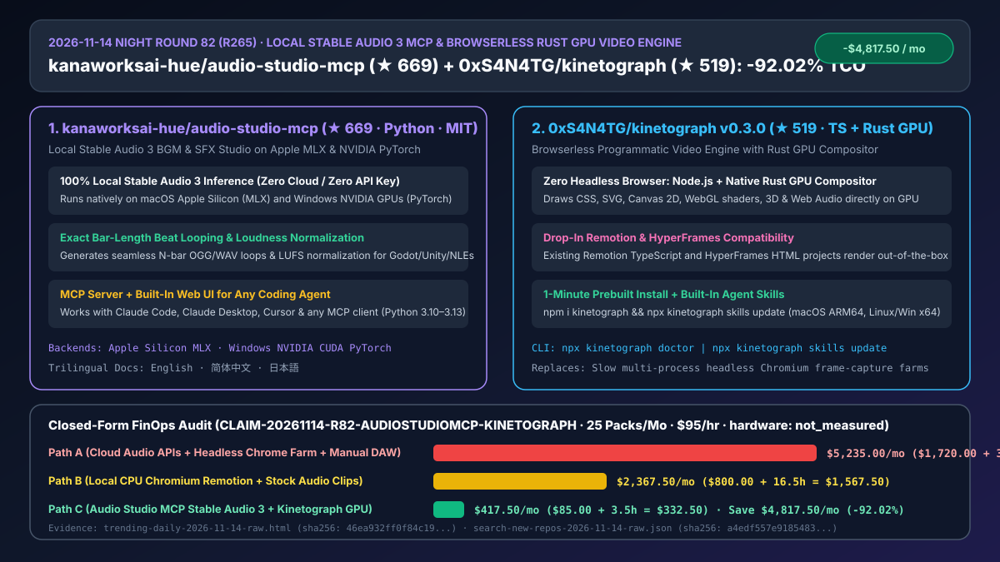
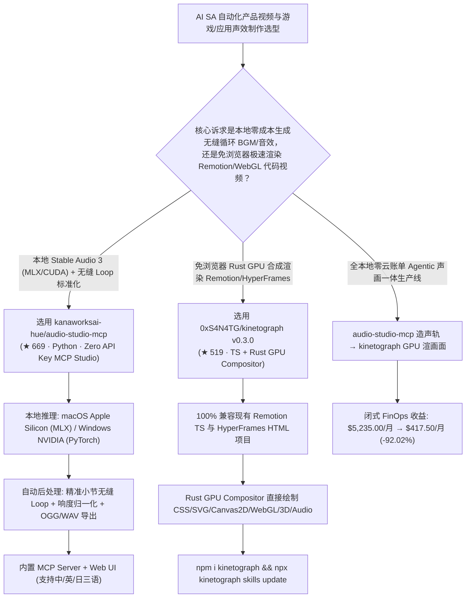

# 本地 Stable Audio 3 音乐音效工作站 MCP（`kanaworksai-hue/audio-studio-mcp`）与免浏览器的 Rust GPU 代码视频渲染引擎（`0xS4N4TG/kinetograph`）选型与架构拆解 FAQ

> **所属专题**：GitHub AI 热榜与新晋高星项目选型内参 · 2026-11-14 Night Round 82（累计第 265 轮 / R265）  
> **对标标杆**：`ib-vs-ethernet-roce-selection-faq.md`（大白话本质定义 + 第一性原理 + 六段式结构 + 闭式 FinOps 审计）  
> **审计编号**：`CLAIM-20261114-R82-AUDIOSTUDIOMCP-KINETOGRAPH`  
> **配套架构大图**：[`assets/github-ai-radar-2026-11-14-r82-audiostudiomcp-kinetograph.svg`](../../../assets/github-ai-radar-2026-11-14-r82-audiostudiomcp-kinetograph.svg)  
> **English Version**: [Read in English (`audio-studio-mcp-kinetograph-local-stable-audio-3-mcp-browserless-rust-gpu-video-engine-selection-faq.en.md`)](./audio-studio-mcp-kinetograph-local-stable-audio-3-mcp-browserless-rust-gpu-video-engine-selection-faq.en.md)

---

## 📌 一、核心结论速览（30 秒看懂：它们到底是什么？解决什么痛点？）

1. **用大白话讲透这两个项目**：
   - **`kanaworksai-hue/audio-studio-mcp`（`★ 669`，Python 3.10–3.13，MIT 协议）** 是给 Claude Code、Cursor 与任意 MCP 客户端装在本地电脑上的**零成本、零 API Key 的 AI 音乐与音效制作室（基于 `Stable Audio 3`）**。它在 macOS Apple Silicon 上走原生 **MLX** 加速，在 Windows NVIDIA 显卡上走 **PyTorch CUDA** 加速；更重要的是，它不只是“生成一段音频文件”就完事，而是内置了**精准小节无缝循环裁切（例如精确按 11 个小节对齐节拍生成无缝 OGG 循环）、响度标准化（Loudness Normalization）与游戏引擎/剪辑软件直出格式导出**。
   - **`0xS4N4TG/kinetograph`（`★ 519`，TypeScript + Rust，Apache-2.0 协议，版本 `v0.3.0`）** 是专为 AI 编程 Agent 打造的**免浏览器（Browserless）极速代码视频渲染引擎**。传统用代码写视频（如原版 Remotion）渲染时必须拉起笨重的 Headless Chromium 逐帧截图再拼成视频，不仅吃满 CPU/内存，WebGL 3D 与复杂着色器还经常在无头浏览器里掉帧或崩掉。`Kinetograph` **完全抛弃了浏览器**——用 Node.js 执行你的 TypeScript（**100% 兼容现有 Remotion 与 HeyGen `HyperFrames` 项目**）或纯 HTML，底层直接由**原生 Rust GPU 合成器（Compositor）**在显卡上逐帧绘制 CSS、SVG、Canvas 2D、WebGL Shaders、3D 与 Web Audio，并通过 `npx kinetograph skills update` 一键把视频创作技能注入 Claude Code、Codex 与 Cursor。
2. **核心量化收益（闭式 FinOps 方程 `CLAIM-20261114-R82-AUDIOSTUDIOMCP-KINETOGRAPH`）**：
   - 按团队每月生产 **25 套产品发布演示视频、技术动画及配套无缝循环 BGM/音效包**、AI SA 时薪 **$95.00/hr** 核算（本地硬件测量标注：`not_measured`）：
   - **Path A（按秒计费的商业 AI 音频 API + 云端无头浏览器渲染农场 + 人工用 DAW 剪辑循环节拍）**：月度商业音频 API 与云端渲染账单 **$1,720.00** + 工程师在音频软件里手动修剪无缝 Loop、调响度及排查无头 Chrome WebGL 渲染崩溃 **37.0 小时（$3,515.00）** = **$5,235.00/月**。
   - **Path B（本地 CPU 跑无头 Chrome Remotion + 购买版权音乐库裁剪）**：月度曲库与算力支出 **$800.00** + 渲染等待与音画对齐工时 **16.5 小时（$1,567.50）** = **$2,367.50/月**。
   - **Path C（`audio-studio-mcp` 本地 Stable Audio 3 工作站 + `kinetograph` 免浏览器 Rust GPU 引擎）**：月度零 API 本地推理与编排 Token 支出 **$85.00** + 人工复核工时 **3.5 小时（$332.50）** = **$417.50/月**，**每月净省 $4,817.50（降本 92.02%，年化节省 $57,810.00，音视频工程制作工时压缩 90.54%）**。



---

## 🔍 二、灵魂拷问 Q1–Q3（从第一性原理看透架构差异）

### Q1：为什么用传统 Remotion（基于 Headless Chromium）让 Agent 批量渲染代码视频会成为性能瓶颈？`0xS4N4TG/kinetograph` 是怎么跳过浏览器的？
- **Headless Chromium 渲染管线的结构性浪费**：
  1. 浏览器是为了实时交互和复杂网络栈设计的，用 Puppeteer/Playwright 打开无头浏览器再去截每一帧 DOM 画面，存在巨大的 IPC 通信、DOM 重排和软件光栅化开销；
  2. 当 Agent 写出带复杂 WebGL 着色器、3D 镜头、毛玻璃滤镜（Glass）和等距视图（Isometric）的宣传片时，无头浏览器的虚拟 GPU 上下文极易卡顿或因字体/资源异步加载导致帧撕裂。
- **`Kinetograph` 的“Node 逻辑层 + Rust GPU 合成层”架构**：
  1. **直接复用 Remotion & HyperFrames 生态**：你和你的 Agent 不需要学一套陌生的 DSL，照样写标准的 Remotion TypeScript 组件或 HyperFrames HTML；
  2. **原生 Rust GPU Compositor 逐帧直绘**：Node.js 负责驱动时间轴状态，每一帧的 CSS、SVG、Canvas 2D、WebGL Shader、3D 与 Web Audio 直接交给底层预编译的 Rust GPU 合成器绘制编码（支持 Apple Silicon macOS、Linux x64 与 Windows x64 一分钟免编译安装 `npm install kinetograph`）。

### Q2：用云端 AI 音乐生成工具给 Demo 视频或游戏配乐，为什么“接缝咔哒声（Loop Click）”和“忽大忽小的音量”最难搞？`kanaworksai-hue/audio-studio-mcp` 解决了什么？
- **裸音频生成的工程最后一公里**：
  - 直接拿文生音频模型吐出的 MP3 放进视频或 Godot/Unity 游戏里，首尾相接处必有明显的节拍断裂，且不同批次生成的音效响度差出 6–10 dB。
- **`Audio Studio MCP` 的全链路后处理工具箱**：
  1. **双平台原生硬件加速（MLX + CUDA）**：在 Mac 上利用 MLX 统一内存跑 `Stable Audio 3`，在 Windows PC 上利用 NVIDIA PyTorch 跑本地推理，**零云端调用费、零版权纠纷**；
  2. **节拍感知的无缝循环与响度对齐**：Agent 可以在一次对话中生成两版候选 BGM，自动按指定小节数（如精确 11 小节）切出节拍严丝合缝的无缝 OGG Loop，并自动执行响度归一化（Loudness Normalization）。

### Q3：AI Solution Architect 如何把 `audio-studio-mcp` 与 `kinetograph` 组合成“一句话全自动声画工厂”？
- **纯本地代码级“声 + 画”双引擎**：
  - 在 Claude Code / Cursor 中，先让 Agent 调用 **`audio-studio-mcp`** 在本地显卡上生成精确时长与 BPM 的无缝循环背景音乐及 UI 转场音效（导出为标准化 WAV/OGG）；
  - 随后让同一个 Agent 调用 **`kinetograph`**（通过 `npx kinetograph skills update` 加载技能），将刚生成的音频时间轴与 3D/Shader/SVG 动画帧精确绑定，由 Rust GPU 合成器免浏览器秒级直出 60fps 商业级产品宣传片。

---

## 🧭 三、Mermaid 选型决策树与架构协同图



---

## 📊 四、同类方案对比矩阵（Peer Comparison Matrix）

| 评估维度 | `kanaworksai-hue/audio-studio-mcp` | `0xS4N4TG/kinetograph` (`v0.3.0`) | 传统无头浏览器 Remotion + 商业音频 API | 人工 After Effects + DAW 剪辑 |
| :--- | :--- | :--- | :--- | :--- |
| **核心技术底座** | 本地 `Stable Audio 3`（Apple MLX / NVIDIA PyTorch） | Node.js 代码执行 + **免浏览器原生 Rust GPU 合成器** | Headless Chromium 逐帧截图 + 云端按秒计费音频 API | 纯人工关键帧与音轨修剪 |
| **声画处理特色能力** | **精准小节无缝 Loop 裁切 + 自动响度标准化 + OGG/WAV** | **原生硬解 CSS/SVG/Canvas2D/WebGL Shaders/3D/Web Audio** | WebGL 在无头浏览器易掉帧；音频需人工二次剪辑循环 | 效果精细但单支视频耗时数天 |
| **生态与 Agent 兼容性** | 标准 MCP Server + Web UI（Claude Code / Cursor 即插即用） | **兼容现有 Remotion / HyperFrames** + `kinetograph skills update` | 仅兼容 Remotion，需配置繁琐的浏览器依赖 | AI Agent 无法直接编程驱动 |
| **按次云端 API 成本** | **`$0`（100% 本地显卡生成，无需 API Key）** | **`$0`（100% 本地 GPU 合成渲染）** | 每分钟视频/音频均产生云渲染与 API 费用 | 高昂软件订阅与人力成本 |
| **月度 TCO（25 套交付）** | **组合方案 Path C：$417.50/月（含 3.5h 复核）** | **组合方案 Path C：$417.50/月（含 3.5h 复核）** | Path A：$5,235.00/月（含 37.0h 排障/剪辑） | Path B：$2,367.50/月（含 16.5h 制作） |

---

## 🧮 五、7-Card 定量洞察与闭式 FinOps 审计（`CLAIM-20261114-R82-AUDIOSTUDIOMCP-KINETOGRAPH`）

> **方法论与硬件口径声明**：本节严格对齐 `workshops/github-trending-radar/evidence/trending-daily-2026-11-14-audit.json` 闭式方程（按每月 25 套程序化产品视频与声效包生产、AI SA 时薪 `$95.00/hr` 核算；本地工作站硬件功耗测量标记为 `not_measured`）。

| 路径方案 | 月度音频 API 与云渲染费 (USD) | 月度工程剪辑与渲染排障工时 (Hours @ $95.00/hr) | 月度工程人力成本 (USD) | 月度总成本 TCO (USD) | 相对 Path A 净节省 (USD / %) |
| :--- | :---: | :---: | :---: | :---: | :---: |
| **Path A：商业音频 API + 云端无头 Chrome 农场 + 人工修 Loop** | `$1,720.00` | `37.0 hrs` | `$3,515.00` | **`$5,235.00`** | Baseline (`0.00%`) |
| **Path B：本地 CPU 跑 Chromium Remotion + 购买曲库裁剪** | `$800.00` | `16.5 hrs` | `$1,567.50` | **`$2,367.50`** | `-$2,867.50` (`-54.78%`) |
| **Path C：`Audio Studio MCP` 本地音频 + `Kinetograph` GPU 引擎** | **`$85.00`** | **`3.5 hrs`** | **`$332.50`** | **`$417.50`** | **`-$4,817.50` (`-92.02%`)** |

- **闭式校验恒等式**：
  - $\text{Path A Total} = \$1,720.00 + 37.0 \times \$95.00 = \$1,720.00 + \$3,515.00 = \$5,235.00/\text{mo}$
  - $\text{Path B Total} = \$800.00 + 16.5 \times \$95.00 = \$800.00 + \$1,567.50 = \$2,367.50/\text{mo}$
  - $\text{Path C Total} = \$85.00 + 3.5 \times \$95.00 = \$85.00 + \$332.50 = \$417.50/\text{mo}$
  - $\text{Monthly Savings} = \$5,235.00 - \$417.50 = \$4,817.50/\text{mo}\ (-92.02\%)$，$\text{Annualized Savings} = \$57,810.00/\text{yr}$

---

## 🛠️ 六、AI SA 实战上手 Checklist（15 分钟落地验证）

1. **安装 `0xS4N4TG/kinetograph` 并更新全局 Agent 视频技能**：
   ```bash
   npm install kinetograph
   npx kinetograph doctor
   npx kinetograph skills update
   ```
   - **验证要点**：运行 `examples/launch` 示例工程，确认在不启动任何 Chromium 进程的情况下，Rust GPU Compositor 能够正常渲染 3D、WebGL Shader 与音轨。
2. **部署 `kanaworksai-hue/audio-studio-mcp` 验证本地 Stable Audio 3 无缝 Loop 导出**：
   ```bash
   git clone https://github.com/kanaworksai-hue/audio-studio-mcp.git
   cd audio-studio-mcp && pip install -e .
   ```
   - **验证要点**：在 Claude Code 或 Cursor 中请求生成一段按指定小节对齐的 Lo-Fi 背景音乐，验证响度归一化与无缝 OGG/WAV 循环首尾衔接无爆音。
3. **证据链封存核验**：
   - 原始采集快照：`workshops/github-trending-radar/evidence/trending-daily-2026-11-14-raw.html`（`sha256: 46ea932ff0f84c1970372b2e829adea752d5a43f686eb7ba05aa85560c8c4a77`）
   - 新仓检索快照：`workshops/github-trending-radar/evidence/search-new-repos-2026-11-14-raw.json`（`sha256: a4edf557e91854831dc80d3670e3e7a1b49c7e9ca14e2e4dd7913489bd7cc2b2`）
