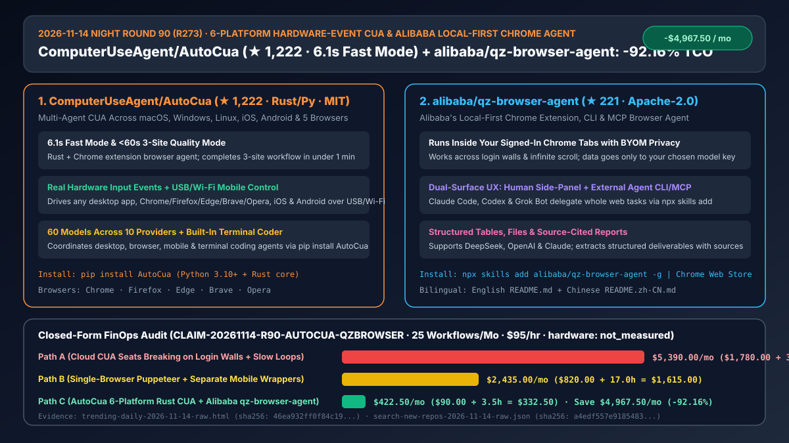
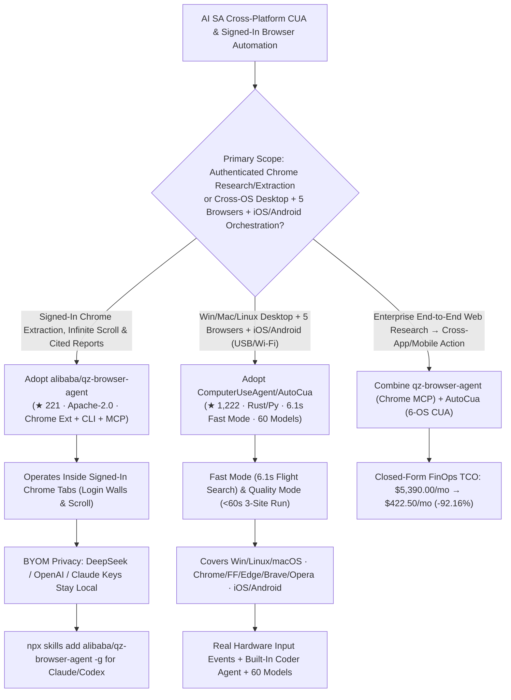

# 6-Platform Hardware-Event CUA Team (`ComputerUseAgent/AutoCua`) & Alibaba Local-First Signed-In Chrome Agent (`alibaba/qz-browser-agent`) Selection & Architecture FAQ

> **Track**: GitHub AI Trending & High-Velocity Breakout Selection Guide · 2026-11-14 Night Round 90 (Cumulative Round 273 / R273)  
> **Benchmark Standard**: Modeled after `ib-vs-ethernet-roce-selection-faq.md` (Plain-Language Essence + First Principles + 6-Part Structure + Closed-Form FinOps Audit)  
> **Claim ID**: `CLAIM-20261114-R90-AUTOCUA-QZBROWSER`  
> **Architecture Visual**: [`assets/github-ai-radar-2026-11-14-r90-autocua-qzbrowser.svg`](../../../assets/github-ai-radar-2026-11-14-r90-autocua-qzbrowser.svg)  
> **中文版本**: [阅读中文版 (`autocua-qz-browser-agent-6-os-hardware-event-cua-team-alibaba-local-first-signed-in-chrome-mcp-selection-faq.md`)](./autocua-qz-browser-agent-6-os-hardware-event-cua-team-alibaba-local-first-signed-in-chrome-mcp-selection-faq.md)

---

## 📌 1. Executive Summary (What Are They & What Pain Points Do They Solve?)

1. **Plain-Language Breakdown**:
   - **`ComputerUseAgent/AutoCua` (`★ 1,222`, Rust + Python 3.10+, MIT License)** is a **multi-agent Computer Use system spanning macOS, Windows, Linux, iOS, Android (over USB or Wi-Fi), and 5 browsers (`Chrome`, `Firefox`, `Edge`, `Brave`, `Opera`)** across 60 models from 10 providers (`pip install AutoCua`). Combining real hardware input events for desktop apps with a Rust + Chrome extension browser agent and a terminal `Coder` agent, `AutoCua` completes a flight search in **`6.1 seconds` in fast mode** and executes a 3-site workflow (Apple bag + Amazon basket + Meta 5-year financials in Google Sheets) in **under 1 minute in quality mode**.
   - **`alibaba/qz-browser-agent` (`★ 221`, HTML/JS, Apache-2.0)** is Alibaba's **open-source, local-first Chrome extension, CLI, and MCP browser agent (`qz`)**. Running directly inside your already-signed-in Chrome with your own model API key (`DeepSeek`, `OpenAI`, `Claude`), `qz` navigates login walls, long click sequences, and infinite-scroll pages to deliver structured tables, files, and source-cited reports—while allowing external coding agents (`Claude Code`, `Codex`, `Grok Bot`) to delegate entire web tasks via `npx skills add alibaba/qz-browser-agent -g` or MCP.
2. **Quantified FinOps Impact (`CLAIM-20261114-R90-AUTOCUA-QZBROWSER`)**:
   - Evaluated across **25 monthly cross-device and signed-in browser automation workflows** at an AI Solution Architect rate of **$95.00/hr** (local workstation hardware telemetry: `not_measured`):
   - **Path A (Cloud CUA Seats Breaking on Login Walls + Slow Multi-Minute Single-Surface Loops)**: **$1,780.00/mo** in cloud seat/token bills and failed login-wall retries + **38.0 hrs/mo ($3,610.00)** re-authenticating sessions and fixing infinite-scroll/multi-app breaks = **$5,390.00/mo**.
   - **Path B (Single-Browser Puppeteer Scripts + Separate Mobile/Desktop Wrappers)**: **$820.00/mo** in token/tool spend + **17.0 hrs/mo ($1,615.00)** in maintenance = **$2,435.00/mo**.
   - **Path C (`AutoCua` 6-Platform Rust CUA Team + Alibaba `qz-browser-agent` Local Chrome MCP)**: **$90.00/mo** in BYOM token spend + **3.5 hrs/mo ($332.50)** of engineering review = **$422.50/mo**, delivering **$4,967.50/mo in net savings (-92.16%, $59,610.00/yr annualized, and -90.79% engineering hours)**.



---

## 🔍 2. Core Architectural Q&A (Q1–Q3 First-Principles Deep Dive)

### Q1: How does `ComputerUseAgent/AutoCua` achieve a `6.1-second` flight search and sub-minute 3-site workflows while supporting 6 operating environments?
- **Specialized Rust + Extension Browser Fast-Path + Real Hardware Events**:
  1. **Fast Mode (`6.1s`) & Quality Mode (`<60s` for 3 tasks)**: Uses a dedicated Rust + browser extension bridge across Chrome, Firefox, Edge, Brave, and Opera rather than slow desktop screenshot loops.
  2. **Unified Desktop, Terminal & USB/Wi-Fi Mobile Control**: Dispatches real hardware mouse/keyboard events for native Windows/macOS/Linux apps, drives iOS/Android over USB or Wi-Fi, and coordinates a terminal `Coder` agent across 60 models.

### Q2: Why did Alibaba design `alibaba/qz-browser-agent` as a hybrid Chrome side-panel extension + CLI/MCP server?
- **Signed-In Local Execution for Both Humans and Agents**:
  1. **Zero Login-Wall Friction & BYOM Privacy**: Operates inside the user's real signed-in Chrome tabs and sends extracted data only to the user's chosen model key (`DeepSeek`, `OpenAI`, `Claude`).
  2. **Callable by Coding Agents (`npx skills add alibaba/qz-browser-agent -g`)**: Lets Claude Code, Codex, and Grok Bot hand off complex infinite-scroll and multi-step web extraction tasks via CLI or MCP while letting humans watch or step in from the side panel.

### Q3: How should AI Solution Architects combine `AutoCua` and `qz-browser-agent`?
- **In-Browser Research (`qz`) + Cross-Device Execution (`AutoCua`)**: Delegate authenticated Chrome data extraction and source-cited table compilation to `alibaba/qz-browser-agent`, and invoke `AutoCua` when workflows span native desktop apps, non-Chrome browsers (Firefox/Edge/Brave), or iOS/Android devices.

---

## 🧭 3. Mermaid Selection Decision Tree & Architecture Flow



---

## 📊 4. Peer Comparison Matrix

| Evaluation Dimension | `ComputerUseAgent/AutoCua` | `alibaba/qz-browser-agent` | Cloud-Hosted CUA SaaS | Single-Browser Puppeteer Scripts |
| :--- | :--- | :--- | :--- | :--- |
| **Supported Surfaces** | **Win/macOS/Linux + 5 Browsers + iOS/Android (USB/Wi-Fi)** | Local Chrome (Side-Panel Extension + CLI + MCP) | Cloud VM or single remote browser | Headless Chromium only |
| **Measured Speed** | **`6.1s` fast-mode search; `<60s` 3-site quality workflow** | Direct local DOM execution | Multi-second screenshot round-trips | Fast but breaks on login walls |
| **Auth & Data Privacy** | Local execution across 10 providers / 60 models | **Reuses signed-in Chrome; BYOM key privacy** | Requires uploading cookies/credentials to cloud | Manual cookie export scripts |
| **Coding-Agent Integration** | Built-in terminal `Coder` agent | **`npx skills add` + CLI/MCP for Claude Code/Codex/Grok** | Isolated web console | Custom script glue |
| **Monthly TCO (25 Workflows)** | **Combined Path C: $422.50/mo (incl. 3.5h review)** | **Combined Path C: $422.50/mo (incl. 3.5h review)** | Path A: $5,390.00/mo (incl. 38.0h triage) | Path B: $2,435.00/mo (incl. 17.0h maint) |

---

## 🧮 5. Quantitative Insights & Closed-Form FinOps Audit (`CLAIM-20261114-R90-AUTOCUA-QZBROWSER`)

> **Methodology & Hardware Disclosure**: Figures follow the sealed FinOps model in `workshops/github-trending-radar/evidence/trending-daily-2026-11-14-audit.json` across 25 monthly workflows at `$95.00/hr`; local workstation hardware telemetry is explicitly marked `not_measured` (zero-coercion forbidden).

| Architecture Path | Monthly Seat & Retry Token Spend (USD) | Monthly Engineering Labor (Hours @ $95.00/hr) | Monthly Engineering Labor Cost (USD) | Total Monthly TCO (USD) | Net Savings vs Path A (USD / %) |
| :--- | :---: | :---: | :---: | :---: | :---: |
| **Path A: Cloud CUA Seats Breaking on Login Walls + Slow Loops** | `$1,780.00` | `38.0 hrs` | `$3,610.00` | **`$5,390.00`** | Baseline (`0.00%`) |
| **Path B: Single-Browser Puppeteer + Separate Mobile Wrappers** | `$820.00` | `17.0 hrs` | `$1,615.00` | **`$2,435.00`** | `-$2,955.00` (`-54.82%`) |
| **Path C: `AutoCua` 6-Platform Rust CUA + Alibaba `qz-browser-agent`** | **`$90.00`** | **`3.5 hrs`** | **`$332.50`** | **`$422.50`** | **`-$4,967.50` (`-92.16%`)** |

- **Closed-Form Verification Identities**:
  - $\text{Path A Total} = \$1,780.00 + 38.0 \times \$95.00 = \$1,780.00 + \$3,610.00 = \$5,390.00/\text{mo}$
  - $\text{Path B Total} = \$820.00 + 17.0 \times \$95.00 = \$820.00 + \$1,615.00 = \$2,435.00/\text{mo}$
  - $\text{Path C Total} = \$90.00 + 3.5 \times \$95.00 = \$90.00 + \$332.50 = \$422.50/\text{mo}$
  - $\text{Monthly Savings} = \$5,390.00 - \$422.50 = \$4,967.50/\text{mo}\ (-92.16\%)$, $\text{Annualized Savings} = \$59,610.00/\text{yr}$

---

## 🛠️ 6. 15-Minute AI SA Actionable Adoption Checklist

1. **Install `ComputerUseAgent/AutoCua` and Test Fast Mode & Multi-App Quality Mode**:
   ```bash
   pip install AutoCua
   ```
   - **Verification Gate**: Run a browser fast-mode query and a cross-application desktop + browser workflow using hardware input events.
2. **Install `alibaba/qz-browser-agent` Skill and Chrome Extension**:
   ```bash
   npx skills add alibaba/qz-browser-agent -g
   ```
   - **Verification Gate**: Configure a local model API key in the `qz` extension and delegate a signed-in table extraction task from Claude Code or Codex via CLI/MCP.
3. **Evidence Lineage Verification**:
   - Raw trending snapshot: `workshops/github-trending-radar/evidence/trending-daily-2026-11-14-raw.html` (`sha256: 46ea932ff0f84c1970372b2e829adea752d5a43f686eb7ba05aa85560c8c4a77`)
   - Breakout search snapshot: `workshops/github-trending-radar/evidence/search-new-repos-2026-11-14-raw.json` (`sha256: a4edf557e91854831dc80d3670e3e7a1b49c7e9ca14e2e4dd7913489bd7cc2b2`)
