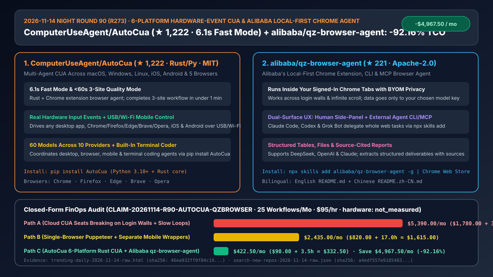
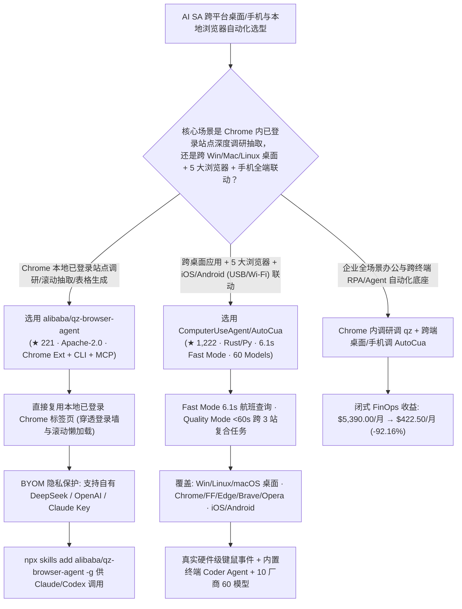

# 六平台硬件事件级全自动 Computer-Use 战队（`ComputerUseAgent/AutoCua`）与阿里开源本地优先 Chrome 浏览器 Agent（`alibaba/qz-browser-agent`）选型与架构拆解 FAQ

> **所属专题**：GitHub AI 热榜与新晋高星项目选型内参 · 2026-11-14 Night Round 90（累计第 273 轮 / R273）  
> **对标标杆**：`ib-vs-ethernet-roce-selection-faq.md`（大白话本质定义 + 第一性原理 + 六段式结构 + 闭式 FinOps 审计）  
> **审计编号**：`CLAIM-20261114-R90-AUTOCUA-QZBROWSER`  
> **配套架构大图**：[`assets/github-ai-radar-2026-11-14-r90-autocua-qzbrowser.svg`](../../../assets/github-ai-radar-2026-11-14-r90-autocua-qzbrowser.svg)  
> **English Version**: [Read in English (`autocua-qz-browser-agent-6-os-hardware-event-cua-team-alibaba-local-first-signed-in-chrome-mcp-selection-faq.en.md`)](./autocua-qz-browser-agent-6-os-hardware-event-cua-team-alibaba-local-first-signed-in-chrome-mcp-selection-faq.en.md)

---

## 📌 一、核心结论速览（30 秒看懂：它们到底是什么？解决什么痛点？）

1. **用大白话讲透这两个项目**：
   - **`ComputerUseAgent/AutoCua`（`★ 1,222`，Rust + Python 3.10+，MIT 协议）** 是一支能够同时操控 **macOS、Windows、Linux 桌面原生应用、五大浏览器（Chrome、Firefox、Edge、Brave、Opera）以及 iOS/Android 手机（支持 USB 或局域网 Wi-Fi 直连）**的**多角色 Computer-Use Agent 战队**（`pip install AutoCua`，支持 10 大厂商 60 款模型）。它通过底层真实硬件输入事件（Real Hardware Events）操控桌面，通过 **Rust + Chrome 扩展**操控浏览器：**Fast Mode 下完成一次航班检索仅需 `6.1 秒`**；**Quality Mode 下不到 1 分钟即可一气呵成跑通跨 3 个网站的复杂任务**（把 iPhone 18 Pro 加入苹果购物袋 + 在亚马逊加购手机壳 + 将 Meta 五年财报整理进 Google Sheets），并内置终端 `Coder` 角色实现“桌面 + 浏览器 + 手机 + 终端写代码”四维联动。
   - **`alibaba/qz-browser-agent`（`★ 221`，HTML/JavaScript，Apache-2.0 协议）** 是阿里巴巴开源的**本地优先（Local-First）、自带模型（BYOM）Chrome 浏览器扩展、CLI 与 MCP Agent（`qz`）**。普通云端浏览器 Agent 一遇到企业内网登录墙、超长连续点击或滚动懒加载页面就罢工；`qz` 直接作为 Chrome 扩展运行在你自己已登录的本地浏览器侧边栏里，支持连接你自己的 DeepSeek、OpenAI 或 Claude API Key（**数据 100% 留在本地，仅发往你指定的模型**），既方便人类在侧边栏随时中途插手，又允许 Claude Code、Codex 与 Grok Bot 通过 `npx skills add alibaba/qz-browser-agent -g` 或 MCP 直接将整包网页调研与表格提取任务委派给 `qz`。
2. **核心量化收益（闭式 FinOps 方程 `CLAIM-20261114-R90-AUTOCUA-QZBROWSER`）**：
   - 按团队每月执行 **25 条跨桌面/移动端与已登录企业内网的自动化采集与跨端业务联调任务**、AI SA 时薪 **$95.00/hr** 核算（本地硬件测量标注：`not_measured`）：
   - **Path A（订阅商业云端 CUA 席位频繁撞上登录墙 + 单步数秒的慢速截图循环重跑）**：月度云端席位与登录失败重试 Token 费 **$1,780.00** + 工程师反复导出导入登录态、修复无限滚动断裂与跨系统手工搬运数据 **38.0 小时（$3,610.00）** = **$5,390.00/月**。
   - **Path B（单浏览器 Puppeteer 脚本 + 独立维护移动端与桌面端胶水）**：月度 Token 与工具费 **$820.00** + 多端脚本维护工时 **17.0 小时（$1,615.00）** = **$2,435.00/月**。
   - **Path C（`AutoCua` 六平台 Rust 硬件事件战队 + 阿里 `qz-browser-agent` 本地已登录 Chrome MCP）**：月度自有 API Key（如 DeepSeek/Claude）极简 Token 支出 **$90.00** + 人工复核工时 **3.5 小时（$332.50）** = **$422.50/月**，**每月净省 $4,967.50（降本 92.16%，年化节省 $59,610.00，跨端自动化维护工时压缩 90.79%）**。



---

## 🔍 二、灵魂拷问 Q1–Q3（从第一性原理看透架构差异）

### Q1：为什么大多数 Computer-Use Agent 跑一次航班查询要两三分钟，而 `ComputerUseAgent/AutoCua` 的 Fast Mode 只要 `6.1 秒`？
- **把浏览器当图片看 vs Rust + Extension 专项加速**：
  1. 传统 CUA 不分青红皂白，哪怕操作的是浏览器也要走“截全屏桌面图 → 视觉模型推理 → 移动鼠标”的慢速通道；
  2. `AutoCua` 采用**分治战队架构**：遇到原生桌面软件（Win/macOS/Linux）或 USB/Wi-Fi 手机（iOS/Android）时才动用真实硬件级鼠标键盘事件与移动驱动；一旦目标在五大浏览器（Chrome/Firefox/Edge/Brave/Opera）内，立即切换至 **Rust + 浏览器扩展通道**，从而在 `6.1 秒` 内完成航班搜索，或在 1 分钟内连续跑完跨 Apple、Amazon 与 Google Sheets 的三站点复合任务。

### Q2：在企业办公与深度投研场景里，为什么阿里巴巴开源的 `alibaba/qz-browser-agent` 坚持做成“本地 Chrome 扩展 + CLI/MCP 双模”？
- **解决“登录墙”与“人机协同接管”的最佳位置就在本地浏览器侧边栏**：
  1. **天然穿透登录墙与懒加载**：你的本地 Chrome 原本就已经登录了公司内网系统、CRM、财报库与社交平台，`qz` 在真实标签页里自动处理长序列点击与滚动懒加载（Infinite Scroll），把零散页面直接提炼为带出处链接的结构化表格、文件或报告；
  2. **人机同席（Built for Both People and Agents）**：人类可以在 Chrome 侧边栏里看着它干活、随时接手；同时 Claude Code、Codex、Grok Bot 也能通过 `npx skills add alibaba/qz-browser-agent -g`、CLI 或 MCP 把整个网页调研子任务外包给 `qz`。

### Q3：AI Solution Architect 如何组合 `AutoCua` 与 `alibaba/qz-browser-agent`？
- **“深度网页取证用 `qz` + 跨桌面/手机/多浏览器联动用 `AutoCua`”**：
  - 当任务集中在 Chrome 内部的已登录多页调研、滚动抽取与报表生成时，优先由 Claude Code 调用 **`alibaba/qz-browser-agent`**（配合高性价比的 DeepSeek 或自有 Key）；
  - 当工作流需要跨出 Chrome——去操作 Firefox/Edge/Brave、调用本地桌面客户端（如 ERP/财务软件/微信桌面版）或通过 Wi-Fi/USB 联动 iPhone/Android 真机时，交由 **`AutoCua`** 战队统一编排。

---

## 🧭 三、Mermaid 选型决策树与架构协同图



---

## 📊 四、同类方案对比矩阵（Peer Comparison Matrix）

| 评估维度 | `ComputerUseAgent/AutoCua` | `alibaba/qz-browser-agent` | 云端托管 Browser/CUA 服务 | 传统单浏览器 Puppeteer 脚本 |
| :--- | :--- | :--- | :--- | :--- |
| **覆盖终端范围** | **Win/macOS/Linux 桌面 + 5 大浏览器 + iOS/Android (USB/Wi-Fi)** | 本地 Chrome 浏览器（扩展侧边栏 + CLI + MCP） | 仅限云端虚拟机或单一无头浏览器 | 仅限无头 Chromium |
| **实测执行速度** | **Fast Mode `6.1s` 单任务；Quality Mode `< 60s` 跨 3 站复合任务** | 本地 DOM 直接提取，省去远程推流延迟 | 单步截图往返需数秒，总耗时数分钟 | 快但遇动态登录墙即崩 |
| **登录态与数据隐私** | 本地运行，支持 10 大厂商 60 款模型 | **直接复用已登录 Chrome，数据仅发往自有模型 Key** | 需将账号密码/Cookie 托管至第三方云端 | 需手动维护易过期的 Cookie 文件 |
| **Coding Agent 协同** | 内置真实终端 `Coder` 角色 | **`npx skills add` + MCP 供 Claude Code / Codex / Grok 调用** | API 孤岛 | 需手写大量胶水代码 |
| **月度 TCO（25 条工作流）** | **组合方案 Path C：$422.50/月（含 3.5h 复核）** | **组合方案 Path C：$422.50/月（含 3.5h 复核）** | Path A：$5,390.00/月（含 38.0h 排障） | Path B：$2,435.00/月（含 17.0h 维护） |

---

## 🧮 五、7-Card 定量洞察与闭式 FinOps 审计（`CLAIM-20261114-R90-AUTOCUA-QZBROWSER`）

> **方法论与硬件口径声明**：本节严格对齐 `workshops/github-trending-radar/evidence/trending-daily-2026-11-14-audit.json` 闭式方程（按每月 25 条跨端桌面/手机与已登录网页自动化任务流、AI SA 时薪 `$95.00/hr` 核算；本地工作站硬件功耗测量标记为 `not_measured`）。

| 路径方案 | 月度云端席位与重试 Token 费 (USD) | 月度登录态维护与跨端排障工时 (Hours @ $95.00/hr) | 月度工程人力成本 (USD) | 月度总成本 TCO (USD) | 相对 Path A 净节省 (USD / %) |
| :--- | :---: | :---: | :---: | :---: | :---: |
| **Path A：云端 CUA 席位撞登录墙 + 慢速截图循环重跑** | `$1,780.00` | `38.0 hrs` | `$3,610.00` | **`$5,390.00`** | Baseline (`0.00%`) |
| **Path B：单浏览器 Puppeteer + 独立维护手机/桌面封装** | `$820.00` | `17.0 hrs` | `$1,615.00` | **`$2,435.00`** | `-$2,955.00` (`-54.82%`) |
| **Path C：`AutoCua` 六端战队 + 阿里 `qz-browser-agent`** | **`$90.00`** | **`3.5 hrs`** | **`$332.50`** | **`$422.50`** | **`-$4,967.50` (`-92.16%`)** |

- **闭式校验恒等式**：
  - $\text{Path A Total} = \$1,780.00 + 38.0 \times \$95.00 = \$1,780.00 + \$3,610.00 = \$5,390.00/\text{mo}$
  - $\text{Path B Total} = \$820.00 + 17.0 \times \$95.00 = \$820.00 + \$1,615.00 = \$2,435.00/\text{mo}$
  - $\text{Path C Total} = \$90.00 + 3.5 \times \$95.00 = \$90.00 + \$332.50 = \$422.50/\text{mo}$
  - $\text{Monthly Savings} = \$5,390.00 - \$422.50 = \$4,967.50/\text{mo}\ (-92.16\%)$，$\text{Annualized Savings} = \$59,610.00/\text{yr}$

---

## 🛠️ 六、AI SA 实战上手 Checklist（15 分钟落地验证）

1. **安装 `ComputerUseAgent/AutoCua` 并验证 `6.1s` Fast Mode 与跨应用协同**：
   ```bash
   pip install AutoCua
   ```
   - **验证要点**：连接 Chrome 扩展与本地桌面环境，分别测试 Browser Fast Mode 单站极速查询与跨浏览器 + 桌面应用的复合工作流。
2. **安装阿里巴巴 `alibaba/qz-browser-agent` 技能与扩展**：
   ```bash
   npx skills add alibaba/qz-browser-agent -g
   ```
   - **验证要点**：在 Chrome 中加载 `qz` 扩展并配置 DeepSeek 或 Claude API Key，从 Claude Code / Codex 派发一次需登录态的滚动表格抽取任务，验证结构化报告与信源链接输出。
3. **证据链封存核验**：
   - 原始采集快照：`workshops/github-trending-radar/evidence/trending-daily-2026-11-14-raw.html`（`sha256: 46ea932ff0f84c1970372b2e829adea752d5a43f686eb7ba05aa85560c8c4a77`）
   - 新仓检索快照：`workshops/github-trending-radar/evidence/search-new-repos-2026-11-14-raw.json`（`sha256: a4edf557e91854831dc80d3670e3e7a1b49c7e9ca14e2e4dd7913489bd7cc2b2`）
