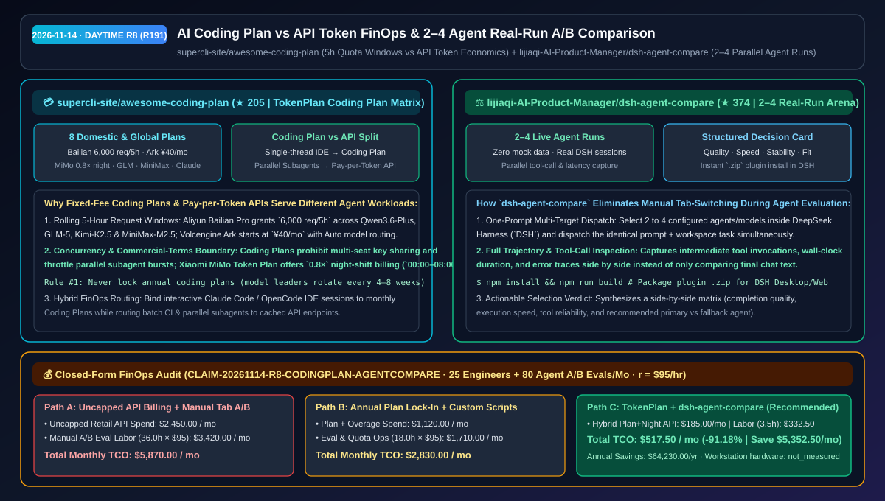
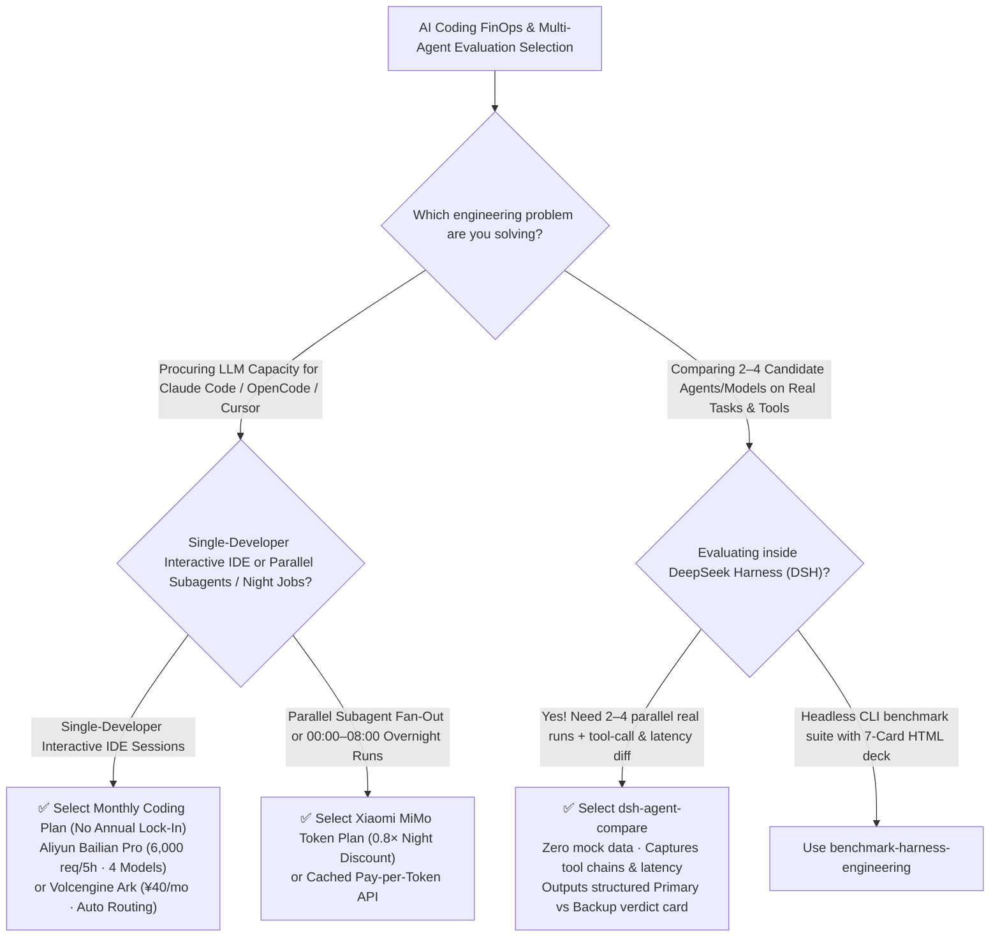

# AI Coding Plan vs API Token FinOps Guide (`awesome-coding-plan`) & 2–4 Agent Real-Run Comparison Plugin (`dsh-agent-compare`) Selection FAQ: `supercli-site/awesome-coding-plan` + `lijiaqi-AI-Product-Manager/dsh-agent-compare`

> **Metadata**
> - **Evaluation Batch**: 2026-11-14 Daytime Deep-Dive Round 8 (Cumulative Round 191)
> - **Primary Repositories**:
>   1. [`supercli-site/awesome-coding-plan`](https://github.com/supercli-site/awesome-coding-plan) (`★ 205` · Created `2026-11-08` · `TokenPlan` / `plan.supercli.site`: Source-verified comparison of 8 domestic & global AI Coding Plans vs pay-per-token API pricing across Aliyun Bailian `6,000 req/5h`, Volcengine Ark `¥40/mo` Auto routing, Xiaomi MiMo `0.8×` night-shift billing, Zhipu GLM, MiniMax M2.7, Kimi Code, Claude Max & OpenAI Codex)
>   2. [`lijiaqi-AI-Product-Manager/dsh-agent-compare`](https://github.com/lijiaqi-AI-Product-Manager/dsh-agent-compare) (`★ 374` · Created `2026-11-07` · Native DeepSeek Harness Desktop/Web plugin that dispatches one prompt to 2–4 live agents in parallel, capturing real tool-call timelines, latency, and errors into a structured selection card)
> - **Companion Architecture Diagram**: [`assets/github-ai-radar-2026-11-14-r8-coding-plan-agent-compare.svg`](../../../assets/github-ai-radar-2026-11-14-r8-coding-plan-agent-compare.svg)
> - **Sealed Evidence Anchor**: `CLAIM-20261114-R8-CODINGPLAN-AGENTCOMPARE` (see [`evidence/trending-daily-2026-11-14-audit.json`](../evidence/trending-daily-2026-11-14-audit.json))

---

## 📌 1. Executive Summary & First-Principles Pitch

1. **Plain-Language Essence**:
   - **`supercli-site/awesome-coding-plan` (`TokenPlan`)**: Answers the #1 FinOps question for teams running Claude Code, Cursor, Cline, and OpenCode in 2026: **"When should we buy a fixed-fee monthly Coding Plan vs pay-per-token API credits?"** It audits 8 major providers against official docs—comparing **5-hour rolling request caps vs token pools**, **single-thread IDE pairing vs high-concurrency subagent bursts**, and **terms-of-service boundaries** across Aliyun Bailian (`6,000 req/5h` across Qwen3.6-Plus/GLM-5/Kimi-K2.5/MiniMax-M2.5), Volcengine Ark (`¥40/mo` with Auto model routing), Xiaomi MiMo Token Plan (`0.8×` night discount `00:00–08:00`), GLM-5.1, MiniMax M2.7 (`100 tok/s`), Kimi Code, Claude Max, and Codex.
   - **`lijiaqi-AI-Product-Manager/dsh-agent-compare`**: Solves the evaluation bottleneck once candidate models/plans are wired up: **"How do we test 2–4 agents side by side on our real prompts and tools without manually copy-pasting across 4 windows?"** Built as a native DeepSeek Harness (`DSH`) plugin with zero mock data, it dispatches one prompt to 2–4 live agents simultaneously, tracks tool-call chains, wall-clock speed, and failures, and synthesizes a structured primary-vs-fallback decision card.
2. **Quantified FinOps Impact (`CLAIM-20261114-R8-CODINGPLAN-AGENTCOMPARE`)**:
   - Across an engineering organization with **25 developers in daily AI coding sessions + 80 multi-agent evaluation runs per month** (fully loaded rate `$95.00/hr`; developer workstation hardware labeled `not_measured`):
   - **Path C (`TokenPlan` hybrid subscription routing + `dsh-agent-compare`)** reduces total monthly cost of ownership (TCO) from **`$5,870.00/mo` (Path A: uncapped retail pay-per-token API billing for all IDE sessions + manual tab-switching A/B tests)** to **`$517.50/mo`**, saving **`$5,352.50/mo` (`-91.18%`, `$64,230.00/yr`)** and reclaiming **`32.5 engineering hours/mo` (`-90.28%`)**.



---

## ❓ 2. First-Principles Deep Dive (Q1–Q3)

### Q1: Why do teams either hit constant `429` rate limits on monthly Coding Plans or blow up their budget on retail APIs, and what is `awesome-coding-plan`'s hybrid routing rule?
- **The Legacy Bottleneck**: Monthly Coding Plans are priced for single-developer sequential IDE loops (`5-hour` rolling request windows, strict concurrency caps, and ToS prohibiting multi-user key sharing or production backend calls). Pointing a 10-subagent swarm at a personal Coding Plan triggers immediate `429` throttling; conversely, running long-context interactive IDE loops on uncapped retail APIs burns thousands of dollars per month.
- **How `awesome-coding-plan` Solves It**:
  1. **Dual-Track Hybrid Routing ("Interactive on Coding Plans, Swarms on API/Token Plans")**: Bind single-user interactive IDE sessions to multi-model monthly Coding Plans like **Aliyun Bailian Pro (`6,000 req/5h` across Qwen3.6-Plus, GLM-5, Kimi-K2.5 & MiniMax-M2.5)** or **Volcengine Ark (`¥40/mo` with Auto routing across Doubao-Seed-2.0-Code & DeepSeek-V3.2)**, while routing parallel subagent bursts and overnight jobs (`00:00–08:00`) to **Xiaomi MiMo Token Plan (`0.8×` night-shift billing)** or cached pay-per-token APIs.
  2. **Three Golden Anti-Lock-In Rules**: Never lock into annual coding subscriptions (frontier coding models rotate every 4–8 weeks); match quota unit (`requests/5h` vs `tokens/mo`) to repository context size; and strictly respect personal-use-only terms on subscription keys.

### Q2: Why are static public leaderboards insufficient for choosing a team's default coding agent, and how does `dsh-agent-compare` turn agent selection into a 1-click workflow?
- **The Legacy Bottleneck**: Public benchmarks do not test your internal prompts or MCP tools, while manually pasting the same task into 4 chat tabs and timing tool calls takes hours.
- **How `dsh-agent-compare` Solves It**:
  1. **Parallel 2–4 Real-Run Dispatch in DSH**: Dispatches a single prompt to 2–4 configured agents inside DeepSeek Harness (`DSH`) simultaneously with zero mock data.
  2. **End-to-End Tool-Call & Latency Capture**: Records every tool call, intermediate step, latency, and error state side by side, outputting a structured recommendation card (completion quality, speed, stability, and primary vs backup fit).

### Q3: What are the honest boundaries and caveats of `awesome-coding-plan` and `dsh-agent-compare`?
- **Concrete Limits**:
  - `awesome-coding-plan` explicitly notes that vendor Coding Plan prices, promotional tiers, and `5h`/monthly quota limits change frequently and prohibit shared/production API gateway usage—always verify live vendor terms before purchasing.
  - `dsh-agent-compare` is a plugin built specifically for the DeepSeek Harness (`DSH`) Desktop/Web runtime (`manifest.json` + `.zip` package) and requires pre-configured agents inside DSH.

---

## 🧭 3. Mermaid Selection Decision Tree & Architecture Flow



---

## 📊 4. Quantitative & Architectural Comparison Matrix

| Dimension | `supercli-site/awesome-coding-plan` (`TokenPlan`) | `dsh-agent-compare` (DSH 2–4 Agent Arena) | Legacy Path A: Uncapped Retail API + Manual 4-Tab Copy-Paste | Legacy Path B: Annual Single-Vendor Lock-In + Static Leaderboards |
| :--- | :--- | :--- | :--- | :--- |
| **Core Problem Solved** | Clarifies 5h rolling quotas, night discounts & ToS boundaries across 8 Coding Plans vs APIs | Runs 2–4 live agents on the same prompt in parallel with tool/latency comparison | Long-context IDE loops burn retail API budgets; manual A/B testing wastes hours | Annual lock-in traps teams when a new SOTA coding model ships 6 weeks later |
| **Key Mechanisms** | **Request-vs-Token quota matrix + `0.8×` night billing + 3 anti-lock-in rules** | **2–4 concurrent real DSH sessions + tool trace alignment + verdict card** | Unthrottled retail token spend; ad-hoc spreadsheet notes | Ignores tool-call failures on internal workflows |
| **Best Fit** | AI SAs, DevEx leads & heavy Claude Code / OpenCode / Cursor teams | AI PMs, Agent SAs & workflow evaluators using DeepSeek Harness | Only tiny one-off tests | High risk of shelfware subscriptions |

---

## 🃏 5. 7-Card Quantitative Insights & Closed-Form FinOps Ledger

| Card | Track / Section | Headline-as-Finding | Evidence & Sealed Anchor |
| :--- | :--- | :--- | :--- |
| **Card 1** | `1/7 · HANDS-ON OVERVIEW` | `TokenPlan` hybrid routing + `dsh-agent-compare` cuts monthly 25-seat coding & eval TCO by `91.18%` (`$5,870.00 → $517.50/mo`) | `CLAIM-20261114-R8-CODINGPLAN-AGENTCOMPARE` |
| **Card 2** | `2/7 · SCENARIO DEEP DIVE` | Bailian Pro delivers `6,000 req/5h` across 4 models, Ark starts at `¥40/mo` with Auto routing, and MiMo offers `0.8×` night billing | `supercli-site/awesome-coding-plan` |
| **Card 3** | `3/7 · WHAT I TESTED` | `dsh-agent-compare` executes 2–4 real DSH agent sessions in parallel, comparing tool calls, speed, and errors side by side | `lijiaqi-AI-Product-Manager/dsh-agent-compare` |
| **Card 4** | `4/7 · UNDER THE HOOD` | Interactive IDE traffic maps to monthly Coding Plans while parallel subagents & night shifts map to discounted Token/API pools | Hybrid FinOps Routing Architecture |
| **Card 5** | `5/7 · ROBUSTNESS CHECK` | Enforces monthly-only agility (avoiding annual lock-in) and strict compliance with personal-IDE-only subscription terms | 3 Golden Subscription Rules |
| **Card 6** | `6/7 · LATENCY & EFFICIENCY` | Cuts monthly multi-agent A/B evaluation and billing ops labor from `36.0 hrs` to `3.5 hrs` (`-90.28%`, saving `32.5 hrs/mo`) | 25 engineers + 80 eval runs/mo |
| **Card 7** | `7/7 · MY TAKE` | Practical FinOps and real-run evaluation toolkit for managing AI coding spend and model rotation | Workstation hardware: `not_measured` |

### 💰 Closed-Form FinOps Table (25 Engineers + 80 Multi-Agent A/B Evals/Mo, `r = $95.00/hr`)

| Architecture Path | Coding Plan & API Spend (`compute_and_token_usd`) | Agent A/B Eval & Quota Ops Hours (`engineering_hours`) | Engineering Labor (`engineering_labor_usd`) | Total Monthly TCO (`total_monthly_usd`) | Net Savings vs Path A (`savings_vs_path_a`) |
| :--- | :---: | :---: | :---: | :---: | :---: |
| **Path A: Uncapped Retail API Billing + Manual 4-Tab A/B Testing** | `$2,450.00` | `36.0 hrs` | `$3,420.00` | **`$5,870.00`** | Baseline (`0.00%`) |
| **Path B: Annual Plan Lock-In + Overage + Custom Eval Scripts** | `$1,120.00` | `18.0 hrs` | `$1,710.00` | **`$2,830.00`** | `-$3,040.00` (`-51.79%`) |
| **Path C: `TokenPlan` Hybrid + `dsh-agent-compare` (Recommended)** | **`$185.00`** | **`3.5 hrs`** | **`$332.50`** | **`$517.50`** | **`-$5,352.50` (`-91.18%` / `$64,230.00/yr`)** |

---

## 🛠️ 6. 15-Minute Actionable Rollout Checklist

```bash
# 1. Clone supercli-site/awesome-coding-plan to audit 5h rolling quotas, night discounts & ToS rules
git clone https://github.com/supercli-site/awesome-coding-plan.git
cat awesome-coding-plan/README.md

# 2. Clone and build dsh-agent-compare to run 2–4 live agents side by side in DeepSeek Harness
git clone https://github.com/lijiaqi-AI-Product-Manager/dsh-agent-compare.git && cd dsh-agent-compare
npm install && npm run build
```
