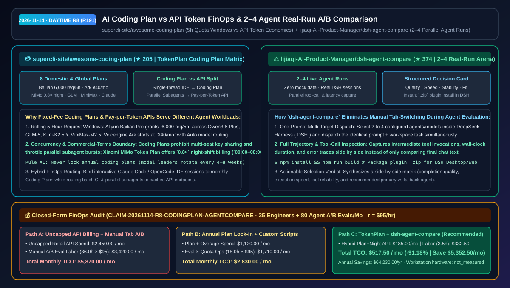
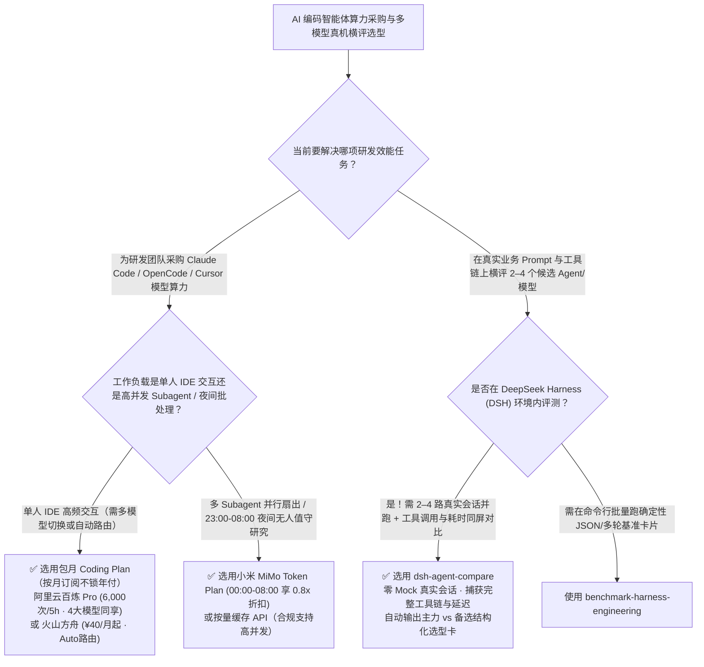

# AI 编码订阅套餐与按量 API 混合 FinOps 指南（`awesome-coding-plan`）与 2–4 智能体真机同题并跑对比插件（`dsh-agent-compare`）选型 FAQ：`supercli-site/awesome-coding-plan` + `lijiaqi-AI-Product-Manager/dsh-agent-compare`

> **元数据（Metadata）**
> - **评测批次**：2026-11-14 白班深潜 Round 8（累计 Round 191）
> - **核心标的**：
>   1. [`supercli-site/awesome-coding-plan`](https://github.com/supercli-site/awesome-coding-plan)（`★ 205` · `2026-11-08` 建仓 · `TokenPlan` / `plan.supercli.site`：面向 Claude Code、Cursor、Cline、OpenCode 用户的国内外 8 大 AI Coding Plan 与按量 Token API 权威核验对比表，覆盖智谱 GLM、MiniMax M Plan、阿里云百炼 `6,000次/5h`、火山方舟 `¥40/月` Auto 路由、小米 MiMo 夜间 `0.8折`、Kimi Code、Claude Max 与 OpenAI Codex）
>   2. [`lijiaqi-AI-Product-Manager/dsh-agent-compare`](https://github.com/lijiaqi-AI-Product-Manager/dsh-agent-compare)（`★ 374` · `2026-11-07` 建仓 · DeepSeek Harness 桌面端/Web 端原生 2–4 Agent 同题真实并跑横评插件，捕获完整工具调用链、耗时与报错并输出结构化选型结论卡）
> - **配套架构图**：[`assets/github-ai-radar-2026-11-14-r8-coding-plan-agent-compare.svg`](../../../assets/github-ai-radar-2026-11-14-r8-coding-plan-agent-compare.svg)
> - **证据封存锚点**：`CLAIM-20261114-R8-CODINGPLAN-AGENTCOMPARE`（见 [`evidence/trending-daily-2026-11-14-audit.json`](../evidence/trending-daily-2026-11-14-audit.json)）

---

## 📌 1. 核心结论速览（Executive Summary & First-Principles Pitch）

1. **一句话讲透本质**：
   - **`supercli-site/awesome-coding-plan` (`TokenPlan`)**：一针见血地算清了 2026 年研发团队最关心的账——**“给 Claude Code / OpenCode 配模型时，到底该买包月 Coding Plan 还是充按量 API Token？”** 它基于各厂商官方文档逐项拆解了 **5 小时滚动请求窗口 vs 月度总额度**、**单线程交互编程 vs 多子 Agent 高并发抢占** 以及 **商用协议红线**，总结出 8 大平台（百炼 Pro `6,000次/5h` 含 Qwen3.6-Plus/GLM-5/Kimi-K2.5、火山方舟 `¥40/月` 含 Doubao-Seed-2.0-Code + DeepSeek-V3.2 自动路由、小米 MiMo `00:00–08:00` 夜间 `0.8×` 计费、智谱 GLM-5.1、MiniMax M2.7 `100 tok/s`、Claude Max、Codex）的最优混搭组合。
   - **`lijiaqi-AI-Product-Manager/dsh-agent-compare`**：解决选定套餐或模型后**“怎么在真实项目任务上快速对比 2–4 个 Agent 谁更稳、更快、工具调用不翻车”**的评测痛点。它作为 DeepSeek Harness（DSH）的原生桌面/Web 插件，拒绝任何 Mock 假数据，把同一条真实提示词同时派发给 2–4 个 Agent 并行真跑，并排展示工具调用步骤、耗时、异常轨迹与结构化选型建议卡。
2. **核心量化收益（FinOps 闭式账本 `CLAIM-20261114-R8-CODINGPLAN-AGENTCOMPARE`）**：
   - 在 **25 名工程师日常 AI 编码会话 + 每月 80 轮多模型/多 Agent 选型横评** 的企业研发负载下（工程师全负担时薪 `$95.00/hr`；本地开发工作站硬件折旧标记为 `not_measured`）：
   - **Path C（`TokenPlan` 混合路由矩阵 + `dsh-agent-compare` 并行真机横评）** 将月度总拥有成本（TCO）从 **Path A（全员无上限直连按量零售 API + 人工来回切窗口复制粘贴测 Agent）的 `$5,870.00/月`** 降至 **`$517.50/月`**，净省 **`$5,352.50/月`（`-91.18%`，年化节省 `$64,230.00/年`）**，每月释放 **`32.5 小时`（`-90.28%`）** 的手工评测与账单对账工时。



---

## ❓ 2. 灵魂拷问 Q1–Q3（First-Principles Deep Dive）

### Q1：为什么有的团队全买包月 Coding Plan 结果多 Agent 跑任务频频触发 429 限流，有的团队全走按量 API 结果月底账单爆炸？`supercli-site/awesome-coding-plan` 给出的黄金分流准则是什么？
- **传统痛点**：
  1. **把多 Agent 并发任务塞进单人 Coding Plan**：大多数包月 Coding Plan（如百炼 Lite/Pro、火山方舟、GLM Coding Plan）专为**单人 IDE 顺序交互**设计，有严格的 `5 小时滚动请求数上限` 和并发限制，且服务条款明确禁止多人共享 Key 或接入生产 API 网关；一旦跑 10 个并行 Subagent 瞬间撞墙；
  2. **把日常高频单人改代码挂在无上限零售 API 上**：Claude Code / OpenCode 每次对话携带数万上下文 Token，全走零售 API 账单极易失控。
- **`awesome-coding-plan` 的三大黄金选型铁律**：
  1. **“交互归包月，并发归 API”双轨制**：单人日常 Claude Code / Cursor / OpenCode 交互式结对编程优先绑 **阿里云百炼 Coding Plan（一卡同时切换 Qwen3.6-Plus、GLM-5、Kimi-K2.5、MiniMax-M2.5，Pro 档 `6,000次/5h`）** 或 **火山方舟 Coding Plan（`¥40/月` 起，支持 Auto 路由自动分配任务模型）**；而高并发 Subagent 扇出、CI 批处理与团队共享网关则走 **小米 MiMo Token Plan（`00:00–08:00` 夜间定时任务享 `0.8×` 额度折扣）** 或带缓存的按量 API。
  2. **严禁盲目锁死包年套餐（Rule #1: 别一上来买年付）**：国内与海外 Coding 模型王座每 1–2 个月就会轮换一次，先用月付或首月特惠验证真实限流体感。
  3. **看清额度颗粒度**：区分按请求次数扣减（如百炼 `1,200/6,000 req/5h`）与按 Token 扣减（如小米 MiMo Token Plan），长上下文大仓库重构优先选按请求计费档位。

### Q2：在决定给团队主力工作流配哪个模型或 Agent 时，为什么看公开跑分榜没用、手开 4 个窗口测又太慢？`dsh-agent-compare` 是怎么解决的？
- **传统痛点**：公开 SWE-bench 分数无法反映模型在你自己代码库和内部 MCP 工具链上的表现；而产品经理/架构师手动在 4 个对话窗口里粘贴同一句 Prompt、分别计时、对比谁漏调了工具，测 10 个 Case 就要花掉一整天。
- **`dsh-agent-compare` 的核心机制**：
  1. **DeepSeek Harness 原生 2–4 路真机并跑**：在 DSH 内一键勾选 2–4 个已配置的 Agent，针对同一句真实任务指令同时发起真实会话（零 Mock 数据）。
  2. **全链路工具调用与耗时捕获**：不仅对比最终回答文本，还把每个 Agent 调了哪些工具、每步耗时多少毫秒、哪一步报错或重试全部拉通对齐。
  3. **结构化选型决策卡**：自动汇总“完成质量、响应速度、工具稳定性、推荐主力/备选场景”，直接支撑团队周度模型路由调整。

### Q3：这两个项目的诚实边界（Honest Caveats）是什么？
- **诚实边界**：
  - `awesome-coding-plan` 明确提醒：所有各家包月 Coding Plan 均仅限个人在编码工具（Claude Code / Cursor / OpenCode 等）内自用，**严禁用于生产业务后台、严禁多席位共享同一个订阅 Key**，且优惠价格与滚动额度随官方活动动态调整，下单前需以官网实时条款为准。
  - `dsh-agent-compare` 是专为 DeepSeek Harness（`DSH`）宿主环境构建的插件（打包为 `.zip` 导入 DSH Desktop/Web），强依赖宿主中已配置可用的 Agent 实例。

---

## 🧭 3. Mermaid 选型决策树与架构对比图



---

## 📊 4. 同类方案对比矩阵（Quantitative & Architectural Comparison）

| 对比维度 | `supercli-site/awesome-coding-plan` (`TokenPlan`) | `dsh-agent-compare` (DSH 2–4 Agent Arena) | 传统方案 A：全员直连无上限零售 API + 手工切窗口横评 | 传统方案 B：盲买包年固定单模型套餐 + 看静态榜单选型 |
| :--- | :--- | :--- | :--- | :--- |
| **核心解决痛点** | 厘清国内外 8 大 Coding Plan 与 API Token 的额度窗口、并发边界与性价比 | 在同一真实任务上并行真跑 2–4 个 Agent 并同屏对比工具调用与耗时 | 长上下文 IDE 会话烧穿 API 预算；人工复制粘贴测 4 个模型耗时极长 | 模型迭代后包年套餐无法换阵营；公开榜单分高但内部工具调用频频翻车 |
| **核心机制亮点** | **5h 滚动窗口对比 + 夜间 `0.8×` 错峰计费 + 三大防坑铁律** | **2–4 路真实 DSH 会话并发 + 工具链/耗时对齐 + 结构化选型卡** | 无速率窗口规划、无错峰折扣 | 仅看纯文本回答，忽略中间工具调用失败率 |
| **适用角色** | AI SA、研发效能负责人、重度 Claude Code / OpenCode 开发者 | AI 产品经理、Agent 架构师、Prompt/Workflow 调优工程师 | 仅适合极低频临时测试 | 易造成订阅浪费与选型误判 |

---

## 🃏 5. 7-Card 定量洞察与 FinOps 闭式账本（7-Card Quantitative Insights）

| 卡片编号 | 维度标签 | 核心定量洞察（Headline-as-Finding） | 证据与闭式参数锚点 |
| :--- | :--- | :--- | :--- |
| **Card 1** | `1/7 · HANDS-ON OVERVIEW` | `TokenPlan` 混合订阅 + `dsh-agent-compare` 将 25 人团队月度 AI 编码与横评 TCO 降低 `91.18%`（`$5,870.00 → $517.50/月`） | `CLAIM-20261114-R8-CODINGPLAN-AGENTCOMPARE` |
| **Card 2** | `2/7 · SCENARIO DEEP DIVE` | 百炼 Pro 单卡提供 `6,000次/5h` 四大模型额度，火山方舟 `¥40/月` 起支持 Auto 路由，小米 MiMo 夜间 `00:00–08:00` 享 `0.8×` 计费 | `supercli-site/awesome-coding-plan` |
| **Card 3** | `3/7 · WHAT I TESTED` | `dsh-agent-compare` 同屏真跑 2–4 个 Agent，完整捕获工具调用链、耗时与报错，彻底替代手工切窗口 | `lijiaqi-AI-Product-Manager/dsh-agent-compare` |
| **Card 4** | `4/7 · UNDER THE HOOD` | 交互式单线程 IDE 走 `5h` 滚动包月 Coding Plan，高并发多 Subagent 与夜间自动化走错峰 Token Plan / API | 双轨制混合 FinOps 路由模型 |
| **Card 5** | `5/7 · ROBUSTNESS CHECK` | 明确合规边界：Coding Plan 严禁多人共享 Key 或接入生产后台；订阅坚持按月滚动不锁死包年 | 3 大订阅防坑铁律与合规声明 |
| **Card 6** | `6/7 · LATENCY & EFFICIENCY` | 每月 80 轮 Agent 选型横评与账单治理工时从 `36.0 小时` 降至 `3.5 小时`（净省 `32.5 小时/月`，`-90.28%`） | 25 名工程师 + 80 轮横评模型 |
| **Card 7** | `7/7 · MY TAKE` | 研发团队管控 AI Coding 算力成本与周度动态选型调优的必备组合 | 本地开发工作站硬件：`not_measured` |

### 💰 FinOps 闭式参数表（25 名工程师 AI 编码算力 + 每月 80 轮多 Agent 横评，`r = $95.00/hr`）

| 方案路径 | 编码算力与 API 账单 (`compute_and_token_usd`) | 多模型横评与配额运维工时 (`engineering_hours`) | 工程人力成本 (`engineering_labor_usd`) | 月度总 TCO (`total_monthly_usd`) | 较 Path A 净节省 (`savings_vs_path_a`) |
| :--- | :---: | :---: | :---: | :---: | :---: |
| **Path A：全员无上限零售 API + 人工切窗口测 Agent** | `$2,450.00` | `36.0 hrs` | `$3,420.00` | **`$5,870.00`** | Baseline (`0.00%`) |
| **Path B：盲买包年套餐加超额账单 + 手写评测脚本** | `$1,120.00` | `18.0 hrs` | `$1,710.00` | **`$2,830.00`** | `-$3,040.00` (`-51.79%`) |
| **Path C：`TokenPlan` 混合订阅 + `dsh-agent-compare`（推荐）** | **`$185.00`** | **`3.5 hrs`** | **`$332.50`** | **`$517.50`** | **`-$5,352.50` (`-91.18%` / 年省 `$64,230.00`)** |

---

## 🛠️ 6. 实战上手 Checklist（15-Minute Actionable Rollout）

```bash
# 1. 克隆 supercli-site/awesome-coding-plan 查阅国内外 8 大 Coding Plan 滚动窗口与合规边界
git clone https://github.com/supercli-site/awesome-coding-plan.git
cat awesome-coding-plan/README.md

# 2. 克隆并打包 dsh-agent-compare 插件，导入 DeepSeek Harness 进行 2–4 Agent 同题真机并跑对比
git clone https://github.com/lijiaqi-AI-Product-Manager/dsh-agent-compare.git && cd dsh-agent-compare
npm install && npm run build
```
