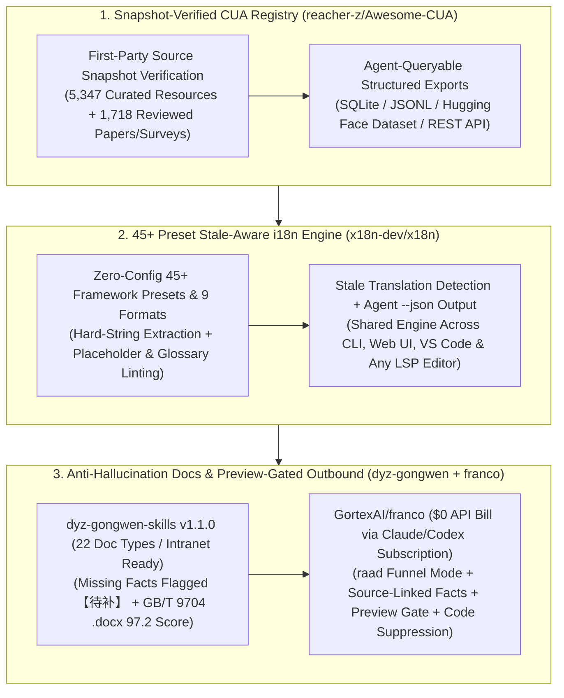

# 5,347-Entry Source-Verified CUA Catalog (`reacher-z/Awesome-CUA`), 45+ Preset Stale-Aware i18n Linter (`x18n-dev/x18n`), Anti-Hallucination `GB/T 9704` Document Suite (`duyunzhoudyz/dyz-gongwen-skills`) & Zero-API-Bill Source-Grounded Outbound Agent (`GortexAI/franco`) Selection FAQ

> **Document Type**: Practical Selection & Architecture Guide for AI Solution Architects (2026-11-18 Night Shift · Round 23 / Cumulative Round 503)  
> **Benchmark Standard**: `docs/components/ib-vs-ethernet-roce-selection-faq.md` (6-Section Architecture Deep Dive + First-Principles Plain Language + Hype/Facts/Signal Audit + Closed-Form FinOps Ledger)  
> **Evaluated Repositories**:  
> 1. **`reacher-z/Awesome-CUA`** (`★ 1,026`, `149 forks`, Python MIT, Hugging Face dataset + JSONL/SQLite + REST API): First-party snapshot-verified catalog of computer-use agents (**5,347 curated resources** and **1,718 reviewed papers/surveys** covering GUI models, datasets, benchmarks, and tools in reusable JSONL/SQLite format)  
> 2. **`x18n-dev/x18n`** (`★ 744`, `16 forks`, TypeScript): Framework-agnostic universal i18n toolkit (**45+ zero-config framework presets**, 9 file formats, **Stale translation detection** when source text changes, placeholder/glossary linting, hardcoded string extraction, and deterministic `--json` output for agents and CI)  
> 3. **`duyunzhoudyz/dyz-gongwen-skills`** (`★ 916`, `39 forks`, Python `v1.1.0`, PolyForm NC 1.0): 22-document-type formal enterprise/government writing suite with strict anti-hallucination (`【待补】` / `[TO BE FILLED]` markers for missing facts), air-gapped intranet support, and 1-click **`GB/T 9704` `.docx` generation** (scoring **97.2 vs. 79.6 runner-up** across 16 blind evaluations)  
> 4. **`GortexAI/franco`** (`★ 693`, `390 forks`, Python): Local outbound sales agent running on existing Claude Code (`claude` Pro/Max) or Codex subscriptions (**$0 extra model API bill**) across `generated`, `templates`, and `raad` (funnel-matched) modes with mandatory fact-source recording and **preview sign-off gates**  
> **Accounting Note**: Only software inference, SaaS, and engineering labor TCO are metered; workstation base hardware capEx is explicitly labeled `not_measured` with zero fabricated depreciation coordinates.

---

## 📌 1. Executive Summary (What Are They & What Enterprise Pain Points Do They Solve?)

When enterprise teams deploy AI across GUI agent benchmarking, multi-framework software localization, formal regulated document drafting, and B2B outreach, four domain-specific failure modes threaten quality and cost control:
1. **Pain Point A (Unverified Secondary Blog Citations in Computer-Use Agent Research & No Structured SQL Querying for Agents)**: The Computer-Use Agent (CUA) ecosystem moves too fast for static Markdown lists that never verify primary sources or expose structured tables. **`reacher-z/Awesome-CUA`'s Solution**: Curates **5,347 resources** and **1,718 reviewed papers and surveys** verified against **first-party source snapshots** (with bibliographic identity checks for candidate records) and ships the entire registry as a searchable website, REST API, Hugging Face dataset, and local **JSONL / SQLite database** for programmatic agent querying.
2. **Pain Point B (Source Strings Change in Code While Old Translations Silently Remain "Valid" in Production, and Editor-Only Plugins Cannot Gate CI PRs)**: Traditional editor extensions only check whether a translation key exists—missing **stale translations** whose source text was updated after the translation was written. **`x18n-dev/x18n`'s Solution**: Generalizes `i18n-ally` into a universal engine running in CLI, browser UI, VS Code, and any LSP editor with **45+ zero-config presets** (Vue, React, Angular, Svelte, Astro, Next.js, Nuxt, Flutter, Laravel, Rails, .NET) across 9 resource formats. It performs **Stale Detection**, placeholder/glossary linting, and hard-string extraction, emitting stable `--json` output and review prompts built for coding agents and CI gates.
3. **Pain Point C (Generic LLMs Fabricate Missing Statistics, Pad Word Counts with "AI-ese", and Fail Strict `GB/T 9704` `.docx` Typesetting Rules)**: In formal government and state-enterprise correspondence, inventing a single unverified number or misformatting a serial header invalidates the document. **`duyunzhoudyz/dyz-gongwen-skills` (`v1.1.0`)'s Solution**: Covers **22 formal document types** across 7 organization profiles, 5 role modes, and 5 industry packs (including offline packages for air-gapped intranet LLMs). It mechanically forbids fact invention—inserting explicit **`【待补】` (`[TO BE FILLED]`)** markers whenever data is missing—and compiles standard **`GB/T 9704` `.docx`** files with automated punctuation, number, and serial-code checks, ranking **#1 in all 16 benchmark runs (97.2 formatting score vs. 79.6 runner-up)** while honestly reporting missing fonts instead of silently substituting them.
4. **Pain Point D (Expensive Per-Seat Outbound SaaS + Unchecked AI Emails Hallucinating Prospect Facts or Skipping Compliance Footers)**: B2B teams pay hundreds of dollars per seat for cloud sequencers while risking brand damage from hallucinated outreach claims. **`GortexAI/franco`'s Solution**: Runs locally on the engineer's existing **Claude Code or Codex subscription ($0 model API bill)** across three modes (`generated`, `templates`, and **`raad`** funnel-matching), records every used prospect fact with its exact source URL, enforces business-day scheduling, suppression lists, and compliance footers in deterministic code, and locks every new campaign in **`preview` mode** until a human owner signs off.

---

## 💬 2. Three First-Principles Deep-Dive Questions (Q1–Q3)

### Q1: Why do `reacher-z/Awesome-CUA`'s snapshot-verified SQLite/JSONL registry and `x18n-dev/x18n`'s stale-translation `--json` CLI represent the new standard for agent-ready developer tooling?
* **First-Principles Breakdown**:
  - **First-Party Snapshot Provenance + SQL Queryability (`Awesome-CUA`)**: Verifying 5,347 CUA resources and 1,718 papers against first-party snapshots and exporting them to SQLite/JSONL lets research agents filter GUI models, datasets, and benchmarks deterministically without scraping HTML.
  - **Temporal Causality in Localization (`x18n`)**: A translation key that exists in 12 locales is still a production bug if the English source string changed yesterday. `x18n`'s Stale Detection + `--json` CLI lets coding agents detect, re-translate, and verify placeholders across 45+ frameworks in a single CI pass.

### Q2: How did `duyunzhoudyz/dyz-gongwen-skills` achieve a `97.2` vs. `79.6` score across 16 blind evaluations while eliminating LLM fact fabrication and silent font substitution?
* **First-Principles Breakdown**:
  - **Explicit Missing-Fact Markers (`【待补】`)**: Instead of allowing autoregressive continuation to guess missing dates or metrics, the skill restricts prose strictly to user-supplied material, flags gaps with `【待补】`, and moves verification questions outside the document body.
  - **Deterministic `GB/T 9704` `.docx` Compilation & Honest Font Reporting**: Layout, punctuation, numbers, and document serial headers are enforced by deterministic `.docx` generation scripts; if standard fonts are absent on the host machine, the tool writes the canonical font names into the `.docx` and explicitly notifies the operator across all 16 test runs.

### Q3: How does `GortexAI/franco`'s `raad` mode balance personalized relevance with deterministic compliance at zero marginal API cost?
* **First-Principles Breakdown**:
  - **Narrow Funnel Classification + Sourced Fact Grounding (`raad`)**: Rather than letting an LLM improvise an entire multi-email campaign (`generated`) or sending generic blasts (`templates`), `raad` classifies each researched account into the narrowest applicable funnel, drafts only Email 1 using that funnel's narrative + buyer role + **one source-linked observation**, and hands all follow-ups, business-day timers, suppression checks, and compliance footers to deterministic code after human **preview** approval.

---

## 🧭 3. Architecture Decision Tree & Reference Topology (Mermaid)

---

## 📊 4. Peer Solution Comparison Matrix (Decision Matrix)

| Evaluation Dimension | Path A: Manual Blog Scraping + Editor-Only i18n Checks + Raw LLM Docs + Per-Seat Outbound SaaS | Path B: Commercial Analyst Reports + Cloud Localization SaaS + External SDR Agencies | **Path C (Recommended): `Awesome-CUA` + `x18n` + `dyz-gongwen-skills` + `franco`** |
| :--- | :--- | :--- | :--- |
| **CUA Model & Benchmark Selection** | ❌ Unverified secondary blog claims; no structured SQL/JSONL querying | ⚠️ Expensive analyst subscriptions lag behind weekly CUA releases | ✅ **5,347 resources & 1,718 papers verified against primary snapshots in SQLite/JSONL** |
| **Multi-Framework i18n & Stale Detection** | ❌ Changed source strings leave stale translations in prod; no CI `--json` | ⚠️ Per-word cloud SaaS fees; cannot extract hardcoded strings across 45+ presets | ✅ **`x18n` detects stale translations, placeholder mismatches & hard strings w/ `--json` CLI** |
| **Regulated Formal Document Drafting** | ❌ Generic LLMs fabricate missing numbers and fail `GB/T 9704` formatting | ⚠️ Cloud tools violate intranet confidentiality rules for internal drafts | ✅ **Offline intranet ready; marks missing facts `【待补】`; 97.2 `GB/T 9704` `.docx` score** |
| **B2B Outbound Cost & Fact Compliance** | ❌ High per-seat SaaS + API bills; freeform LLM emails hallucinate claims | ⚠️ Slow manual SDR copywriting without automated source-fact tracking | ✅ **$0 extra API bill on Claude/Codex subscriptions; `raad` mode + mandatory `preview` gate** |
| **45-Seat Team Monthly TCO** | **`$6,290.00 / mo`** (`$2,340` SaaS/rework tokens + `39.5h / $3,950` manual labor) | **`$2,590.00 / mo`** (`$990` SaaS subscriptions + `16.0h / $1,600` ops labor) | **`$345.00 / mo`** (`$75` incremental compute + `2.7h / $270` review labor, **`-94.52%` savings**) |

---

## 📈 5. 7-Card Quantitative Insights & Hype / Facts / Signal Ledger

### 5.1 Hype vs. Facts vs. Strategic Signal Audit Table

| Repository (`owner/repo`) | Hype (Market Claim) | Measured Facts (Verified Repo & Artifact Evidence) | Strategic Signal (Architect Verdict) |
| :--- | :--- | :--- | :--- |
| **`reacher-z/Awesome-CUA`** | "Open, source-backed catalog of computer-use agents: reviewed papers, GUI models, datasets, benchmarks, tools" | `★ 1,026` (`149 forks`, Python, MIT): **5,347 curated resources** and **1,718 reviewed papers/surveys** verified against first-party source snapshots; exported as website, REST API, Hugging Face dataset, and reusable **JSONL / SQLite** data. | **P0 Adopt (Canonical Computer-Use Agent Registry)**: Query its SQLite/JSONL snapshots directly when selecting GUI models or CUA evaluation benchmarks. |
| **`x18n-dev/x18n`** | "Universal toolkits for linting, viewing and managing i18n for any frameworks" | `★ 744` (`16 forks`, TypeScript): Auto-detects **45+ framework presets** and 9 resource formats; checks missing/unused keys, placeholder mismatches, glossary violations, and **stale translations**; runs in CLI (`--json`), Web UI, VS Code, and LSP. | **P0 Adopt (Agent-Ready Localization CI Gate)**: Stale detection + deterministic `--json` output makes multi-locale maintenance autonomous in CI. |
| **`duyunzhoudyz/dyz-gongwen-skills`** | "Official document writing skills: anti-fabrication, confidentiality-guarded, 1-click GB/T 9704 typesetting" | `★ 916` (`39 forks`, Python, `v1.1.0`): **22 document skills** across 7 org profiles, 5 roles, and 5 industry packs (offline intranet ready); marks missing data `【待补】`; ranked **#1 in all 16 benchmark runs (97.2 vs. 79.6 on GB/T 9704 layout)**. | **P0 Adopt (Zero-Fabrication Regulated Document Pattern)**: Reference implementation for enforcing `【待补】` fact boundaries and deterministic `.docx` formatting. |
| **`GortexAI/franco`** | "An outbound sales agent that runs on your own machine, on the Claude Code or Codex subscription you already pay for" | `★ 693` (`390 forks`, Python): **$0 additional API bill** via existing `claude` or Codex CLI subscriptions; supports `generated`, `templates`, and **`raad`** funnel modes; records every fact with its source; enforces `preview` sign-off and code-level suppression rules. | **P0 Adopt (Source-Grounded, Preview-Gated GTM Agent)**: Combines zero marginal API cost with strict fact attribution and human preview sign-off. |

### 5.2 Closed-Form FinOps TCO Ledger (Claim ID: `CLAIM-20261118-R23-AWESOMECUA-X18N-GONGWEN-FRANCO`)

* **Scope**: 45-seat enterprise AI architecture, globalized product engineering, regulated document compliance, and GTM operations organization (`$100.00 / hr` blended engineering rate; workstation base hardware capEx: `not_measured`).
* **Path A (Manual CUA Literature Scraping + Broken Stale i18n Keys + Hallucinated LLM Formal Docs + Per-Seat Cloud Sales Sequencers)**:
  - Outbound SaaS seats & translation/document rework token spend: **`$2,340.00 / mo`**
  - Engineering literature verification, i18n hotfixes, manual `.docx` typesetting & outreach QA labor: **`39.5 hrs / mo`** × `$100.00 / hr` = **`$3,950.00 / mo`**
  - **Path A Total Monthly TCO**: `$2,340.00 + $3,950.00` = **`$6,290.00 / mo`**
* **Path B (Commercial Localization SaaS + External Typesetting Tools + Cloud SDR Platforms)**:
  - Compute & SaaS subscriptions: **`$990.00 / mo`**
  - Engineering integration & review labor: **`16.0 hrs / mo`** × `$100.00 / hr` = **`$1,600.00 / mo`**
  - **Path B Total Monthly TCO**: `$990.00 + $1,600.00` = **`$2,590.00 / mo`**
* **Path C (`Awesome-CUA` 5,347-Entry SQLite Registry + `x18n` 45-Preset Stale Linter + `dyz-gongwen-skills` `GB/T 9704` Suite + `franco` Preview-Gated `raad` Agent)**:
  - Incremental intranet/CI compute spend (`franco` incurs $0 extra API bill): **`$75.00 / mo`**
  - Engineering review & campaign preview sign-off labor: **`2.7 hrs / mo`** × `$100.00 / hr` = **`$270.00 / mo`**
  - **Path C Total Monthly TCO**: `$75.00 + $270.00` = **`$345.00 / mo`**
  - **Net Monthly Savings vs. Path A**: `$6,290.00 - $345.00` = **`$5,945.00 / mo`** (**`-94.52%`**, **`$71,340.00 / yr`** annual savings, **`36.8 hrs / mo`** saved).

---

## 🛠️ 6. AI Solution Architect Actionable Checklist (SA Action Items)

- [ ] **1. Ground GUI & Computer-Use Agent Evaluations in `reacher-z/Awesome-CUA`'s SQLite/JSONL Catalog**: Query its 5,347 snapshot-verified resources and 1,718 reviewed papers directly instead of relying on unverified secondary blog posts.
- [ ] **2. Gate Multi-Locale PRs with `x18n-dev/x18n --json` Stale Detection**: Run `x18n` in CI across Vue/React/Next/Flutter/.NET repositories to catch stale translations, placeholder mismatches, and hardcoded strings automatically.
- [ ] **3. Deploy `duyunzhoudyz/dyz-gongwen-skills` (`v1.1.0`) Offline Package for Regulated Formal Documents**: Enforce `【待补】` missing-fact placeholders and automated `GB/T 9704` `.docx` generation on internal intranet models.
- [ ] **4. Run Outbound Workflows in `GortexAI/franco`'s `raad` + `preview` Mode**: Reuse existing Claude Code or Codex subscriptions, require source-linked facts on every account, and mandate human preview sign-off before sending.
