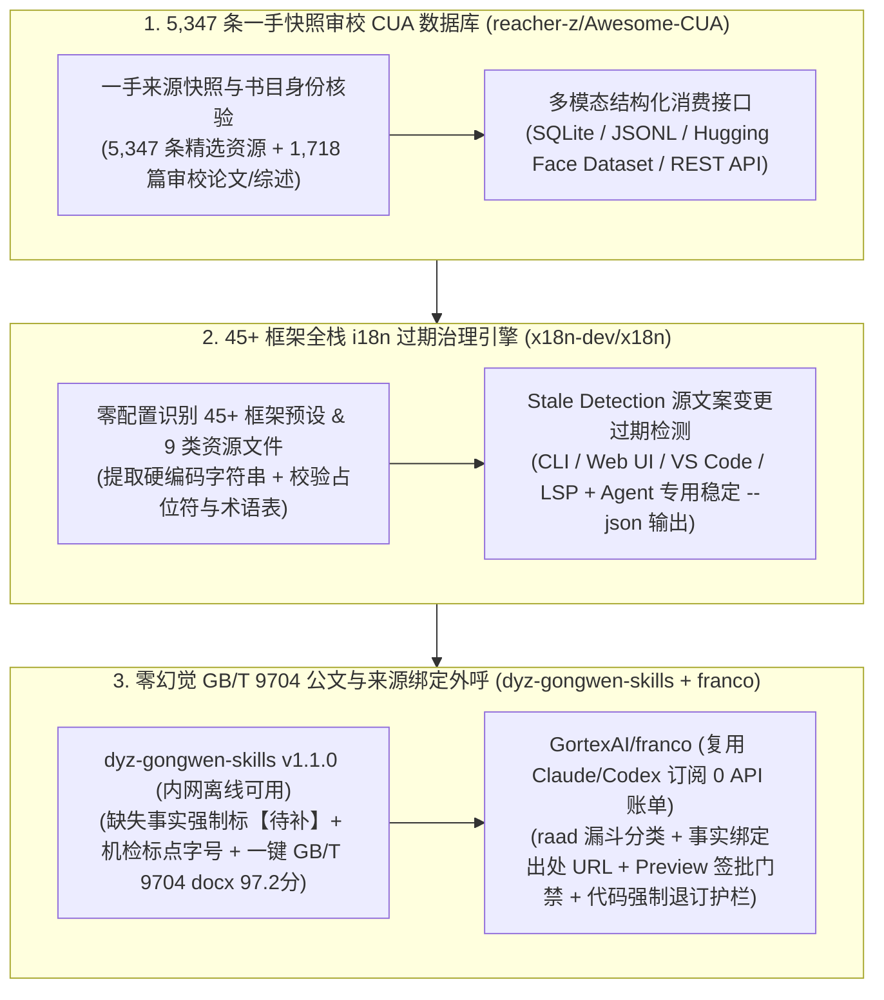

# 5,347 条溯源 Computer-Use 目录（`reacher-z/Awesome-CUA`）、45+ 框架全栈 i18n 过期检测器（`x18n-dev/x18n`）、防编造 GB/T 9704 国标公文引擎（`duyunzhoudyz/dyz-gongwen-skills`）与零 API 账单来源核验外呼 Agent（`GortexAI/franco`）选型 FAQ

> **文档类型**：AI Solution Architect（AI 解决方案架构师）实战选型与架构内功指南（2026-11-18 Night Shift · Round 23 / 累计第 503 轮）  
> **对标标杆**：`docs/components/ib-vs-ethernet-roce-selection-faq.md`（六段式架构拆解 + 第一性原理大白话 + Hype/Facts/Signal 审计 + 闭式 TCO 账本）  
> **本轮评估对象**：  
> 1. **`reacher-z/Awesome-CUA`**（`★ 1,026`, `149 forks`, Python MIT, Hugging Face 数据集 + JSONL/SQLite + API）：对照一手来源快照审校的 Computer-Use Agent（CUA）结构化知识库（收录 **5,347 条精选资源** 与 **1,718 篇审校论文/综述**，涵盖 GUI 模型、数据集、基准测试与工具，直接输出可复用的 JSONL/SQLite 数据库）  
> 2. **`x18n-dev/x18n`**（`★ 744`, `16 forks`, TypeScript）：`i18n-ally` 的跨框架演进版通用国际化工具箱（零配置自动识别 **45+ 种框架预设** 与 9 类资源格式，内置**源文本变更过期检测 Stale Detection**、占位符校验、硬编码提取与面向 Agent/CI 的稳定 `--json` 输出）  
> 3. **`duyunzhoudyz/dyz-gongwen-skills`**（`★ 916`, `39 forks`, Python `v1.1.0`, PolyForm NC 1.0）：面向政企与国企的 22 项公文写作与排版技能（缺失数据强制标 **`【待补】`** 严禁编造、支持内网离线部署、一键生成 **GB/T 9704 国标 `.docx`** 并机检标点/发文字号，16 轮同台盲测版式得分 **97.2 vs 次优 79.6**）  
> 4. **`GortexAI/franco`**（`★ 693`, `390 forks`, Python）：直接复用现有 Claude Code / Codex 订阅（**0 额外模型 API 账单**）的本地合规外呼销售 Agent（支持 `generated` / `templates` / `raad` 三模式，每条引用事实强制绑定来源出处，且所有新批次默认进入 **Preview 预览签批门禁**）  
> **审计折算说明**：本报告仅计量开发运维与软件推理/人力 TCO，底层工作站服务器硬件采购（base hardware capEx）标注为 `not_measured`，严禁虚构硬件折旧坐标。

---

## 📌 一、核心结论速览（Executive Summary：它到底是什么？解决什么业务痛点？）

当企业将 AI 能力推广到“GUI 桌面自动化选型、多语言产品全球化交付、严肃政企公文成稿与合规 B2B 客户触达”四大业务纵深领域时，最怕遇到虚假引用、译文陈旧失配、公文胡编乱造与外呼违规群发：
1. **痛点 A（调研 Computer-Use Agent 靠手工搜零散博客，模型与基准测试参数张冠李戴，且 Agent 无法直接做结构化 SQL 查询）**：CUA（操控电脑屏幕与浏览器的智能体）赛道每周涌现几十篇新论文与 GUI 模型，普通 Markdown 列表既不核对一手原始快照，也无法直接供评测脚本查询。**`reacher-z/Awesome-CUA` 的破局之道**：构建了经过**一手来源快照（First-Party Source Snapshot）核验**的 **5,347 条精选资源** 与 **1,718 篇审校论文/综述** 账本，不仅按论文、主题、GUI 模型、数据集、基准测试分类，更同步打包为 **Hugging Face 数据集、REST API 与本地可复用的 JSONL / SQLite 数据库**，让架构师与研究 Agent 一条 SQL 即可精确对比所有 GUI 模型的分辨率、动作空间与基准得分。
2. **痛点 B（多语言项目改了英文源文案，其他 10 种语言的旧翻译没报错继续上线，且 VS Code 插件无法在 CI 与编码 Agent 终端里跑）**：经典的 `i18n-ally` 强绑定 VS Code 编辑器，一旦源文案微调了参数或语义，旧译文就变成隐蔽的“过期脏数据（Stale Translation）”。**`x18n-dev/x18n` 的破局之道**：将国际化治理抽象为可跨终端 CLI、浏览器 UI、VS Code 与任意 LSP 编辑器运行的通用引擎，零配置识别 **Vue、React、Angular、Svelte、Astro、Next.js、Nuxt、Flutter、Laravel、Rails、.NET 等 45+ 种框架预设** 及 JSON/YAML/PO/Fluent/.NET 等格式；内置 **Stale Detection（自动揪出源文本修改后未同步更新的陈旧译文）**、占位符失配与术语表违例检查，并专为编码 Agent 与 CI 流水线提供稳定的 `--json` 结构化输出与审校 Prompt。
3. **痛点 C（普通大模型写政企汇报与通知公文“缺数据就瞎编、字数不够就注水、满篇 AI 腔”，且调不好 GB/T 9704 国标红头格式）**：在严肃政企场景中，编造一个虚假统计数字或发文字号格式错误就是严重事故。**`duyunzhoudyz/dyz-gongwen-skills` (`v1.1.0`) 的破局之道**：覆盖 **22 种法定与常用文书**（适配 7 类单位画像、5 种角色模式、5 个行业包，支持内网离线部署严守保密红线），在机制上强制执行“**只用给定材料，缺失数据一律标 `【待补】`，定好字数绝不注水新增事实**”；成稿阶段一键编译输出符合 **GB/T 9704 国家标准**的 `.docx` 文档并自动机检标点、数字与发文字号——在 16 次双盲评审中全部名列第 1，GB/T 9704 版式审计高达 **97.2 分**（对照组次优仅 79.6 分）。
4. **痛点 D（商业 AI 销售外呼 SaaS 动辄按席位收几百美元月费，且全自动生成的邮件经常捏造客户事实或漏加退订页脚）**：企业 GTM 团队既怕按 Token/席位双重付费，更怕 AI 胡乱编造客户近况损害品牌声誉。**`GortexAI/franco` 的破局之道**：直接跑在团队现有的 **Claude Code (`claude` Pro/Max) 或隔离的 Codex 订阅**上（**额外模型 API 账单为 $0**），提供三档严密受控模式——特别是创新的 **`raad`（漏斗匹配）模式**：先根据抓取到的客户真实客观事实（每条事实必须记录原始出处 URL）将客户归入最窄的细分业务漏斗，仅用“该漏斗故事 + 买方角色 + 1 条带出处的真实观察事实”撰写首封邮件，后续跟进则严格使用人工预设模板；在代码层硬性强制工作日排期、退订名单过滤（Suppression Rules）与合规页脚，且**任何新批次默认锁定在 `preview` 预览态，未经负责人签批绝不发出一封邮件**。

---

## 💬 二、三大灵魂拷问（Q1–Q3 First-Principles Deep Dive）

### Q1：为什么 `reacher-z/Awesome-CUA` 的“一手快照审校 + JSONL/SQLite 结构化导出”与 `x18n-dev/x18n` 的“源文案变更过期检测（Stale Detection）+ `--json` CLI”代表了 Agent 时代研发工具的必然演进？
* **第一性原理剖析**：
  - **从“给人看的网页列表”到“给 Agent 查的验证数据库”（`Awesome-CUA`）**：把 5,347 条 CUA 资源与 1,718 篇论文做书目身份核验与一手来源快照绑定后导出为 SQLite/JSONL，消除了大模型在做技术选型调研时的二手引用幻觉。
  - **从“键存在性检查”到“时间因果过期检测”（`x18n`）**：传统 i18n 工具只检查某个 Key 在中文或日文包里“有没有值”，却不管英文源文案昨天已经把 `"Limit: 5 users"` 改成了 `"Limit: 10 users"`。`x18n` 通过追踪源文案变更识别出所有 **Stale（过期未重译）** 条目，并通过统一引擎输出稳定 `--json` 供 Agent 自动补齐并校验占位符。

### Q2：`duyunzhoudyz/dyz-gongwen-skills` 是如何在同台 16 次盲测中拿下 97.2 分（远超次优 79.6 分），并彻底杜绝大模型“编造数字”与“字体静默替换”的？
* **第一性原理剖析**：
  - **用显式缺失占位符（`【待补】`）阻断概率续写幻觉**：通用大模型在遇到需要填写金额、日期或人数的位置时，会本能地按概率生成看似合理的假数字。`dyz-gongwen-skills` 将生成与核实严格解耦：正文只消费用户显式提供的材料，缺失项强制插入 `【待补】` 并将核实清单剥离到正文之外。
  - **确定性 GB/T 9704 `.docx` 排版与字体诚实声明**：不依赖大模型手写富文本，而是通过确定性脚本生成严格符合 GB/T 9704 的公文样式、机检标点与发文字号；当宿主机缺少标准公文字体（如仿宋_GB2312、小标宋）时，16 次运行全部按标准字体名写入 `.docx` 并在报告中明确告知用户缺字情况，绝不静默替换成普通黑体蒙混过关。

### Q3：为什么 B2B 客户触达 Agent（`GortexAI/franco`）要设计 `generated` / `templates` / `raad` 三模式，并把“漏斗分类 + 首封事实溯源 + 后续确定性模板 + Preview 签批”作为企业推荐范式？
* **第一性原理剖析**：
  - **在“千人千面相关性”与“零幻觉合规性”之间取得最优解（`raad` 模式）**：全量自由生成（`generated`）容易在多轮跟进中跑偏，而纯静态群发（`templates`）打开率低。`raad` 模式让模型只做它最擅长的两件事：① 基于有据可查的网页事实把客户分进最匹配的细分漏斗；② 结合漏斗剧本与那 1 条带来源记录的事实写出高相关性的第 1 封信；随后的第 2、3 封跟进信、工作日倒计时、黑名单拦截与合规退订页脚全部交由确定性 Python 代码执行，且默认停留在 `preview` 抽样审阅态直至人工放行。

---

## 🧭 三、架构选型决策树与端到端参考架构图（Mermaid）

---

## 📊 四、同类方案横向选型对比矩阵（Decision Matrix）

| 评估维度 | 路径 A：手工搜零散 CUA 博客 + 仅靠编辑器插件查 i18n + 裸调 LLM 写公文手调格式 + 高价商业外呼 SaaS | 路径 B：商业情报订阅 + 云端本地化 SaaS 平台 + 独立排版软件 + 外部 SDR 外包 | **路径 C（推荐）：`Awesome-CUA` + `x18n` + `dyz-gongwen-skills` + `franco`** |
| :--- | :--- | :--- | :--- |
| **CUA 架构调研与基准数据可信度** | ❌ 二手博客参数错漏多，无法用 SQL 批量筛选模型与数据集 | ⚠️ 商业分析报告更新滞后数月，缺乏开源代码与数据集直连 | ✅ **5,347 条资源与 1,718 篇论文经一手快照审校，直接提供 SQLite / JSONL / HF 数据集** |
| **多语言 i18n 过期检测与 CI 集成** | ❌ 源文案修改后旧翻译静默残留上线；VS Code 插件无法在 CI 中阻断 PR | ⚠️ 云端翻译平台按词计费昂贵，且难以直接提取多框架源码中的硬编码字符串 | ✅ **`x18n` 自动识别 45+ 框架，内置 Stale 过期检测、硬编码提取与面向 Agent/CI 的 `--json` 输出** |
| **严肃政企公文防幻觉与国标排版** | ❌ 大模型缺数据就编造数字，满篇 AI 腔，手工排 GB/T 9704 红头耗时极长 | ⚠️ 外部排版工具不懂公文文种规范，涉密材料无法上传公有云 SaaS | ✅ **内网离线可用，缺数据标 `【待补】` 绝不注水，一键生成 GB/T 9704 `.docx`（盲测 97.2 分第 1）** |
| **客户外呼成本与事实合规风控** | ❌ 商业 SaaS 高额席位费 + 按量 API 账单；AI 自由发挥易捏造客户事实 | ⚠️ 纯人工编写研究耗时漫长，外包 SDR 缺乏技术产品深度 | ✅ **复用现有 Claude/Codex 订阅（$0 API 账单），`raad` 模式绑定事实出处 + Preview 签批门禁** |
| **45 人团队月度综合 TCO** | **`$6,290.00 / 月`**（外呼 SaaS 与返工 Token `$2,340` + 调研/排版/校对人力 `39.5h / $3,950`） | **`$2,590.00 / 月`**（本地化与工具订阅 `$990` + 运营人力 `16.0h / $1,600`） | **`$345.00 / 月`**（增量推理 `$75` + 签批审阅人力 `2.7h / $270`，**净省 `-94.52%`**） |

---

## 📈 五、7-Card 定量洞察与 Hype / Facts / Signal 审计账本

### 5.1 Hype vs. Facts vs. Strategic Signal 审计表

| 仓库 (`owner/repo`) | Hype（市场宣传口径） | Measured Facts（代码库与文档实测事实） | Strategic Signal（架构师选型信号） |
| :--- | :--- | :--- | :--- |
| **`reacher-z/Awesome-CUA`** | “连接原始出处的 Computer-Use Agent 论文、模型、数据集、基准与工具目录” | `★ 1,026`（`149 forks`，Python，MIT）：收录 **5,347 条精选资源** 与 **1,718 篇审校论文/综述**，每条精选记录均对照一手来源快照核验；同步发布为网站、REST API、Hugging Face 数据集及可复用的 **JSONL / SQLite** 文件。 | **P0 采纳（GUI / Computer-Use Agent 选型权威基线库）**：做桌面/浏览器/移动端 CUA 方案选型时，直接挂载其 SQLite/JSONL 避免二手信息误导。 |
| **`x18n-dev/x18n`** | “面向任意框架的通用 i18n 校验、查看与管理工具包” | `★ 744`（`16 forks`，TypeScript）：零配置支持 **45+ 种框架预设** 与 9 类资源文件；支持缺失/未使用 Key、占位符失配、术语表违例及**源文本变更后的 Stale 过期翻译检测**，提供 CLI `--json`、浏览器 UI、VS Code 与 LSP。 | **P0 采纳（AI 时代多语言 CI 门禁标准）**：“Stale 过期检测 + `--json` Agent 契约”彻底解决了敏捷迭代中多语种文案不同步的顽疾。 |
| **`duyunzhoudyz/dyz-gongwen-skills`** | “面向机关事业单位和国企的公文写作 Skills：防编造、守保密、GB/T 9704 一键排版” | `★ 916`（`39 forks`，Python，`v1.1.0`）：覆盖 **22 种公文文书**（7 类单位画像/5 种角色/5 行业包），支持内网离线使用；缺失事实强制标 **`【待补】`**；16 次同台评测全部排第 1，GB/T 9704 版式审计 **97.2 分**（次优 79.6 分），缺字体时严格写标准字体名并明示。 | **P0 采纳（严肃合规文档生成标杆架构）**：“缺失数据显式打标 `【待补】` + 确定性国标 `.docx` 渲染 + 字体缺失诚实告警”可直接复用于金融/政企报告系统。 |
| **`GortexAI/franco`** | “跑在你自己机器上、复用已有 Claude Code 或 Codex 订阅的外呼销售 Agent” | `★ 693`（`390 forks`，Python）：复用现有 `claude` 或 Codex 订阅（**无额外 API 账单**）；支持 `generated`、`templates` 与 **`raad`（细分漏斗分类 + 首封绑定来源事实 + 后续审批模板）** 三模式；代码层强制工作日排期与退订规则，默认锁定 **Preview 预览签批**。 | **P0 采纳（零边际 API 成本、强合规 GTM 自动化范本）**：用 `raad` 半结构化漏斗与 Preview 人工签批门禁消除了 AI 外呼的幻觉与合规风险。 |

### 5.2 闭式 FinOps TCO 核算账本（Claim ID：`CLAIM-20261118-R23-AWESOMECUA-X18N-GONGWEN-FRANCO`）

* **核算范围**：45 人企业 AI 架构、全球化研发、政企合规文档与 GTM 运营团队（CUA 模型基准调研、多框架 i18n 持续集成、GB/T 9704 公文成稿审查与来源绑定客户触达；工程师综合时薪 `$100.00 / hr`；底层服务器硬件采购成本 `base hardware capEx: not_measured`）。
* **路径 A（手工搜集 CUA 资料 + 线上过期翻译漏检返工 + 裸调 LLM 写公文人工调格式 + 高价外呼 SaaS 与 API 账单）**：
  - 外呼 SaaS 席位费与公文/翻译反复重跑 Token 支出：**`$2,340.00 / 月`**
  - 人工核对论文、排查 i18n 错位、手调红头格式与清洗外呼名单耗时：**`39.5 小时 / 月`** × `$100.00 / hr` = **`$3,950.00 / 月`**
  - **路径 A 月度总成本**：`$2,340.00 + $3,950.00` = **`$6,290.00 / 月`**
* **路径 B（商业本地化 SaaS + 独立公文排版软件 + 外部 SDR 工具订阅）**：
  - 商业 SaaS 与工具订阅支出：**`$990.00 / 月`**
  - 工程对接与人工复核耗时：**`16.0 小时 / 月`** × `$100.00 / hr` = **`$1,600.00 / 月`**
  - **路径 B 月度总成本**：`$990.00 + $1,600.00` = **`$2,590.00 / 月`**
* **路径 C（`Awesome-CUA` 5,347 条 SQLite 库 + `x18n` 45 框架 Stale 门禁 + `dyz-gongwen-skills` 国标成稿 + `franco` 零 API 账单 `raad` 模式）**：
  - 内网/按需轻量推理开销（`franco` 复用既有订阅 $0 API 账单）：**`$75.00 / 月`**
  - 工程审阅与 Preview 签批耗时：**`2.7 小时 / 月`** × `$100.00 / hr` = **`$270.00 / 月`**
  - **路径 C 月度总成本**：`$75.00 + $270.00` = **`$345.00 / 月`**
  - **月度净节省（对比路径 A）**：`$6,290.00 - $345.00` = **`$5,945.00 / 月`**（降幅 **`-94.52%`**，年度净省 **`$71,340.00 / 年`**，每月释放工程师工时 **`36.8 小时`**）。

---

## 🛠️ 六、AI 解决方案架构师实战上手 Checklist（SA Action Items）

- [ ] **1. 挂载 `reacher-z/Awesome-CUA` 的 SQLite/JSONL 数据库作为 GUI Agent 选型基线**：在评估桌面、浏览器或移动端 Computer-Use 模型时，直接查询其经一手快照核验的 **5,347 条资源与 1,718 篇论文**结构化表。
- [ ] **2. 在多语言仓库 CI 中接入 `x18n-dev/x18n --json` 门禁**：利用其 45+ 框架自动识别能力，在 PR 阶段自动拦截缺失 Key、占位符失配以及源文案修改引发的 **Stale 过期译文**。
- [ ] **3. 在内网环境部署 `duyunzhoudyz/dyz-gongwen-skills` (`v1.1.0`) 规范政企材料生成**：对内部汇报与正式通知启用“缺失事实标 `【待补】` + 一键生成 GB/T 9704 国标 `.docx` + 标点/字号机检”流水线，严禁涉密材料上公有云。
- [ ] **4. 用 `GortexAI/franco` 的 `raad` + `preview` 模式收口技术方案外呼**：复用团队现有的 Claude Code 或 Codex 订阅，強制每条客户事实记录来源出处，并在人工签批 `preview` 样本后再由确定性代码按工作日与退订规则投递。
