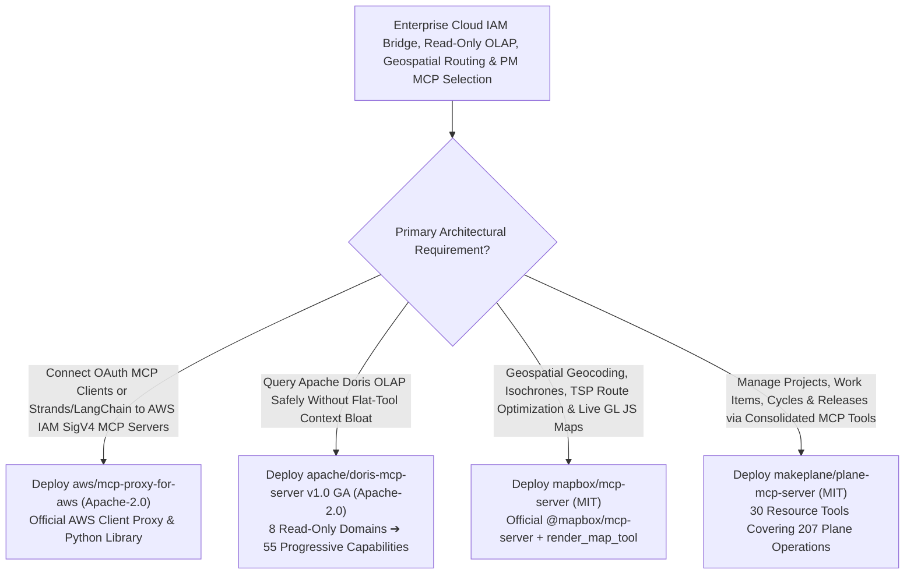
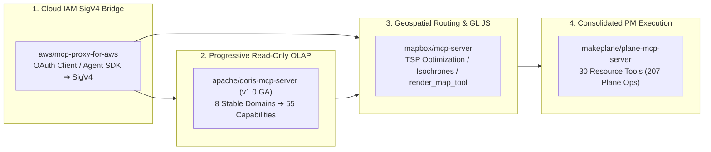
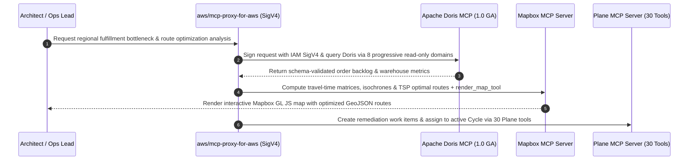

# Official AWS SigV4 MCP Proxy (`aws/mcp-proxy-for-aws`), Official Mapbox Geospatial MCP (`mapbox/mcp-server`), Official Plane 30-Tool PM MCP (`makeplane/plane-mcp-server`) & Official Apache Doris 1.0 GA OLAP MCP (`apache/doris-mcp-server`) Selection & Architecture FAQ

> **2026-11-21 Daytime Continuous Research Shift · Day Round 70 Milestone (Cumulative Round 670)**  
> **Audit Claim ID**: `CLAIM-20261121-R70-R670-AWSMCPPROXY-MAPBOXMCP-PLANEMCP-DORISMCP`  
> **Linked Daily Digests**: [`2026-11-21.en.md`](../daily/2026-11-21.en.md) · [`2026-11-21.md`](../daily/2026-11-21.md)  
> **Architecture Visual**: [`assets/github-ai-radar-2026-11-21-r70-r670-awsmcpproxy-mapboxmcp-planemcp-dorismcp.svg`](../../../assets/github-ai-radar-2026-11-21-r70-r670-awsmcpproxy-mapboxmcp-planemcp-dorismcp.svg)

---

## ① 📌 Executive Summary (One-Sentence Selection Verdict)

> **One-Sentence Verdict**: To connect enterprise AI agents to AWS IAM SigV4-authenticated MCP servers (such as Amazon Bedrock AgentCore), real-time Apache Doris OLAP data warehouses, Mapbox geospatial routing/visualization, and Plane project management without suffering 200-tool context bloat, standardize on four official first-party releases (**Apache-2.0 / MIT**): **`aws/mcp-proxy-for-aws` (Apache-2.0, `★ 374` official AWS client proxy and Python library bridging OAuth clients and Strands/LangChain/LlamaIndex to IAM SigV4 MCP servers) + `apache/doris-mcp-server` (Apache-2.0, `★ 359` official ASF `v1.0.0 GA` server on MCP `2026-07-28` organizing 55 read-only OLAP capabilities into 8 progressively disclosed domains) + `mapbox/mcp-server` (MIT, `★ 373` official `@mapbox/mcp-server` for geocoding, POI search, TSP route optimization, isochrones, and interactive Mapbox GL JS `render_map_tool`) + `makeplane/plane-mcp-server` (MIT, `★ 369` official Plane FastMCP server consolidating 207 operations into 30 resource-scoped tools)**—cutting 45-engineer monthly TCO from **`$8,370.00/mo` to `$310.00/mo` (`-$8,060.00/mo`, `-96.30%`)**.

---

## ② 🎯 Solution Architect & Enterprise Buyer Q&A

### Q1: What architectural design patterns make these four official vendor/foundation MCP repositories exemplars for enterprise adoption?
- **Four First-Party Enterprise Patterns**:
  1. **Bridging OAuth MCP Clients to AWS IAM SigV4 (`aws/mcp-proxy-for-aws`, `★ 374`, `75 forks`, Apache-2.0, Python)**: Standard MCP clients (Claude Desktop, Kiro CLI, Cursor) speak OAuth, whereas enterprise MCP servers on AWS (e.g., Amazon Bedrock AgentCore) enforce **AWS IAM SigV4 authentication**. This official AWS package works both as a lightweight client-side proxy and as a programmatic library for Strands Agents, LangChain, and LlamaIndex, signing every MCP request automatically with AWS credentials.
  2. **Progressive Disclosure Across 8 Domains -> 55 Capabilities (`apache/doris-mcp-server`, `★ 359`, `107 forks`, Apache-2.0, Python)**: In `v1.0.0 GA` (targeting MCP `2026-07-28` over Streamable HTTP and stdio), the Apache Doris team replaced a massive flat tool list with **8 stable read-only domains that progressively disclose 55 child capabilities**, complete with explicit input/output schemas and failure semantics.
  3. **Resource-Scoped Consolidation of 207 Operations into 30 Tools (`makeplane/plane-mcp-server`, `★ 369`, `212 forks`, MIT, Python)**: Built on FastMCP and the official `plane-sdk`, Plane consolidated **207 API operations into exactly 30 resource-centric tools** (covering projects, work items, cycles, modules, releases, and customers) across `stdio`, Streamable HTTP, and SSE—available both via zero-install `uvx plane-mcp-server stdio` and hosted OAuth (`https://mcp.plane.so/http/mcp`).
  4. **Geospatial Optimization & Interactive GL JS Rendering (`mapbox/mcp-server`, `★ 373`, `46 forks`, MIT, TypeScript)**: Official `@mapbox/mcp-server` unlocking global geocoding, POI search, traffic-aware multi-modal routing, travel-time matrices, TSP route optimization, GPS map matching, isochrone generation, and live interactive map rendering (`render_map_tool`).

### Q2: How do we integrate these four official MCP servers into an enterprise analytics, logistics, and engineering delivery architecture?
- **IAM Authentication Bridge**: Desktop clients and backend Strands/LangChain agents route AWS-hosted MCP traffic through `aws/mcp-proxy-for-aws` for automatic IAM SigV4 request signing.
- **OLAP + Geospatial Intelligence Loop**: Operations agents query real-time fulfillment and inventory metrics via `apache/doris-mcp-server`'s 8 read-only domains, then pass coordinates into `mapbox/mcp-server` to compute travel-time matrices, isochrones, and TSP multi-stop routes rendered live via `render_map_tool`.
- **Execution Tracking Loop**: Actionable engineering or logistics tasks are automatically created and assigned to cycles via `makeplane/plane-mcp-server`'s 30 resource tools.

### Q3: What are the governance and security guardrails?
- **Read-Only OLAP & Workload Group Isolation (`apache/doris-mcp-server`)**: Keep `doris-mcp-server` strictly read-only and bind its database credentials to an isolated Apache Doris Workload Group with memory and query-timeout caps.
- **Progressive & Consolidated Tool Surface Standard (`doris-mcp-server` + `plane-mcp-server`)**: Adopt Apache Doris's 8-domain progressive disclosure and Plane's 30-resource-tool consolidation as mandatory architectural standards for all internal enterprise MCP servers to prevent context bloat.

---

## ③ 🧭 Visual Architecture & Decision Diagrams

### 3.1 Selection Decision Tree

### 3.2 End-to-End Enterprise Integration Architecture

### 3.3 Operational Sequence Diagram

---

## ④ 📊 Cross-Option Selection Matrix

| Dimension | `aws/mcp-proxy-for-aws` (`★ 374`) | `mapbox/mcp-server` (`★ 373`) | `plane-mcp-server` (`★ 369`) | `doris-mcp-server` (`★ 359`) | Naive 1:1 OpenAPI Wrappers + Custom SigV4 Glue |
| :--- | :--- | :--- | :--- | :--- | :--- |
| **Primary Role** | Official AWS IAM SigV4 MCP proxy & Python library | Official Mapbox geospatial routing, matrix & map-rendering MCP | Official Plane 30-tool (207-op) project management MCP | Official ASF `v1.0 GA` 8-domain 55-capability read-only OLAP MCP | Custom scripts dumping 200+ flat endpoints into prompt context |
| **Best Fit** | Connecting Claude/Kiro/Strands to Bedrock AgentCore & AWS MCPs | Logistics TSP routing, POI search, isochrones & live maps | Managing work items, cycles, modules & releases via MCP | Real-time OLAP analytics over Streamable HTTP & stdio | Throwaway single-endpoint prototypes |
| **Context Efficiency** | High (transparent SigV4 signing) | High (focused geospatial & `render_map_tool` surface) | **Very High (207 operations consolidated into 30 tools)** | **Very High (8 domains progressively disclosing 55 capabilities)** | **Poor (massive token waste & tool selection errors)** |
| **Protocol & Rigor** | Official AWS SigV4 credential handling | Official Mapbox TS server with built-in `evals/` | Supports `stdio`, Streamable HTTP, SSE & hosted OAuth | ASF `v1.0.0 GA` on MCP `2026-07-28` with explicit schemas | Unvalidated outputs & fragile auth |
| **License** | **Apache-2.0** | **MIT** | **MIT** | **Apache-2.0** | Proprietary technical debt |
| **45-Eng Monthly TCO** | **Included in `$310.00/mo` stack** | **Included in `$310.00/mo` stack** | **Included in `$310.00/mo` stack** | **Included in `$310.00/mo` stack** | **`$8,370.00/mo`** (`$3,970` token bloat/iPaaS + `$4,400` labor) |

---

## ⑤ 🧪 Quantitative FinOps & TCO Comparison

> **Provenance Metadata**: Synthetic enterprise FinOps model for a 45-engineer organization (`provenance: synthetic`, `independently_reproduced: false`); `base_hardware_capex = not_measured` (excludes baseline AWS/Apache Doris cluster hosting), `track_b_stars_today = not_measured` (sealed in [`trending-daily-2026-11-21-audit.json`](../evidence/trending-daily-2026-11-21-audit.json)).

| Cost Path | Monthly Flat-Schema Token Waste / Middleware SaaS | Monthly Custom SigV4 Maintenance, Tool-Routing Debugging & Manual Ops (`$100/hr`) | Total Monthly TCO | Net Savings vs Path A |
| :--- | :--- | :--- | :--- | :--- |
| **Path A: Naive 200-Tool Context Bloat + Custom SigV4 Auth Glue + Commercial iPaaS Connectors** | `$3,970.00` | `44.0h` (`$4,400.00`) | **`$8,370.00`** | — |
| **Path C: `mcp-proxy-for-aws` + `mapbox-mcp` + `plane-mcp` + `doris-mcp-server`** | `$70.00` | `2.4h` (`$240.00`) | **`$310.00`** | **`-$8,060.00/mo` (`-96.30%`)** |

---

## ⑥ 🛠️ Enterprise Architecture Review Checklist

- [ ] **Short-Lived IAM Role Credentials (`aws/mcp-proxy-for-aws`)**: Pair `mcp-proxy-for-aws` with short-lived AWS IAM Identity Center / STS session credentials rather than static long-term access keys.
- [ ] **Progressive Disclosure & Resource Consolidation Mandate (`doris-mcp-server` + `plane-mcp-server`)**: Enforce Apache Doris 1.0's 8-domain progressive disclosure and Plane's 30-resource-tool consolidation pattern across all internal MCP implementations.
- [ ] **Read-Only Workload Group Isolation (`apache/doris-mcp-server`)**: Connect `doris-mcp-server` using a read-only Doris database user bound to a resource-capped Workload Group.
- [ ] **Scoped Mapbox Access Tokens (`mapbox/mcp-server`)**: Provision least-privilege Mapbox tokens restricted to geocoding, routing, matrix, and map-rendering scopes with monthly budget alerts.
