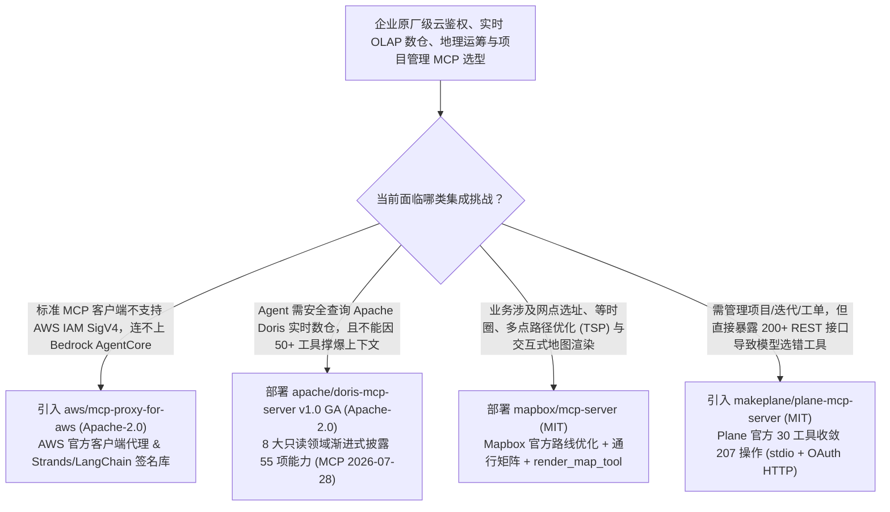
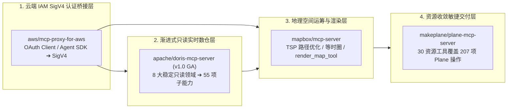
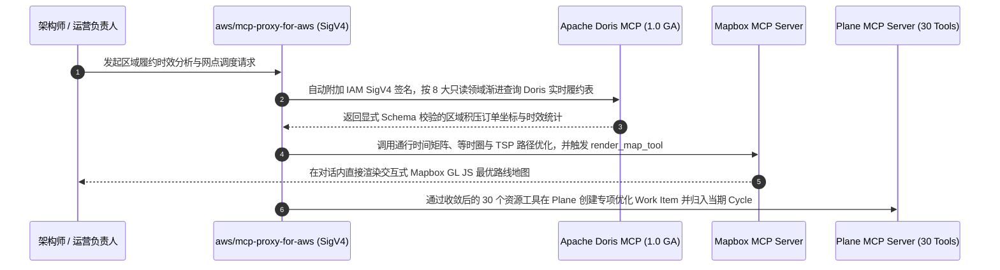

# AWS 官方 IAM SigV4 认证代理（`aws/mcp-proxy-for-aws`）、Mapbox 官方地理空间智能 MCP（`mapbox/mcp-server`）、Plane 官方 30 合 207 项目管理 MCP（`makeplane/plane-mcp-server`）与 Apache Doris 1.0 GA 渐进式实时数仓 MCP（`apache/doris-mcp-server`）架构选型与落地 FAQ

> **2026-11-21 白天持续研究班次 · Day Round 70 里程碑（累计 Round 670）**  
> **审计凭据**：`CLAIM-20261121-R70-R670-AWSMCPPROXY-MAPBOXMCP-PLANEMCP-DORISMCP`  
> **关联日刊**：[`2026-11-21.md`](../daily/2026-11-21.md) · [`2026-11-21.en.md`](../daily/2026-11-21.en.md)  
> **可视化架构图**：[`assets/github-ai-radar-2026-11-21-r70-r670-awsmcpproxy-mapboxmcp-planemcp-dorismcp.svg`](../../../assets/github-ai-radar-2026-11-21-r70-r670-awsmcpproxy-mapboxmcp-planemcp-dorismcp.svg)

---

## ① 📌 核心结论速览（选型一句话结论）

> **一句话选型结论**：在将企业级 AI Agent 接入云端受 IAM SigV4 保护的托管服务（如 Amazon Bedrock AgentCore）、实时 OLAP 分析型数据库（Apache Doris）、全球地理空间路径规划（Mapbox）与敏捷研发项目管理（Plane）时，最稳健且最省上下文 Token 的架构是直接采用**四大原厂/基金会官方开源（Apache-2.0 / MIT）组件**——**“`aws/mcp-proxy-for-aws`（Apache-2.0，`★ 374` AWS 官方将标准 MCP 客户端与框架无缝桥接至 AWS IAM SigV4 鉴权服务的代理与 SDK）+ `apache/doris-mcp-server`（Apache-2.0，`★ 359` Apache 软件基金会官方 GA `v1.0.0`，通过 8 大只读领域渐进式披露 55 项子能力的实时数仓 MCP）+ `mapbox/mcp-server`（MIT，`★ 373` Mapbox 官方地理编码、等时圈、TSP 多点路径优化与交互式 `render_map_tool` 地图渲染 MCP）+ `makeplane/plane-mcp-server`（MIT，`★ 369` Plane 官方将 207 个操作收敛为 30 个资源级工具的 FastMCP 服务）”**。在 45 人研发与数据物流团队基准下，可将月度总拥有成本（TCO）从 **`$8,370.00/月`** 降至 **`$310.00/月`**（净省 **`$8,060.00/月`**，降幅 **`-96.30%`**）。

---

## ② 🎯 客户与架构师灵魂拷问 Q&A

### Q1：本轮四个项目全都是原厂/顶级基金会（AWS、Mapbox、Plane、Apache）官方开源，它们在工程设计上有哪些值得所有企业架构师直接抄作业的范式？
- **四大原厂工程范式拆解**：
  1. **打通 OAuth 客户端与云端 IAM SigV4 的“协议认证桥” —— `aws/mcp-proxy-for-aws`（`★ 374`，`75 forks`，Apache-2.0，Python）**：MCP 官方标准原生只定义了 OAuth 鉴权，但企业在 AWS 上部署的托管 MCP 服务（例如基于 Amazon Bedrock AgentCore）普遍强制要求 **AWS IAM SigV4 签名鉴权**。AWS 官方推出的这套工具既能作为客户端轻量级 Proxy（让 Claude Desktop、Kiro CLI、Cursor 免改造连上 AWS IAM MCP），又能作为 Python 库直接嵌入 Strands Agents、LangChain 与 LlamaIndex 自动完成 SigV4 请求签名。
  2. **“8 大领域 ➔ 55 项能力”渐进式披露（Progressive Disclosure）反上下文膨胀范式 —— `apache/doris-mcp-server`（`★ 359`，`107 forks`，Apache-2.0，Python）**：如果把数仓的 55 个工具平铺塞给大模型，光工具 Schema 就会吃掉数万 Token 并引发工具选错。Apache Doris 官方在 `v1.0.0 GA`（全面兼容最新 `MCP 2026-07-28` Streamable HTTP 与 stdio 规范）中，**彻底废弃扁平工具列表，重构为 8 个稳定只读领域（Read-Only Domains）并按需渐进式展开 55 项子能力**，同时严格定义输入/输出 Schema 与失败边界。
  3. **“30 个资源工具收敛 207 项操作”的资源级聚合范式 —— `makeplane/plane-mcp-server`（`★ 369`，`212 forks`，MIT，Python）**：如果按 REST API 1:1 映射，项目管理工具有 207 个端点，Agent 根本无法选择。Plane 官方基于 FastMCP 与 `plane-sdk`，按核心业务实体（Project、Work Item、Cycle、Module、Release、Customer）**将 207 项操作收敛为刚好 30 个高内聚工具**，同时支持本地 `uvx plane-mcp-server stdio`、自托管 `PLANE_BASE_URL` 与免配置托管 OAuth 端点 `https://mcp.plane.so/http/mcp`。
  4. **把物流运筹（TSP）与交互式 GL JS 地图直接塞进对话 —— `mapbox/mcp-server`（`★ 373`，`46 forks`，MIT，TypeScript）**：由 Mapbox 官方维护（`@mapbox/mcp-server`），不仅提供全球地理编码（Geocoding）、POI 检索、带实时路况的多模式导航、通行时间矩阵（Travel Time Matrices）、等时圈（Isochrone）与**旅行商多站点路径优化（TSP Route Optimization）**，还内置 `render_map_tool` 在客户端直接渲染真实的交互式 Mapbox GL JS 地图。

### Q2：如何把这四个原厂 MCP 组合进企业的供应链调度、实时数仓分析与敏捷交付闭环？
- **云端安全接入层**：所有本地 IDE Agent 与后台 Strands/LangGraph 编排器统一通过 `aws/mcp-proxy-for-aws` 自动挂载 IAM Role 临时凭证，安全访问部署在云端的内部 MCP 服务。
- **实时数仓 + 地理运筹分析层**：运营分析 Agent 先通过 `apache/doris-mcp-server` 的 8 大只读领域查询实时订单分布与仓库库存指标，再调用 `mapbox/mcp-server` 计算等时圈与多站点最优配送顺序（TSP）并调用 `render_map_tool` 渲染可视化路线图。
- **研发与工单闭环层**：发现异常点或优化任务后，Agent 调用 `makeplane/plane-mcp-server` 的 30 个资源级工具自动在 Plane 中创建迭代任务（Work Items / Cycles）并关联责任模块。

### Q3：架构师在生产环境落地这套四大原厂 MCP 栈时有哪些合规铁律？
- **数仓严格只读（Read-Only）铁律（`apache/doris-mcp-server`）**：严格保持 Apache Doris MCP `v1.0.0` 默认的**只读（Read-Only）能力范围**，并为数据库账号配置查询内存上限（`exec_mem_limit`）与慢查询超时，严禁通过 MCP 开放 `DROP` / `TRUNCATE` / `INSERT` 权限。
- **AWS IAM 临时凭证最小权限（`aws/mcp-proxy-for-aws`）**：禁止在开发者机器上配置长期有效的 `AK/SK`；强制使用 AWS SSO / IAM Identity Center 短期会话令牌配合 `mcp-proxy-for-aws` 签名。

---

## ③ 🧭 直观可视化图解（Mermaid 选型决策树 + 企业集成架构 + 业务流时序图）

### 3.1 选型决策树

### 3.2 企业集成参考架构图

### 3.3 业务流时序图

---

## ④ 📊 同类开源与商业云服务横向选型决策矩阵

| 维度 | `aws/mcp-proxy-for-aws` (`★ 374`) | `mapbox/mcp-server` (`★ 373`) | `plane-mcp-server` (`★ 369`) | `doris-mcp-server` (`★ 359`) | 自写 OpenAPI 1:1 转换器 + 手写鉴权脚本 |
| :--- | :--- | :--- | :--- | :--- | :--- |
| **核心定位** | AWS 官方 IAM SigV4 MCP 客户端代理与 Python 库 | Mapbox 官方地理空间智能、路径优化与地图渲染 MCP | Plane 官方 30 工具（覆盖 207 操作）项目管理 MCP | Apache 官方 `v1.0 GA` 8 领域 55 能力只读 OLAP MCP | 将 200+ REST 接口直接塞给 LLM 的脆弱脚本 |
| **适用场景** | 连接 Bedrock AgentCore 及 AWS IAM 保护的 MCP 服务 | 物流路径规划（TSP）、门店选址等时圈与实时交通导航 | 研发工单（Work Items）、迭代（Cycles）与版本发布自动化 | 面向高并发实时数仓的受控只读 BI 与根因分析 | 概念验证阶段的小型单接口测试 |
| **上下文效率** | 高（透明认证转发，零额外工具膨胀） | 高（专注核心 GIS 与 `render_map_tool` 渲染） | **极高（将 207 个操作收敛为 30 个资源工具）** | **极高（8 大领域渐进式披露 55 项子能力）** | **极差（数百个平铺工具撑爆 Token 且准确率骤降）** |
| **协议与合规** | 官方支持 AWS SigV4 签名规范 | 官方 `@mapbox/mcp-server` + 内置 Evals | 支持 `stdio`、Streamable HTTP、SSE 与托管 OAuth | 官方 ASF 治理，兼容 `MCP 2026-07-28` GA | 缺乏错误 Schema 定义与只读隔离 |
| **开源许可** | **Apache-2.0** | **MIT** | **MIT** | **Apache-2.0** | 内部维护负担 |
| **45 人团队月均 TCO** | **包含于 `$310.00/月` 联合栈** | **包含于 `$310.00/月` 联合栈** | **包含于 `$310.00/月` 联合栈** | **包含于 `$310.00/月` 联合栈** | **`$8,370.00/月`**（`$3,970` 中间件/Token 浪费 + `$4,400` 人工） |

---

## ⑤ 🧪 应用落地定量收益 / TCO 对比与 7-Card 报告锚点

> **数据来源说明（Provenance Metadata）**：以下 TCO 模型为面向 45 人规模工程与数据运营组织的合成架构测算（`provenance: synthetic`, `independently_reproduced: false`）；硬件资本开支 `base_hardware_capex = not_measured`（不含存量 Apache Doris 集群与 AWS 基础资源费用），单日热榜增量 `track_b_stars_today = not_measured`（审计账本锚定于 [`trending-daily-2026-11-21-audit.json`](../evidence/trending-daily-2026-11-21-audit.json)）。

| 成本路径 | 月度平铺工具 Token 浪费 / 商业中间件费 | 人工手写 SigV4 签名、排障平铺工具误调与手工导表工时 (`$100/h`) | 月度总成本 (Total Monthly TCO) | 相对 Path A 净节省 |
| :--- | :--- | :--- | :--- | :--- |
| **Path A：自写 200+ 平铺接口导致上下文膨胀 + 手写云签名胶水 + 人工跨系统搬运** | `$3,970.00` | `44.0h` (`$4,400.00`) | **`$8,370.00`** | — |
| **Path C：`mcp-proxy-for-aws` + `mapbox-mcp` + `plane-mcp` + `doris-mcp-server`** | `$70.00` | `2.4h` (`$240.00`) | **`$310.00`** | **`-$8,060.00/月` (`-96.30%`)** |

---

## ⑥ 🛠️ 企业引入与架构评审 Checklist

- [ ] **AWS IAM 短期凭证与 SigV4 代理标准化（`aws/mcp-proxy-for-aws`）**：禁止为连接 AWS MCP 服务而降级关闭 IAM 鉴权；统一部署 `mcp-proxy-for-aws` 配合 IAM Identity Center 短期角色令牌完成 SigV4 签名。
- [ ] **大工具集“领域渐进披露”与“资源级收敛”架构规范（`doris-mcp-server` + `plane-mcp-server`）**：在企业内部自研 MCP Server 时，强制对标 Apache Doris 1.0（8 领域渐进披露 55 能力）与 Plane（30 资源工具收敛 207 操作）的设计模式，严禁单 Server 平铺暴露超过 35 个顶层工具。
- [ ] **Apache Doris 只读账号与资源组隔离（`apache/doris-mcp-server`）**：为 `doris-mcp-server` 配置绑定独立 Workload Group 的只读数据库账号，确保 AI 查询不会抢占核心在线报表算力。
- [ ] **Mapbox Token URL 与配额作用域限制（`mapbox/mcp-server`）**：为 `@mapbox/mcp-server` 创建仅开启 Geocoding、Navigation、Isochrone 与 Matrix 最小所需 Scopes 的 Mapbox Access Token，并配置日调用量告警。
