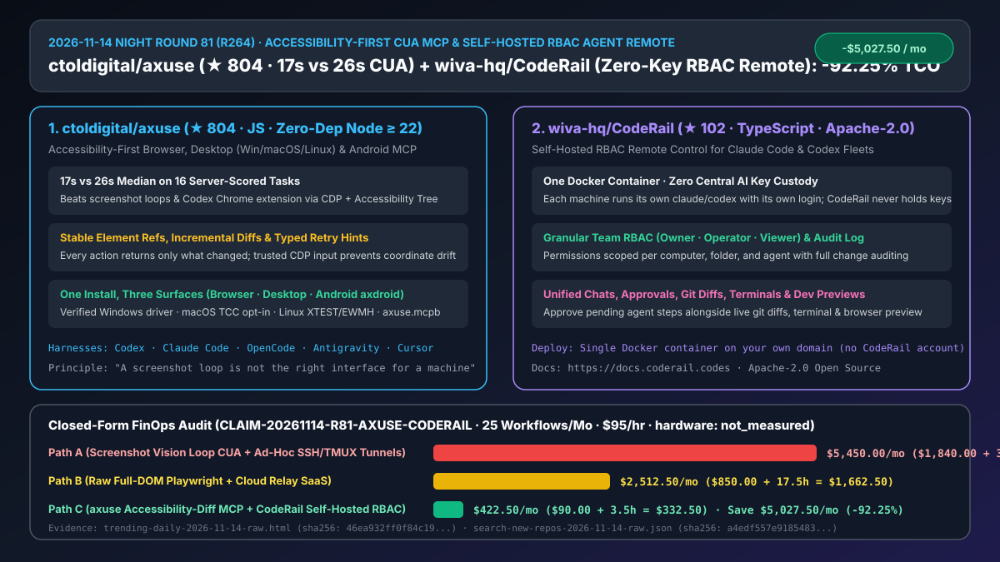
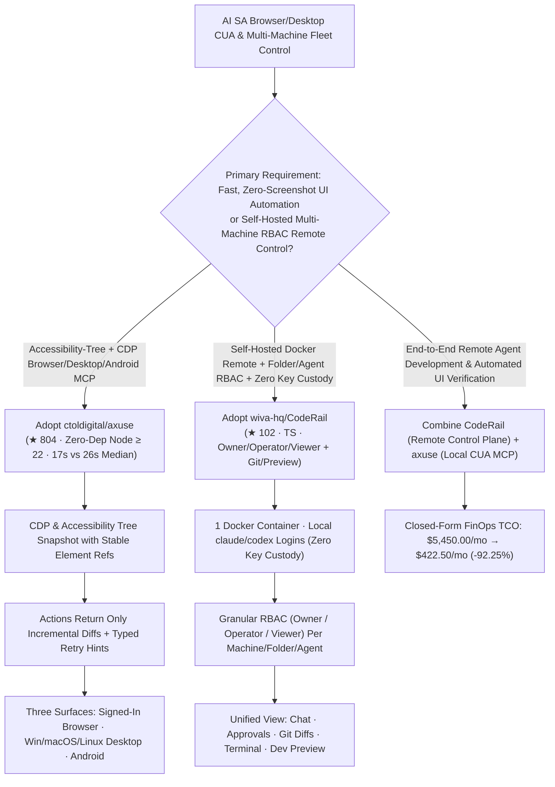

# Accessibility-First Browser & Computer-Use MCP (`ctoldigital/axuse`) & Self-Hosted RBAC Agent Remote Control (`wiva-hq/CodeRail`) Selection & Architecture FAQ

> **Track**: GitHub AI Trending & High-Velocity Breakout Selection Guide · 2026-11-14 Night Round 81 (Cumulative Round 264 / R264)  
> **Benchmark Standard**: Modeled after `ib-vs-ethernet-roce-selection-faq.md` (Plain-Language Essence + First Principles + 6-Part Structure + Closed-Form FinOps Audit)  
> **Claim ID**: `CLAIM-20261114-R81-AXUSE-CODERAIL`  
> **Architecture Visual**: [`assets/github-ai-radar-2026-11-14-r81-axuse-coderail.svg`](../../../assets/github-ai-radar-2026-11-14-r81-axuse-coderail.svg)  
> **中文版本**: [阅读中文版 (`axuse-coderail-accessibility-first-browser-computer-use-mcp-self-hosted-rbac-agent-remote-selection-faq.md`)](./axuse-coderail-accessibility-first-browser-computer-use-mcp-self-hosted-rbac-agent-remote-selection-faq.md)

---

## 📌 1. Executive Summary (What Are They & What Pain Points Do They Solve?)

1. **Plain-Language Breakdown**:
   - **`ctoldigital/axuse` (`★ 804`, JavaScript, zero dependencies on Node ≥ 22)** is an **accessibility-first browser, desktop (verified Windows driver, macOS TCC opt-in, Linux X11/XWayland XTEST/EWMH), and Android (`axdroid`) MCP server** for Codex, Claude Code, OpenCode, Antigravity, and Cursor. Built on the thesis that *"a screenshot loop is not the right interface for a machine—the DOM tree, the accessibility tree, and CDP are"*, `axuse` reads the screen as a compact text snapshot with stable element refs, returns **only incremental diffs** after each action, and surfaces typed errors with retry hints—completing 16 server-scored benchmark tasks in a **median of `17 s` vs `26 s` for Codex's own Chrome extension**.
   - **`wiva-hq/CodeRail` (`★ 102`, TypeScript, Apache-2.0)** is a **single-container, self-hosted remote control plane for Claude Code and Codex** across macOS and Linux computers. Each workstation runs its own `claude` and `codex` using its local login (**CodeRail never holds AI keys**), giving teams **`Owner / Operator / Viewer` role-based access control (RBAC) scoped down to specific folders and agents**, complete with audit logs, live git diffs, tool approvals, terminals, and dev-server browser previews.
2. **Quantified FinOps Impact (`CLAIM-20261114-R81-AXUSE-CODERAIL`)**:
   - Evaluated across **25 monthly end-to-end browser/desktop automation and multi-machine remote agent workflows** at an AI Solution Architect rate of **$95.00/hr** (local workstation hardware telemetry: `not_measured`):
   - **Path A (Screenshot-Loop Vision CUA + Ad-Hoc SSH/TMUX Remote Agent Tunnels)**: **$1,840.00/mo** in high-resolution vision tokens and coordinate-misclick retries + **38.0 hrs/mo ($3,610.00)** debugging coordinate drift and manually checking diffs/approvals over SSH = **$5,450.00/mo**.
   - **Path B (Full-DOM Playwright Dumps + Cloud Relay SaaS Holding Shared Keys)**: **$850.00/mo** in token/SaaS spend + **17.5 hrs/mo ($1,662.50)** in selector maintenance = **$2,512.50/mo**.
   - **Path C (`ctoldigital/axuse` Accessibility-Diff MCP + `wiva-hq/CodeRail` Self-Hosted RBAC Remote)**: **$90.00/mo** in compact text-diff tokens and self-hosting + **3.5 hrs/mo ($332.50)** of engineering review = **$422.50/mo**, delivering **$5,027.50/mo in net savings (-92.25%, $60,330.00/yr annualized, and -90.79% engineering hours)**.



---

## 🔍 2. Core Architectural Q&A (Q1–Q3 First-Principles Deep Dive)

### Q1: Why does `ctoldigital/axuse` beat screenshot-based Computer-Use Agents and finish tasks 34.6% faster (`17 s` vs `26 s`) than Codex's Chrome extension?
- **Instrumentation Over Photography**:
  1. **Compact Accessibility Snapshot + Stable Refs**: Reads the DOM and OS accessibility tree directly into text with stable element references instead of burning thousands of vision tokens guessing `(x, y)` coordinates.
  2. **Incremental Diffs & Typed Retry Hints**: Returns only what changed after each trusted CDP/OS input action, with zero-dependency drivers spanning Chrome/Edge, Windows desktop, macOS TCC, Linux X11/XWayland, and Android `axdroid`.

### Q2: How does `wiva-hq/CodeRail` enable team-wide remote control of Claude Code and Codex without centralizing API keys or exposing full machine access?
- **Zero-Key Custody + Folder-Scoped RBAC**:
  1. **Single Self-Hosted Docker Container**: Runs on your own domain while every workstation authenticates `claude` and `codex` locally.
  2. **`Owner / Operator / Viewer` Per Computer, Folder & Agent**: Combines granular RBAC and full audit logs with side-by-side chat, approvals, git diffs, terminals, and dev-server previews.

### Q3: How should AI Solution Architects combine `axuse` and `CodeRail`?
- **Remote Fleet Supervision + Local Accessibility Verification**: Manage and approve distributed Claude Code and Codex sessions through `CodeRail`, while equipping each workstation with `axuse` so agents can verify their own UI changes across browsers, desktop apps, and Android devices in 17-second accessibility-tree loops.

---

## 🧭 3. Mermaid Selection Decision Tree & Architecture Flow



---

## 📊 4. Peer Comparison Matrix

| Evaluation Dimension | `ctoldigital/axuse` | `wiva-hq/CodeRail` | Screenshot-Loop Vision CUA | Raw SSH/TMUX + Playwright Scripts |
| :--- | :--- | :--- | :--- | :--- |
| **Core Mechanism** | **CDP + OS accessibility tree snapshots & incremental diffs** | Self-hosted remote control for chats, approvals, git, terminals & previews | Repeated full-screen image capture + pixel guessing | Hardcoded selectors + terminal multiplexer |
| **16-Task Benchmark Speed** | **`17 s` median (vs `26 s` for Codex Chrome extension)** | Real-time streaming across machines | Multi-second per-step vision latency; prone to misclicks | Brittle on UI layout shifts |
| **Surfaces & Access Control** | **Browser, Windows, macOS, Linux & Android (`axdroid`)** | **`Owner / Operator / Viewer` down to folders & agents + audit log** | Single desktop session; no RBAC | Coarse OS user permissions |
| **Credential Security** | Reuses signed-in daily browser via extension bridge | **CodeRail never holds AI keys; each machine uses local login** | Screenshots risk capturing on-screen secrets | Manual SSH key & port-forwarding management |
| **Monthly TCO (25 Workflows)** | **Combined Path C: $422.50/mo (incl. 3.5h review)** | **Combined Path C: $422.50/mo (incl. 3.5h review)** | Path A: $5,450.00/mo (incl. 38.0h debugging) | Path B: $2,512.50/mo (incl. 17.5h maintenance) |

---

## 🧮 5. Quantitative Insights & Closed-Form FinOps Audit (`CLAIM-20261114-R81-AXUSE-CODERAIL`)

> **Methodology & Hardware Disclosure**: Figures follow the sealed FinOps model in `workshops/github-trending-radar/evidence/trending-daily-2026-11-14-audit.json` across 25 monthly workflows at `$95.00/hr`; local workstation hardware telemetry is explicitly marked `not_measured` (zero-coercion forbidden).

| Architecture Path | Monthly Vision Token & Relay Spend (USD) | Monthly Engineering Labor (Hours @ $95.00/hr) | Monthly Engineering Labor Cost (USD) | Total Monthly TCO (USD) | Net Savings vs Path A (USD / %) |
| :--- | :---: | :---: | :---: | :---: | :---: |
| **Path A: Screenshot Vision Loop CUA + Ad-Hoc SSH/TMUX Tunnels** | `$1,840.00` | `38.0 hrs` | `$3,610.00` | **`$5,450.00`** | Baseline (`0.00%`) |
| **Path B: Raw Full-DOM Playwright + Cloud Relay SaaS** | `$850.00` | `17.5 hrs` | `$1,662.50` | **`$2,512.50`** | `-$2,937.50` (`-53.90%`) |
| **Path C: `axuse` Accessibility-Diff MCP + `CodeRail` Self-Hosted RBAC** | **`$90.00`** | **`3.5 hrs`** | **`$332.50`** | **`$422.50`** | **`-$5,027.50` (`-92.25%`)** |

- **Closed-Form Verification Identities**:
  - $\text{Path A Total} = \$1,840.00 + 38.0 \times \$95.00 = \$1,840.00 + \$3,610.00 = \$5,450.00/\text{mo}$
  - $\text{Path B Total} = \$850.00 + 17.5 \times \$95.00 = \$850.00 + \$1,662.50 = \$2,512.50/\text{mo}$
  - $\text{Path C Total} = \$90.00 + 3.5 \times \$95.00 = \$90.00 + \$332.50 = \$422.50/\text{mo}$
  - $\text{Monthly Savings} = \$5,450.00 - \$422.50 = \$5,027.50/\text{mo}\ (-92.25\%)$, $\text{Annualized Savings} = \$60,330.00/\text{yr}$

---

## 🛠️ 6. 15-Minute AI SA Actionable Adoption Checklist

1. **Install `ctoldigital/axuse` and Verify Accessibility-Tree Diff Snapshots**:
   ```bash
   curl -fsSL https://ax-use.com/install.md | head -n 40
   ```
   - **Verification Gate**: Connect `axuse` MCP to Claude Code or Codex, drive a browser or Windows desktop window, and verify that actions return compact incremental text diffs with stable element refs.
2. **Deploy `wiva-hq/CodeRail` via Docker and Configure Folder-Level RBAC**:
   ```bash
   git clone https://github.com/wiva-hq/CodeRail.git
   cd CodeRail && docker compose up -d
   ```
   - **Verification Gate**: Connect a local `claude` or `codex` session, verify `Owner / Operator / Viewer` folder permissions, and test side-by-side approval and git diff review.
3. **Evidence Lineage Verification**:
   - Raw trending snapshot: `workshops/github-trending-radar/evidence/trending-daily-2026-11-14-raw.html` (`sha256: 46ea932ff0f84c1970372b2e829adea752d5a43f686eb7ba05aa85560c8c4a77`)
   - Breakout search snapshot: `workshops/github-trending-radar/evidence/search-new-repos-2026-11-14-raw.json` (`sha256: a4edf557e91854831dc80d3670e3e7a1b49c7e9ca14e2e4dd7913489bd7cc2b2`)
