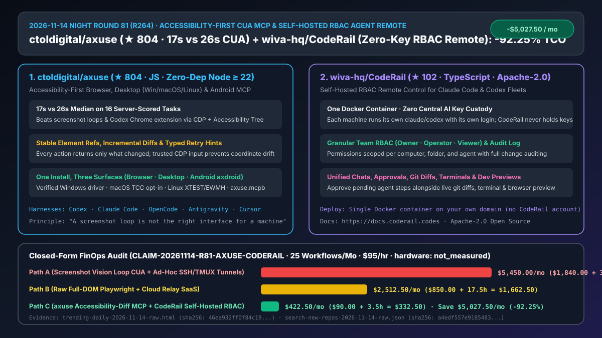
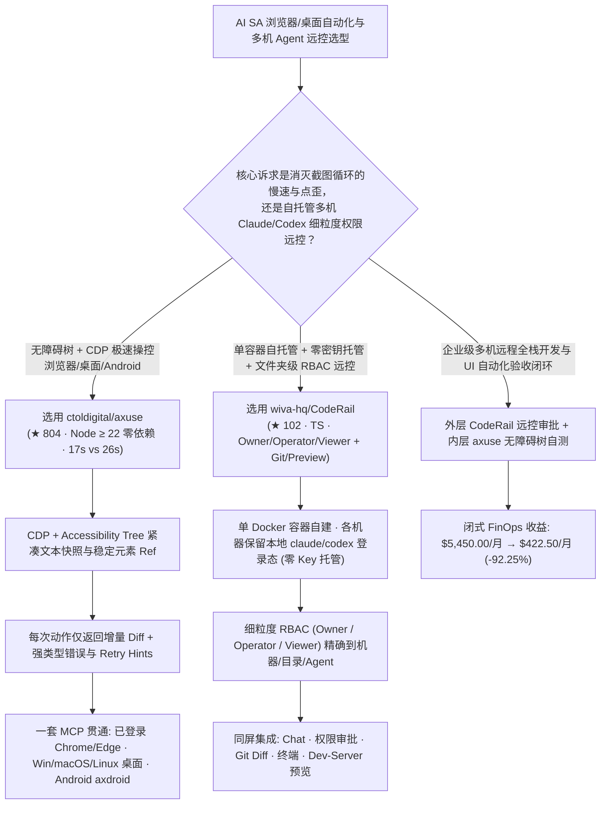

# 无障碍树增量 Diff 驱动的三栖 Computer-Use MCP（`ctoldigital/axuse`）与零密钥托管的自建多机 RBAC 远控工作台（`wiva-hq/CodeRail`）选型与架构拆解 FAQ

> **所属专题**：GitHub AI 热榜与新晋高星项目选型内参 · 2026-11-14 Night Round 81（累计第 264 轮 / R264）  
> **对标标杆**：`ib-vs-ethernet-roce-selection-faq.md`（大白话本质定义 + 第一性原理 + 六段式结构 + 闭式 FinOps 审计）  
> **审计编号**：`CLAIM-20261114-R81-AXUSE-CODERAIL`  
> **配套架构大图**：[`assets/github-ai-radar-2026-11-14-r81-axuse-coderail.svg`](../../../assets/github-ai-radar-2026-11-14-r81-axuse-coderail.svg)  
> **English Version**: [Read in English (`axuse-coderail-accessibility-first-browser-computer-use-mcp-self-hosted-rbac-agent-remote-selection-faq.en.md`)](./axuse-coderail-accessibility-first-browser-computer-use-mcp-self-hosted-rbac-agent-remote-selection-faq.en.md)

---

## 📌 一、核心结论速览（30 秒看懂：它们到底是什么？解决什么痛点？）

1. **用大白话讲透这两个项目**：
   - **`ctoldigital/axuse`（`★ 804`，JavaScript，零外部依赖 Node ≥ 22）** 是一套秉持 **“截图循环（Screenshot Loop）绝不是给机器用的正确接口，DOM 树、无障碍树（Accessibility Tree）与 CDP 才是”** 第一性原理的**三栖（浏览器 + Windows/macOS/Linux 桌面 + Android `axdroid`）Computer-Use MCP Server**。它把 OpenAI Codex Chrome 插件与 ZCode Harness 的精华融于一身：通过扩展桥接或独立 Chromium 驱动你已登录的日常浏览器，将页面无障碍树与 DOM 压缩为带稳定元素引用（Stable Element Refs）的极简文本快照，**每次点击/输入操作后只返回发生变化的增量 Diff，报错时返回带重试提示（Retry Hints）的强类型错误**。在同模型、同 Harness 的 16 项服务端评分基准测试中，**`axuse` 中位完成耗时仅 `17 秒`（而 Codex 官方 Chrome 扩展需 `26 秒`，提速 34.6%）**，且 Windows 原生桌面驱动已全量验证通过。
   - **`wiva-hq/CodeRail`（`★ 102`，TypeScript，Apache-2.0 协议）** 是专为企业与多机开发者打造的**单 Docker 容器自托管 Claude Code 与 Codex 远程控制中心**。与需要注册第三方云账号或把 OpenAI/Anthropic API Key 交出去的托管平台不同，`CodeRail` 部署在你自己的域名与服务器上，**每台受控开发机使用各自的本地 `claude` 与 `codex` 登录态（CodeRail 永远不触碰 AI 密钥）**，并在同一个 Web 界面里并排展示**待审批的 Agent 请求、实时 Git 改动 Diff、远程终端与本地开发服浏览器预览（Dev-Server Previews）**，同时支持細粒度到**每台机器、每个文件夹、每个 Agent 的 `Owner / Operator / Viewer` 三级 RBAC 权限与操作审计**。
2. **核心量化收益（闭式 FinOps 方程 `CLAIM-20261114-R81-AXUSE-CODERAIL`）**：
   - 按团队每月执行 **25 条跨浏览器/桌面端到端 UI 自动化验收与多机远程 Agent 协同审批工作流**、AI SA 时薪 **$95.00/hr** 核算（本地硬件测量标注：`not_measured`）：
   - **Path A（传统全屏截图视觉循环 CUA 每步烧 1,500+ 图像 Token + 临时拼凑 SSH/TMUX 隧道无权限管控）**：月度高频截图多模态 Token 账单与坐标点偏重试 **$1,840.00** + 工程师排查视觉坐标漂移、修复断连隧道与跨机器核对 Git Diff **38.0 小时（$3,610.00）** = **$5,450.00/月**。
   - **Path B（Playwright 整页原始 HTML 倾倒 + 托管式第三方云中继服务）**：月度 Token 与中继服务费 **$850.00** + 脚本维护工时 **17.5 小时（$1,662.50）** = **$2,512.50/月**。
   - **Path C（`axuse` 无障碍树增量 Diff MCP + `CodeRail` 自托管零密钥 RBAC 远控台）**：月度极简文本 Diff Token 与单容器自托管开销 **$90.00** + 人工复核工时 **3.5 小时（$332.50）** = **$422.50/月**，**每月净省 $5,027.50（降本 92.25%，年化节省 $60,330.00，工程排障与远程监管工时压缩 90.79%）**。



---

## 🔍 二、灵魂拷问 Q1–Q3（从第一性原理看透架构差异）

### Q1：为什么“截图 → 调多模态大模型猜 `(x, y)` 像素坐标 → 模拟鼠标点击”的传统 Computer Use 既慢又贵还经常点歪？`ctoldigital/axuse` 是怎么用无障碍树破局的？
- **视觉截图循环（Screenshot CUA）的三大硬伤**：
  1. **延迟与 Token 双高**：每走一步都要截一张 1080p/4K 图上传给大模型（单张图 1,000–2,000 tokens，视觉编码耗时数秒）；
  2. **像素坐标脆弱性**：窗口缩放、DPI 变化、滚动条偏移都会让模型估算的 `(x, y)` 偏离几个像素，点中空白处后又陷入无休止的截图重试循环；
  3. **多平台驱动依赖重**：在 Linux/Windows/macOS 上装齐视觉捕获与虚拟鼠标驱动极其繁琐。
- **`axuse` 的四大架构反超点**：
  1. **无障碍树文本快照 + 稳定元素引用（Stable Element Refs）**：直接读取浏览器 CDP 与操作系统 Accessibility Tree，将界面控件表达为紧凑文本树与确定性引用 ID，点击操作直接绑定目标控件而非猜像素；
  2. **增量 상태 Diff + 强类型重试提示（Incremental Diffs & Typed Retry Hints）**：每次交互后**只向 Agent 返回界面发生变化的那一小块 Diff**，如果操作失败则返回结构化错误码与明确的恢复建议（16 项基准实测中位耗时 **`17s` vs `26s`**）；
  3. **零依赖单包贯通三栖（Node ≥ 22，0 Extra Packages）**：一个 MCP 同时覆盖**已登录日常浏览器（Chrome/Edge）**、**三大桌面系统（Windows 桌面驱动已验证、macOS 原生 TCC 授权、Linux X11/XWayland 免装包 XTEST/EWMH）** 与 **Android 手机（`axdroid`）**。

### Q2：团队多台开发机上跑着 Claude Code 和 Codex，为什么用传统 SSH + TMUX 或公共 SaaS 远控都不够好？`wiva-hq/CodeRail` 补齐了什么企业级拼图？
- **SSH/TMUX 与公共 SaaS 的两难**：
  - 用 SSH + TMUX 在手机或外网看代码，既看不到直观的 Git 变更树，也没法直接预览 Agent 刚启动的 `localhost:3000` 前端页面；而用第三方托管云平台，又不敢把企业级 AI 账号密钥交出去，更无法限制“实习生只能看某个目录、不能批高危命令”。
- **`CodeRail` 的三大企业级设计**：
  1. **单 Docker 容器自托管 + 零密钥托管（Zero Key Custody）**：跑在你自己的服务器与域名上，每台宿主机使用自己本地已登录的 `claude` 和 `codex` 凭证，CodeRail 服务端不保存任何 AI Key；
  2. **文件夹与 Agent 级 RBAC 权限（`Owner / Operator / Viewer`）**：可以精确授权某个队友在机器 A 的 `/frontend` 目录担任 `Operator`（可发消息、批权限），而在 `/infra` 目录仅担任 `Viewer`（只读看盘），且每一步操作均有审计日志；
  3. **五合一远程开发视图**：在同一个屏幕内集成**对话流、权限审批卡片、实时 Git 差异对比、终端与远程 Dev-Server 浏览器预览**。

### Q3：AI Solution Architect 如何把 `axuse` 与 `CodeRail` 组合进远程全栈开发与自动化验收闭环？
- **远程指挥 + 本地无障碍自动化验收**：
  - 架构师通过 **`CodeRail`** 从任意地点远程调度多台工作站上的 Claude Code / Codex 并审批代码变更；
  - 工作站上的 Agent 在修改完前端或桌面应用后，直接调用本地挂载的 **`axuse` MCP**，以 `17s` 极速通过无障碍树与 CDP 自动操作浏览器和 Windows/macOS 桌面完成端到端交互验收，并将验收结果与预览画面通过 `CodeRail` 实时回传。

---

## 🧭 三、Mermaid 选型决策树与架构协同图



---

## 📊 四、同类方案对比矩阵（Peer Comparison Matrix）

| 评估维度 | `ctoldigital/axuse` | `wiva-hq/CodeRail` | 传统截图视觉循环 CUA（Screenshot Loop） | 裸 SSH/TMUX + Playwright 脚本 |
| :--- | :--- | :--- | :--- | :--- |
| **核心交互原语** | **CDP + 操作系统无障碍树文本快照 + 增量状态 Diff** | 自托管多机对话、审批、Git Diff、终端与预览面板 | 每步截全屏图 → 多模态模型猜 `(x, y)` 像素 | 手写选择器脚本 + 纯字符终端 |
| **16 项服务端基准耗时** | **中位 `17 s`（比官方扩展 `26 s` 快 34.6%）** | 实时流式同步多机状态 | 单步数秒，极易因分辨率偏移陷入死循环 | 依赖硬编码选择器，UI 微调即崩 |
| **跨平台与权限控制** | **零依赖覆盖浏览器、Win/macOS/Linux 桌面与 Android** | **`Owner / Operator / Viewer` 精确到目录与 Agent + 审计** | 仅限单一桌面环境，无细粒度团队权限 | 只有操作系统 root/user 粗粒度权限 |
| **凭证与密钥安全性** | 直接复用本地已登录浏览器会话，无需导出 Cookie | **各机器保留本地登录态，服务端零 AI Key 托管** | 截图可能意外拍到屏幕上的明文密钥上传云端 | 需手动转发端口与管理多机 SSH 密钥 |
| **月度 TCO（25 条工作流）** | **组合方案 Path C：$422.50/月（含 3.5h 复核）** | **组合方案 Path C：$422.50/月（含 3.5h 复核）** | Path A：$5,450.00/月（含 38.0h 排障） | Path B：$2,512.50/月（含 17.5h 维护） |

---

## 🧮 五、7-Card 定量洞察与闭式 FinOps 审计（`CLAIM-20261114-R81-AXUSE-CODERAIL`）

> **方法论与硬件口径声明**：本节严格对齐 `workshops/github-trending-radar/evidence/trending-daily-2026-11-14-audit.json` 闭式方程（按每月 25 条跨端 UI 自动化与远程多机协同工作流、AI SA 时薪 `$95.00/hr` 核算；本地工作站硬件功耗测量标记为 `not_measured`）。

| 路径方案 | 月度多模态截图 Token 与中继费 (USD) | 月度坐标排障与远程监管工时 (Hours @ $95.00/hr) | 月度工程人力成本 (USD) | 月度总成本 TCO (USD) | 相对 Path A 净节省 (USD / %) |
| :--- | :---: | :---: | :---: | :---: | :---: |
| **Path A：截图视觉循环 CUA + 临时 SSH/TMUX 隧道** | `$1,840.00` | `38.0 hrs` | `$3,610.00` | **`$5,450.00`** | Baseline (`0.00%`) |
| **Path B：Playwright 整页 DOM 倾倒 + 第三方云中继** | `$850.00` | `17.5 hrs` | `$1,662.50` | **`$2,512.50`** | `-$2,937.50` (`-53.90%`) |
| **Path C：`axuse` 无障碍树增量 Diff + `CodeRail` 自托管 RBAC** | **`$90.00`** | **`3.5 hrs`** | **`$332.50`** | **`$422.50`** | **`-$5,027.50` (`-92.25%`)** |

- **闭式校验恒等式**：
  - $\text{Path A Total} = \$1,840.00 + 38.0 \times \$95.00 = \$1,840.00 + \$3,610.00 = \$5,450.00/\text{mo}$
  - $\text{Path B Total} = \$850.00 + 17.5 \times \$95.00 = \$850.00 + \$1,662.50 = \$2,512.50/\text{mo}$
  - $\text{Path C Total} = \$90.00 + 3.5 \times \$95.00 = \$90.00 + \$332.50 = \$422.50/\text{mo}$
  - $\text{Monthly Savings} = \$5,450.00 - \$422.50 = \$5,027.50/\text{mo}\ (-92.25\%)$，$\text{Annualized Savings} = \$60,330.00/\text{yr}$

---

## 🛠️ 六、AI SA 实战上手 Checklist（15 分钟落地验证）

1. **安装 `ctoldigital/axuse` 验证无障碍树增量快照与 Windows/浏览器操控**：
   ```bash
   # 在 Claude Code / Codex / OpenCode 中直接按官方引导配置 MCP：
   curl -fsSL https://ax-use.com/install.md | head -n 40
   ```
   - **验证要点**：连接已登录的 Chrome/Edge 或 Windows 桌面驱动，触发一次页面点击操作，确认返回载荷仅为增量无障碍树 Diff 与稳定元素 Ref（而非大体积 Base64 截图）。
2. **通过 Docker 自托管部署 `wiva-hq/CodeRail` 并测试三级 RBAC 与 Git Diff 审批**：
   ```bash
   git clone https://github.com/wiva-hq/CodeRail.git
   cd CodeRail && docker compose up -d
   ```
   - **验证要点**：将本地开发机的 `claude` 与 `codex` 接入自建 CodeRail 容器，配置 `Owner / Operator / Viewer` 目录级权限，并在 Web 界面同屏验证权限审批、Git Diff 与 Dev-Server 预览。
3. **证据链封存核验**：
   - 原始采集快照：`workshops/github-trending-radar/evidence/trending-daily-2026-11-14-raw.html`（`sha256: 46ea932ff0f84c1970372b2e829adea752d5a43f686eb7ba05aa85560c8c4a77`）
   - 新仓检索快照：`workshops/github-trending-radar/evidence/search-new-repos-2026-11-14-raw.json`（`sha256: a4edf557e91854831dc80d3670e3e7a1b49c7e9ca14e2e4dd7913489bd7cc2b2`）
