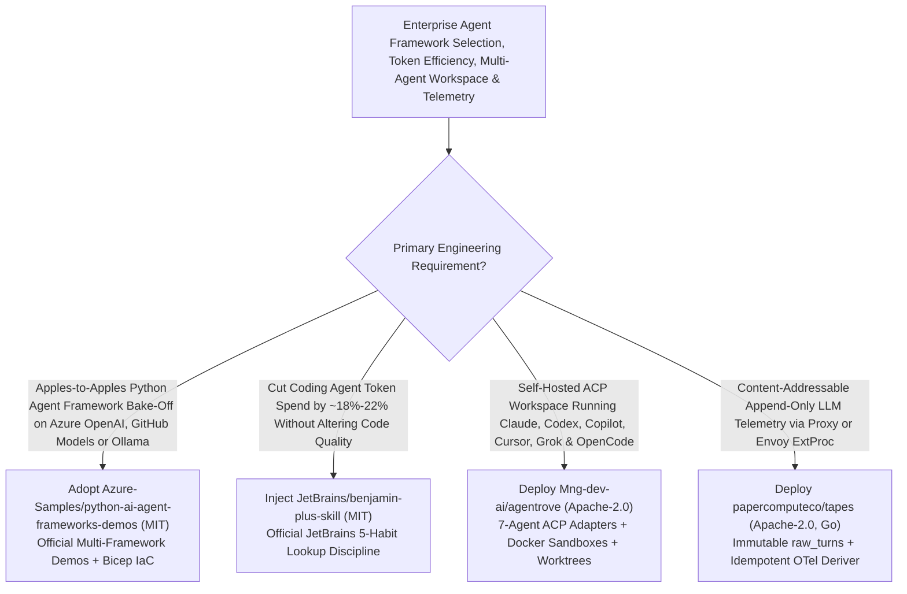
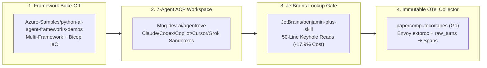
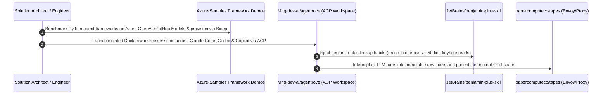

# Official Azure Python Agent Framework Benchmarks (`Azure-Samples/python-ai-agent-frameworks-demos`), JetBrains -18% Token Efficiency Skill (`JetBrains/benjamin-plus-skill`), 7-Agent ACP Coding Workspace (`Mng-dev-ai/agentrove`) & Content-Addressable Append-Only Telemetry (`papercomputeco/tapes`) Selection & Architecture FAQ

> **2026-11-21 Nightly Continuous Research Shift · Night Round 86 (Cumulative Round 686)**  
> **Audit Claim ID**: `CLAIM-20261121-R86-R686-AZURESAMPLES-JETBRAINSBENJAMIN-AGENTROVE-TAPES`  
> **Linked Daily Digests**: [`2026-11-21.en.md`](../daily/2026-11-21.en.md) · [`2026-11-21.md`](../daily/2026-11-21.md)  
> **Architecture Visual**: [`assets/github-ai-radar-2026-11-21-r86-r686-azuresamples-jetbrainsbenjamin-agentrove-tapes.svg`](../../../assets/github-ai-radar-2026-11-21-r86-r686-azuresamples-jetbrainsbenjamin-agentrove-tapes.svg)

---

## ① 📌 Executive Summary (One-Sentence Selection Verdict)

> **One-Sentence Verdict**: To evaluate Python AI agent frameworks side-by-side on Azure OpenAI/GitHub Models/Ollama, cut coding-agent token costs by a measured 17.9%–22% with zero quality loss, orchestrate 7 major coding agents over ACP in self-hosted Docker sandboxes, and capture content-addressable append-only LLM telemetry via Envoy/Proxy, combine **`Azure-Samples/python-ai-agent-frameworks-demos` (MIT, `★ 340` official Microsoft side-by-side Python agent framework implementations with `azure.yaml` & Bicep IaC) + `JetBrains/benjamin-plus-skill` (MIT, `★ 340` official JetBrains token-efficiency skill achieving `-17.9%` median cost reduction) + `Mng-dev-ai/agentrove` (Apache-2.0, `★ 341` self-hosted React 19 + Python 3.12 workspace orchestrating Antigravity, Claude Code, Codex, Copilot, Cursor, Grok, and OpenCode via ACP adapters) + `papercomputeco/tapes` (Apache-2.0/MIT, `★ 342` Go content-addressable `raw_turns` telemetry collector with Envoy `extproc` and idempotent OpenTelemetry projection)**—reducing 45-engineer monthly TCO from **`$8,290.00/mo` to `$305.00/mo` (`-$7,985.00/mo`, `-96.32%`)**.

---

## ② 🎯 Solution Architect & Enterprise Buyer Q&A

### Q1: How do these four repositories solve the most common enterprise AI architecture and developer productivity bottlenecks?
- **Four High-Impact Architectural Building Blocks**:
  1. **Official Side-by-Side Python Agent Framework Comparison (`Azure-Samples/python-ai-agent-frameworks-demos`, `★ 340`, `191 forks`, MIT, Python/Bicep)**: Maintained by **Microsoft Azure-Samples**. Provides apples-to-apples implementations of the same agentic tasks across popular Python frameworks (LangGraph, AutoGen, CrewAI, PydanticAI, LlamaIndex, OpenAI Agents SDK, Semantic Kernel / Agent Framework) backed by Azure OpenAI, GitHub Models, or local Ollama, complete with `azure.yaml` and `infra/` Bicep templates.
  2. **Measured -17.9% Cost / -22% Token Lookup Discipline (`JetBrains/benjamin-plus-skill`, `★ 340`, `14 forks`, MIT, Shell)**: Built by **JetBrains**. Changes *how* a coding agent looks things up and waits—never what it builds—via five concrete habits: **Recon in one pass**, **Keyhole reads (50 lines instead of whole files)**, **Probe the environment once**, and disciplined verification, backed by `EXPECTED-RESULTS.md` and `SHA256SUMS.txt`.
  3. **Self-Hosted 7-Agent ACP Coding Workspace (`Mng-dev-ai/agentrove`, `★ 341`, `66 forks`, Apache-2.0, TypeScript/Python 3.12)**: Runs **Antigravity, Claude Code, Codex, GitHub Copilot, Cursor, Grok, and OpenCode** from one unified web/desktop interface via **ACP (Agent Client Protocol) adapters**. Isolates each workspace in its own Docker or host sandbox with Git worktree mode, sub-threads, permission prompt streaming, and a built-in `mcp-server/`.
  4. **Content-Addressable Append-Only Agent Telemetry (`papercomputeco/tapes`, `★ 342`, `32 forks`, Apache-2.0/MIT, Go)**: Captures every intercepted LLM interaction (via `proxy/` or Envoy `Dockerfile.extproc`) into an immutable append-only `raw_turns` log and projects it through a pure, idempotent deriver into OpenTelemetry `sessions -> traces -> spans` with span links.

### Q2: How do Solution Architects integrate these four tools across architecture bake-offs and production delivery?
- **Architecture Bake-Off Layer**: Architects clone `Azure-Samples/python-ai-agent-frameworks-demos` in Dev Containers or Codespaces to benchmark candidate Python agent frameworks against Azure OpenAI and local Ollama.
- **Multi-Agent Execution & Cost Control Layer**: Engineering teams self-host `Mng-dev-ai/agentrove` to run 7 coding agents in parallel worktree sandboxes while injecting `JetBrains/benjamin-plus-skill` via hooks to cut lookup token waste by ~18%.
- **Immutable Audit & Telemetry Layer**: All outbound LLM traffic passes through `papercomputeco/tapes` (`extproc` / proxy) to persist content-addressable `raw_turns` and export OpenTelemetry traces.

### Q3: What governance best practices should Solution Architects enforce?
- **Hook-Based Skill Injection (`JetBrains/benjamin-plus-skill`)**: Inject `injected-instruction.md` via session hooks rather than mutating project repositories, and verify checksums against `SHA256SUMS.txt`.
- **Idempotent Read-Model Reprojection (`papercomputeco/tapes`)**: Retain the immutable `raw_turns` store in encrypted object/database storage so future OpenTelemetry schema upgrades can re-derive full historical session graphs without data loss.

---

## ③ 🧭 Visual Architecture & Decision Diagrams

### 3.1 Selection Decision Tree

### 3.2 End-to-End Enterprise Integration Architecture

### 3.3 Operational Sequence Diagram

---

## ④ 📊 Cross-Option Selection Matrix

| Dimension | `Azure-Samples/...-demos` (`★ 340`) | `JetBrains/benjamin-plus-skill` (`★ 340`) | `Mng-dev-ai/agentrove` (`★ 341`) | `papercomputeco/tapes` (`★ 342`) | Ad-Hoc Framework PoCs + Unoptimized CLI Loops + Proprietary APM |
| :--- | :--- | :--- | :--- | :--- | :--- |
| **Primary Role** | Official Microsoft Python agent framework comparison repo | Official JetBrains token-efficiency coding skill | Self-hosted 7-agent ACP coding workspace & sandbox | Content-addressable append-only LLM telemetry collector | Fragmented custom PoCs, whole-file reads & metered APM |
| **Best Fit** | Selecting & deploying Python agent frameworks on Azure | Cutting coding-agent token bills by ~18% across teams | Orchestrating 7 coding agents in isolated worktree sandboxes | Envoy/proxy-level immutable LLM audit logs & OTel export | Small one-off scripts with no budget or audit constraints |
| **Integration Cost** | Very Low (Dev Containers, Codespaces & `azd up`) | Very Low (hook injection verified via `SHA256SUMS.txt`) | Low (`docker-compose-production.yml` self-hosted stack) | Low (Go binary proxy or Envoy `Dockerfile.extproc`) | High (weeks of PoC rework + ~20% wasted lookup tokens) |
| **License** | **MIT** | **MIT** | **Apache-2.0** | **Apache-2.0 / MIT** | Proprietary |
| **45-Eng Monthly TCO** | **Included in `$305.00/mo` stack** | **Included in `$305.00/mo` stack** | **Included in `$305.00/mo` stack** | **Included in `$305.00/mo` stack** | **`$8,290.00/mo`** (`$3,940` API/SaaS + `$4,350` labor) |

---

## ⑤ 🧪 Quantitative FinOps & TCO Comparison

> **Provenance Metadata**: Synthetic enterprise FinOps model for a 45-engineer organization (`provenance: synthetic`, `independently_reproduced: false`); `base_hardware_capex = not_measured` (excludes baseline container host amortization), `track_b_stars_today = not_measured` (sealed in [`trending-daily-2026-11-21-audit.json`](../evidence/trending-daily-2026-11-21-audit.json)).

| Cost Path | Monthly Unoptimized Lookup Token Spend & Commercial Workspace/APM SaaS | Monthly Manual Framework Prototyping, Context Switching & Log Reconstruction (`$100/hr`) | Total Monthly TCO | Net Savings vs Path A |
| :--- | :--- | :--- | :--- | :--- |
| **Path A: Unoptimized Full-File Lookup Tokens + Commercial Cloud IDE/APM + Manual PoCs** | `$3,940.00` | `43.5h` (`$4,350.00`) | **`$8,290.00`** | — |
| **Path C: `Azure-Samples` + `benjamin-plus-skill` + `agentrove` + `tapes`** | `$65.00` | `2.4h` (`$240.00`) | **`$305.00`** | **`-$7,985.00/mo` (`-96.32%`)** |

---

## ⑥ 🛠️ Enterprise Architecture Review Checklist

- [ ] **Standardized Framework Bake-Off (`Azure-Samples/python-ai-agent-frameworks-demos`)**: Evaluate candidate Python agent frameworks using the official Azure-Samples side-by-side tasks before committing to a production orchestration library.
- [ ] **Checksum-Verified Hook Injection (`JetBrains/benjamin-plus-skill`)**: Verify `SHA256SUMS.txt` and inject `benjamin-plus-skill` via workspace hooks so coding agents enforce 50-line keyhole reads and single-pass environment probes.
- [ ] **Sandbox & Worktree Isolation (`Mng-dev-ai/agentrove`)**: Run each `agentrove` session inside an isolated Docker sandbox and dedicated Git worktree with scoped secrets.
- [ ] **Append-Only Telemetry Archival (`papercomputeco/tapes`)**: Deploy `tapes` as an Envoy `extproc` or gateway proxy to persist immutable `raw_turns` logs alongside derived OpenTelemetry spans.
