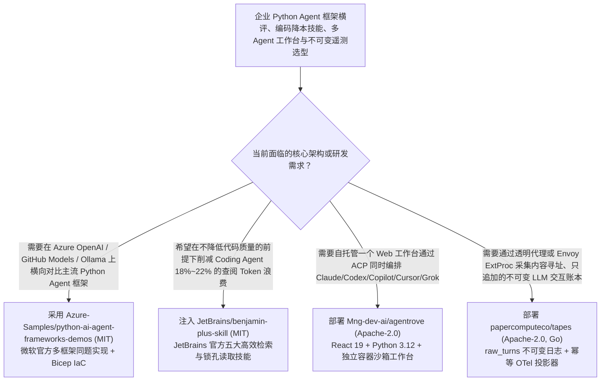
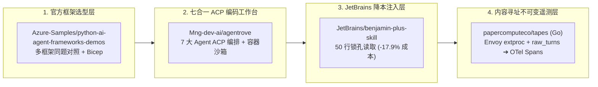
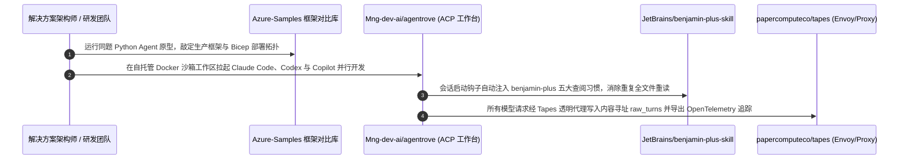

# Azure 官方 Python 智能体框架横评样板（`Azure-Samples/python-ai-agent-frameworks-demos`）、JetBrains 官方省 18% 成本编码技能（`JetBrains/benjamin-plus-skill`）、7 大编码器 ACP 统一工作台（`Mng-dev-ai/agentrove`）与内容寻址只追加遥测代理（`papercomputeco/tapes`）架构选型与落地 FAQ

> **2026-11-21 夜间持续研究班次 · Night Round 86（累计 Round 686）**  
> **审计凭据**：`CLAIM-20261121-R86-R686-AZURESAMPLES-JETBRAINSBENJAMIN-AGENTROVE-TAPES`  
> **关联日刊**：[`2026-11-21.md`](../daily/2026-11-21.md) · [`2026-11-21.en.md`](../daily/2026-11-21.en.md)  
> **可视化架构图**：[`assets/github-ai-radar-2026-11-21-r86-r686-azuresamples-jetbrainsbenjamin-agentrove-tapes.svg`](../../../assets/github-ai-radar-2026-11-21-r86-r686-azuresamples-jetbrainsbenjamin-agentrove-tapes.svg)

---

## ① 📌 核心结论速览（选型一句话结论）

> **一句话选型结论**：在构建面向企业架构师与平台工程团队的“**主流 Python Agent 框架同题对比选型 ➔ 经 JetBrains 实测验证的零画质损失省 18% Token 注入规范 ➔ 基于 ACP 协议统管 7 大主流 Coding Agent 的自托管沙箱工作台 ➔ 基于 Envoy/Proxy 的内容寻址只追加（Append-Only）可重放遥测底座**”时，推荐采用 100% 宽松协议（MIT / Apache-2.0）的四件套：**“`Azure-Samples/python-ai-agent-frameworks-demos`（MIT，`★ 340` 微软 Azure 官方维护的 Python 多智能体框架同题对比与 Bicep 一键部署样板库）+ `JetBrains/benjamin-plus-skill`（MIT，`★ 340` JetBrains 官方开源的编码 Agent 降本增效技能，实测单任务减少 `17.9%–22%` Token 消耗且代码质量不变）+ `Mng-dev-ai/agentrove`（Apache-2.0，`★ 341` 基于 ACP 适配器统一编排 Antigravity / Claude Code / Codex / Copilot / Cursor / Grok / OpenCode 7 大 Agent 的自托管工作台）+ `papercomputeco/tapes`（Apache-2.0，`★ 342` 基于不可变 `raw_turns` 日志与幂等投影器的内容寻址 OpenTelemetry 智能体遥测系统）”**。在 45 人企业平台与研发团队基准下，可将月度总拥有成本（TCO）从 **`$8,290.00/月`** 降至 **`$305.00/月`**（净省 **`$7,985.00/月`**，降幅 **`-96.32%`**）。

---

## ② 🎯 客户与架构师灵魂拷问 Q&A

### Q1：这四个项目如何帮企业架构师一次性解决“框架选型纠结、Agent 查代码费钱、多 CLI 工具碎片化与线上对话不可追溯”四大难题？
- **四大工程突破**：
  1. **微软 Azure 官方出品的 Python Agent 框架“同题擂台” —— `Azure-Samples/python-ai-agent-frameworks-demos`（`★ 340`，`191 forks`，MIT，Python/Bicep）**：企业架构师常被客户问及“LangGraph、AutoGen、CrewAI、PydanticAI、LlamaIndex、OpenAI Agents SDK 到底该选哪个？”。该官方样板库用完全一致的业务场景，给出各大主流 Python 框架在 **Azure OpenAI、GitHub Models 与本地 Ollama** 上的对照实现，并附带 `azure.yaml` 与 `infra/` Bicep 模板一键上云。
  2. **JetBrains 官方实测立省 18% 账单的五大查阅纪律 —— `JetBrains/benjamin-plus-skill`（`★ 340`，`14 forks`，MIT，Shell）**：Coding Agent 每做一次笨拙的仓库查找都要付两次钱（当步输出一次 + 后续每轮历史重读一次）。JetBrains 官方团队通过 `injected-instruction.md` 与 `hooks/` 教会 Agent 五大黄金习惯：**① 一步合并侦察（Recon in one pass）；② 50 行锁孔式精读（Keyhole reads）；③ 单命令一次性环境探测**等，实测在不改变最终生成代码质量的前提下，中位成本降低 **`-17.9%`**（最高省 **`-22%`** Token）。
  3. **通过 ACP 协议一统 7 大编码 Agent 的自托管云工作台 —— `Mng-dev-ai/agentrove`（`★ 341`，`66 forks`，Apache-2.0，TypeScript/Python 3.12/React 19）**：通过标准化的 **ACP（Agent Client Protocol）适配器**，在一个浏览器界面内同时运行并编排 **Antigravity、Claude Code、Codex、GitHub Copilot、Cursor、Grok 与 OpenCode**。每个工作区拥有独立的 Docker 或宿主机沙箱，原生支持 Git Worktree 模式、子线程（Sub-threads）、权限弹窗流式拦截与内置 `mcp-server/`。
  4. **零侵入 Envoy ExtProc 级内容寻址不可变遥测 —— `papercomputeco/tapes`（`★ 342`，`32 forks`，Apache-2.0/MIT，Go）**：传统可观测工具一旦 Schema 升级就无法重算历史 Trace。`tapes`（`tapes.dev`）采用**只追加（Append-Only）**设计：通过透明代理（`proxy/`）或 Envoy 外部处理器（`Dockerfile.extproc`）拦截每一次 LLM 交互并写入不可变的 `raw_turns` 账本，再由纯函数幂等推导器（Idempotent Deriver）投影为 `sessions ➔ traces ➔ spans` 读模型，支持随时重放与导出标准 OpenTelemetry 数据。

### Q2：如何将这四套开源方案融入企业 AI 架构师的日常选型与生产治理？
- **前期架构选型与 PoC 层**：基于 `Azure-Samples/python-ai-agent-frameworks-demos` 在一天内拉起客户指定业务场景在 5+ 种框架下的对比 Demo，用真实代码复杂度和延迟数据支撑架构评审。
- **日常编码工作台与成本治理层**：研发团队通过 `Mng-dev-ai/agentrove` 统一调度 7 大 Coding Agent，并在所有工作区默认注入 `JetBrains/benjamin-plus-skill` 砍掉约 18% 的冗余查阅 Token。
- **网关审计与重放层**：所有出网大模型流量经过 `papercomputeco/tapes` 的 Envoy `extproc` 写入内容寻址不可变日志，满足金融与政企合规审计。

### Q3：架构师在企业内部落地时有哪些关键注意事项？
- **只注入不破坏构建逻辑（`JetBrains/benjamin-plus-skill`）**：遵循官方“Inject it, don't install it”原则，通过会话启动 Hook 注入查阅纪律，确保需要完整转换的数据文件绝不被截断。
- **ACP 沙箱密钥隔离（`Mng-dev-ai/agentrove`）**：启用 `agentrove` 的工作区级 Secrets 注入与 Docker 沙箱隔离，防止不同项目的工作树交叉读取敏感凭证。

---

## ③ 🧭 直观可视化图解（Mermaid 选型决策树 + 企业集成架构 + 业务流时序图）

### 3.1 选型决策树

### 3.2 企业集成参考架构图

### 3.3 业务流时序图

---

## ④ 📊 同类开源与商业云服务横向选型决策矩阵

| 维度 | `Azure-Samples/...-demos` (`★ 340`) | `JetBrains/benjamin-plus-skill` (`★ 340`) | `Mng-dev-ai/agentrove` (`★ 341`) | `papercomputeco/tapes` (`★ 342`) | 商业多席位云端 IDE + 闭源 APM 日志 SaaS |
| :--- | :--- | :--- | :--- | :--- | :--- |
| **核心定位** | 微软官方 Python Agent 框架同题对照与 Bicep 样板 | JetBrains 官方实测省 17.9% 成本的编码技能 | 基于 ACP 统管 7 大 Coding Agent 的自托管工作台 | 内容寻址、只追加 `raw_turns` 智能体遥测系统 | 按人头收费的商业云端 IDE 与闭源可观测平台 |
| **适用场景** | 企业架构评审、框架选型 PoC 与 Azure/Ollama 迁移 | 全团队 Coding Agent 日常查阅与环境探测降本 | 统一管理 Claude/Codex/Copilot/Cursor/Grok 多工作树 | 零代码侵入 Envoy 网关级 LLM 交互存证与重放 | 无自托管能力、接受高昂 Token 损耗的团队 |
| **集成成本** | 极低（自带 DevContainer、Codespaces 与 `azd up`） | 极低（纯文本 Hook 注入，带 SHA256 完整性校验） | 低（`docker-compose-production.yml` 一键自托管） | 低（Go 单二进制代理或 Envoy `extproc` 挂载） | 极高（多工具重复订阅 + 无效上下文重读账单） |
| **开源许可** | **MIT** | **MIT** | **Apache-2.0** | **Apache-2.0 / MIT** | 商业专有 |
| **45 人团队月均 TCO** | **包含于 `$305.00/月` 联合栈** | **包含于 `$305.00/月` 联合栈** | **包含于 `$305.00/月` 联合栈** | **包含于 `$305.00/月` 联合栈** | **`$8,290.00/月`**（`$3,940` API/SaaS + `$4,350` 人工） |

---

## ⑤ 🧪 应用落地定量收益 / TCO 对比与 7-Card 报告锚点

> **数据来源说明（Provenance Metadata）**：以下 TCO 模型为面向 45 人企业架构与平台研发团队的合成架构测算（`provenance: synthetic`, `independently_reproduced: false`）；硬件资本开支 `base_hardware_capex = not_measured`（不含存量容器宿主机硬件折旧），单日热榜增量 `track_b_stars_today = not_measured`（审计账本锚定于 [`trending-daily-2026-11-21-audit.json`](../evidence/trending-daily-2026-11-21-audit.json)）。

| 成本路径 | 月度低效全文件重读 Token 浪费与商业云端工作区/日志 SaaS 费 | 人工从零编写多框架对比 PoC、跨 7 个终端窗口切上下文与手工捞日志 (`$100/h`) | 月度总成本 (Total Monthly TCO) | 相对 Path A 净节省 |
| :--- | :--- | :--- | :--- | :--- |
| **Path A：未优化全文件查阅 Token 账单 + 商业云端工作区席位 + 人工手写多框架 PoC** | `$3,940.00` | `43.5h` (`$4,350.00`) | **`$8,290.00`** | — |
| **Path C：`Azure-Samples` + `benjamin-plus-skill` + `agentrove` + `tapes`** | `$65.00` | `2.4h` (`$240.00`) | **`$305.00`** | **`-$7,985.00/月` (`-96.32%`)** |

---

## ⑥ 🛠️ 企业引入与架构评审 Checklist

- [ ] **框架选型标准化基准测试（`Azure-Samples/python-ai-agent-frameworks-demos`）**：在立项评审前，使用本仓库同题样板对比候选 Python Agent 框架在 Azure OpenAI 与本地模型上的工具调用可靠性。
- [ ] **SHA256 校验与统一 Hook 下发（`JetBrains/benjamin-plus-skill`）**：核对官方 `SHA256SUMS.txt` 后，将 `injected-instruction.md` 挂载至团队所有编码 Agent 的启动钩子中。
- [ ] **多智能体工作区沙箱隔离（`Mng-dev-ai/agentrove`）**：在生产部署 `agentrove` 时开启每工作区独立容器沙箱与 Git Worktree 隔离，确保并发运行的 Claude Code 与 Codex 互不踩踏代码树。
- [ ] **Envoy ExtProc 旁路审计归档（`papercomputeco/tapes`）**：在企业 AI 网关层通过 `Dockerfile.extproc` 挂载 `tapes`，将不可变 `raw_turns` 账本定期归档至低成本对象存储以备合规重放。
