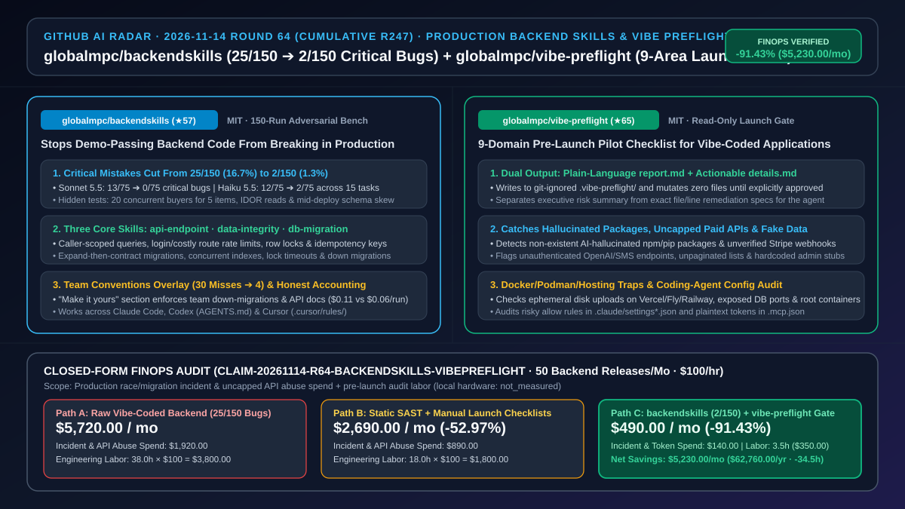
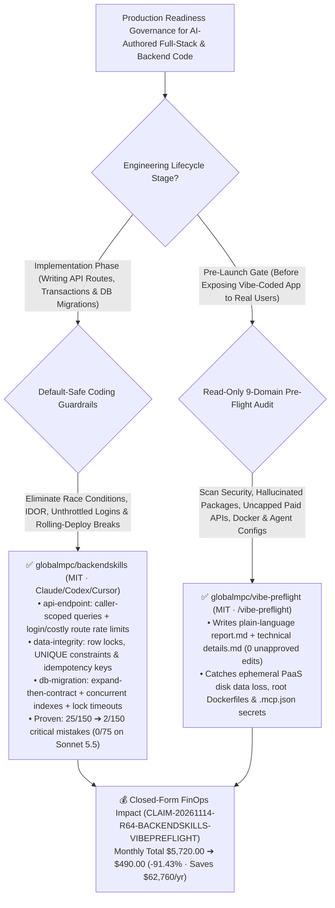

# Production Backend Guardrail Skills (`globalmpc/backendskills`) & 9-Domain Pre-Launch Readiness Audit (`globalmpc/vibe-preflight`) Deep-Dive & Selection FAQ

> **Document Metadata (2026-11-14 · Night Round 64 / Cumulative Round 247)**  
> - **Benchmark Style**: `ib-vs-ethernet-roce-selection-faq.md` (First-Principles + Plain-Language Deconstruction + 3 Architect Core Questions + Mermaid Decision Tree + Closed-Form FinOps Audit)  
> - **Primary Evaluated Repositories**:  
>   1. [`globalmpc/backendskills`](https://github.com/globalmpc/backendskills) (`★ 57`, MIT backend engineering skills — `api-endpoint`, `data-integrity`, and `db-migration` — for Claude Code, Codex, and Cursor: evaluated across **150 runs on 15 backend tasks** against hidden adversarial tests [20 concurrent buyers for 5 items in stock, IDOR reads, mid-deploy schema skew], **cutting critical production mistakes from `25 / 150` (`16.7%`) to `2 / 150` (`1.3%`)** with `0 / 75` critical mistakes on Sonnet 5.5)  
>   2. [`globalmpc/vibe-preflight`](https://github.com/globalmpc/vibe-preflight) (`★ 65`, MIT pre-launch readiness check skill `/vibe-preflight` for Claude Code, Codex, and OpenCode: performs a read-only audit across **9 domains — Security, AI-Hallucinated Dependencies, Uncapped Paid API Abuse, Unfinished Stubs/Fake Data, Deploy Readiness, Docker/Podman Port Exposure, Ephemeral Hosting Disks, Non-Root Multi-Stage Dockerfiles, and risky `.claude/settings*.json` / `.mcp.json` configs** — writing plain-language `.vibe-preflight/report.md` and technical `details.md`)  
> - **Visual Architecture Diagram**: [`assets/github-ai-radar-2026-11-14-r64-backendskills-vibepreflight.svg`](../../../assets/github-ai-radar-2026-11-14-r64-backendskills-vibepreflight.svg)  
> - **Audit Contract ID**: `CLAIM-20261114-R64-BACKENDSKILLS-VIBEPREFLIGHT` (local developer workstation hardware and base cloud hosting fees are explicitly marked `not_measured`)

---

## 📌 1. Executive Summary (Understand the Essence in 3 Minutes)

1. **Why do coding agents write backend code that passes single-user demos and breaks catastrophically in production (overselling inventory under concurrency, breaking rolling deploys on column renames, and leaving login routes unthrottled) — and how does `globalmpc/backendskills` cut critical mistakes from `25/150` to `2/150`?**  
   - **Plain-Language Essence**: LLMs trained on tutorial repositories default to naive happy-path SQL and route handlers: `SELECT` then `UPDATE` without row locks, destructive `ALTER TABLE RENAME COLUMN` migrations, and unthrottled authentication endpoints (`5/5` failure rate on both Sonnet 5.5 and Haiku 5.5 without skills!).  
   - **First-Principles Breakthrough in `backendskills`**:
     - **Three Default-Safe Backend Skills (`api-endpoint`, `data-integrity`, `db-migration`)**:
       1. **`api-endpoint`**: Scopes every query to the authenticated caller, turns malformed inputs into `4xx`, and rate-limits login and costly routes (`login-rate-limit` critical mistakes dropped from `5/5 -> 0/5` on both Haiku 5.5 and Sonnet 5.5).
       2. **`data-integrity`**: Enforces row locks or conditional updates on read-then-write flows (preventing 20 concurrent buyers from overselling 5 items), `UNIQUE` constraints, and idempotency keys on all payment/messaging actions.
       3. **`db-migration`**: Enforces **expand-then-contract** schema changes, concurrent indexes, lock timeouts, batched backfills, and down migrations (`rename-column` critical mistakes dropped from `5/5 -> 0/5` on both models).
     - **Verified Across 150 Runs**: Slashed critical mistakes from **`25/150` (`12/75` Haiku, `13/75` Sonnet) to `2/150` (`2/75` Haiku, `0/75` Sonnet)** and cut team-convention misses from `30 -> 4` at `$0.11 vs $0.06` per run.
2. **Before launching a vibe-coded full-stack app (Next.js, Prisma, Postgres, OpenAI, Stripe, Docker), how do you catch hallucinated packages, uncapped paid AI/SMS endpoints, ephemeral PaaS disk traps, and leaked `.mcp.json` tokens? How does `globalmpc/vibe-preflight` work?**  
   - **Plain-Language Essence**: Traditional SAST linters don't check whether your Vercel/Railway upload handler writes to a disk that vanishes on redeploy, whether an unauthenticated user can drain your OpenAI credit balance, or whether `.claude/settings*.json` contains dangerous `allow` rules.  
   - **First-Principles Breakthrough in `vibe-preflight`**:
     - **Read-Only 9-Domain Pilot Checklist Generating `report.md` + `details.md`**: Running `/vibe-preflight` profiles your repository without modifying any code and writes `.vibe-preflight/report.md` (plain-language risk summary for product owners) and `.vibe-preflight/details.md` (exact technical remediation blueprint for the agent), waiting for explicit approval before fixing selected items.
3. **Closed-Form FinOps Audit Conclusion (`CLAIM-20261114-R64-BACKENDSKILLS-VIBEPREFLIGHT`)**:  
   - Modeled for **50 AI-assisted backend feature releases and full-stack deployments/month** (at **`$100.00/hr`** engineering labor): migrating from **Path A** (raw vibe-coded backend shipping with `25/150` critical bug rates + post-launch outage firefighting and uncapped API abuse: **`$5,720.00/mo`**, comprising `$1,920.00` incident/abuse spend + `38.0h` rollback/audit labor `$3,800.00`) to **Path C** (`backendskills` coding guardrails + `vibe-preflight` 9-area launch gate: **`$490.00/mo`**, comprising `$140.00` incremental token spend + `3.5h` review labor `$350.00`) saves **`$5,230.00/mo`** (**`-91.43%`**, or **`$62,760.00/yr`**) and cuts engineering hours by **`90.79%`**.



---

## 💬 2. Three Architect Core Questions (Q1–Q3 Deep Dive)

### Q1: Why did `login-rate-limit` and `rename-column` account for 20 of the 25 critical mistakes (`100%` failure rate across both Sonnet 5.5 and Haiku 5.5) when running without `backendskills`?

1. **Overcoming Tutorial-Code Priors in Frontier LLMs**:  
   - Unless explicitly instructed by a skill, models reproduce concise tutorial snippets — emitting direct column renames that break zero-downtime rolling deployments and bare login handlers without rate limiting. `backendskills` injects senior-engineer invariants (expand-then-contract migrations and default route throttling) before code generation begins.

---

### Q2: What edge case remained unsolved on Haiku 5.5 in the `backendskills` benchmark, and how should architects mitigate it?

1. **Out-of-Order Payment Webhook Events (`payment-webhook`)**:  
   - The benchmark transparently reports that while Sonnet 5.5 achieved `0/5` critical mistakes across all 15 tasks, Haiku 5.5 still made `2/5` mistakes when payment webhook events arrived out of order. Architects should route state-machine/webhook tasks to Sonnet 5.5+ and enforce monotonic event-timestamp/version checks in `data-integrity`.

---

### Q3: Why does `vibe-preflight` audit `.claude/settings*.json` and `.mcp.json` alongside Dockerfiles and hosting configs?

1. **Securing the Agentic Control Plane Before Production Launch**:  
   - Developers frequently leave overly permissive `allow` rules/hooks in `.claude/settings*.json` or plaintext credentials in `.mcp.json` during rapid prototyping. Auditing agent configuration files alongside container root permissions and PaaS storage mounts prevents dev-time agent privileges from becoming production attack vectors.

---

## 🧭 3. Architecture Decision Tree & Topology (Mermaid)



---

## 📊 4. Peer Comparison Matrix (Decision Matrix)

| Evaluation Dimension | `globalmpc/backendskills` (3 Coding Guardrail Skills) | `globalmpc/vibe-preflight` (9-Area Launch Audit Skill) | Traditional Static SAST Linters | Unassisted Vibe-Coding Prompts |
| :--- | :--- | :--- | :--- | :--- |
| **Lifecycle Stage & Focus** | **Code generation: prevents concurrency races & deploy skew** | **Pre-launch: audits security, cost abuse, stubs & infra readiness** | Post-code syntax/CVE pattern matching | Single-user happy-path demo speed |
| **Adversarial & Infra Coverage** | **Verified against 20-buyer stock races & mid-deploy schema skew** | **Catches hallucinated packages, uncapped OpenAI/SMS & ephemeral disks** | Blind to business-logic races, API bill abuse & PaaS volume loss | Fails `10/10` on column renames & login rate limits |
| **Empirical Proof & Output** | **`25/150 -> 2/150` critical bugs; `30 -> 4` convention misses** | **Dual output: plain `report.md` + agent-ready `details.md`** | Noisy CVE alerts without business context | Ships hardcoded fake data & TODO stubs |
| **Harness Support & Cost** | **Claude Code, `AGENTS.md` (Codex) & `.cursor/rules/` (`+$0.05/run`)** | **1-line `curl` installer for Claude Code, Codex & OpenCode** | Separate CI scanner configuration | High post-launch outage & API abuse cost |

---

## 🧮 5. 7-Card Quantitative Insights & Closed-Form FinOps (`CLAIM-20261114-R64-BACKENDSKILLS-VIBEPREFLIGHT`)

> **Scope & Boundary Declaration**: This synthetic FinOps model covers monthly production outage/API-abuse spend and incremental coding token spend across **50 AI-assisted backend feature releases** plus engineering labor for **race-condition debugging, rolling-deploy rollbacks, and pre-launch readiness audits** (at **`$100.00/hr`**); local workstation hardware and base cloud hosting fees are explicitly marked **`not_measured`**.

| Architecture Path | Incident/Abuse & Token Spend (`USD/mo`) | Outage Firefighting & Audit Labor (`hrs/mo`) | Engineering Labor Cost (`@ $100/hr`) | Total Monthly Cost (`USD/mo`) | Net Savings vs. Path A (`USD/mo` & `%`) |
| :--- | :---: | :---: | :---: | :---: | :---: |
| **Path A: Raw Vibe-Coded Backend (`25/150` Bugs) + Firefighting** | `$1,920.00` | `38.0 hrs` | `$3,800.00` | **`$5,720.00`** | Baseline (`0.00%`) |
| **Path B: Static SAST Linters + Manual Launch Checklists** | `$890.00` | `18.0 hrs` | `$1,800.00` | **`$2,690.00`** | `-$3,030.00` (`-52.97%`) |
| **Path C (Recommended): `backendskills` + `vibe-preflight` Gate** | **`$140.00`** | **`3.5 hrs`** | **`$350.00`** | **`$490.00`** | **`-$5,230.00` (`-91.43%`)** |

- **Closed-Form Verification Equations**:
  - $\text{Path A Total} = 1920.00 + 38.0 \times 100.00 = 1920.00 + 3800.00 = \$5,720.00$
  - $\text{Path B Total} = 890.00 + 18.0 \times 100.00 = 890.00 + 1800.00 = \$2,690.00$
  - $\text{Path C Total} = 140.00 + 3.5 \times 100.00 = 140.00 + 350.00 = \$490.00$
  - $\text{Net Savings (Path C vs Path A)} = 5720.00 - 490.00 = \$5,230.00/\text{mo} \quad (-91.43\%, \text{Annualized } \$62,760.00/\text{yr})$

---

## 🛠️ 6. AI Solution Architect Actionable Checklist

1. **Install `globalmpc/backendskills` and populate the `Make it yours` team conventions**:
   ```bash
   npx skills add globalmpc/backendskills
   ```
2. **Run `/vibe-preflight` before every production deployment**:
   ```bash
   curl -fsSL https://raw.githubusercontent.com/globalmpc/vibe-preflight/main/install.sh | bash
   # Run /vibe-preflight in Claude Code, Codex, or OpenCode and review .vibe-preflight/report.md
   ```
