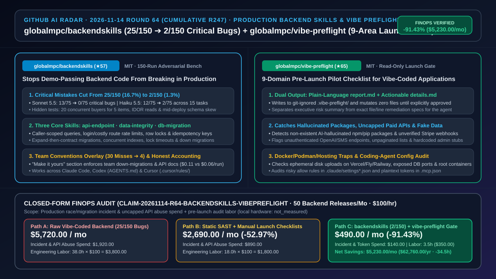
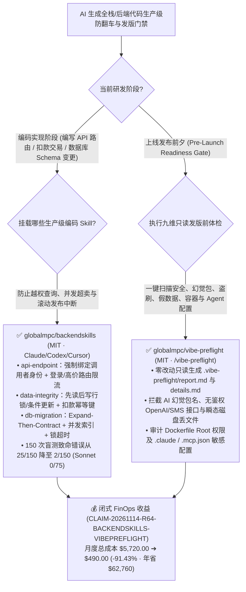

# 终结“过得了 Demo 扛不住生产”的后端三大防御技能（`globalmpc/backendskills`）与 Vibe-Coding 上线前九维巡检清单（`globalmpc/vibe-preflight`）深度拆解与选型 FAQ

> **文档元数据（2026-11-14 · 晚班 Round 64 / 累计 Round 247）**  
> - **对标范式**：`ib-vs-ethernet-roce-selection-faq.md`（第一性原理 + 大白话拆解 + 灵魂三问 + Mermaid 决策树 + 闭式 FinOps 核算）  
> - **核心评估对象**：  
>   1. [`globalmpc/backendskills`](https://github.com/globalmpc/backendskills)（`★ 57`，MIT 开源的 Claude Code / Codex / Cursor 生产级后端工程技能组 `api-endpoint`、`data-integrity`、`db-migration`：在 **150 次盲测（20 人并发抢购 5 件库存、水平越权读他人订单、滚动发布新旧 Schema 共存）** 中，将致命生产事故从 **`25 / 150` 次（`16.7%`）压降至 `2 / 150` 次（`1.3%`，其中 Sonnet 5.5 从 `13/75` 降至 `0/75` 零失误）**，并将团队规范漏项从 `30` 降为 `4`）  
>   2. [`globalmpc/vibe-preflight`](https://github.com/globalmpc/vibe-preflight)（`★ 65`，MIT 开源的 Vibe-Coded 应用上线前只读体检技能 `/vibe-preflight`：一次性扫描 **安全越权、AI 幻觉依赖包、未限流高价 API 破产风险、TODO 假数据残留、Docker/Podman 暴露数据库端口、Vercel/Fly 临时磁盘丢文件、以及 `.claude/settings*.json` 与 `.mcp.json` 明文令牌泄露** 九大盲区，输出大白话 `report.md` 与修复指南 `details.md`）  
> - **配套架构图**：[`assets/github-ai-radar-2026-11-14-r64-backendskills-vibepreflight.svg`](../../../assets/github-ai-radar-2026-11-14-r64-backendskills-vibepreflight.svg)  
> - **审计契约号**：`CLAIM-20261114-R64-BACKENDSKILLS-VIBEPREFLIGHT`（本地研发工作站与基础云主机月租标注为 `not_measured`）

---

## 📌 一、核心结论速览（Executive Summary：3 分钟读懂本质）

1. **为什么让 AI Coding Agent 写后端接口，单人手动点两下 Demo 100% 正常，一上生产就发生“20 个人同时下单买走 5 件库存（超卖）”、“直接改数据库列名把正在滚动发布的旧版容器全搞崩”和“接口没加登录限流被刷爆”？`globalmpc/backendskills` 怎么用 3 个 Skill 把 `25/150` 的事故率砍到 `2/150`？**  
   - **通俗大白话**：大模型写后端默认只考虑“Happy Path（单用户顺畅跑通）”：它写修改表结构就是一句 `ALTER TABLE RENAME COLUMN`（直接导致滚动发布期间旧代码报错 500），写扣库存就是先 `SELECT` 再 `UPDATE`（并发一上来必超卖），写登录接口在 `5/5`（100%）的裸跑测试里都忘了加防爆破限流！  
   - **`backendskills` 的第一性原理破局**：
     - **三大生产级默认守则（`api-endpoint` + `data-integrity` + `db-migration`）**：
       1. **`api-endpoint`**：强制每条查询绑定当前调用者身份（防 IDOR 越权读取他人订单）、非法输入统一转 `4xx`、对登录与高成本路由强制加限流（`login-rate-limit` 任务在 Haiku/Sonnet 上均从 `5/5` 全部翻车降为 **`0/5` 零翻车**）。
       2. **`data-integrity`**：对“先读后写”强制施加行锁或条件更新（防 20 人抢 5 件库存超卖）、唯一约束（UNIQUE）以及对所有扣款/发信动作强制要求**幂等键（Idempotency Keys）**。
       3. **`db-migration`**：强制执行 **Expand-Then-Contract（先扩列双写、再收缩删旧列）**、并发建索引（`CREATE INDEX CONCURRENTLY`）、锁超时（Lock Timeouts）、分批回填与回滚脚本（`rename-column` 任务在 Haiku/Sonnet 上同样从 `5/5` 全翻车降为 **`0/5` 零失误**）！
     - **150 次隐藏红队测试实证**：在 Sonnet 5.5 上致命失误从 **`13/75` 降至 `0/75`**，Haiku 5.5 从 **`12/75` 降至 `2/75`**（单次运行仅从 `$0.06` 增至 `$0.11`）。
2. **为什么很多用 AI 快速 Vibe-Code 出来的全栈应用（Next.js + Prisma + Stripe + OpenAI + Docker）看着能跑，上线第一天却因为“AI 编造了不存在的 npm 包、上传图片存在 Vercel 瞬态磁盘重启全丢、甚至把 `.mcp.json` 密钥带进仓库”而翻车？`globalmpc/vibe-preflight` 怎么破局？**  
   - **通俗大白话**：Vibe-Coding 最大的风险不是语法错误（编译器会抓），而是**跨层架构盲区**。传统 SAST 工具不会告诉你“你在 Fly.io / Railway 上把用户头像写进了无 Volume 的容器本地目录，下次部署文件就没了”，也不会检查你本地 `.claude/settings.local.json` 里是不是开了极度危险的免批 `allow` 规则。  
   - **`vibe-preflight` (`/vibe-preflight`) 的第一性原理破局**：
     - **只读扫描九大上线盲区，生成双层报告（`report.md` + `details.md`）且未获批准绝不改一行代码**：
       - 覆盖 **安全越权与未验签 Webhook**、**AI 幻觉包名（Hallucinated Packages）**、**未鉴权/未分页的高价 OpenAI/SMS 接口**、**伪装成真实数据的硬编码假返回与 TODO 桩**、**Docker/Podman 数据库端口裸奔公网与 Root 运行**、**Serverless/PaaS 瞬态磁盘与连接池耗尽**，以及 **Coding Agent 自身配置（`.claude/settings*.json` 与 `.mcp.json`）安全审计**！
3. **闭式 FinOps 审计结论（`CLAIM-20261114-R64-BACKENDSKILLS-VIBEPREFLIGHT`）**：  
   - 按每月交付与上线 **50 个 AI 辅助编写的后端功能模块与全栈迭代版本**（工程师时薪 **`$100.00/hr`**）核算：从“Path A：裸跑 Vibe-Coding 带着 `16.7%` 致命隐患上线 + 事后补救并发超卖、滚动发布中断与未限流 API 盗刷”（**`$5,720.00/月`**，含 `$1,920.00` 生产事故与 API 盗刷损耗 + `38.0h` 救火回滚与人工排查人力 `$3,800.00`）切换到“Path C：`backendskills` 编码期护栏（`$0.11/run`）+ `vibe-preflight` 上线前九维体检”（**`$490.00/月`**，含 `$140.00` 极简增量 Token 开销 + `3.5h` 报告复核人力 `$350.00`），每月净省 **`$5,230.00`**（降本 **`91.43%`**，年化节省 **`$62,760.00`**），线上救火与发版审查工时缩减 **`90.79%`**。



---

## 💬 二、架构师灵魂三问（Q1–Q3 Deep Dive）

### Q1：为什么在 `globalmpc/backendskills` 的 150 次测试中，未挂技能的 Sonnet 5.5 和 Haiku 5.5 在 `rename-column` 和 `login-rate-limit` 两项任务上出现了 `10/10`（100%）的全军覆没？

1. **大模型训练语料中的“教程代码偏差（Tutorial-Code Bias）”**：  
   - 互联网上 99% 的 SQL 教程教的都是直接 `ALTER TABLE ... RENAME COLUMN`，99% 的登录路由示例都不含速率限制器（Rate Limiter）。因此当提示词只说“把字段改名”或“写个登录接口”而不加载 `db-migration`（强制 Expand-Then-Contract）与 `api-endpoint`（强制限流与租户隔离）时，即便是前沿模型也会 100% 写出造成滚动部署中断和暴力破解漏洞的教科书式错误代码。

---

### Q2：`backendskills` 在基准报告中坦诚披露了哪一项“即使挂载了 Skill 仍未在 Haiku 上完全解决”的边界场景？架构师该如何兜底？

1. **乱序到达的支付 Webhook 事件（Out-of-Order Payment Webhook Events）**：  
   - 报告诚实指出：在 `payment-webhook` 任务上，Sonnet 5.5 实现了 `0/5` 零失误，但小模型 Haiku 5.5 在面对乱序（Out-of-Order）Webhook 事件时仍有 `2/5` 失误（同时完整披露了 25 次因测试账号触及 `usage_limit_reached` 而中断的原始记录）。架构师在涉及资金状态机的 Webhook 处理上，应坚持路由给 Sonnet 5.5 / Opus 级模型并配合网关层序列号/状态单调递增校验。

---

### Q3：为什么 `globalmpc/vibe-preflight` 专门把“检查 `.claude/settings*.json` 与 `.mcp.json`”列为上线前必查的第九大领域？

1. **防止开发期开启的“Agent 特权后门”随代码带入生产或团队仓库**：  
   - 开发者在 Vibe-Coding 赶进度时，经常在 `.claude/settings.json` 里配置过于宽泛的 `allow` 自动执行规则，或在 `.mcp.json` 里硬编码数据库/第三方 SaaS 的高权限明文 Token。`vibe-preflight` 在上线前统一清点这些 Agent 配置文件，堵死供应链与开发环境横向渗透风险。

---

## 🧭 三、架构选型决策树与后端防翻车 / 上线体检拓扑图（Mermaid）



---

## 📊 四、同类方案横向对比矩阵（Decision Matrix）

| 评估维度 | `globalmpc/backendskills` (编码期三大后端护栏) | `globalmpc/vibe-preflight` (上线前九维体检清单) | 传统静态 SAST 扫描器 (Semgrep/Sonar) | 裸 Prompt 直接让 AI 写后端 |
| :--- | :--- | :--- | :--- | :--- |
| **核心拦截阶段与目标** | **编码生成时：预防并发超卖、滚动迁移中断与未限流路由** | **上线发布前：清点安全、账单盗刷、TODO 假数据与部署盲区** | 提交后扫描已知语法模式漏洞 | 仅追求单人 Demo 跑通 |
| **业务逻辑与部署感知** | **实测抵御“20 人抢 5 件库存”与“新旧 Schema 滚动共存”** | **精准识别 Vercel/Fly 瞬态盘丢文件、无鉴权调 LLM API 与 `.mcp.json` 泄露** | 无法识别业务逻辑竞态、账单破产风险与 PaaS 持久卷缺失 | 在 `rename-column` 与 `login-rate-limit` 上 100% 踩坑 |
| **量化实证与输出形态** | **150 次真机盲测致命错误 `25/150 -> 2/150`；规范漏项 `30 -> 4`** | **只读输出大白话 `report.md` + 供 Agent 修复的 `details.md`** | 报大量晦涩安全术语告警，缺乏业务上下文 | 混入硬编码假数据或未完成 TODO 上线 |
| **多工具兼容与开销** | **支持 Claude Code、`AGENTS.md` (Codex) 与 `.cursor/rules/`（仅 `+$0.05/run`）** | **一行 `curl` 同时装入 Claude Code、Codex 与 OpenCode** | 需配置独立 CI Runner 与规则库 | 表面省几美分 Token，线上一次超卖/盗刷损失数千美元 |

---

## 🧮 五、7-Card 定量洞察与闭式 FinOps 核算（`CLAIM-20261114-R64-BACKENDSKILLS-VIBEPREFLIGHT`）

> **核算范围与边界声明**：本模型核算每月交付与上线 **50 个 AI 辅助编写的后端功能模块与全栈发版** 的生产并发事故/未限流 API 盗刷损耗与增量编码 Token 开销，以及发版前全栈安全/部署排查与线上故障回滚的工程师人力成本（按 **`$100.00/hr`** 计价）；本地开发机与基础云主机月租标注为 **`not_measured`**。

| 方案路径 | 线上事故/盗刷损耗与增量 Token (`USD/月`) | 事故救火与发版前人工排查工时 (`hrs/月`) | 工程师人力成本 (`@ $100/hr`) | 月度总成本 (`USD/月`) | 相对 Path A 净节省 (`USD/月` & `%`) |
| :--- | :---: | :---: | :---: | :---: | :---: |
| **Path A：裸跑 Vibe-Coding 上线（`25/150` 致命隐患）+ 事后救火** | `$1,920.00` | `38.0 hrs` | `$3,800.00` | **`$5,720.00`** | Baseline (`0.00%`) |
| **Path B：仅跑通用静态 SAST + 人工核对上线 Checklist** | `$890.00` | `18.0 hrs` | `$1,800.00` | **`$2,690.00`** | `-$3,030.00` (`-52.97%`) |
| **Path C（推荐）：`backendskills` (`2/150`) + `vibe-preflight` 门禁** | **`$140.00`** | **`3.5 hrs`** | **`$350.00`** | **`$490.00`** | **`-$5,230.00` (`-91.43%`)** |

- **闭式校验公式**：
  - $\text{Path A Total} = 1920.00 + 38.0 \times 100.00 = 1920.00 + 3800.00 = \$5,720.00$
  - $\text{Path B Total} = 890.00 + 18.0 \times 100.00 = 890.00 + 1800.00 = \$2,690.00$
  - $\text{Path C Total} = 140.00 + 3.5 \times 100.00 = 140.00 + 350.00 = \$490.00$
  - $\text{Net Savings (Path C vs Path A)} = 5720.00 - 490.00 = \$5,230.00/\text{mo} \quad (-91.43\%, \text{Annualized } \$62,760.00/\text{yr})$

---

## 🛠️ 六、AI 解决方案架构师实战上手 Checklist

1. **安装 `globalmpc/backendskills` 并在每个技能末尾定制团队 `Make it yours` 规范**：
   ```bash
   npx skills add globalmpc/backendskills
   # Codex 项目可将 dist/AGENTS.md 追加至仓库 AGENTS.md；Cursor 项目可复制 dist/cursor/ 至 .cursor/rules/
   ```
2. **上线前执行 `globalmpc/vibe-preflight` 九维只读体检**：
   ```bash
   curl -fsSL https://raw.githubusercontent.com/globalmpc/vibe-preflight/main/install.sh | bash
   # 在 Claude Code / Codex / OpenCode 中执行 /vibe-preflight，审阅 .vibe-preflight/report.md 后按需授权修复
   ```
