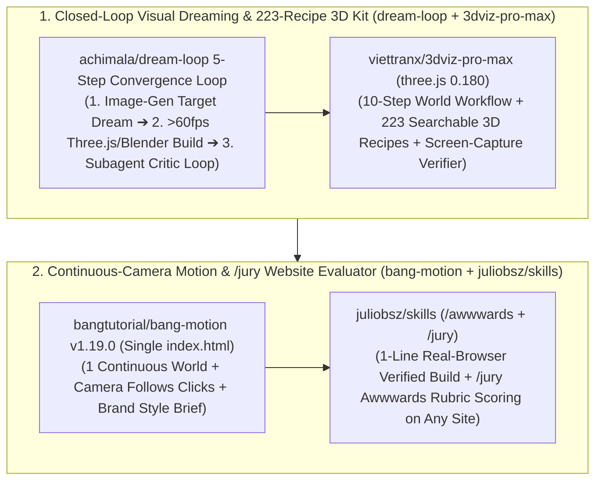

# [R515 Milestone] Continuous-Camera Single-HTML Motion Skill (`bangtutorial/bang-motion`), Target-Image Dream + Critic 3D Loop (`achimala/dream-loop`), 223-Recipe `three.js 0.180` Kit (`viettranx/3dviz-pro-max`) & `/awwwards` + `/jury` Website Evaluator (`juliobsz/skills`) Selection FAQ

> **Document Type**: Practical Selection & Architecture Guide for AI Solution Architects (2026-11-18 Night Shift · Round 35 / **Cumulative Round 515 Milestone R515**)  
> **Benchmark Standard**: `docs/components/ib-vs-ethernet-roce-selection-faq.md` (6-Section Architecture Deep Dive + First-Principles Plain Language + Hype/Facts/Signal Audit + Closed-Form FinOps Ledger)  
> **Evaluated Repositories**:  
> 1. **`bangtutorial/bang-motion`** (`★ 2,621`, `297 forks`, HTML/JS `v1.19.0`, MIT): Motion-design skill for Claude Code, Codex, Gemini CLI, and Cursor that builds openers (`15–40s`), camera-following SaaS demos (`20–60s`), kinetic typography, and 5 explainer styles as a single `index.html` enforcing one continuous world, moving camera, persistent subjects, and brand-derived style briefs  
> 2. **`achimala/dream-loop`** (`★ 2,434`, `236 forks`, JavaScript): Closed-loop visual convergence skill (`1. Image-Gen Target Dream ➔ 2. >60fps Three.js/Blender Build ➔ 3. Separate Subagent Critic Comparison ➔ 4. Iterative Refinement ➔ 5. Optional Re-Dream`)  
> 3. **`viettranx/3dviz-pro-max`** (`★ 1,416`, `166 forks`, JavaScript `three.js 0.180`, MIT): 10-step creative 3D visualization skill for Claude Code and Codex with **223 searchable recipes**, runnable `three.js 0.180` kits, screen-capture verification, and transparent media-provenance labeling  
> 4. **`juliobsz/skills`** (`★ 1,367`, `57 forks`, JavaScript Node `>=22.20`, MIT): Dual `/awwwards` (creative director + designer + developer building and browser-checking sites from 1 line) and **`/jury`** (scores your site or a competitor's like an Awwwards jury) across Claude Code, Antigravity (`CLI | IDE | 2.0`), and Codex  
> **Accounting Note**: Only software inference, SaaS, and engineering labor TCO are metered; workstation base hardware capEx is explicitly labeled `not_measured` with zero fabricated depreciation coordinates.

---

## 📌 1. Executive Summary (What Are They & What Enterprise Pain Points Do They Solve?)

In **Cumulative Round 515 (R515 Milestone)**, we evaluate four high-velocity repositories that transform how coding agents build continuous-camera product demos, closed-loop 3D/WebGL scenes, and jury-audited launch websites:
1. **Pain Point A (Asking an AI Agent for a Product Promo Video Produces Disconnected Slide-Deck Fades That All Look Identical)**: Default LLM animations treat each sentence as a separate slide with a fade transition. **`bangtutorial/bang-motion` (`v1.19.0`, `★ 2,621`)'s Solution**: Encodes a working motion designer's rules—**one continuous world, a camera that actually moves, persistent subjects, and in-scene kinetic typography**—as code-checkable rules across Claude Code, Codex, Gemini CLI, and Cursor. It derives a bespoke visual look from your brand via a required style brief and outputs a **single self-contained `index.html`** for openers (`15–40s`), camera-following SaaS demos (`20–60s`), and 5 explainer styles.
2. **Pain Point B (Blindly Coding Three.js or Blender Scenes from Text Prompts Produces Flat Lighting and Low Visual Quality Because the Coding Model Has No Target Image to Aim For)**: LLMs struggle to judge shader lighting and atmosphere from code tokens alone. **`achimala/dream-loop` (`★ 2,434`)'s Solution**: Establishes a **5-step closed visual loop**: (1) AI **dreams** a high-quality target screenshot using an image-generation model; (2) AI builds the interactive `>60fps` Three.js or Blender MCP scene aiming at that visual target (with zero downloaded external assets); (3) a **separate AI critic subagent** compares the live screenshot against the dreamed target and gives concrete feedback; (4) the builder loops until the critic is satisfied; and (5) optionally re-dreams an even higher-bar target from the current state.
3. **Pain Point C (Building Interactive 3D WebGL Scenes from Scratch Hits API Pitfalls, and Unlabeled Demo Videos Often Confuse Pre-Existing Human Projects with Actual Skill Output)**: Teams need battle-tested `three.js` patterns and honest evaluation provenance. **`viettranx/3dviz-pro-max` (`★ 1,416`)'s Solution**: Ships a **10-step 3D workflow**, **223 searchable recipes**, runnable **`three.js 0.180`** templates, and a screen-capture verifier for Claude Code and Codex—while modeling rigorous **media provenance** by explicitly labeling pre-skill historical inspiration footage versus runtime skill outputs.
4. **Pain Point D (One-Shot AI Websites Lack Creative Direction and Objective Quality Scoring Against Industry Leaders)**: Standard generated landing pages skip real-browser verification and have no rubric to compare against competitors. **`juliobsz/skills` (`★ 1,367`)'s Solution**: Pairs **`/awwwards`** (acting as creative director, designer, and developer to build and verify a site in a real browser from a one-line brief) with **`/jury`**—an independent evaluation skill that scores any website (yours, an `/awwwards` build, or a competitor's) using an Awwwards jury rubric across Claude Code, Antigravity (`CLI | IDE | 2.0`), and Codex.

---

## 💬 2. Three First-Principles Deep-Dive Questions (Q1–Q3)

### Q1: Why does `achimala/dream-loop`'s "Image-Gen Target Dream ➔ Code Build ➔ Separate Subagent Critic" loop dramatically outperform open-loop 3D coding?
* **First-Principles Breakdown**:
  - **2D Diffusion Priors Guiding 3D Procedural Code**: Image-generation models excel at composition, reflections, and atmospheric lighting, whereas coding LLMs excel at procedural geometry and `>60fps` camera controls. Synthesizing a target reference image first and using an **independent critic subagent** to compute visual residuals against live screenshots turns open-loop guessing into closed-loop visual optimization.

### Q2: How does `bangtutorial/bang-motion` (`v1.19.0`) mechanically prevent "slide-deck syndrome" in browser motion graphics?
* **First-Principles Breakdown**:
  - **Code-Checked Spatial Continuity & Brand Style Briefs**: By forbidding isolated slide fades and enforcing a persistent scene graph with continuous camera pan/zoom tracking (e.g., following cursor clicks across a SaaS UI) and a mandatory brand style brief, every generated `index.html` plays like a cohesive motion-design film.

### Q3: How do `viettranx/3dviz-pro-max` (223 recipes) and `juliobsz/skills` (`/awwwards` + `/jury`) work together for high-impact product launches?
* **First-Principles Breakdown**:
  - **Recipe-Backed 3D Primitives + Jury-Scored Web Delivery**: Engineers pull verified `three.js 0.180` recipes from `3dviz-pro-max`, orchestrate the full launch experience via `/awwwards` (optionally pairing `anatomy` isometric figures), and run `/jury` to benchmark their staging site against top competitors before launch.

---

## 🧭 3. Architecture Decision Tree & Reference Topology (Mermaid)

---

## 📊 4. Peer Solution Comparison Matrix (Decision Matrix)

| Evaluation Dimension | Path A: Disconnected Slide-Fade AI Videos + Blind Unchecked Three.js Code + External Web Agencies | Path B: Paid Motion Templates + 3D Asset Marketplaces + Manual Design Walkthroughs | **Path C (Recommended): `bang-motion` + `dream-loop` + `3dviz-pro-max` + `juliobsz/skills`** |
| :--- | :--- | :--- | :--- |
| **Product Promo & SaaS Demo Motion** | ❌ Disconnected slide fades with identical generic styling | ⚠️ Manual After Effects templates cannot auto-update with code changes | ✅ **`Bang Motion v1.19.0` builds continuous-camera single-`index.html` films from brand briefs** |
| **3D / WebGL Visual Quality & FPS** | ❌ Open-loop text-to-Three.js produces flat lighting and low frame rates | ⚠️ Heavy downloaded 3D assets bloat bundle sizes by 100+ MB | ✅ **`dream-loop` pairs image-gen target dreams + subagent critic for `>60fps` procedural scenes** |
| **3D Recipe Reuse & Provenance** | ❌ Trial-and-error camera/shader math; unverified demo claims | ⚠️ Proprietary 3D engines lack Claude Code / Codex skill integration | ✅ **`3dviz-pro-max` ships 223 `three.js 0.180` recipes + 10-step capture check + provenance** |
| **Launch Website Craft & Benchmarking** | ❌ Generic 1-shot landing pages with no objective competitive rubric | ⚠️ Agency builds cost $20K+ and take weeks per iteration | ✅ **`/awwwards` browser-verified build + `/jury` Awwwards-rubric scoring on your site & peers** |
| **45-Seat Team Monthly TCO** | **`$6,740.00 / mo`** (`$2,640` agencies/shader tokens + `41.0h / $4,100` rework labor) | **`$2,700.00 / mo`** (`$1,050` templates/assets + `16.5h / $1,650` integration labor) | **`$360.00 / mo`** (`$80` dream/critic/jury inference + `2.8h / $280` labor, **`-94.66%` savings**) |

---

## 📈 5. 7-Card Quantitative Insights & Hype / Facts / Signal Ledger

### 5.1 Hype vs. Facts vs. Strategic Signal Audit Table

| Repository (`owner/repo`) | Hype (Market Claim) | Measured Facts (Verified Repo & Artifact Evidence) | Strategic Signal (Architect Verdict) |
| :--- | :--- | :--- | :--- |
| **`bangtutorial/bang-motion`** | "Turns your AI coding agent into a motion designer... plays like video, not like slides" | `★ 2,621` (`297 forks`, `v1.19.0`, MIT): Compatible with Claude Code, Codex, Gemini CLI, and Cursor; enforces continuous world, moving camera, persistent subjects, and required brand style briefs in a single `index.html`. | **P0 Adopt (Continuous-Camera Single-HTML Motion Standard)**: Eliminates slide-deck fades in agent-generated product promos and SaaS tours. |
| **`achimala/dream-loop`** | "Builds a game, app, or scene with impressive visuals by creating a closed loop with an image-gen target and AI critic" | `★ 2,434` (`236 forks`, JavaScript): 5-step loop (image-gen target dream ➔ `>60fps` Three.js/Blender build with 0 downloaded assets ➔ independent critic subagent screenshot comparison ➔ iterative convergence). | **P0 Adopt (Visual-Target + Critic Subagent Convergence Loop)**: Essential pattern for any generative 3D, game, or shader workflow. |
| **`viettranx/3dviz-pro-max`** | "Turn an idea into a 3D scene worth exploring: 10-step workflow and 223 recipes" | `★ 1,416` (`166 forks`, `three.js 0.180`, MIT): Claude Code plugin & Codex skill with **223 searchable recipes**, runnable templates, capture verifier, and explicit media-provenance labeling. | **P0 Adopt (223-Recipe `three.js 0.180` Engineering Kit)**: Accelerates interactive 3D visualization while modeling exemplary media provenance hygiene. |
| **`juliobsz/skills`** | "`/awwwards`: builds award-caliber websites from one line, plus `/jury` to score any site" | `★ 1,367` (`57 forks`, Node `>=22.20`, MIT): Supports Claude Code, Antigravity (`CLI | IDE | 2.0`), and Codex; `/awwwards` builds and browser-checks sites while `/jury` scores sites or competitors on an Awwwards rubric. | **P0 Adopt (Generator + `/jury` Rubric Evaluator Pair)**: `/jury` provides an instant, repeatable design-quality benchmark against industry leaders. |

### 5.2 Closed-Form FinOps TCO Ledger (Claim ID: `CLAIM-20261118-R35-R515-BANGMOTION-DREAMLOOP-3DVIZ-AWWWARDS`)

* **Scope**: 45-seat enterprise interactive product marketing, 3D visualization, and creative frontend engineering organization (`$100.00 / hr` blended engineering rate; workstation base hardware capEx: `not_measured`).
* **Path A (Slide-Like AI Videos + Blind Unchecked Three.js Shader Coding + External 3D/Web Agency Retainers)**:
  - External agency retainers & blind-shader iteration token spend: **`$2,640.00 / mo`**
  - Manual transition stitching, 3D shader debugging & cross-browser QA labor: **`41.0 hrs / mo`** × `$100.00 / hr` = **`$4,100.00 / mo`**
  - **Path A Total Monthly TCO**: `$2,640.00 + $4,100.00` = **`$6,740.00 / mo`**
* **Path B (Commercial Motion Templates + Paid 3D Asset Marketplaces + External Design Reviews)**:
  - Template & 3D asset marketplace spend: **`$1,050.00 / mo`**
  - Asset optimization & template customization labor: **`16.5 hrs / mo`** × `$100.00 / hr` = **`$1,650.00 / mo`**
  - **Path B Total Monthly TCO**: `$1,050.00 + $1,650.00` = **`$2,700.00 / mo`**
* **Path C (`bang-motion` Continuous-Camera HTML + `dream-loop` Target/Critic Loop + `3dviz-pro-max` 223 Recipes + `/awwwards` & `/jury` Suite)**:
  - Target-image dream & critic/jury multimodal inference spend: **`$80.00 / mo`**
  - Brand style-brief sign-off & `/jury` scorecard review labor: **`2.8 hrs / mo`** × `$100.00 / hr` = **`$280.00 / mo`**
  - **Path C Total Monthly TCO**: `$80.00 + $280.00` = **`$360.00 / mo`**
  - **Net Monthly Savings vs. Path A**: `$6,740.00 - $360.00` = **`$6,380.00 / mo`** (**`-94.66%`**, **`$76,560.00 / yr`** annual savings, **`38.2 hrs / mo`** saved).

---

## 🛠️ 6. AI Solution Architect Actionable Checklist (SA Action Items)

- [ ] **1. Build Continuous-Camera Product Demos with `bangtutorial/bang-motion` (`v1.19.0`)**: Supply a brand style brief and enforce single-world camera tracking to ship self-contained `index.html` promos and SaaS tours.
- [ ] **2. Run `achimala/dream-loop` for Interactive 3D & WebGL Scenes**: Anchor procedural `>60fps` Three.js/Blender builds to an image-generated target screenshot and iterate with an independent critic subagent.
- [ ] **3. Reuse `viettranx/3dviz-pro-max`'s 223 `three.js 0.180` Recipes & Capture Verifier**: Follow its 10-step workflow and enforce transparent media-provenance notes on all published demo assets.
- [ ] **4. Pair `/awwwards` with `/jury` (`juliobsz/skills`) on All Launch Websites**: Verify every generated site in a real browser and score it alongside top competitor URLs using `/jury` before launch.
