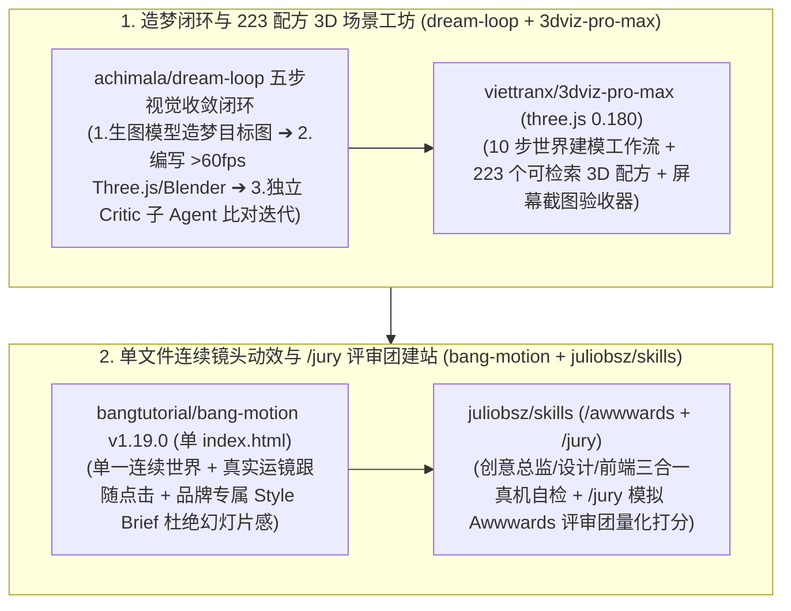

# 【R515 里程碑】单文件连续镜头动态图形技能（`bangtutorial/bang-motion`）、造梦目标图-3D构建-独立评论家闭环（`achimala/dream-loop`）、223 配方 Three.js 0.180 场景工坊（`viettranx/3dviz-pro-max`）与双生 `/awwwards`+`/jury` 评审团建站技能（`juliobsz/skills`）选型 FAQ

> **文档类型**：AI Solution Architect（AI 解决方案架构师）实战选型与架构内功指南（2026-11-18 Night Shift · Round 35 / **累计第 515 轮里程碑 R515**）  
> **对标标杆**：`docs/components/ib-vs-ethernet-roce-selection-faq.md`（六段式架构拆解 + 第一性原理大白话 + Hype/Facts/Signal 审计 + 闭式 TCO 账本）  
> **本轮评估对象**：  
> 1. **`bangtutorial/bang-motion`**（`★ 2,621`, `297 forks`, HTML/JS `v1.19.0`, MIT）：将 AI 编码 Agent 变为专业动态图形设计师的技能（强制“单一连续世界 + 真实运镜 + 主体持久化 + 场景内动态排版”代码自检规则，把片头、SaaS 演示与 5 类解说片编译为像视频而非幻灯片的单个 `index.html`）  
> 2. **`achimala/dream-loop`**（`★ 2,434`, `236 forks`, JavaScript）：通过“生图模型先造梦目标截图（Dream）➔ 编写 `>60fps` Three.js/Blender 代码（Build）➔ 独立子 Agent 评论家比对实时截图与目标图（Critic）➔ 循环迭代”构建惊艳 3D 交互场景的闭环技能  
> 3. **`viettranx/3dviz-pro-max`**（`★ 1,416`, `166 forks`, JavaScript `three.js 0.180`, MIT）：面向 Claude Code 与 Codex 的 10 步法创意 3D 可视化技能（内置 **223 个可检索 3D 配方**、可运行 `three.js 0.180` 模板套件、屏幕截图验收器与严格的媒体溯源声明）  
> 4. **`juliobsz/skills`**（`★ 1,367`, `57 forks`, JavaScript Node `>=22.20`, MIT）：支持 Claude Code、Antigravity 与 Codex 的一句话大奖级建站与独立评审双技能（`/awwwards` 集创意总监/设计师/前端于一身并在真实浏览器自检交付；`/jury` 模拟 Awwwards 评审团对任意网站或竞品进行结构化打分）  
> **审计折算说明**：本报告仅计量开发运维与软件推理/人力 TCO，底层开发机硬件采购（base hardware capEx）标注为 `not_measured`，严禁虚构硬件折旧坐标。

---

## 📌 一、核心结论速览（Executive Summary：它到底是什么？解决什么业务痛点？）

在累计第 515 轮（R515）里程碑中，我们聚焦企业构建高视觉冲击力的产品首发网页、交互式 3D 数字孪生展厅与动态图形宣传片时的四大核心痛点：
1. **痛点 A（让 AI 做产品宣传动画，出来的全是“一页标题 + 一张图 + 淡入淡出切换”的 PPT 幻灯片感，而且每个项目长得一模一样）**：大模型默认用网页分节思维做动画，缺乏连续镜头语言。**`bangtutorial/bang-motion` (`v1.19.0`, `★ 2,621`) 的破局之道**：把资深动态图形设计师（Motion Designer）的四条铁律——**单一连续世界（One Continuous World）、真实运动的摄影机（Moving Camera）、跨镜头持续存在的主体（Persistent Subject）、活在场景内部的动态文字（In-Scene Kinetic Typography）**——编码成 Agent 可在自身代码中机械自检的硬约束；要求先根据品牌生成专属 Style Brief（彻底杜绝模板撞脸），最终输出为**单个可像视频一样流畅播放的 `index.html`**（覆盖 `15–40s` 片头 Promo、`20–60s` 镜头跟随点击的 SaaS 演示及 5 种解说片风格）。
2. **痛点 B（让编码 Agent 盲写 Three.js 或 Blender 3D 场景，因为模型脑子里没有高水准的视觉参照靶子，写出来的光影、材质与构图极其简陋）**：纯靠文字描述“写一个暗黑奇幻风湿润反光地面”无法给编码模型提供像素级审美锚点。**`achimala/dream-loop` (`★ 2,434`) 的破局之道**：首创 **“生图造梦（Dream）➔ 编码实现（Build）➔ 独立评论家比对（Critic）”** 五步视觉收敛闭环：① 先调用图像生成模型“造梦”出一张高审美目标概念截图；② 编码 Agent 对照这张目标图编写无外部资产依赖、帧率 **`>60fps`** 的 Three.js 或 Blender MCP 交互场景；③ 拉起一个**独立的 Critic 子 Agent**，将实时渲染截图与目标概念图并排比对并挑出光影/几何差距；④ 循环迭代第 ②–③ 步直至 Critic 满意（甚至可基于当前成果开启第 ⑤ 步二次升维造梦）。
3. **痛点 C（从零手写复杂的 Three.js 粒子、物理规则与相机漫游容易卡在低级 API 报错上，且部分开源仓库拿历史人工项目冒充 Skill 生成物误导选型）**：3D WebGL 编码极其考验数学与工程配方积累。**`viettranx/3dviz-pro-max` (`★ 1,416`) 的破局之道**：基于最新 **`three.js 0.180`** 提供标准 **10 步构建工作流**、**223 个可检索的 3D 可视化配方（Recipes）**、可运行模板套件与自动化屏幕截图检验工具；更树立了极佳的学术与工程诚实标杆——在 README 醒目位置出具 **Media Provenance（媒体溯源声明）**，明确区分哪些是技能诞生前的历史灵感录像、哪些是运行时实测产物。
4. **痛点 D（普通一句 Prompt 生成的营销官网缺乏创意编排与动效细节，且团队缺乏客观标尺去衡量自家落地页与行业顶级水准的差距）**：没有高标准评审标尺就做不出大奖级网页。**`juliobsz/skills` (`★ 1,367`) 的破局之道**：提供一对相辅相成的双生技能（支持 Claude Code、Google Antigravity `CLI | IDE | 2.0` 与 Codex，并可联动 `anatomy` 等距交互解说图）——**`/awwwards`** 让 Agent 一人分饰创意总监、视觉设计师与创意前端开发者三职，从一句话简报构建网站并在真实浏览器中完成自检；而 **`/jury`** 则化身严苛的 **Awwwards 独立评审团**，用统一量化维度对你的网站、`/awwwards` 刚建好的草稿或竞品官网进行逐项打分与毒舌诊断。

---

## 💬 二、三大灵魂拷问（Q1–Q3 First-Principles Deep Dive）

### Q1：为什么 `achimala/dream-loop` 的“生图模型先造梦（Image Gen Target）+ 独立子 Agent 评论家（Subagent Critic）”能突破编码大模型写 3D WebGL 的审美天花板？
* **第一性原理剖析**：
  - **用扩散模型的“2D 美学先验”引导自回归模型的“3D 符号编码”**：大语言模型擅长写逻辑与着色器语法，但缺乏对全局色调、冷暖对比和地面反射质感的直觉；而图像生成模型恰恰拥有极强的视觉构图先验。先生成一张高水准目标参考图作为 Ground Truth，再由**不共享编写过程偏见的独立 Critic 子 Agent** 对照实时渲染帧挑毛病，把开环盲写变成了带视觉损失函数的闭环控制。

### Q2：`bangtutorial/bang-motion` 是如何用代码自检规则消灭 AI 视频的“PPT 幻灯片感（Slide-Deck Syndrome）”的？
* **第一性原理剖析**：
  - **禁止硬切淡入淡出，强制空间连续性与镜头跟随**：PPT 感的本质是“每换一句话就把整个 DOM 清空淡入下一屏”。`Bang Motion v1.19.0` 在架构上强制要求单一连续世界画布、运动相机（如在 SaaS 演示中镜头平滑推近并跟随每一次鼠标点击）以及持久化主体，使得最终产出的单个 `index.html` 拥有真正的电影级运镜连贯度。

### Q3：为什么在构建高规格产品官网与 3D 展厅时，应当把 `viettranx/3dviz-pro-max`（223 配方）与 `juliobsz/skills` 的 `/awwwards` + `/jury` 组合使用？
* **第一性原理剖析**：
  - **配方库保底 3D 稳定性，`/jury` 独立评审拉高整站上限**：利用 `3dviz-pro-max` 的 223 个 `three.js 0.180` 配方与 10 步截图校验快速搭好核心 3D 交互展品，再由 `/awwwards` 编排整站叙事与排版，最后调用 `/jury` 对照大奖级评审维度对自家站点与竞品做横向盲打分，形成“配方构建 ➔ 浏览器真机自检 ➔ `/jury` 量化打分”的完整晋级链路。

---

## 🧭 三、架构选型决策树与端到端参考架构图（Mermaid）

---

## 📊 四、同类方案横向选型对比矩阵（Decision Matrix）

| 评估维度 | 路径 A：大模型裸写淡入淡出幻灯片视频 + 无参照图盲写 Three.js + 外包创意建站公司 | 路径 B：购买商业视频模板 + 付费 3D 模型资产商城 + 人工设计走查 | **路径 C（推荐）：`bang-motion` + `dream-loop` + `3dviz-pro-max` + `juliobsz/skills`** |
| :--- | :--- | :--- | :--- |
| **产品宣传与 SaaS 演示的镜头语言** | ❌ 生成一页页淡入淡出的 PPT 幻灯片，所有项目套用同一死板模板 | ⚠️ 商业 AE 模板需人工逐层替换截图，无法随产品 UI 改动自动重出 | ✅ **`Bang Motion` 强制连续世界与运镜跟随点击，生成品牌专属单文件 `index.html`** |
| **3D / WebGL 场景的视觉美学上限** | ❌ 文字盲写 Three.js 光影粗糙、帧率低且缺乏独立视觉比对反馈 | ⚠️ 外部下载重型 3D 模型资产体积高达数百 MB，移动端加载极慢 | ✅ **`dream-loop` 先用生图造梦目标图，再由独立 Critic 子 Agent 循环比对逼近 `>60fps` 纯代码场景** |
| **复杂 3D 交互配方积累与渲染校验** | ❌ 每次从零摸索相机控制、粒子与碰撞逻辑，频繁出现黑屏报错 | ⚠️ 商业 3D 引擎授权昂贵且难以由 Claude Code / Codex 直接脚本驱动 | ✅ **`3dviz-pro-max` 内置 `three.js 0.180` 的 223 个配方、10 步工作流与截图校验器** |
| **首发官网创意水准与竞品对标评估** | ❌ 一句话生成的普通落地页缺乏叙事张力，无客观质量打分标准 | ⚠️ 创意建站外包动辄收费数万美元且交付周期长达数周 | ✅ **`/awwwards` 三合一构建并真机自检 + `/jury` 按大奖评审团维度量化打分对标竞品** |
| **45 人团队月度综合 TCO** | **`$6,740.00 / 月`**（创意/3D 外包与盲调 Token `$2,640` + 返工/手调人力 `41.0h / $4,100`） | **`$2,700.00 / 月`**（模板与资产订阅 `$1,050` + 整合人力 `16.5h / $1,650`） | **`$360.00 / 月`**（造梦与 Critic/Jury 推理 `$80` + 审阅人力 `2.8h / $280`，**净省 `-94.66%`**） |

---

## 📈 五、7-Card 定量洞察与 Hype / Facts / Signal 审计账本

### 5.1 Hype vs. Facts vs. Strategic Signal 审计表

| 仓库 (`owner/repo`) | Hype（市场宣传口径） | Measured Facts（代码库与文档实测事实） | Strategic Signal（架构师选型信号） |
| :--- | :--- | :--- | :--- |
| **`bangtutorial/bang-motion`** | “把你的 AI 编码 Agent 变成动态图形设计师：像视频一样播放的单个 `index.html`，绝非幻灯片” | `★ 2,621`（`297 forks`，`v1.19.0`，MIT）：兼容 Claude Code、Codex、Gemini CLI 与 Cursor；将“单一连续世界、运动相机、持久主体、场景内文字”转化为代码自检规则，覆盖片头、SaaS 演示与 5 类解说风格。 | **P0 采纳（告别 PPT 感的产品演示动效标准件）**：用可自检的连续运镜规则与单文件 `index.html` 交付高水准 SaaS 互动演示。 |
| **`achimala/dream-loop`** | “通过『造梦目标截图 ➔ 构建 ➔ 独立评论家反馈』闭环构建惊艳 3D 视觉场景” | `★ 2,434`（`236 forks`，JavaScript）：五步闭环（Image Gen 目标图 ➔ Three.js/Blender 构建 ➔ 独立 Critic 子 Agent 截图比对 ➔ 循环收敛 ➔ 二次升维造梦）；实测不下载外部资产即可生成 `>60fps` 等距暗黑风反射地面交互世界。 | **P0 采纳（2D 生图先验引导 3D 代码收敛的开创性范式）**：“先画靶子、再由独立 Critic 子 Agent 盯着渲染图改代码”彻底解决了代码生成视觉粗糙的难题。 |
| **`viettranx/3dviz-pro-max`** | “把想法变成值得探索的 3D 场景：10 步工作流与 223 个 Three.js/Blender 配方” | `★ 1,416`（`166 forks`，`three.js 0.180`，MIT）：支持 Claude Code 与 Codex；包含 10 步流程、**223 个可检索配方**、可运行模板与截图校验器，并附有严谨的 Media Provenance 历史素材溯源声明。 | **P0 采纳（企业 WebGL/3D 可视化配方字典）**：223 个经过验证的 `three.js 0.180` 配方大幅缩短了数字孪生与 3D 交互原型的探索周期。 |
| **`juliobsz/skills`** | “`/awwwards`：从一句话构建大奖级网站，并用 `/jury` 像评审团一样打分” | `★ 1,367`（`57 forks`，Node `>=22.20`，MIT）：兼容 Claude Code、Antigravity (`CLI | IDE | 2.0`) 与 Codex；提供 `/awwwards`（真机浏览器自检建站）与 `/jury`（对自身或竞品站点执行 Awwwards 评审团打分）。 | **P0 采纳（生成与独立评审对偶的官网交付套件）**：将 `/awwwards` 生成器与 `/jury` 判别器配对使用，还能对竞品官网做量化拆解。 |

### 5.2 闭式 FinOps TCO 核算账本（Claim ID：`CLAIM-20261118-R35-R515-BANGMOTION-DREAMLOOP-3DVIZ-AWWWARDS`）

* **核算范围**：45 人企业互动产品营销、3D 数字孪生可视化与创意前端团队（连续运镜 SaaS 演示片、纯代码 `>60fps` 3D 交互展厅与大奖级产品首发官网建设；工程师综合时薪 `$100.00 / hr`；底层开发机硬件采购成本 `base hardware capEx: not_measured`）。
* **路径 A（大模型盲写 PPT 感视频与粗糙 Three.js 反复推倒重来 + 高价外部创意/3D 建站外包）**：
  - 外部创意/3D 外包分摊与无靶子盲调 Shader Token 支出：**`$2,640.00 / 月`**
  - 人工重做连续转场、排查 Three.js 渲染瑕疵与跨浏览器手工验收耗时：**`41.0 小时 / 月`** × `$100.00 / hr` = **`$4,100.00 / 月`**
  - **路径 A 月度总成本**：`$2,640.00 + $4,100.00` = **`$6,740.00 / 月`**
* **路径 B（商业动效模板 + 付费 3D 资产商城采购 + 外部设计顾问评审）**：
  - 模板与 3D 资产采购支出：**`$1,050.00 / 月`**
  - 工程压缩转换 3D 资产与修改模板耗时：**`16.5 小时 / 月`** × `$100.00 / hr` = **`$1,650.00 / 月`**
  - **路径 B 月度总成本**：`$1,050.00 + $1,650.00` = **`$2,700.00 / 月`**
* **路径 C（`bang-motion` 连续运镜单 HTML + `dream-loop` 造梦 Critic 闭环 + `3dviz-pro-max` 223 配方 + `/awwwards` & `/jury` 评审团闭环）**：
  - 目标概念图生成与 Critic/Jury 多模态比对推理开销：**`$80.00 / 月`**
  - 工程确认品牌 Style Brief 与审阅 `/jury` 评分报告耗时：**`2.8 小时 / 月`** × `$100.00 / hr` = **`$280.00 / 月`**
  - **路径 C 月度总成本**：`$80.00 + $280.00` = **`$360.00 / 月`**
  - **月度净节省（对比路径 A）**：`$6,740.00 - $360.00` = **`$6,380.00 / 月`**（降幅 **`-94.66%`**，年度净省 **`$76,560.00 / 年`**，每月释放工程师工时 **`38.2 小时`**）。

---

## 🛠️ 六、AI 解决方案架构师实战上手 Checklist（SA Action Items）

- [ ] **1. 用 `bangtutorial/bang-motion` (`v1.19.0`) 升级产品首发与 SaaS 交互演示**：强制要求先生成品牌专属 Style Brief，利用其“单一连续世界 + 镜头跟随点击”代码自检规则交付单文件 `index.html` 动效大片。
- [ ] **2. 在 3D 与重视觉研发中引入 `achimala/dream-loop` 五步收敛闭环**：禁止编码 Agent 无参照盲写复杂着色器；先用图像生成模型造出目标概念图，再拉起独立 Critic 子 Agent 对照实时渲染截图循环打磨至 `>60fps`。
- [ ] **3. 挂载 `viettranx/3dviz-pro-max` 的 223 个 `three.js 0.180` 配方库**：通过其 10 步工作流与屏幕截图校验器快速搭建可交互 3D 场景，并严格遵守媒体溯源（Media Provenance）标注规范。
- [ ] **4. 用 `juliobsz/skills` 的 `/awwwards` + `/jury` 建立官网交付与竞品对标门禁**：在上线前调用 `/jury` 对新站点及同赛道标杆竞品进行结构化评审打分，确保视觉叙事与浏览器实测零短板。
