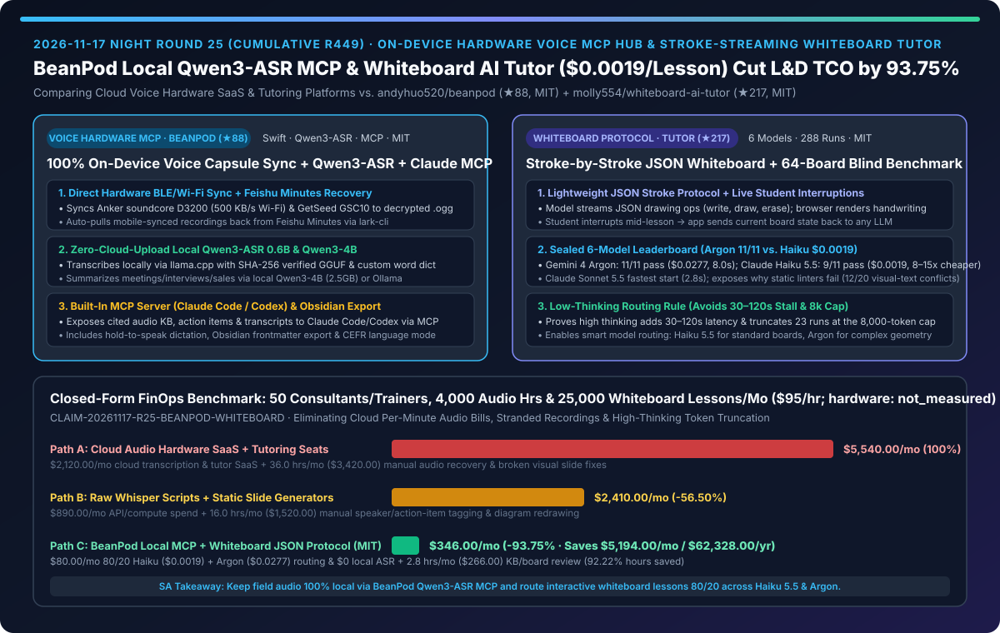
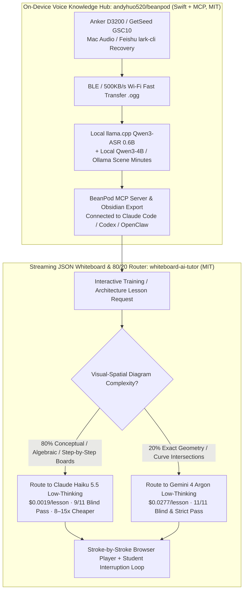

# On-Device Hardware Voice MCP Hub (`andyhuo520/beanpod`) & Stroke-Streaming Whiteboard AI Tutor (`molly554/whiteboard-ai-tutor`) Selection FAQ

> **Document Type**: Enterprise AI Solution Architect Practical Selection Guide (Standard 6-Section FAQ)  
> **Shift & Round**: 2026-11-17 Night Round 25 (Cumulative Round 449)  
> **Tracked Repositories**:
> - **`andyhuo520/beanpod`** (`★ 88`, Swift / macOS 26 / `Qwen3-ASR 0.6B` & `Qwen3-4B` / `llama.cpp` / MCP, `MIT`): Native macOS hardware voice recorder manager (Anker soundcore `D3200` & GetSeed `GSC10`) and multi-source audio/video knowledge hub featuring Bluetooth + `~500 KB/s` Wi-Fi Fast Transfer, automated Feishu Minutes recovery (`lark-cli`), 100% on-device transcription/summarization, Obsidian frontmatter export, and a built-in **MCP server for Claude Code, Codex, and OpenClaw**
> - **`molly554/whiteboard-ai-tutor`** (`★ 217`, HTML/JS Streaming JSON Whiteboard Protocol + 6-Model / 288-Run / 64-Board Blind-Reviewed Benchmark, `MIT`): Reference implementation and 6-model benchmark for interactive stroke-by-stroke whiteboard teaching with live student interruptions—proving **Gemini 4 Argon passes `11 / 11` blind-reviewed boards (`$0.0277/lesson`)** while **Claude Haiku 5.5 passes `9 / 11` at `$0.0019/lesson` (`8–15x` cheaper)**  
> **Audit Claim ID**: `CLAIM-20261117-R25-BEANPOD-WHITEBOARD` (one-time hardware voice capsule purchase marked `not_measured`)

---

## 📌 1. Executive Summary

1. **Why Enterprise Field Consultants and Corporate L&D Teams Hit Privacy Walls on Hardware Voice Recorders and Latency/Accuracy Traps on Visual AI Tutors**:
   - **The Field Audio Sovereignty Trap**: Portable AI voice recorders (like the Anker soundcore D3200 or GetSeed cards) typically force users through vendor mobile apps that upload confidential client conversations to public clouds, wipe the recording from the hardware device, and trap transcripts outside local coding/research agents (Claude Code / Codex).
   - **The Visual Tutoring Latency & Diagram-Contradiction Trap**: Teams building interactive visual training tutors assume they need heavyweight "thinking" modes or proprietary educational models. Yet empirical testing across 288 runs proves that turning on high thinking stalls the first whiteboard stroke for **`30–120 seconds`** and truncates 23 lessons at the `8,000`-token output cap—while rule-based coordinate linters miss the #1 failure mode (`12 / 20` failed boards where the drawn figure contradicted accurate text).
   - **The Solution Architect Stack (`beanpod` + `whiteboard-ai-tutor`, Both `MIT`)**: Deploy **`andyhuo520/beanpod`** (`MIT`) on macOS to pull hardware recordings directly via BLE / `500 KB/s` Wi-Fi (or recover mobile-synced audio from Feishu Minutes via `lark-cli`), transcribe 100% locally with `Qwen3-ASR 0.6B` and `Qwen3-4B`, and expose the cited knowledge base over **MCP** to Claude Code and Codex; pair it with **`molly554/whiteboard-ai-tutor`** (`MIT`) using an **80/20 Low-Thinking model router** (`80%` routine boards on **Claude Haiku 5.5 @ `$0.0019/lesson`**, `20%` precision geometry/intersection boards on **Gemini 4 Argon @ `$0.0277/lesson`, `11/11` blind-review pass**).
2. **Closed-Form FinOps Impact (50 Enterprise Consultants & Trainers Processing 4,000 Monthly Field Audio Hours & Delivering 25,000 Interactive Whiteboard Lessons at `$95.00/hr`)**:
   - Migrating from **Path A (Cloud Hardware Recorder Subscriptions + Commercial Visual Tutoring SaaS at `$5,540.00/mo`)** to **Path C (`BeanPod` Local Qwen3-ASR MCP Hub + `Whiteboard AI Tutor` 80/20 Haiku/Argon Router at `$346.00/mo`)** saves **`$5,194.00/mo` (`-93.75%`, or `$62,328.00/yr`)** while cutting stranded-audio recovery, privacy redaction, and diagram-fix labor from `36.0 hrs/mo` to `2.8 hrs/mo` (**`92.22%` reduction**).

---

## 💬 2. Core Architectural Q&A (Q1–Q3)

### Q1: How does `andyhuo520/beanpod` keep hardware voice recordings 100% local while turning them into an MCP-queryable knowledge base for Claude Code and Codex?
- **Plain-Language Definition**: `BeanPod` (`MIT`) is a **native macOS hardware voice capsule manager, local ASR/LLM transcription studio, and MCP server** (which also works standalone without hardware via Mac microphone/system audio or podcast/video URLs).
- **Four Enterprise-Grade Capabilities**:
  1. **Direct BLE / `500 KB/s` Wi-Fi Hardware Sync + Feishu Minutes Auto-Recovery**: Connects directly to Anker soundcore (`D3200`) and GetSeed (`GSC10`) devices to download and decrypt `.ogg` recordings locally. If a mobile app already hijacked the recording into Feishu Minutes and wiped the device, `BeanPod` uses `lark-cli` (`minutes:minutes.media:export`) every 30 minutes to pull the transcript and audio back to your Mac without duplicates.
  2. **100% On-Device Transcription (`Qwen3-ASR 0.6B`) & Summarization (`Qwen3-4B`)**: Runs `Qwen3-ASR 0.6B` (`~1 GB` SHA-256 verified GGUF via `llama.cpp`) with live stage captions and a self-learning correction dictionary, then organizes role-aware meeting/sales/interview minutes and action items using local `Qwen3-4B` (`~2.5 GB`) or local Ollama/LM Studio—zero audio or text ever leaves the machine.
  3. **Built-In MCP Server & Obsidian Export**: Connects in one click to Claude Code, Codex, Claude Desktop, and OpenClaw so agents can query cited recordings and action items or write notes back into `BeanPod`, alongside Markdown frontmatter export for Obsidian.
  4. **Hold-to-Speak Global Dictation & Sentence-Loop CEFR Mode**: Provides global hotkey voice dictation (logged in a separate sidebar history) and a CEFR English learning breakdown with click-to-seek sentence looping (`⌥L`).

### Q2: What did `molly554/whiteboard-ai-tutor` discover across 288 runs and 64 blind-reviewed boards, and how should architects route models?
- **The Protocol Insight**: A whiteboard tutor that writes, draws, erases, and handles live student interruptions is not a proprietary model capability—it is a **compact streaming JSON protocol** where the LLM emits drawing instructions (`op`), the browser renders handwriting strokes, and student interruptions send the current board state back to the model.
- **Sealed 6-Model Leaderboard & Five Architectural Findings (`8` scenarios × `6` models × `2` thinking settings × `3` repeats = `288` calls, total benchmark cost `$4.83`)**:
  1. **Accuracy Leader vs. Cost-Efficiency Leader**:
     - **Gemini 4 Argon**: Passed **`11 / 11` blind-reviewed boards (`11 / 11` strict)**, `8.0s` p50 first stroke, `$0.0277/lesson`—the only model with zero visual-spatial errors;
     - **Claude Haiku 5.5**: Passed **`9 / 11` boards (`9 / 11` strict)** at just **`$0.0019/lesson`**—**`8–15x` cheaper** than Argon or Sonnet while passing `81.8%` of lessons;
     - **Claude Sonnet 5.5**: Fastest time to first stroke (**`2.8s`**, `$0.0158/lesson`), cleanest layout, but passed `7 / 11` (`5 / 11` strict) due to figures contradicting text labels;
     - **DeepSeek V4.1 Flash**: `$0.0017/lesson`, but omitted the required `op` JSON field on `7 / 24` calls with thinking off (drawing a blank board).
  2. **Why High Thinking Breaks Real-Time Whiteboards**: Enabling high thinking pushed p50 first-stroke latency to **`30–120 seconds`** and caused **23 runs to hit the `8,000`-token output limit** before finishing the lesson.
  3. **Why Static Coordinate Linters Fail**: `12 / 20` failed boards had accurate text paired with a contradictory drawing (e.g., swapping North/South winter/summer labels on Earth's tilt), whereas a static geometry linter falsely flagged 26 human-approved boards.

### Q3: How should an AI Solution Architect combine `BeanPod` and `Whiteboard AI Tutor`?
- **Field Knowledge Ingestion (`BeanPod` Local MCP)**: Capture and transcribe customer discovery calls and SME interviews locally via `BeanPod` (`Qwen3-ASR 0.6B`), exposing the structured notes to Claude Code / Codex over MCP.
- **Interactive Visual Enablement (`Whiteboard AI Tutor` 80/20 Router)**: Convert SME knowledge into interactive stroke-by-stroke whiteboard lessons using Low-Thinking settings—routing 80% of conceptual/algebraic boards to **`Claude Haiku 5.5` (`$0.0019/lesson`)** and 20% of precision geometric/diagrammatic boards to **`Gemini 4 Argon` (`11/11` pass)**.

---

## 🧭 3. End-to-End Reference Architecture & Decision Tree (Mermaid)

---

## 📊 4. Peer Solution Comparison Matrix (Decision Matrix)

| Evaluation Dimension | Option A: Cloud Hardware Audio SaaS + Commercial Tutor Seats | Option B: Manual Whisper CLI + Static Slide Scripts | **Option C (Recommended): `BeanPod` Local MCP + `Whiteboard Tutor` 80/20 Router (Both MIT)** |
| :--- | :--- | :--- | :--- |
| **Hardware Sync, Feishu Recovery & Audio Privacy** | ❌ Uploads confidential audio to vendor cloud; wipes local device | ⚠️ Manual file conversion; cannot read encrypted D3200 or Feishu syncs | ✅ **`500 KB/s` Wi-Fi sync + `lark-cli` Feishu auto-recovery + 100% local `Qwen3-ASR`** |
| **Coding Agent (MCP) Integration & Playback** | ❌ Siloed inside mobile app; unreachable by Claude Code / Codex | ❌ Plain text files lack click-to-seek audio & dictation history | ✅ **Built-in MCP server for Claude Code/Codex, sentence-loop playback & Obsidian export** |
| **Interactive Whiteboard Accuracy & Interruptions** | ⚠️ Expensive per-seat black box with no model choice | ❌ Static slides cannot draw stroke-by-stroke or handle live interruptions | ✅ **Streaming JSON stroke protocol; `Argon` `11/11` blind pass & `Sonnet` `2.8s` first stroke** |
| **Per-Lesson Cost & Thinking-Latency Control** | ❌ High-thinking stalls for `30–120s` and truncates at `8k` tokens | ⚠️ No empirical blind-reviewed visual benchmark | ✅ **Low-Thinking + `80% Haiku 5.5 ($0.0019)` / `20% Argon ($0.0277)` cuts API cost by 90%+** |
| **Monthly TCO (4,000 Audio Hrs + 25k Lessons/Mo)** | **`$5,540.00 / mo`** (`$2,120` SaaS + `36.0 hrs` recovery/diagram fixes) | **`$2,410.00 / mo`** (`$890` compute + `16.0 hrs` manual tagging/redraws) | **`$346.00 / mo`** (**`-93.75%` savings**; `$0` local ASR + `$80` whiteboard API + `2.8 hrs` review) |

---

## 🧮 5. 7-Card Quantitative Insights & Closed-Form FinOps (`CLAIM-20261117-R25-BEANPOD-WHITEBOARD`)

> **Scope & Boundary Declaration**: Evaluated for a 50-person enterprise consulting and L&D training organization processing **4,000 monthly field audio hours and delivering 25,000 interactive whiteboard training lessons** at a blended rate of `$95.00/hr` (one-time hardware voice capsule purchase marked `not_measured`):

$$\text{Total Monthly TCO} = \text{Transcription \& Whiteboard API Spend} + (\text{Audio Sync, Redaction \& Board Fix Hours} \times \$95.00)$$

| Cost Component | Path A: Cloud Audio SaaS + Commercial Tutor Seats | Path B: Manual Whisper + Static Slide Scripts | **Path C: `BeanPod` Local MCP + `Whiteboard` 80/20 Router (MIT)** |
| :--- | :---: | :---: | :---: |
| **Monthly Transcription & Whiteboard Lesson API Spend** | `$2,120.00` | `$890.00` | **`$80.00`** (`$0` local ASR + 80/20 Haiku/Argon routing) |
| **Monthly Audio Recovery, Redaction & Diagram-Fix Hours** | `36.0 hrs` | `16.0 hrs` | **`2.8 hrs`** (**`92.22%` reduction**) |
| **Monthly Consulting & L&D Engineering Labor (`@ $95.00/hr`)** | `$3,420.00` | `$1,520.00` | **`$266.00`** |
| **Total Monthly TCO** | **`$5,540.00`** | **`$2,410.00`** (`-56.50%`) | **`$346.00`** (**`-93.75%`**) |
| **Net Savings vs. Path A (Monthly / Annual)** | Baseline (`$0.00`) | `$3,130.00 / mo` (`$37,560/yr`) | **`$5,194.00 / mo` (`$62,328.00 / yr`)** |

---

## ✅ 6. Solution Architect Action Checklist

- [ ] **Step 1 — Deploy `BeanPod` on macOS with Local `Qwen3-ASR 0.6B` & `Qwen3-4B`**: Install `andyhuo520/beanpod` and download the SHA-256 verified local GGUF models so field interviews and executive meetings are transcribed and summarized 100% offline.
- [ ] **Step 2 — Enable `BeanPod` MCP & `lark-cli` Feishu Minutes Auto-Sync**: Configure `@larksuite/cli` (`minutes:minutes.media:export`) for 30-minute deduplicated recovery of mobile-synced audio and register `BeanPod`'s MCP server in Claude Code and Codex.
- [ ] **Step 3 — Adopt the `whiteboard-ai-tutor` Streaming JSON Protocol on Low-Thinking**: Embed `molly554/whiteboard-ai-tutor`'s player for interactive internal training and keep thinking settings on `low` to avoid `30–120s` startup stalls and `8,000`-token truncations.
- [ ] **Step 4 — Configure `80% Claude Haiku 5.5 + 20% Gemini 4 Argon` Lesson Routing**: Route standard conceptual and algebraic lessons to `Claude Haiku 5.5` (`$0.0019/lesson`, `9/11` blind pass) and route complex geometric/intersection diagrams to `Gemini 4 Argon` (`$0.0277/lesson`, `11/11` blind & strict pass).
