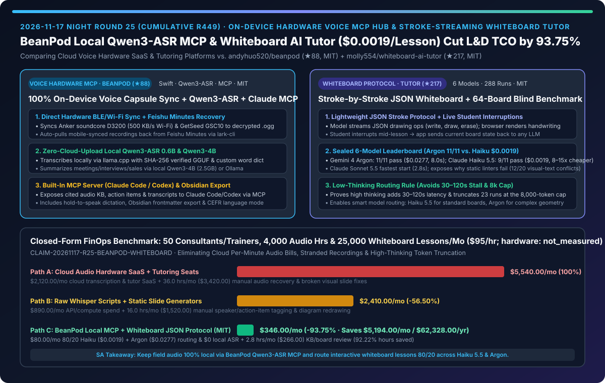
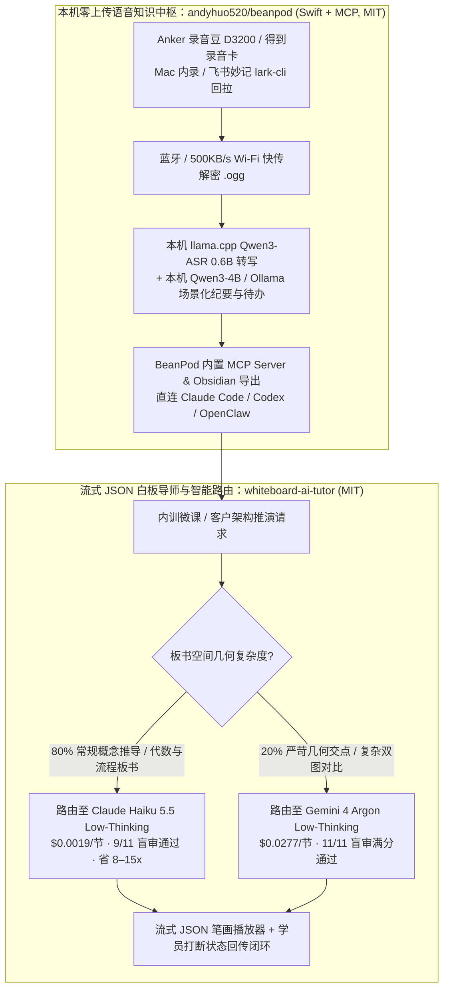

# 本机 Qwen3-ASR 硬件录音与知识库 MCP 中枢（`andyhuo520/beanpod`）及流式 JSON 交互白板教学协议与评测（`molly554/whiteboard-ai-tutor`）架构选型 FAQ

> **文档类型**：AI Solution Architect（AI 解决方案架构师）实战选型指南（六段式标准 FAQ）  
> **所属轮次**：2026-11-17 Night Round 25（Cumulative Round 449）  
> **追踪目标**：
> - **`andyhuo520/beanpod`**（`★ 88`，Swift / macOS 26 / `Qwen3-ASR 0.6B` & `Qwen3-4B` / `llama.cpp` / MCP，`MIT`）：原生 macOS 硬件录音豆（Anker soundcore `D3200` / 得到 `GSC10`）与全渠道音视频知识库管理中枢，支持蓝牙/Wi-Fi 快传（`~500 KB/s`）与飞书妙记自动回拉（`lark-cli`）、100% 本机转写与场景化纪要、逐句高亮回听、导出 Obsidian Markdown，并自带 **MCP 服务直连 Claude Code / Codex / OpenClaw**
> - **`molly554/whiteboard-ai-tutor`**（`★ 217`，HTML/JS 流式 JSON 笔画协议 + 6 大模型 × 288 次生成 × 64 块盲审白板基准，`MIT`）：把“边讲边写边画、随时允许学员打断追问的 AI 白板导师”解耦为轻量级流式 JSON 协议，并公布首个 6 大模型空间几何作图盲审榜单（**Gemini 4 Argon `11/11` 满分通过** vs **Claude Haiku 5.5 `9/11` 通过且单节成本仅 `$0.0019`，便宜 `8–15 倍`**）  
> **计量审计 ID**：`CLAIM-20261117-R25-BEANPOD-WHITEBOARD`（智能录音硬件设备本身采购费标记为 `not_measured`）

---

## 📌 一、核心结论速览（Executive Summary）

1. **为什么企业咨询顾问、销售与内部培训（L&D）团队在落地“线下拜访录音沉淀 + 交互式 AI 视觉培训导师”时，常常遭遇“硬件录音强制绑死公有云 App 泄密”与“大模型画教学图既贵又经常图文矛盾”的双重困境？**
   - **线下录音硬件的数据主权痛点**：咨询顾问与架构师随身佩戴的便携录音豆（如 Anker 录音豆或录音卡），一旦连上手机官方 App，录音往往被自动上传云端并从硬件清空——不仅机密客户访谈有出域合规风险，而且散落在飞书妙记、本地音频和播客里的知识无法通过 MCP 直接喂给电脑上的 Claude Code 或 Codex。
   - **交互式视觉培训的“高思考延迟与图文撕裂”痛点**：企业想做能边画架构图/数学几何证明边讲解、还能被员工随时打断提问的 AI 导师，如果盲目开启大模型的深思考（High Thinking）模式，首笔延迟会飙升到 **`30–120 秒`** 且频繁撞上 `8,000` Token 输出上限导致画板半途截断；而只靠规则 Linter 校验又无法发现“文字写对了、图却画反了”的空间错位。
   - **架构师黄金组合（`beanpod` + `whiteboard-ai-tutor`，双 `MIT`）**：在顾问与高管 macOS 终端部署 **`andyhuo520/beanpod`**（蓝牙/Wi-Fi 直接把硬件录音解密拉回本地，用 `Qwen3-ASR 0.6B` 与 `Qwen3-4B` 100% 本机离线转写整理，或通过 `lark-cli` 自动找回被飞书同步走的录音，再经内置 MCP Server 暴露给 Claude Code / Codex）；在企业内部实训与客户赋能白板层采用 **`molly554/whiteboard-ai-tutor`** 的流式 JSON 笔画协议与 **`80/20` 双模型路由策略**（80% 常规概念课走 **Claude Haiku 5.5 `@ $0.0019/节`**，20% 严苛几何/供需交点课走 **Gemini 4 Argon `@ $0.0277/节`，盲审 `11/11` 全过**，且统一保持 Low Thinking 避免 120s 卡顿）。
2. **闭式 FinOps 量化收益（50 名企业咨询顾问与内训师、每月处理 4,000 小时线下访谈录音并生成 25,000 节交互式白板实训微课，综合时薪 `$95.00/hr`）**：
   - 从 **Path A（商业硬件录音云端转写订阅 + 商业 AI 视觉培训 SaaS 席位，`$5,540.00/月`）** 切换至 **Path C（`beanpod` 本机 Qwen3-ASR MCP 中枢 + `whiteboard-ai-tutor` Haiku/Argon 混合路由白板协议，`$346.00/月`）**，每月净省 **`$5,194.00/月`（降幅 `-93.75%`，年化节省 `$62,328.00/年`）**，录音跨端找回、隐私脱敏与错图重画工时从 `36.0 小时/月` 降至 `2.8 小时/月`（节省 **`92.22%`**）。

---

## 💬 二、灵魂拷问 Q1–Q3（大白话拆解应用场景与架构本质）

### Q1：`andyhuo520/beanpod`（豆仓）是如何解放便携录音硬件、守住本机隐私底线，并把日常语音直接变成 Claude Code / Codex 的 MCP 知识库的？
- **大白话本质定义**：`BeanPod` 是装在 Mac 上的**“开源全能录音豆管家 + 本机离线转写纪要室 + Coding Agent 语音记忆中枢”**（没有录音豆也能直接用 Mac 麦克风/系统内录或贴播客/B站/YouTube 链接使用）。
- **四大企业级生产力特性**：
  1. **硬件直连解密 + 飞书妙记自动追回**：支持蓝牙与 **Wi-Fi 快传（`~500 KB/s`）**直接把 Anker 录音豆（`D3200`）和得到录音卡（`GSC10`）里的录音拉回本地解密为通用 `.ogg`；如果不小心先被手机 App 同步进飞书妙记并清空了设备，内置的「飞书妙记」卡片可通过官方 `lark-cli`（`minutes:minutes.media:export`）每 30 分钟自动把文字稿与原音频拉回本机并智能去重。
  2. **100% 本机离线转写与场景化整理（零数据上传）**：默认通过 `llama.cpp` 运行 **`Qwen3-ASR 0.6B`**（约 1 GB，SHA-256 校验，支持实时投屏字幕與自定义纠错词库）与本机 **`Qwen3-4B`**（约 2.5 GB，或本地 Ollama / LM Studio），自动识别会议、访谈、销售、沟通、课程等场景生成分栏纪要与待办，录音与文字全程不出本机。
  3. **一键 MCP 接入 Claude Code / Codex / OpenClaw**：自带 MCP Server 与 CLI 工具，让你的编程与办公 Agent 直接在终端里检索历史会议录音、核对某条待办的原话出处（带时间戳回放），或把分析结论写回豆仓知识库（支持一键导出带 frontmatter 的 Obsidian Markdown）。
  4. **按住说话全局语音输入 + CEFR 英语精听模式**：按住快捷键对着录音豆说话即可把文字直接打进当前软件（独立保存在侧栏历史中不污染正式会议列表）；面对英文访谈/播客，勾选「英语学习模式」即可自动拆解 CEFR 难度、重点词汇与难句语法并支持 `⌥L` 单句循环跟读。

### Q2：`molly554/whiteboard-ai-tutor` 通过 6 大模型、288 次运行和 64 块盲审白板，揭示了哪些反直觉的大模型选型真相？
- **协议本质**：让 AI 边讲课边在白板上写公式、画几何图形、擦除重写，并允许学生随时打断插话，根本不需要绑定昂贵的专有教育大模型——它只是一个**流式 JSON 绘图指令协议**（模型流式输出 JSON 笔画，浏览器渲染为手写轨迹，学生打断时把当前画板状态传回模型）。
- **6 大模型盲审排行榜与五大选型铁律（8 大科学/数学/经济学场景 × 6 模型 × 2 思考档位 × 3 次重复 = 288 次调用，总评测成本仅 `$4.83`）**：
  1. **空间几何精度之王 vs 极致性价比之王**：
     - **Gemini 4 Argon**：盲审 **`11 / 11` 全过（Strict 严苛模式同样 `11 / 11`）**，p50 首笔耗时 `8.0s`，单节成本 `$0.0277`——是唯一在复杂几何（如勾股定理双正方形拼接、供需曲线均衡点交汇）上零失误的模型；
     - **Claude Haiku 5.5**：盲审 **`9 / 11` 通过（Strict `9 / 11`）**，单节成本仅 **`$0.0019`**——比 Argon 和 Sonnet **便宜 `8–15 倍`**，却依然拿下 81.8% 的高通过率！
     - **Claude Sonnet 5.5**：首笔响应最快（**`2.8s`**），排版最整洁，但盲审仅 `7 / 11`（Strict `5 / 11`），因为常出现“文字写对了，但画出来的图形与文字相反（如把朝向太阳的地球标成北半球冬季）”。
  2. **为什么绝对不能在实时白板上无脑开“深思考（Thinking On）”？**：实测开启 Thinking 后，Gemini 3.8 Flash 与 DeepSeek 模型的首笔等待时间暴涨至 **`30–120 秒`**，且有 **23 次调用直接撞上 `8,000` Token 输出上限**导致白板还没画完就断掉！
  3. **为什么静态坐标 Linter 靠不住？**：在未通过盲审的 20 块白板中，有 **12 块是因为“图形语义与正确文字自相矛盾”**；而机械规则 Linter 报错的 41 块白板里有 26 块其实人类盲审完全合格。

### Q3：企业 AI 架构师如何把 `BeanPod` 与 `Whiteboard AI Tutor` 组合成“知识采集 → 交互式内训赋能”闭环？
- **知识采集团队（`BeanPod` + 本地 `Qwen3-ASR` + MCP）**：顾问与 SME 专家将日常客户会议、技术架构评审录音通过 `BeanPod` 在本地转写为结构化知识库，并通过 MCP 暴露给内部课程生成 Agent；
- **交互式白板实训台（`Whiteboard AI Tutor` 双模型路由）**：Agent 提取知识库中的核心痛点与推演逻辑，通过流式 JSON 白板协议生成可随时打断提问的交互式微课——常规流程说明默认路由给 **`Claude Haiku 5.5`（`$0.0019/节`，Low Thinking）**，涉及精确架构拓扑或几何/数据交点的板书自动路由给 **`Gemini 4 Argon`（`11/11` 精度）**。

---

## 🧭 三、端到端集成参考架构与选型决策树（Mermaid）

---

## 📊 四、同赛道方案横向选型对比矩阵（Decision Matrix）

| 评估维度 | 方案 A：商业硬件云端转写订阅 + 商业 AI 视觉培训 SaaS | 方案 B：手工跑 Whisper 脚本 + 静态 PPT 生成器 | **方案 C（推荐）：`BeanPod` 本机 MCP + `Whiteboard Tutor` 80/20 路由（双 MIT）** |
| :--- | :--- | :--- | :--- |
| **硬件录音同步、飞书防丢与数据隐私** | ❌ 强制上传厂商公有云，手机同步后电脑端找不到原音频 | ⚠️ 需手工导出转码，无法直接解析录音豆加密音频与飞书妙记 | ✅ **直连录音豆 Wi-Fi 快传 + `lark-cli` 自动追回飞书妙记 + 本机 `Qwen3-ASR` 零上传** |
| **Coding Agent (MCP) 接入与逐句回听** | ❌ 封闭在手机 App 内，Claude Code / Codex 无法直接检索 | ❌ 纯文本文件无逐句时间戳联动与全局语音输入历史 | ✅ **内置 MCP Server 直连 Claude Code/Codex，支持单击回听、Obsidian 导出与 CEFR 英语模式** |
| **交互式白板空间作图精度与打断响应** | ⚠️ 商业黑盒按席位高价收费，无法自选底层模型 | ❌ 静态 PPT 无法边讲边画，也不支持学员半途打断重画 | ✅ **流式 JSON 笔画协议支持实时打断；`Argon` 达 `11/11` 盲审满分，`Sonnet` `2.8s` 首笔响应** |
| **单节微课模型推理成本与防截断控制** | ❌ 盲目开深思考导致首笔卡顿 `30–120s` 且撞 `8k` 上限截断 | ⚠️ 无多模型盲审基准支撑 | ✅ **Low-Thinking + `80% Haiku 5.5 ($0.0019)` / `20% Argon ($0.0277)` 路由，成本压降 90%+** |
| **月度总拥有成本（TCO，4000h 录音 + 2.5 万微课）** | **`$5,540.00 / 月`**（含 `$2,120` 云订阅 + `36.0h` 导音频与改错图） | **`$2,410.00 / 月`**（含 `$890` 算力 + `16.0h` 手工整理与重画） | **`$346.00 / 月`**（**净省 `-93.75%`**，`$0` 本机转写 + `$80` 混合白板 API + `2.8h` 抽检） |

---

## 🧮 五、7-Card 定量洞察与闭式 FinOps 核算（`CLAIM-20261117-R25-BEANPOD-WHITEBOARD`）

> **核算范围与边界声明**：面向 50 名企业咨询顾问与内部讲师团队，每月处理 **4,000 小时线下会议/访谈录音并生成 25,000 节交互式白板培训微课**（综合时薪 `$95.00/hr`；录音豆硬件本身一次性采购费标记为 `not_measured`）：

$$\text{Total Monthly TCO} = \text{Transcription \& Whiteboard API Spend} + (\text{Audio Sync, Redaction \& Board Fix Hours} \times \$95.00)$$

| 成本构成项 | Path A：商业云转写订阅 + 商业培训 SaaS | Path B：手工 Whisper + 静态课件脚本 | **Path C：`BeanPod` 本机 MCP + `Whiteboard` 80/20 路由（MIT）** |
| :--- | :---: | :---: | :---: |
| **月度语音转写与白板生成 API 账单** | `$2,120.00` | `$890.00` | **`$80.00`**（本机 ASR `$0` + Haiku/Argon 混合路由） |
| **月度跨端找音频、隐私脱敏与图文矛盾返修工时** | `36.0 hrs` | `16.0 hrs` | **`2.8 hrs`**（直降 **`92.22%`**） |
| **月度顾问与培训工程师人工成本（`@ $95.00/hr`）** | `$3,420.00` | `$1,520.00` | **`$266.00`** |
| **月度总拥有成本（Monthly TCO）** | **`$5,540.00`** | **`$2,410.00`**（`-56.50%`） | **`$346.00`**（**`-93.75%`**） |
| **相对 Path A 净节省（月度 / 年化）** | 基线（`$0.00`） | `$3,130.00 / 月`（`$37,560/年`） | **`$5,194.00 / 月`（`$62,328.00 / 年`）** |

---

## ✅ 六、AI 解决方案架构师实战上手 Checklist（SA Action Checklist）

- [ ] **Step 1 — 在顾问 Mac 上部署 `BeanPod` 并下载本机 `Qwen3-ASR 0.6B` 与 `Qwen3-4B`**：安装 `andyhuo520/beanpod`，在引导页一键下载经 SHA-256 校验的本地转写与纪要模型，确保敏感客户访谈录音 100% 在本机闭环处理。
- [ ] **Step 2 — 开启 `BeanPod` MCP 服务与 `lark-cli` 飞书妙记自动回拉**：配置 `@larksuite/cli`（开通 `minutes:minutes.media:export` 权限）开启每 30 分钟自动回拉去重，并将 `BeanPod` MCP Server 挂载至 Claude Code / Codex。
- [ ] **Step 3 — 接入 `whiteboard-ai-tutor` 流式 JSON 笔画播放器并禁用高延迟 Thinking**：在内部赋能平台集成 `molly554/whiteboard-ai-tutor` 前端播放器，统一将模型推理设为 Low-Thinking 档位，杜绝 `30–120s` 首笔卡顿与 `8,000` Token 截断。
- [ ] **Step 4 — 实施 `80% Claude Haiku 5.5 + 20% Gemini 4 Argon` 分级白板路由**：将常规代数、概念与流程讲解路由至 `Claude Haiku 5.5`（`$0.0019/节`），将涉及严格几何证明、曲线交点与方位对齐的板书路由至 `Gemini 4 Argon`（盲审 `11/11` 全过）。
