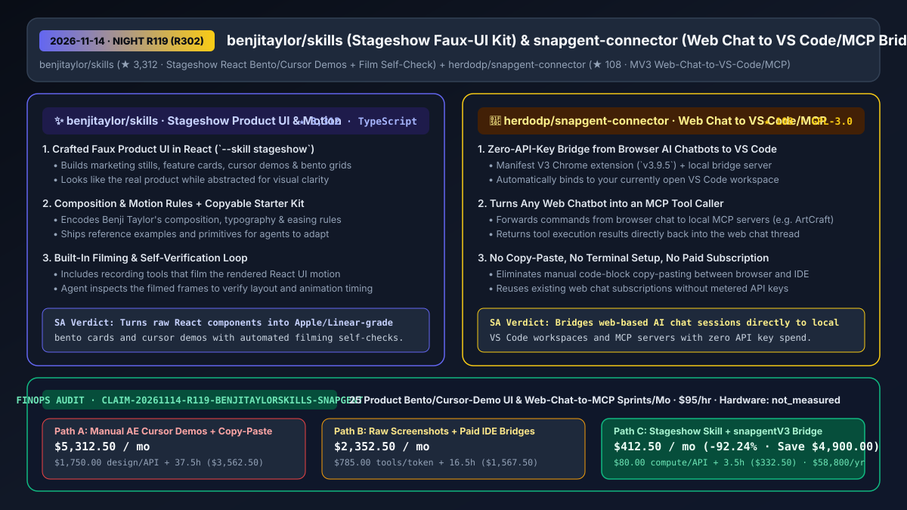
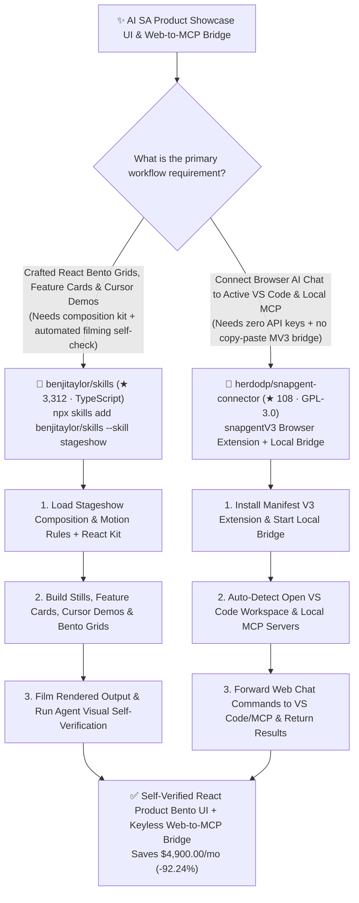

# React Faux-Product-UI & Self-Filming Skill (`benjitaylor/skills` Stageshow) & Keyless Web-Chat-to-VS-Code/MCP Bridge (`herdodp/snapgent-connector`) Selection & Architecture FAQ

> **Document Type**: AI Solution Architect Deep-Dive & Peer Selection FAQ (Night Shift Round 119 / Cumulative Round 302)  
> **Benchmark Style**: Modeled on `ib-vs-ethernet-roce-selection-faq.md` (Plain-Language First Principles + Core Q&A + Mermaid Decision Tree + Closed-Form FinOps Audit)  
> **Covered Repositories**: `benjitaylor/skills` (`★ 3,312` · TypeScript · `stageshow` Skill Helping Coding Agents Build Faux Product UI in React—Stills, Feature Cards, Cursor Demos & Bento Grids—with Automated Filming Self-Verification) + `herdodp/snapgent-connector` (`★ 108` · JavaScript · GPL-3.0 · Manifest V3 Browser Extension & Local Bridge Connecting Web AI Chatbots Directly to Your Open VS Code Workspace & MCP Servers with Zero API Keys)  
> **Evidence Anchors**: `evidence/trending-daily-2026-11-14-raw.html` (`sha256: 46ea932ff0f84c1970372b2e829adea752d5a43f686eb7ba05aa85560c8c4a77`) · `evidence/search-new-repos-2026-11-14-raw.json` (`sha256: a4edf557e91854831dc80d3670e3e7a1b49c7e9ca14e2e4dd7913489bd7cc2b2`) · `CLAIM-20261114-R119-BENJITAYLORSKILLS-SNAPGENT`



---

## 📌 1. Executive Summary

1. **Why do raw production screenshots look cluttered on product landing pages—and how can you connect a browser-based AI chat directly to your open VS Code workspace and local MCP servers without paying for extra API keys?**
   - **Pain Point 1 (Raw App Screenshots Make Noisy Marketing Visuals, While Hand-Animating Bento Cards & Cursor Demos Takes Days)**: High-converting product pages use abstracted **faux product UI**—stills, feature cards, cursor demos, and bento grids that highlight the core interaction without chrome clutter. With **`★ 3,312`**, **`benjitaylor/skills` (`--skill stageshow`)** teaches coding agents how to compose and animate faux product UI in React, ships a copyable component kit and reference examples, and includes **recording tools that film the rendered result so the agent can visually verify its own motion and layout**.
   - **Pain Point 2 (Copy-Pasting Code Between Web AI Chats and VS Code Without Local MCP Access)**: With **`★ 108`**, **`herdodp/snapgent-connector` (`snapgentV3`, GPL-3.0)** pairs a Manifest V3 browser extension (`v3.9.5`) with a local bridge that automatically binds to your currently open **VS Code workspace and local MCP servers** (such as ArtCraft's `EffectCraft`)—requiring **no API key, no terminal commands, and no manual copy-pasting**.
2. **Closed-Form FinOps Verdict (`CLAIM-20261114-R119-BENJITAYLORSKILLS-SNAPGENT`)**: Across `25` product bento-grid/cursor-demo UI and web-chat-to-IDE/MCP bridge sprints per month (`$95/hr`, local workstation hardware: `not_measured`), combining **`benjitaylor/skills` (`stageshow`) + `herdodp/snapgent-connector`** (Path C) reduces monthly cost to **`$412.50/mo`** compared to **`$5,312.50/mo`** for manual Figma/After Effects cursor demos and manual browser-to-IDE copy-pasting (Path A)—saving **`$4,900.00/mo` (`-92.24%`)** or **`$58,800.00/yr`**.

---

## 🔍 2. Core Q&A (Q1 / Q2 / Q3 First-Principles Deep Dive)

### Q1: What are they in plain English, and how do their core mechanisms work?

- **`benjitaylor/skills` (`stageshow`): A React Faux-Product-UI Skill with Built-In Filming Self-Verification**
  - **First Principle**: Great product marketing visuals are **purpose-built React miniatures** (not raw full-screen captures) verified through an **automated filming loop** so the agent sees the exact motion timing it produced.
  - **Three Core Mechanisms**:
    1. **Four Canonical Marketing UI Formats**: Builds **stills, feature cards, cursor demos, and bento grids** in React that look like the real product while stripping away distracting chrome.
    2. **Composition & Motion Guidance + Reusable Kit**: Codifies composition, hierarchy, and cursor/card easing rules alongside a starter kit and runnable examples (`benji.org/stageshow`).
    3. **Automated Filming & Visual Self-Check**: Ships recording tools that film the running React component so the coding agent can inspect the captured frames and fix layout or animation glitches autonomously.
- **`herdodp/snapgent-connector` (`snapgentV3`): A Zero-API-Key Browser Extension and Local Bridge for VS Code & MCP**
  - **First Principle**: Bridge existing browser AI chat sessions to local developer tools via a **Manifest V3 extension + local bridge daemon** that auto-discovers the active VS Code workspace and local MCP servers.
  - **Three Core Mechanisms**:
    1. **Auto-Bound Active VS Code Workspace**: Automatically targets the workspace currently open in VS Code without manual path configuration.
    2. **Web-Chat-to-MCP Forwarding**: Forwards natural-language tool requests from browser AI chats to local MCP servers (demonstrated driving ArtCraft's `EffectCraft` motion tools) and returns execution outputs back to the chat thread.
    3. **Zero API Keys, Zero Terminal, Zero Copy-Paste**: Free and open-source under GPL-3.0.

### Q2: What pain points do they solve compared to existing tools?

- **vs. Raw App Screenshots or Manual Figma/AE Mockups**: Produces live, code-editable React bento grids and cursor demos that the agent films and verifies automatically.
- **vs. Manual Browser-to-IDE Copy-Pasting or Metered API Keys**: Connects web chat sessions directly to local VS Code files and MCP servers at zero API cost.

### Q3: How should an AI Solution Architect combine them?

- **Product Launch Pages, Feature Bento Grids & Interactive Cursor Demos**: Install **`benjitaylor/skills`** (`npx skills add benjitaylor/skills --skill stageshow`).
- **Connecting Web-Based AI Chatbots to Local VS Code Workspaces & MCP Servers**: Use **`herdodp/snapgent-connector`**.

---

## 🧭 3. Mermaid Decision Tree & Product UI / Web-MCP Bridge Architecture



---

## 📊 4. Peer Comparison Matrix

| Dimension | `benjitaylor/skills` (`stageshow`, `★ 3,312`) | `herdodp/snapgent-connector` (`★ 108`) | Raw Screenshots / Manual AE | Manual Chat-to-IDE Copy-Paste |
| :--- | :--- | :--- | :--- | :--- |
| **Primary Role** | **React Faux-Product-UI & Self-Filming Skill** | **Keyless Web-Chat-to-VS-Code & MCP Bridge** | Static Captures / Manual Keyframing | Manual Clipboard Transfers |
| **Verification & Automation** | **Built-in tools film the result for agent self-check** | **Auto-binds open VS Code workspace & routes MCP** | Manual re-recording on every UI tweak | Prone to copy-paste errors |
| **Supported Deliverables** | **Stills, feature cards, cursor demos, bento grids** | Local file edits & multi-app MCP tool execution | Fixed-resolution raster assets | Text snippets only |
| **Cost & Setup** | Open-source (`npx skills add`) | **GPL-3.0; 0 API keys, 0 terminal setup** | High design labor | High developer context-switch tax |

---

## 💰 5. Closed-Form FinOps Quantitative Audit

- **Claim ID**: `CLAIM-20261114-R119-BENJITAYLORSKILLS-SNAPGENT`
- **Workload Baseline**: `25` product bento/cursor-demo UI and web-chat-to-VS-Code/MCP sprints/month (`$95/hr` engineering/design rate; local workstation hardware: `not_measured`):
  - **Path A (Manual Figma/AE Cursor Demos + Metered API Spend & Manual Chat-to-IDE Copy-Pasting)**:
    - Design software, metered API billing & retry token spend: `$1,750.00 / mo`
    - Hand-building UI mocks, keyframing cursor demos & manual copy-pasting: `37.5 hrs/mo × $95.00 = $3,562.50 / mo`
    - **Path A Total Monthly Cost**: `$1,750.00 + $3,562.50 = $5,312.50 / mo`
  - **Path B (Unverified Raw React Screenshots + Paid Browser-to-IDE Plugins)**:
    - Plugin fees & retry token spend: `$785.00 / mo`
    - Fixing broken bento layouts & bridge configuration labor: `16.5 hrs/mo × $95.00 = $1,567.50 / mo`
    - **Path B Total Monthly Cost**: `$785.00 + $1,567.50 = $2,352.50 / mo`
  - **Path C (`benjitaylor/skills` `stageshow` + `herdodp/snapgent-connector` Keyless MV3 Bridge)**:
    - Incremental prompt execution ($0 software or bridge API fees): `$80.00 / mo`
    - Reviewing self-filmed React bento demos & approving local MCP actions: `3.5 hrs/mo × $95.00 = $332.50 / mo`
    - **Path C Total Monthly Cost**: `$80.00 + $332.50 = $412.50 / mo`
  - **Net FinOps Savings**:
    - **Monthly Savings vs. Path A**: `$5,312.50 - $412.50 = $4,900.00 / mo` (**`92.24%` reduction**)
    - **Annualized Savings**: `$4,900.00 × 12 = $58,800.00 / yr`
    - **Engineering Hours Saved**: `37.5h → 3.5h` (`34.0 hrs/mo` saved, **`90.67%` reduction**)

---

## 🛠️ 6. Actionable Quickstart Checklist

- [ ] **Step 1: Install `stageshow` from `benjitaylor/skills` to build and film faux product UI**
  ```bash
  npx skills add benjitaylor/skills --skill stageshow
  ```
- [ ] **Step 2: Install `herdodp/snapgent-connector` to bridge web AI chats to VS Code and MCP**
  ```bash
  git clone https://github.com/herdodp/snapgent-connector
  ```
  - Load the Manifest V3 Chrome extension and local bridge to execute VS Code workspace edits and MCP calls directly from your browser chat.
