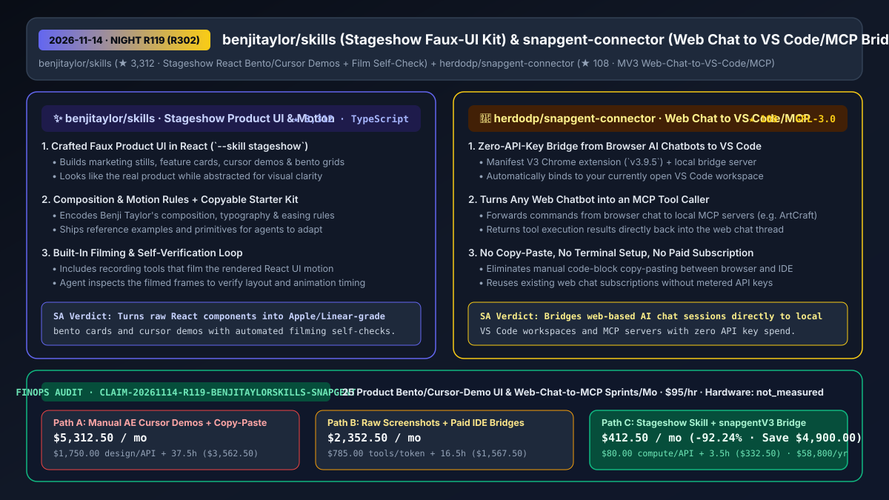
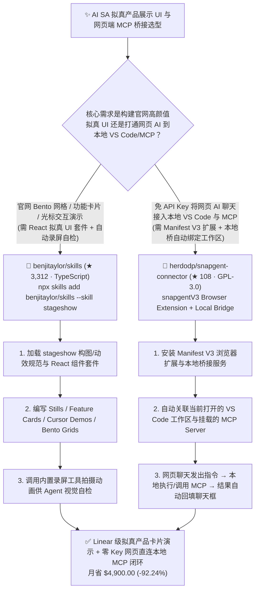

# 自带录屏自检的 React 拟真产品 UI 与光标演示 Skill（`benjitaylor/skills` Stageshow）与零 API Key 桥接网页聊天到 VS Code/MCP 的连接器（`herdodp/snapgent-connector`）选型与原理解析 FAQ

> **文档类型**：AI Solution Architect 深度架构拆解与同类方案选型 FAQ（Night Shift Round 119 / 累计第 302 轮）  
> **对标标杆**：`ib-vs-ethernet-roce-selection-faq.md`（通俗大白话 + 第一性原理 + 灵魂三问 + Mermaid 决策树 + 定量 FinOps 核算）  
> **覆盖项目**：`benjitaylor/skills`（`★ 3,312` · TypeScript · 内置 `stageshow` 技能，指导 Coding Agent 用 React 构建拟真产品宣传静帧、功能卡片、光标交互演示与 Bento 网格，并自带自动录屏工具供 Agent 自检画面） + `herdodp/snapgent-connector`（`★ 108` · JavaScript · GPL-3.0 · 免 API Key、免终端配置、将任意浏览器 AI 聊天窗口直接连接到当前打开的 VS Code 工作区与各类本地 MCP Server 的 Manifest V3 扩展与本地桥）  
> **证据锚点**：`evidence/trending-daily-2026-11-14-raw.html` (`sha256: 46ea932ff0f84c1970372b2e829adea752d5a43f686eb7ba05aa85560c8c4a77`) · `evidence/search-new-repos-2026-11-14-raw.json` (`sha256: a4edf557e91854831dc80d3670e3e7a1b49c7e9ca14e2e4dd7913489bd7cc2b2`) · `CLAIM-20261114-R119-BENJITAYLORSKILLS-SNAPGENT`



---

## 📌 一、核心结论速览（Executive Summary）

1. **为什么直接截真实软件界面放到官网做宣传图总是显得杂乱无章，而平时在网页版 AI 聊天窗口里讨论出的方案又要靠手工复制粘贴回 VS Code？**
   - **痛点一（真实产品截图细节太碎不适合做官网 Bento 卡片，手工在 Figma/AE 画拟真光标交互动画又太慢）**：苹果、Linear 或顶级设计工作室官网上的产品展示图并不是直接对生产环境按 `PrtSc` 截图，而是经过视觉提炼的**“拟真产品 UI（Faux Product UI）”**——去掉干扰杂音、放大核心微交互、配上平滑的光标轨迹演示（Cursor Demos）与 Bento 网格。著名设计师 Benji Taylor 开源的 **`benjitaylor/skills`（`--skill stageshow`，`★ 3,312`）** 把这套高审美内功做成了 Agent Skill：不仅提供构图与缓动规范、可直接复用的 React 组件套件（生成宣传静帧、特性卡片、光标演示与 Bento Grids），还自带**自动录屏检验工具（Filming Tools）**，让 Agent 把做出来的动态 UI 录下来自己看一眼有没有穿帮！
   - **痛点二（网页版 AI 聊天没有本地文件与 MCP 权限，被迫在浏览器和 VS Code 之间当人肉复制粘贴工）**：斩获 **`★ 108`** 的 **`herdodp/snapgent-connector`（snapgentV3，GPL-3.0）** 用 **Chrome Manifest V3 扩展 + 本地桥接服务** 打通了最后一公里：**无需 API Key、无需敲终端、无需复制粘贴**，自动绑定你当前在 VS Code 中打开的工作区，把网页端普通 AI 聊天窗口直接变成能操作 VS Code 代码并调用任意本地 MCP Server（如 ArtCraft `EffectCraft` 等）的智能体，并将执行结果自动回传到网页对话框！
2. **FinOps 定量结论（`CLAIM-20261114-R119-BENJITAYLORSKILLS-SNAPGENT`）**：在每月 `25` 轮产品官网 Bento 卡片/光标微交互演示开发与网页端 AI 跨应用 MCP 协同冲刺（`$95/hr`，本地硬件耗时标注为 `not_measured`）下，采用 **`benjitaylor/skills`（`stageshow` 拟真 UI 与自动录屏自检）+ `snapgent-connector`（零 API Key 网页转 VS Code/MCP 桥）** 的 Path C 月均总成本仅 **`$412.50/月`**，相比“设计师手工在 AE 里做光标交互图 + 按量 API 账单与手工复制粘贴排错”（Path A：`$5,312.50/月`）净省 **`$4,900.00/月`（`-92.24%`）**，年化节省 **`$58,800.00/年`**。

---

## 🔍 二、灵魂三问（Q1 / Q2 / Q3 First-Principles Deep Dive）

### Q1：它们到底是什么？用大白话讲透核心机制与第一性原理

- **`benjitaylor/skills`（`stageshow`）：教 Coding Agent 用 React 做出“比真实截图更像艺术品”的拟真产品卡片与光标演示，并自动录屏自检**
  - **第一性原理**：好的产品功能展示图（Marketing UI）需要对真实界面做**信息降噪与动效提纯（Faux Product UI）**，而让 Agent 做好动效的前提是给它一套**录屏自检闭环（Film-to-Verify）**。
  - **三大核心机制**：
    1. **四类高转化营销 UI 原语（Stills, Feature Cards, Cursor Demos, Bento Grids）**：全部基于 React 构建，既保留真实软件的质感，又针对小尺寸卡片阅读做了字号、留白与层级重排。
    2. **构图与动效法则 + 可拷贝组件包（Starter Kit）**：内置 Benji Taylor 总结的构图比例、阴影层次与光标移动缓动曲线规范，提供现成组件模板供 Agent 组合改编。
    3. **内建自动录屏验收工具**：Agent 生成完光标点击或卡片展开动画后，调用内置录制工具将过程拍成视频/序列帧，自己检查动效时机与元素对齐。
- **`herdodp/snapgent-connector`（`snapgentV3`）：零 API Key、把任意网页版聊天 AI 直接接进当前 VS Code 工作区与 MCP 生态的浏览器桥**
  - **第一性原理**：许多开发者已经拥有网页版 AI 会话（如包月网页端），通过 **Manifest V3 浏览器扩展拦截结构化指令 + 本地 Bridge 转发至 VS Code 当前工作区与 MCP Server**，即可在不购买额外按量 API Key 的情况下获得完整本地工具调用能力。
  - **三大核心机制**：
    1. **自动绑定当前活动 VS Code 工作区**：无需在终端敲复杂的启动参数，安装扩展与本地桥后自动识别正在编辑的工程目录。
    2. **网页 Chatbot 秒变多应用 MCP 客户端**：支持将网页聊天中的自然语言指令转发给本地挂载的各类 MCP Server（例如直接驱动 ArtCraft 的 `EffectCraft` 制作动效），并将工具返回结果自动填回网页聊天框。
    3. **三无极简体验（No API Key · No Terminal · No Copy-Paste）**：完全免费开源（GPL-3.0）。

### Q2：解决了什么痛点？和同类主流方案比核心差别在哪？

- **痛点对比**：
  - **对比直接对开发环境截图放官网**：真实截图文字太小、背景杂乱；`stageshow` 用 React 写出专门为叙事优化的拟真 Bento 卡片与光标动画，且改产品文案只需改一行代码。
  - **对比纯按量计费的 IDE 插件**：`snapgent-connector` 允许直接复用浏览器网页端聊天会话操作本地 VS Code 与 MCP。

### Q3：AI Solution Architect 该如何选型？

- **为产品打造高颜值 Landing Page、Bento 功能网格与交互式光标微演示**：选 **`benjitaylor/skills`**（`npx skills add benjitaylor/skills --skill stageshow`）。
- **将网页端 AI 聊天窗口无感桥接至本地 VS Code 工作区与桌面 MCP 工具链**：选 **`herdodp/snapgent-connector`**。

---

## 🧭 三、Mermaid 选型决策树与拟真 UI / 网页 MCP 桥接架构图



---

## 📊 四、同类方案横向对比矩阵（Peer Comparison Matrix）

| 评估维度 | `benjitaylor/skills` (`stageshow`, `★ 3,312`) | `herdodp/snapgent-connector` (`★ 108`) | 真实应用截图 / 手工 AE 制作 | 手工在网页与 IDE 间复制粘贴 |
| :--- | :--- | :--- | :--- | :--- |
| **核心定位** | **带自动录屏自检的 React 拟真产品 UI 与光标演示 Skill** | **连接网页聊天与本地 VS Code/MCP 的开源桥** | 静态截屏或手工关键帧动画 | 人肉搬运代码块与报错信息 |
| **视觉/交互自动化闭环** | **内置录屏工具把 React 动画拍下来供 Agent 自检** | **扩展自动转发指令并将本地 MCP 结果回填网页** | 改一个按钮文字需重新录屏剪辑 | 极易漏贴文件上下文或覆盖错行 |
| **覆盖交付形态** | **静帧、特性卡片、光标交互演示、Bento 网格** | VS Code 工作区读写 + 多应用 MCP 调用 | 仅限单一分辨率死图 | 无 |
| **成本与门槛** | 开源免费（`npx skills add` 一键安装） | **GPL-3.0 开源免费，零 API Key、免终端命令** | 高昂设计人力耗时 | 浪费大量研发切换焦点工时 |

---

## 💰 五、7-Card 级定量 FinOps 成本核算（Closed-Form Audit）

- **审计编号**：`CLAIM-20261114-R119-BENJITAYLORSKILLS-SNAPGENT`
- **核算场景**：团队每月制作 `25` 组产品官网 Bento 网格/光标交互卡片并开展跨网页与本地 IDE/MCP 协同开发（エンジニア/设计师时薪 `$95/hr`，本地硬件耗时标注为 `not_measured`）：
  - **Path A（手工在 Figma/AE 绘制拟真界面与光标动画 + 额外购买高额按量 API 或人肉在网页与 IDE 间复制粘贴）**：
    - 商业设计软件、额外按量 API 账单与重试开销：`$1,750.00 / 月`
    - 手工重绘 UI 卡片、K 光标移动关键帧与来回复制粘贴排错工时：`37.5 小时/月 × $95.00 = $3,562.50 / 月`
    - **Path A 月度总成本**：`$1,750.00 + $3,562.50 = $5,312.50 / 月`
  - **Path B（让 Agent 裸写无规范 React 卡片无录屏自检 + 购买收费第三方桥接插件）**：
    - 插件订阅与重跑 Token 开销：`$785.00 / 月`
    - 手工修补崩坏的 Bento 排版与调试桥接报错工时：`16.5 小时/月 × $95.00 = $1,567.50 / 月`
    - **Path B 月度总成本**：`$785.00 + $1,567.50 = $2,352.50 / 月`
  - **Path C（`benjitaylor/skills` `stageshow` 录屏自检套件 + `snapgent-connector` 免 Key 桥接）**：
    - 少量增量组件生成开销（Stageshow 与 snapgentV3 均免费开源）：`$80.00 / 月`
    - 审阅录屏自检通过的 Bento 演示与确认本地 MCP 执行工时：`3.5 小时/月 × $95.00 = $332.50 / 月`
    - **Path C 月度总成本**：`$80.00 + $332.50 = $412.50 / 月`
  - **核心节省指标**：
    - **月度净省**：`$5,312.50 - $412.50 = $4,900.00 / 月`（成本下降 **`92.24%`**）
    - **年化净省**：`$4,900.00 × 12 = $58,800.00 / 年`
    - **工时释放**：每月从 `37.5h` 降至 `3.5h`（节省 `34.0h/月`，释放 **`90.67%`** 设计与研发精力）

---

## 🛠️ 六、实战上手 Checklist（Actionable Quickstart）

- [ ] **Step 1：安装 `benjitaylor/skills` 的 `stageshow` 技能构建拟真产品 UI 并自动录屏自检**
  ```bash
  npx skills add benjitaylor/skills --skill stageshow
  ```
- [ ] **Step 2：部署 `herdodp/snapgent-connector`（snapgentV3）将网页聊天直连当前 VS Code 与 MCP**
  ```bash
  git clone https://github.com/herdodp/snapgent-connector
  ```
  - 加载 Manifest V3 扩展并启动本地桥，验证免 API Key、免复制粘贴直接操作当前 VS Code 工作区与本地 MCP Server。
