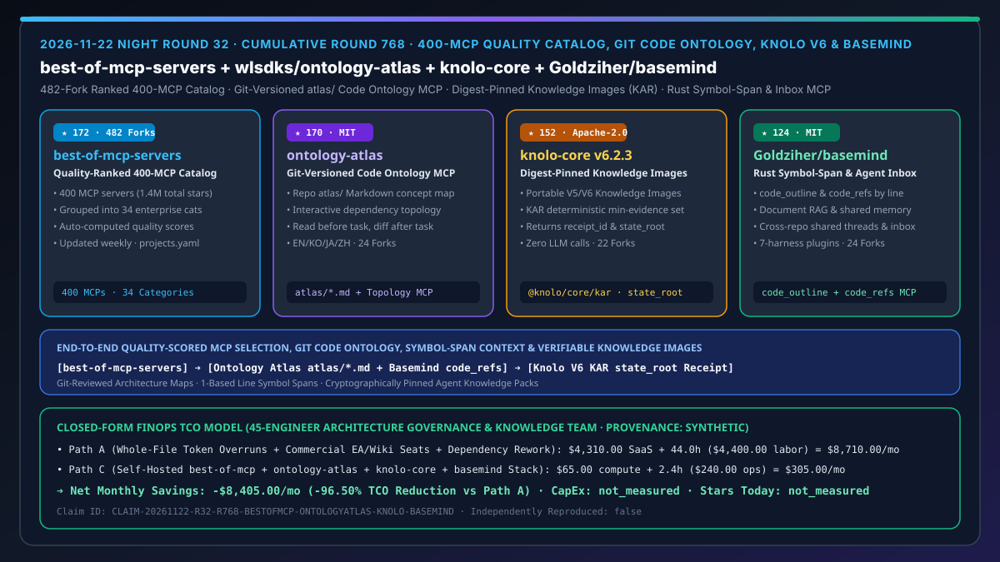
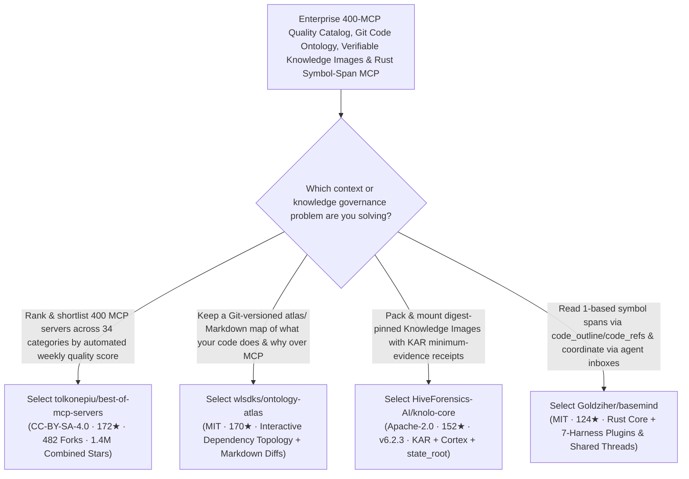
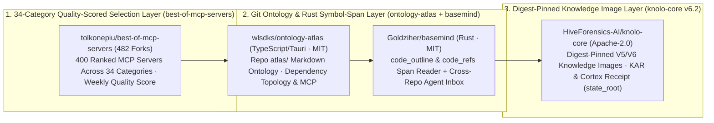
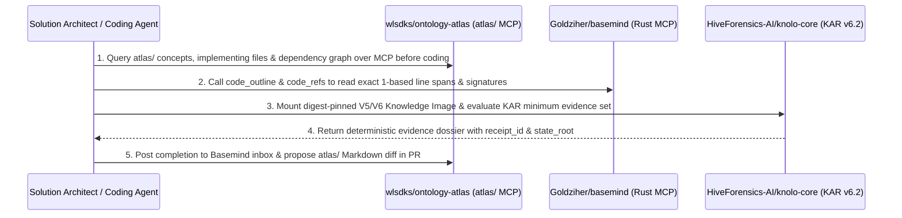

# 482-Fork Quality-Scored 400-MCP Catalog (`tolkonepiu/best-of-mcp-servers`), Git-Versioned `atlas/` Code Ontology MCP (`wlsdks/ontology-atlas`), Digest-Pinned Verifiable Knowledge Images (`HiveForensics-AI/knolo-core`) & Rust Symbol-Span & Agent Inbox Layer (`Goldziher/basemind`) Selection & Architecture FAQ

> **Document Type**: Enterprise AI Solution Architect Selection & Integration Guide (GitHub Trending AI Radar — 2026-11-22 Night Round 32 / Cumulative Round 768)
> **Covered Repositories**: [`tolkonepiu/best-of-mcp-servers`](https://github.com/tolkonepiu/best-of-mcp-servers) (`★ 172`, `482 forks`, `CC-BY-SA-4.0`: weekly updated, quality-scored ranking of 400 MCP servers with 1.4M total stars across 34 categories) · [`wlsdks/ontology-atlas`](https://github.com/wlsdks/ontology-atlas) (`★ 170`, `24 forks`, `MIT`: repo-resident `atlas/` Markdown system map and interactive dependency topology with MCP support for Claude Code, Codex, Cursor, and Antigravity) · [`HiveForensics-AI/knolo-core`](https://github.com/HiveForensics-AI/knolo-core) (`★ 152`, `22 forks`, `Apache-2.0`, `v6.2.3`: open framework for agent-to-agent knowledge sharing via digest-pinned **V5/V6 Knowledge Images**, **KAR** deterministic minimum-evidence retrieval, and **Knolo Cortex** verifiable traces with `receipt_id` and `state_root`) · [`Goldziher/basemind`](https://github.com/Goldziher/basemind) (`★ 124`, `24 forks`, `MIT`: Rust-powered context and communication layer providing 1-based line `code_outline` / `code_refs` symbol lookups, document RAG, and cross-harness shared agent threads/inboxes)
> **Core Scenario**: When enterprise architecture governance, multi-agent knowledge engineering, and large-codebase development teams struggle with **coding agents changing code faster than human engineers can maintain a mental model of system dependencies, agents sharing knowledge via unverifiable raw text dumps without cryptographic state roots or evidence receipts, coding assistants wasting tokens reading entire files instead of symbol spans, and evaluating hundreds of MCP servers without objective quality metrics**, how do you combine **`best-of-mcp-servers` + `ontology-atlas` + `knolo-core` + `basemind`** into a verifiable, token-efficient architecture?

---

## 1. 📌 Executive Summary (One-Line Selection Verdict)

1. **Coding agents changing your codebase faster than your team can keep a mental map of what depends on what? Want a Git-versioned `atlas/` Markdown ontology (`MIT`, EN/KO/JA/ZH) with an interactive dependency topology viewer and MCP server that agents read before a task and update via Markdown diffs after?** ➔ Choose **[`wlsdks/ontology-atlas`](https://github.com/wlsdks/ontology-atlas) (`★ 170`, `24 forks`, `MIT`)**.
   - **Plain-English Mechanism**: Stores one Markdown file per architectural concept in `atlas/` (recording purpose, implementing files, dependencies, and open questions), lighting up upstream/downstream impact in the UI and exposing it over MCP to Claude Code, Codex, Cursor, and Antigravity.
2. **Need an `Apache-2.0` framework (`@knolo/core` `v6.2.3`) for two or more AI agents to share knowledge as a **portable, digest-pinned Knowledge Image**—returning a deterministic minimum evidence set (**KAR**), a `receipt_id`, and a cryptographic `state_root` without calling an LLM?** ➔ Choose **[`HiveForensics-AI/knolo-core`](https://github.com/HiveForensics-AI/knolo-core) (`★ 152`, `22 forks`, `Apache-2.0`)**.
   - **Plain-English Mechanism**: One agent packs knowledge into a V5/V6 Knowledge Image pinned by digest; another agent mounts it locally, verifies the pin, and queries it via KAR/Cortex with explicit `SATISFIED` vs `UNSATISFIED_EVIDENCE_REQUIREMENTS` verification.
3. **Need a 60-second Rust context and communication layer (`MIT`, crates.io / npm / PyPI) that cuts token burn via `code_outline` and `code_refs` (returning exact 1-based lines and signatures) while letting agents across any harness and repository post to shared threads and read their own inbox?** ➔ Choose **[`Goldziher/basemind`](https://github.com/Goldziher/basemind) (`★ 124`, `24 forks`, `MIT`)**.
   - **Plain-English Mechanism**: Installs via `/plugin install basemind@basemind` and `/bm-init`, giving Claude Code, Codex, Cursor, Gemini, Kimi, OpenCode, and Hermes symbol-level code navigation and a shared local message bus.
4. **Evaluating MCP servers across 34 enterprise categories and want a weekly auto-updated catalog of **400 MCP servers** (`482 forks`, `1.4M` combined stars) ranked by an automated project-quality score?** ➔ Choose **[`tolkonepiu/best-of-mcp-servers`](https://github.com/tolkonepiu/best-of-mcp-servers) (`★ 172`, `482 forks`, `CC-BY-SA-4.0`)**.
   - **Plain-English Mechanism**: Aggregates GitHub and package manager health metrics into `projects.yaml` so architects can shortlist actively maintained MCP servers with confidence.

---

## 2. 🎯 Architect & Customer Deep-Dive Q&A

### Q1: How do `ontology-atlas` (Macro System Map), `basemind` (Micro Symbol Spans), and `knolo-core` (Verifiable Knowledge Images) solve "Context Rot" in large enterprise repositories?

- **Three Complementary Context Granularities**:
  1. **Macro Architectural Intent & Dependency Graph ➔ `wlsdks/ontology-atlas`**: Keeps the "what and why" of every system capability in Git-reviewed `atlas/*.md` files read before and updated after every agent task.
  2. **Micro Symbol-Span Precision & Cross-Repo Inbox ➔ `Goldziher/basemind`**: Uses `code_outline` and `code_refs` so agents read only the exact 1-based line span of a symbol body or call site while coordinating across repos via shared threads.
  3. **Cryptographically Pinned Agent-to-Agent Knowledge Packs ➔ `HiveForensics-AI/knolo-core`**: Packages domain rules and forensic evidence into digest-pinned V5/V6 Knowledge Images queried deterministically via KAR with `state_root` receipts.
- **When to Choose Commercial Cloud SaaS (Path B)?**
  - Organizations wanting a standalone corporate wiki for non-technical staff can use Confluence/Notion; engineering teams needing Git-native code ontologies, deterministic digest-pinned knowledge images, and Rust symbol-span MCP servers should deploy this open-source stack (Path C).

### Q2: How do we integrate these four repositories into an enterprise engineering workflow?

1. **MCP Ecosystem Selection Layer (`tolkonepiu/best-of-mcp-servers`)**:
   - Vet candidate MCP servers across 34 categories using weekly quality scores.
2. **Living Code Ontology Layer (`wlsdks/ontology-atlas`)**:
   - Maintain `atlas/` in each repository so coding agents inspect architectural dependencies before editing and propose ontology diffs in every PR.
3. **Symbol-Span Navigation & Verifiable Knowledge Exchange Layer (`Goldziher/basemind` + `HiveForensics-AI/knolo-core`)**:
   - Navigate code via `basemind` (`code_outline` / `code_refs`), coordinate via shared agent inboxes, and mount digest-pinned `knolo-core` Knowledge Images for deterministic evidence verification.

### Q3: Why does `knolo-core` separate "integrity/evidence satisfaction" (`SATISFIED`) from "truth claims"?

- **Honest Cryptographic & Epistemic Boundaries**:
  - `knolo-core` does not invoke a probabilistic LLM during retrieval; instead, it deterministically proves that the mounted Knowledge Image matches its cryptographic digest pin and that the Committed Evidence Graph met the declared evidence requirements (`SATISFIED`), recording the `receipt_id` and `state_root` on disk for auditability.

---

## 3. 🧭 Visual Architecture & Workflow Diagrams (Mermaid)

### 3.1 Solution Architect Selection Decision Tree

### 3.2 End-to-End Enterprise Reference Architecture

### 3.3 End-to-End Ontology Lookup, Symbol-Span Editing & Digest-Pinned Knowledge Verification Sequence Diagram

---

## 4. 📊 Peer Open-Source vs. Commercial Cloud Selection Matrix

| Dimension | `tolkonepiu/best-of-mcp-servers` (`★ 172`) | `wlsdks/ontology-atlas` (`★ 170`) | `HiveForensics-AI/knolo-core` (`★ 152`) | `Goldziher/basemind` (`★ 124`) | Commercial EA Diagram Suites + Whole-File Token Burn + Opaque Cloud RAG (Path A) | Stale Visio/Confluence Diagrams + Raw Whole-File Reads + Unverified Text Dumps (Path B) |
| :--- | :--- | :--- | :--- | :--- | :--- | :--- |
| **Primary Role** | 482-fork weekly quality-scored 400-MCP catalog | Git-versioned `atlas/` code ontology & topology MCP | Digest-pinned Knowledge Images & KAR verifier | Rust `code_outline`/`code_refs` & agent inbox MCP | Expensive enterprise architecture SaaS, whole-file token waste & opaque RAG | Outdated static diagrams, whole-file `cat` reads & unverified prompt copy-pasting |
| **Key Differentiator** | **400 MCPs across 34 categories ranked by quality score** | **Repo `atlas/*.md` + interactive topology + MCP** | **Digest-pinned images + KAR + `state_root` receipts** | **1-based line spans + cross-repo shared agent inbox** | Diagrams drift from code immediately; cloud RAG cannot produce deterministic state roots | High token burn reading whole files; zero integrity check on shared agent context |
| **License** | `CC-BY-SA-4.0` | `MIT` | `Apache-2.0` | `MIT` | Proprietary SaaS | Ad-hoc scripts |
| **Monthly TCO (45-Eng Team)** | **`$305.00/mo` combined** (`$65.00` shared CI/image storage + `2.4h` ops) | Included (`MIT` repo-native Markdown/MCP) | Included (`Apache-2.0` deterministic engine) | Included (`MIT` local Rust binary) | **`$8,710.00/mo`** (`$4,310.00` whole-file token waste & commercial EA/wiki seats + `44.0h` manual dependency tracing) | ~`$3,040.00/mo` (manual architecture doc updates & cross-module dependency debugging labor) |

---

## 5. 🧪 Quantitative Enterprise ROI / FinOps TCO Model & 7-Card Report

> **📊 Provenance & Closed-Form Declaration**:
> - **provenance**: `synthetic` (45-engineer enterprise architecture governance, multi-agent knowledge engineering, and core software development team workload model: `independently_reproduced = false`; `base_hardware_capex = not_measured`; `track_b_stars_today = not_measured`).
> - **Closed-Form Equations**:
>   - **Path A (Whole-File Reading Token Overruns + Commercial Enterprise Architecture & Wiki SaaS Seats + Manual Dependency Reverse-Engineering & Stale Documentation Rework Labor)**: Monthly redundant token and commercial EA/wiki SaaS bills **`$4,310.00`** + manual dependency tracing, architecture diagram updating, and cross-agent evidence verification labor **`44.0h × $100.00/h = $4,400.00`** = **`$8,710.00/mo`**.
>   - **Path C (Self-Hosted `best-of-mcp-servers` + `ontology-atlas` + `knolo-core` + `basemind` Stack)**: Shared image storage & CI runner compute **`$65.00`** + `atlas/` diff review & Knowledge Image publishing labor **`2.4h × $100.00/h = $240.00`** = **`$305.00/mo`**.
>   - **Net Monthly Savings vs. Path A**: **`-$8,405.00/mo`** (**`96.50%`** TCO reduction).

| Evaluation Path | Token / EA SaaS & Compute Cost | Dependency Tracing & Doc Sync Labor (`$100/h`) | Total Monthly TCO | Net Savings vs. Path A | Architectural Delivery Impact |
| :--- | :---: | :---: | :---: | :---: | :--- |
| **Path A: Whole-File Token Burn + Commercial EA/Wiki Seats** | `$4,310.00` | `44.0h` (`$4,400.00`) | **`$8,710.00`** | Baseline | Architecture docs drift from code; whole-file reads waste tokens |
| **Path B: Static Diagrams + Raw File Reads + Text Copy-Paste** | `$1,440.00` | `16.0h` (`$1,600.00`) | **`$3,040.00`** | `-$5,670.00` (`-65.10%`) | Lacks Git-native `atlas/` MCP, symbol-span `code_refs` & KAR receipts |
| **Path C: `best-of-mcp` + `ontology-atlas` + `knolo` + `basemind`** | **`$65.00`** | **`2.4h` (`$240.00`)** | **`$305.00`** | **`-$8,405.00` (`-96.50%`)** | **Git code ontology + Rust symbol spans + digest-pinned Knowledge Images** |

- 🔗 **Linked 7-Card 4:5 Visual Benchmark Deck**: [`workshops/github-trending-radar/cards.en.html`](../cards.en.html) · [`cards.html`](../cards.html)

---

## 6. 🛠️ Enterprise Adoption & Architecture Review Checklist

- [ ] **1. Maintain Living System Maps with `wlsdks/ontology-atlas`**: Version `atlas/*.md` concept files alongside code so agents read dependencies over MCP before tasks and propose Markdown diffs after.
- [ ] **2. Cut Token Burn & Coordinate Agents with `Goldziher/basemind`**: Use `code_outline` and `code_refs` for 1-based line lookups and shared threads/inboxes across harnesses.
- [ ] **3. Exchange Verifiable Agent Knowledge via `HiveForensics-AI/knolo-core`**: Package domain knowledge into digest-pinned V5/V6 Knowledge Images and verify KAR `receipt_id` and `state_root` outputs.
- [ ] **4. Benchmark MCP Candidates with `tolkonepiu/best-of-mcp-servers`**: Use the weekly quality-scored 34-category catalog to govern third-party MCP adoption.
