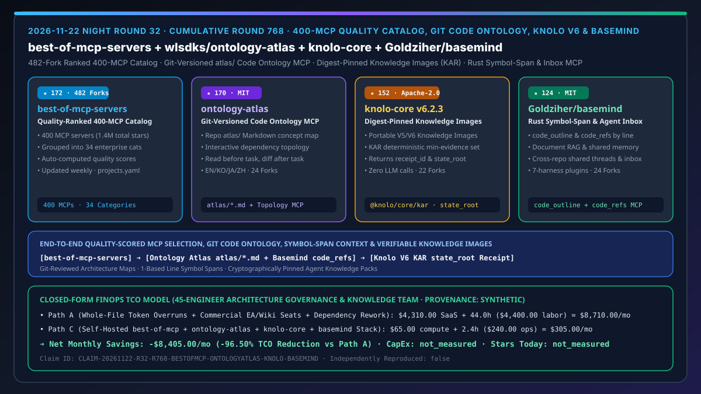
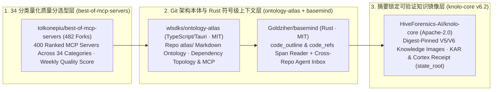
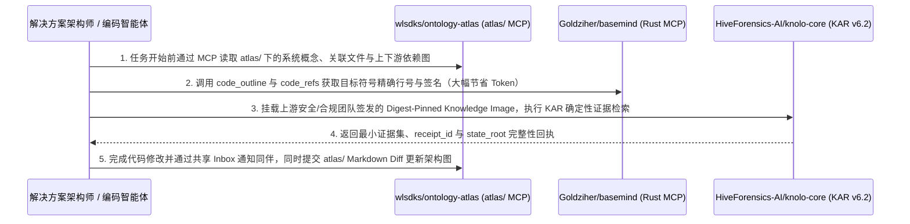

# 482 Forks 质量分排名 400 款 MCP 全景榜（`tolkonepiu/best-of-mcp-servers`）、随代码演进的 `atlas/` 架构本体图谱 MCP（`wlsdks/ontology-atlas`）、摘要锁定的跨智能体可验证知识镜像（`HiveForensics-AI/knolo-core`）与 Rust 符号级代码大纲与跨端信箱层（`Goldziher/basemind`）选型与集成架构 FAQ

> **文档类型**：企业 AI 解决方案架构师（AI Solution Architect）选型决策指南（GitHub Trending AI 雷达 2026-11-22 Night Round 32 / 累计第 768 轮）
> **覆盖项目**：[`tolkonepiu/best-of-mcp-servers`](https://github.com/tolkonepiu/best-of-mcp-servers)（`★ 172`、`482 forks`、`CC-BY-SA-4.0`，每周自动采集 GitHub 与包管理器指标计算质量分、覆盖 34 大分类 400 个项目的权威 MCP 排行榜）· [`wlsdks/ontology-atlas`](https://github.com/wlsdks/ontology-atlas)（`★ 170`、`24 forks`、`MIT`，将系统概念、实现文件、上下游依赖与未决问题存为仓库内 `atlas/` Markdown 文件并通过 MCP 与可视化拓扑图供人机共读共改的架构本体工具）· [`HiveForensics-AI/knolo-core`](https://github.com/HiveForensics-AI/knolo-core)（`★ 152`、`22 forks`、`Apache-2.0`，`v6.2.3`，将知识打包为带哈希摘要锁定的便携式 **Knowledge Image**，通过 **KAR** 与 **Knolo Cortex** 执行确定性最小证据集检索并返回 `receipt_id` 与 `state_root` 的跨智能体知识共享框架）· [`Goldziher/basemind`](https://github.com/Goldziher/basemind)（`★ 124`、`24 forks`、`MIT`，基于 Rust 构建的 `code_outline` / `code_refs` 符号级按行读取与跨仓跨框架共享线程/收件箱 MCP 中枢）
> **核心场景**：当企业架构治理、多智能体知识传递与大型代码库研发团队面临**“AI 编码智能体改代码的速度远超人类团队脑子里的架构心智模型更新速度、两个不同智能体之间交接知识只能靠不可验证的纯文本塞入上下文无法证明引用了哪些证据（State Root）、Agent 每次为了看一个函数签名把几千行源文件整篇读入浪费大量 Token、以及在几百个开源 MCP Server 中缺乏客观质量分指标指导选型”**四大痛点时，如何组合**`best-of-mcp-servers` + `ontology-atlas` + `knolo-core` + `basemind`** 构建可验证、省 Token、架构心智同步的智能体知识工程底座？

---

## 一、📌 核心结论速览（选型一句话结论）

1. **想解决“编码智能体改代码太快，人类团队已经搞不清系统里哪个模块依赖哪个模块、为什么当初这么设计”的心智失控难题——在代码库 `atlas/` 目录下用按概念划分的 Markdown 文件维护一张实时高亮上下游依赖的可视化本体拓扑图，让 Claude Code/Codex/Cursor/Antigravity 在动手前通过 MCP 先读图、改完代码后提 Markdown Diff 更新图** ➔ 选 **[`wlsdks/ontology-atlas`](https://github.com/wlsdks/ontology-atlas)（`★ 170`，`24 forks`，`MIT`）**。
   - **通俗原理**：每个架构概念对应 `atlas/` 下的一个 `.md` 文件（记录职责、关联源码、依赖关系与待解疑问），既能在浏览器/Tauri 桌面端交互式点亮调用链，又能随 Git PR 一起做 Code Review。
2. **想让智能体 A 把整理好的领域知识或取证证据打包成一个“像 Docker 镜像一样由加密哈希摘要（Digest Pin）锁定”的单文件知识镜像（Knowledge Image），交给另一台机器上的智能体 B 本地挂载，并通过 `KAR`（确定性最小证据集检索）返回带 `receipt_id` 和 `state_root` 状态根的完整性回执** ➔ 选 **[`HiveForensics-AI/knolo-core`](https://github.com/HiveForensics-AI/knolo-core)（`★ 152`，`22 forks`，`Apache-2.0`，`v6.2.3`）**。
   - **通俗原理**：零大模型调用、100% 确定性检索，明确区分 `SATISFIED`（满足声明的最小证据要求）与 `UNSATISFIED_EVIDENCE_REQUIREMENTS`，并提供 `@knolo/langchain`、`@knolo/llamaindex` 适配器。
3. **想让编码 Agent 通过 `code_outline` 和 `code_refs` 只按精确行号（1-based line）和签名读取所需函数体与调用点（拒绝整文件盲读烧 Token），同时让同一台机器上跨不同仓库、不同 CLI（Claude/Codex/Cursor/Gemini/Kimi/OpenCode/Hermes）的 Agent 通过内置共享线程与收件箱（Inbox）互相发消息协同** ➔ 选 **[`Goldziher/basemind`](https://github.com/Goldziher/basemind)（`★ 124`，`24 forks`，`MIT`）**。
   - **通俗原理**：60 秒即可通过 `/plugin install basemind@basemind` 与 `/bm-init` 完成安装，由高性能 Rust 二进制统一提供符号级上下文与跨 Agent 通信总线。
4. **想在 34 个细分领域（云平台、浏览器自动化、数据库、代码执行、安全等）的 400 款热门 MCP Server（累计 140 万+ Star）中，按每周自动计算的包管理器与 GitHub 综合项目质量分（Project-Quality Score）客观选型** ➔ 选 **[`tolkonepiu/best-of-mcp-servers`](https://github.com/tolkonepiu/best-of-mcp-servers)（`★ 172`，`482 forks`，`CC-BY-SA-4.0`）**。
   - **通俗原理**：拥有 **482 个社区 Fork**，通过自动化脚本定期更新 `projects.yaml` 与 `latest-changes.md`，帮架构师一眼识别真正活跃维护的头部 MCP 组件。

---

## 二、🎯 客户与架构师灵魂拷问 Q&A（深度架构拆解）

### Q1：为什么“架构本体 (`ontology-atlas`) + 符号级按行切片 (`basemind`) + 摘要锁定知识镜像 (`knolo-core`)”是解决大型工程“上下文腐败（Context Rot）”的黄金三角？

- **三层粒度精准匹配**：
  1. **宏观架构层（Why & What Depends on What）➔ `wlsdks/ontology-atlas`**：告诉 Agent “这个业务概念是什么、为什么存在、改动它会牵连哪些上下游概念”，并以 Git Markdown Diff 的方式强制保持架构图与代码同步。
  2. **微观代码层（Exact Line & Signature）➔ `Goldziher/basemind`**：定位到具体模块后，用 Rust `code_outline` 与 `code_refs` 只提取目标函数的起止行号与调用方签名，避免把几千行无关代码塞进上下文窗口。
  3. **跨智能体可验证证据层（Digest-Pinned Knowledge Image）➔ `HiveForensics-AI/knolo-core`**：当研究 Agent 或安全审计 Agent 需要把外部规范/证据移交给编码 Agent 时，用 `Knolo V6 KAR` 封装为带 `state_root` 校验的便携镜像。
- **何时直接用商业云 SaaS 方案（Path B）？**
  - 若团队仅需托管式的在线文档门户，可使用商业 Confluence / Notion；若追求架构本体与代码同仓 Git 版本化、确定性哈希锁定的跨 Agent 知识包传递及本地 Rust 符号级省 Token 通信，则采用本轮开源栈（Path C）。

### Q2：典型企业级“MCP 质量分选型 (`best-of-mcp-servers`) ➔ 架构本体导航 (`ontology-atlas`) ➔ 符号级编码与跨仓通信 (`basemind`) ➔ 可验证知识镜像交接 (`knolo-core`)”怎么搭？

1. **生态评估与准入层（`tolkonepiu/best-of-mcp-servers`）**：
   - 架构师依据 34 分类质量分排名筛选标准化 MCP 服务。
2. **仓库内架构本体与心智同步层（`wlsdks/ontology-atlas`）**：
   - 在核心仓库维护 `atlas/` 目录，Agent 任务开始前通过 MCP 读取概念拓扑，任务完成后生成 `atlas/` Markdown 变更 Diff。
3. **符号级代码读取与跨智能体知识镜像层（`Goldziher/basemind` + `HiveForensics-AI/knolo-core`）**：
   - 编码过程中通过 `basemind` 的 `code_outline`/`code_refs` 精准读取代码并跨仓发信箱消息；跨团队领域知识通过 `knolo-core` 打包为带摘要锁定的 V5/V6 Knowledge Image 挂载核验。

### Q3：`HiveForensics-AI/knolo-core` 为什么特别强调“`SATISFIED` 代表满足证据要求，而不代表替你做真假背书”？

- **严守确定性基础设施与主观业务判断的边界**：
  - `Knolo` 作为确定性引擎（不调大模型），通过加密摘要（Digest Pin）、已提交证据图（Committed Evidence Graph）与 `KAR` 证明“本次查询确实从指定的未篡改知识镜像中提取了满足规则的最小证据集，并生成了可复核的 `receipt_id` 与 `state_root`”，这正是金融合规与司法取证（Forensics）审计最需要的客观证据链。

---

## 三、🧭 直观可视化图解（Mermaid 决策树 + 集成架构 + 时序图）

### 3.1 架构师选型决策树

```mermaid
flowchart TD
    A["企业 400 款 MCP 质量榜、Git 架构本体图谱、可验证知识镜像与 Rust 符号级代码/通信中枢需求"] --> B{"当前最核心的上下文或架构治理痛点？"}
    B -- "在 34 个分类 400 款 MCP Server 中按每周自动计算的综合质量分客观选型" --> C["选用 tolkonepiu/best-of-mcp-servers<br/>(CC-BY-SA-4.0 · 172★ · 482 Forks · 1.4M 总 Star 量化排名)"]
    B -- "在仓库 atlas/ 目录维护人机共读的 Markdown 系统概念与依赖拓扑图" --> D["选用 wlsdks/ontology-atlas<br/>(MIT · 170★ · 交互式依赖高亮 + Git Diff 架构演进 MCP)"]
    B -- "将领域知识打包为带哈希摘要锁定的便携镜像，通过 KAR 返回可验证回执" --> E["选用 HiveForensics-AI/knolo-core<br/>(Apache-2.0 · 152★ · v6.2.3 · KAR + Cortex + state_root 回执)"]
    B -- "用 Rust code_outline/code_refs 精确按行读代码并通过共享信箱跨仓协同" --> F["选用 Goldziher/basemind<br/>(MIT · 124★ · 7 大客户端插件 + 符号级省 Token 与跨端 Inbox)"]
```

### 3.2 企业端到端生产集成参考架构图

### 3.3 `Ontology Atlas` 读架构、`Basemind` 符号级改码与 `Knolo` 可验证知识镜像交接时序图

---

## 四、📊 同类开源与商业云服务横向选型决策矩阵

| 对比维度 | `tolkonepiu/best-of-mcp-servers` (`★ 172`) | `wlsdks/ontology-atlas` (`★ 170`) | `HiveForensics-AI/knolo-core` (`★ 152`) | `Goldziher/basemind` (`★ 124`) | 商业企业架构 EA 套件 + 全文件暴力读入 Token 账单 + 闭源云知识库 (Path A) | 手工画早己过期的 Visio 图 + 裸跑 `cat` 读全文件 + 复制粘贴长文本 (Path B) |
| :--- | :--- | :--- | :--- | :--- | :--- | :--- |
| **核心能力定位** | 482 Forks 每周更新 400 款 MCP 质量分榜 | 仓库内 `atlas/` 架构本体图谱与 MCP | 摘要锁定便携式知识镜像与 KAR 验证引擎 | Rust 符号级代码切片与跨仓 Agent 信箱 | 昂贵的商业架构绘图软件、无切片暴力读文件的 Token 账单与黑盒 RAG | 画完就过时的静态架构图、整文件读入撑爆上下文与无完整性校验的文本传递 |
| **核心技术突破** | **34 分类 400 项目自动采集 GitHub/包管理质量分** | **每个概念对应一个 Git `.md` + 交互式点亮上下游依赖** | **Digest 锁定知识镜像 + KAR 最小证据集 + `state_root` 回执** | **`code_outline`/`code_refs` 精确到行 + 跨 7 大 CLI 共享收件箱** | 商业架构图与代码仓分离迅速腐败；黑盒向量检索无法出具确定性状态根回执 | Agent 改完代码后架构文档无人同步；整文件读取消耗数倍冗余 Token |
| **开源协议** | `CC-BY-SA-4.0` | `MIT` | `Apache-2.0` | `MIT` | 闭源商业 SaaS | 内部零散脚本 |
| **月度 TCO（45 人团队）** | **组合仅 `$305.00/月`**（`$65.00` 共享构建与知识镜像存储 + `2.4h` 维护） | 同左（`MIT` 随 Git 仓免费版本化） | 同左（`Apache-2.0` 纯确定性零模型费） | 同左（`MIT` 本地 Rust 二进制） | **`$8,710.00/月`**（`$4,310.00` 全文件冗余 Token 与商业架构/知识库席位 + `44.0h` 人工梳理依赖与同步文档） | 约 `$3,040.00/月`（大量人工排查隐式架构依赖冲突与手工补写过期设计文档工时） |

---

## 五、🧪 应用落地定量收益/TCO 对比与 7-Card 报告

> **📊 数据来源与闭式核算声明（Provenance & Closed-Form Schema）**：
> - **provenance**: `synthetic`（基于 45 人企业架构治理、多智能体知识工程与核心研发团队月度工作负载模型：`independently_reproduced = false`；硬件采购基线 `base_hardware_capex = not_measured`；Track B 单日增量 `track_b_stars_today = not_measured`）。
> - **核算公式**：
>   - **Path A（编码 Agent 整文件暴力读入导致的冗余 Token 消耗 + 采购商业企业架构 EA 与知识库 SaaS 席位 + 架构师与工程师因架构图过期、跨模块依赖不清及跨 Agent 知识传递失真导致的返工人工）**：月度冗余 Token 与商业软件订阅账单 **`$4,310.00`** + 人工逆向梳理代码依赖、修补过期架构文档与核验跨智能体证据人工 **`44.0h × $100.00/h = $4,400.00`** = **`$8,710.00/月`**。
>   - **Path C（自建 `best-of-mcp-servers` + `ontology-atlas` + `knolo-core` + `basemind` 开源架构本体与可验证知识栈）**：共享知识镜像存储与 CI 容器开销 **`$65.00`** + `atlas/` 本体评审与镜像发布维护人工 **`2.4h × $100.00/h = $240.00`** = **`$305.00/月`**。
>   - **净节省（Net Savings vs Path A）**：**`-$8,405.00/月`**（成本降低 **`96.50%`**）。

| 评估方案 | 冗余 Token/商业 EA 席位与算力成本 | 架构依赖梳理与文档同步人工（`$100/h`） | 月度总 TCO | 相对 Path A 净节省 | 关键架构交付指标 |
| :--- | :---: | :---: | :---: | :---: | :--- |
| **Path A：全文件读取浪费 Token + 商业架构/知识库席位** | `$4,310.00` | `44.0h` (`$4,400.00`) | **`$8,710.00`** | Baseline | 架构图与代码脱节；整文件读取浪费大量上下文配额 |
| **Path B：静态画图工具 + 裸读全文件 + 纯文本交接** | `$1,440.00` | `16.0h` (`$1,600.00`) | **`$3,040.00`** | `-$5,670.00` (`-65.10%`) | 缺少 `atlas/` 随码演进 MCP、符号级 `code_refs` 与 Digest 知识镜像 |
| **Path C：`best-of-mcp` + `ontology-atlas` + `knolo` + `basemind`** | **`$65.00`** | **`2.4h` (`$240.00`)** | **`$305.00`** | **`-$8,405.00` (`-96.50%`)** | **Git 架构本体 + Rust 符号级省 Token + `state_root` 可验证知识镜像** |

- 🔗 **关联 7-Card 4:5 视觉评测报告**：[`workshops/github-trending-radar/cards.html`](../cards.html) · [`cards.en.html`](../cards.en.html)

---

## 六、🛠️ 企业引入与架构评审 Checklist

- [ ] **1. 在核心工程仓库引入 `wlsdks/ontology-atlas`**：建立 `atlas/` 架构概念目录，要求编码 Agent 任务前通过 MCP 读取依赖拓扑、任务后提交 Markdown Diff。
- [ ] **2. 为编码终端安装 `Goldziher/basemind` (`/bm-init`)**：强制优先调用 `code_outline` 与 `code_refs` 按行读取符号并启用跨仓 Agent 共享信箱。
- [ ] **3. 使用 `HiveForensics-AI/knolo-core` 标准化跨智能体知识分发**：将合规规范与领域知识打包为带 Digest 锁定的 V5/V6 Knowledge Image，通过 KAR 核验 `state_root` 回执。
- [ ] **4. 参考 `tolkonepiu/best-of-mcp-servers` 建立内部 MCP 准入台账**：结合 34 分类每周质量分动态淘汰失修组件。
