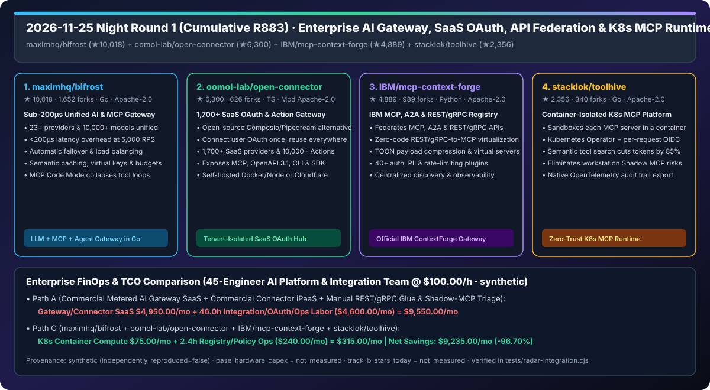
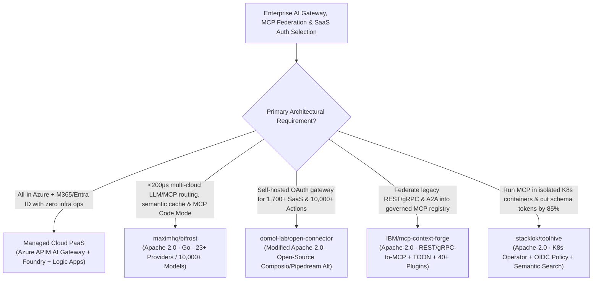
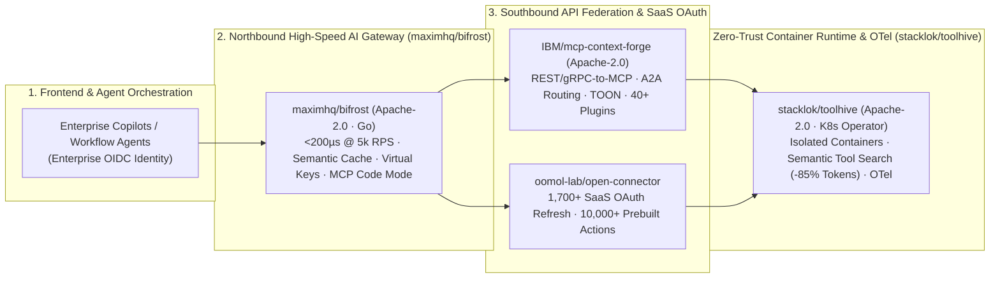
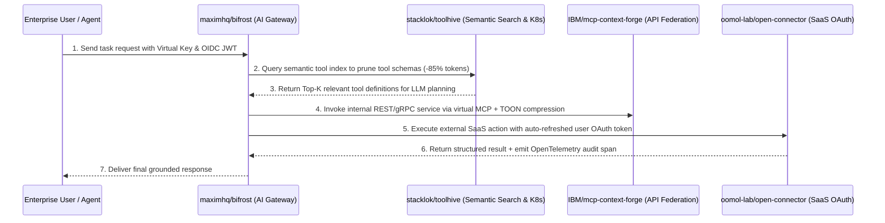

# High-Performance Go AI/MCP Gateway (`maximhq/bifrost`), 1,700+ SaaS OAuth Connector Gateway (`oomol-lab/open-connector`), IBM MCP/A2A/REST Federation Registry (`IBM/mcp-context-forge`) & Container-Isolated K8s MCP Runtime (`stacklok/toolhive`) Selection & Integration Architecture FAQ

> **Document Type**: Enterprise AI Solution Architect Selection Decision Guide (GitHub Trending AI Radar — 2026-11-25 Night Round 1 / Cumulative Round 883)
> **Covered Repositories**: [`maximhq/bifrost`](https://github.com/maximhq/bifrost) (`★ 10,018`, `1,652 forks`, `Apache-2.0`: Go-based high-performance open-source AI gateway unifying LLM gateway, MCP gateway, and agent gateway capabilities across 23+ providers and `10,000+` models with automatic failover, load balancing, semantic caching, virtual keys, budgets, and **MCP Code Mode**, adding `< 200µs` overhead at `5,000 RPS`) · [`oomol-lab/open-connector`](https://github.com/oomol-lab/open-connector) (`★ 6,300`, `626 forks`, `Modified Apache-2.0`: open-source OAuth authentication and connector gateway for AI agents—an open-source Pipedream/Composio alternative connecting `1,700+` SaaS providers and `10,000+` prebuilt Actions across SDK, CLI, MCP, HTTP, and OpenAPI 3.1) · [`IBM/mcp-context-forge`](https://github.com/IBM/mcp-context-forge) (`★ 4,889`, `989 forks`, `Apache-2.0`: Official IBM `ContextForge` open-source registry and proxy sitting in front of any MCP, A2A, or REST/gRPC APIs with automatic REST/gRPC-to-MCP translation, TOON compression, and 40+ governance/security plugins) · [`stacklok/toolhive`](https://github.com/stacklok/toolhive) (`★ 2,356`, `340 forks`, `Apache-2.0`: enterprise-grade MCP container runtime and Kubernetes Operator wrapping every MCP server in a minimal-permission isolated container, enforcing per-request OIDC/IdP access policies, emitting OpenTelemetry traces, and cutting MCP schema token usage by up to `85%` via semantic tool search)
> **Core Enterprise Scenario**: Solving the four foundational blockers of enterprise-wide agent deployment—**multi-provider LLM outages and runaway departmental token bills, repetitive per-agent OAuth token plumbing across 1,000+ SaaS apps, costly manual rewrites of legacy REST/gRPC microservices into MCP, and "Shadow MCP" security risks plus context bloat from running hundreds of unisolated tools**.

---

## 1. 📌 Executive Summary (One-Line Selection Verdict)

1. **Need an ultra-low-latency (`< 200µs` overhead at `5,000 RPS`), zero-config Go gateway that unifies 23+ LLM providers and MCP servers with automatic failover, semantic caching, virtual-key budgets, and MCP Code Mode** ➔ Choose **[`maximhq/bifrost`](https://github.com/maximhq/bifrost) (`★ 10,018`, `1,652 forks`, `Apache-2.0`)**.
   - **Plain-English Mechanism**: Instead of hardcoding vendor SDKs and API keys across dozens of microservices, applications talk to a single OpenAI-compatible `bifrost` endpoint (`npx -y @maximhq/bifrost` or Docker). It handles millisecond failover on HTTP 429/5xx, caches semantically equivalent queries, enforces per-team budgets, and uses **MCP Code Mode** to collapse multi-turn tool chains.
2. **Need your customer-support, sales, and engineering agents to execute authenticated actions across `1,700+` SaaS apps (Salesforce, Jira, Slack, GitHub, Notion) without paying per-invocation iPaaS SaaS markups** ➔ Choose **[`oomol-lab/open-connector`](https://github.com/oomol-lab/open-connector) (`★ 6,300`, `626 forks`, `Modified Apache-2.0`)**.
   - **Plain-English Mechanism**: Offloads OAuth 2.0 consent flows, encrypted credential storage, automatic token refresh, and tenant isolation into a self-hostable gateway ("Connect Once. Use Everywhere"), exposing `10,000+` prebuilt Actions simultaneously via MCP, OpenAPI 3.1, CLI, and TypeScript/Python SDKs.
3. **Need to federate existing internal REST/gRPC microservices, heterogeneous MCP servers, and A2A agents behind a single governed catalog with zero-code protocol translation and 40+ security plugins** ➔ Choose **[`IBM/mcp-context-forge`](https://github.com/IBM/mcp-context-forge) (`★ 4,889`, `989 forks`, `Apache-2.0`)**.
   - **Plain-English Mechanism**: IBM's `ContextForge` translates legacy REST and gRPC services into virtual MCP tools without code rewrites, applies **TOON compression** to shrink verbose tool payloads, routes A2A agent calls, and enforces rate limiting, PII masking, and retries via 40+ extensible plugins.
4. **Need to eliminate "Shadow MCP" on developer laptops and production clusters by running every MCP server inside a zero-trust container on Kubernetes while cutting tool-schema token consumption by up to `85%`** ➔ Choose **[`stacklok/toolhive`](https://github.com/stacklok/toolhive) (`★ 2,356`, `340 forks`, `Apache-2.0`)**.
   - **Plain-English Mechanism**: Uses the `thv` CLI and ToolHive Kubernetes Operator to sandbox each MCP server in a minimal-permission container with IdP/OIDC authentication, OpenTelemetry tracing, and built-in **Semantic Tool Search** that injects only the most relevant tool definitions per turn.

---

## 2. 🎯 Architect & Customer Deep-Dive Q&A

### Q1: How do these four open-source projects compare against managed cloud PaaS (e.g., Azure API Management AI Gateway + Azure AI Foundry + Copilot Studio / Logic Apps Connectors)?

- **Four-Layer Open-Source Reference Stack (Path C)**:
  1. **L1 High-Throughput Model & Budget Gateway ➔ `maximhq/bifrost`**: Northbound LLM/MCP routing (`< 200µs` at `5k RPS`), semantic caching, virtual keys, and MCP Code Mode.
  2. **L2 External SaaS User OAuth Gateway ➔ `oomol-lab/open-connector`**: Multi-tenant OAuth lifecycle and `10,000+` prebuilt actions across `1,700+` SaaS providers.
  3. **L3 Internal API Federation & Governance Registry ➔ `IBM/mcp-context-forge`**: Zero-code REST/gRPC-to-MCP virtualization, A2A routing, TOON compression, and 40+ policy plugins.
  4. **L4 Container-Isolated Runtime & Semantic Tool Pruning ➔ `stacklok/toolhive`**: Kubernetes Operator sandboxing, per-request OIDC policy enforcement, and `-85%` schema token pruning.
- **When to choose Managed Cloud PaaS instead?**
  - Choose **Azure API Management (GenAI Gateway policies) + Azure AI Foundry + Azure Logic Apps / Copilot Studio Connectors** when your enterprise is standardized on Azure/M365, relies heavily on Microsoft Entra ID On-Behalf-Of (OBO) flows for SharePoint/Dynamics/SAP, and prefers a fully managed SLA over operating gateway containers.
  - Choose **Self-Hosted Open-Source Stack (Path C)** when operating across multi-cloud/on-prem environments, running high-RPS agent workloads where commercial iPaaS per-action fees become prohibitive, or federating hundreds of internal gRPC/REST services under strict data-residency boundaries.

### Q2: How do we wire this end-to-end architecture in production?

1. **Northbound Ingress & FinOps Layer (`maximhq/bifrost`)**:
   - All agent frameworks and IDE copilots point to `bifrost`, which authenticates team virtual keys, checks semantic cache, enforces token budgets, and routes across primary/fallback LLM providers.
2. **Protocol Federation & SaaS Auth Layer (`IBM/mcp-context-forge` + `oomol-lab/open-connector`)**:
   - Internal microservice calls route through `ContextForge` (converting REST/gRPC to MCP with TOON compression), while third-party SaaS calls route through `OpenConnector` using per-user refreshed OAuth credentials.
3. **Zero-Trust Execution & Observability Layer (`stacklok/toolhive`)**:
   - `ToolHive` runs every MCP server in an isolated Kubernetes Pod, prunes tool schemas by `85%` via semantic search before LLM prefill, and exports OpenTelemetry traces to enterprise SIEM/APM dashboards.

### Q3: What are the critical production guardrails?

- **Architect Redlines**:
  1. **Never share admin-scoped SaaS tokens across users**: Enforce per-user OAuth delegation in `oomol-lab/open-connector` and OIDC policy checks in `stacklok/toolhive`.
  2. **Avoid raw 500-tool context dumps**: Combine `IBM/mcp-context-forge` virtual server scoping with `stacklok/toolhive` semantic tool search so no single LLM turn receives more than `15–25` tool schemas.

---

## 3. 🧭 Visual Architecture Diagrams (Mermaid Decision Tree + Architecture + Sequence)

### 3.1 Architect Selection Decision Tree

### 3.2 End-to-End Enterprise Production Architecture

### 3.3 End-to-End Execution Sequence

---

## 4. 📊 Horizontal Selection Matrix (Open-Source vs. Managed Cloud vs. Commercial SaaS)

| Dimension | `maximhq/bifrost` (`★ 10,018`) | `oomol-lab/open-connector` (`★ 6,300`) | `IBM/mcp-context-forge` (`★ 4,889`) | `stacklok/toolhive` (`★ 2,356`) | Managed Cloud PaaS (Azure APIM + Foundry + Logic Apps) | Commercial Metered Gateway & Connector SaaS (Path A) |
| :--- | :--- | :--- | :--- | :--- | :--- | :--- |
| **Primary Role** | Ultra-fast Go LLM/MCP/Agent gateway | 1,700+ SaaS OAuth & Action gateway | IBM MCP/A2A/REST federation proxy | Containerized K8s MCP runtime | Fully managed cloud API/AI gateway & connectors | Metered commercial SaaS gateway & iPaaS |
| **Key Differentiator** | **`< 200µs` @ `5k RPS` + MCP Code Mode + Semantic Cache** | **Connect once, reuse `10,000+` SaaS actions everywhere** | **Zero-code REST/gRPC-to-MCP + TOON + 40+ plugins** | **Isolated containers + `-85%` schema tokens via semantic search** | Turnkey SLA + native Entra ID / M365 integration | High per-call markup at scale; external data transit |
| **License** | `Apache-2.0` | `Modified Apache-2.0` | `Apache-2.0` | `Apache-2.0` | Managed Cloud PaaS | Proprietary SaaS |
| **Monthly TCO (45-Eng Team)** | **`$315.00/mo` combined** (`$75.00` K8s compute + `2.4h` ops) | Included in `$315.00/mo` stack | Included in `$315.00/mo` stack | Included in `$315.00/mo` stack | `~$1,850.00/mo` (APIM + managed connector executions) | **`$9,550.00/mo`** (`$4,950.00` SaaS seats/meters + `46.0h` glue/ops) |

---

## 5. 🧪 Quantitative FinOps & TCO Comparison (45-Person Enterprise Team)

> **📊 Provenance & Closed-Form Schema**:
> - **provenance**: `synthetic` (`independently_reproduced = false`; `base_hardware_capex = not_measured`; `track_b_stars_today = not_measured`).
> - **Closed-Form Formula**:
>   - **Path A (Commercial Metered AI Gateway SaaS + Commercial Agent Connector iPaaS Seats + Manual Legacy REST/gRPC Wrappers & Shadow-MCP Incident Triage)**: **`$4,950.00`** monthly SaaS/connector fees + **`46.0h × $100.00/h = $4,600.00`** engineering labor = **`$9,550.00/mo`**.
>   - **Path C (Self-Hosted `maximhq/bifrost` + `oomol-lab/open-connector` + `IBM/mcp-context-forge` + `stacklok/toolhive` Stack)**: **`$75.00`** shared K8s container compute + **`2.4h × $100.00/h = $240.00`** policy maintenance = **`$315.00/mo`**.
>   - **Net Savings vs. Path A**: **`-$9,235.00/mo`** (**`96.70%`** TCO reduction).

| Evaluation Path | SaaS / Gateway / Compute Cost | Integration & Governance Labor (`$100/h`) | Monthly Total TCO | Net Savings vs. Path A | Key Architectural Outcome |
| :--- | :---: | :---: | :---: | :---: | :--- |
| **Path A: Commercial Gateway SaaS + Metered Connector iPaaS + Manual Wrappers** | `$4,950.00` | `46.0h` (`$4,600.00`) | **`$9,550.00`** | Baseline | High per-action fees; unisolated laptop MCP credentials |
| **Path B: Basic Reverse Proxy + Custom Per-Project OAuth & MCP Glue Scripts** | `$1,420.00` | `18.5h` (`$1,850.00`) | **`$3,270.00`** | `-$6,280.00` (`-65.76%`) | Duplicate OAuth plumbing; 100+ tool schemas bloat context |
| **Path C: `bifrost` + `open-connector` + `mcp-context-forge` + `toolhive`** | **`$75.00`** | **`2.4h` (`$240.00`)** | **`$315.00`** | **`-$9,235.00` (`-96.70%`)** | **`<200µs` gateway + 1,700+ SaaS OAuth + REST-to-MCP + `-85%` schema tokens** |

- 🔗 **7-Card 4:5 Visual Benchmark Deck**: [`workshops/github-trending-radar/cards.en.html`](../cards.en.html) · [`cards.html`](../cards.html)

---

## 6. 🛠️ Enterprise Adoption & Architecture Review Checklist

- [ ] **Virtual Key Budgets & PII Cache Bypass**: Configure departmental virtual keys and monthly spend caps in `maximhq/bifrost`, and bypass semantic caching for any request containing customer PII.
- [ ] **Per-User OAuth Tenant Isolation**: Deploy `oomol-lab/open-connector` with KMS-backed storage and bind every OAuth credential strictly to the authenticated enterprise `user_id`.
- [ ] **Read/Write Separation in Federation Registry**: Use `IBM/mcp-context-forge` virtual servers to separate read-only query tools from state-mutating REST/gRPC tools, attaching approval plugins to write actions.
- [ ] **Eliminate Host-Level Shadow MCP**: Enforce `stacklok/toolhive` container sandboxing and semantic tool search across developer workstations and Kubernetes clusters.
