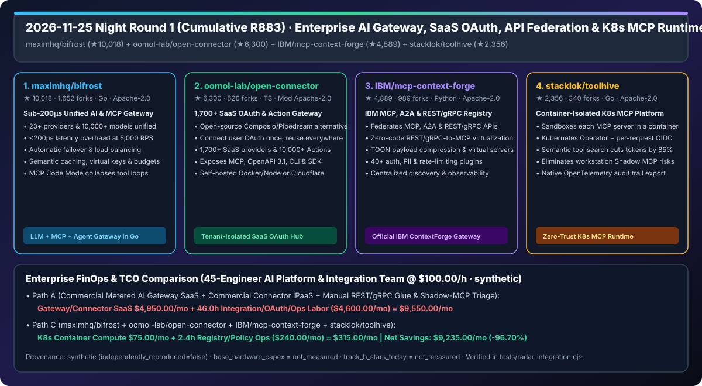
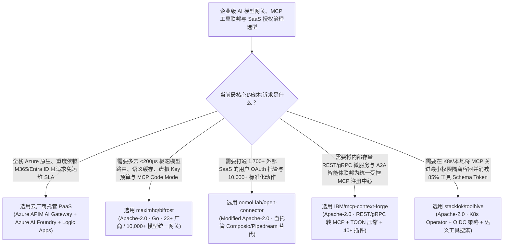
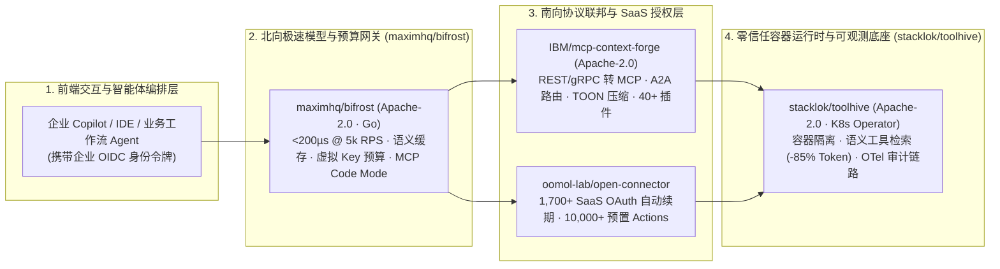
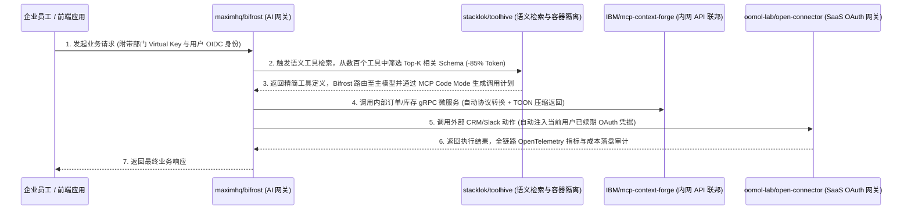

# 高性能 Go AI/MCP 统一网关（`maximhq/bifrost`）、1,700+ SaaS OAuth 授权连接器网关（`oomol-lab/open-connector`）、IBM MCP/A2A/REST 联邦注册代理（`IBM/mcp-context-forge`）与容器级 K8s MCP 安全运行时（`stacklok/toolhive`）选型与集成架构 FAQ

> **文档类型**：企业 AI 解决方案架构师（AI Solution Architect）选型决策指南（GitHub Trending AI 雷达 2026-11-25 Night Round 1 / 累计第 883 轮）
> **覆盖项目**：[`maximhq/bifrost`](https://github.com/maximhq/bifrost)（`★ 10,018`、`1,652 forks`、`Apache-2.0`：由 Go 编写的高性能开源 AI 网关，集 **LLM 网关、MCP 网关与 Agent 网关**于一体，通过单一 OpenAI 兼容端点统一路由 23+ 厂商与 `10,000+` 模型，支持自动故障转移、负载均衡、语义缓存、虚拟密钥、预算配额与 **MCP Code Mode**，在 `5,000 RPS` 高并发下网关自身额外延迟低于 **`200µs`**）· [`oomol-lab/open-connector`](https://github.com/oomol-lab/open-connector)（`★ 6,300`、`626 forks`、`Modified Apache-2.0`：面向 AI Agent 的开源 OAuth 授权连接器网关，作为 Pipedream Connect / Composio 的开源自托管替代方案，“一次连接、随处复用”，将 `1,700+` SaaS 供应商与 `10,000+` 预置业务动作统一暴露为 SDK、CLI、MCP、HTTP 与 OpenAPI 3.1 接口）· [`IBM/mcp-context-forge`](https://github.com/IBM/mcp-context-forge)（`★ 4,889`、`989 forks`、`Apache-2.0`：IBM 官方开源的 `ContextForge` 统一注册中心与代理网关，位于任意 MCP、A2A 或存量 REST/gRPC API 前端，内置 REST/gRPC-to-MCP 自动协议转换、TOON 上下文压缩及 40+ 治理与安全插件）· [`stacklok/toolhive`](https://github.com/stacklok/toolhive)（`★ 2,356`、`340 forks`、`Apache-2.0`：面向开发者与平台工程团队的企业级 MCP 容器安全运行平台与 Kubernetes Operator，将每个 MCP Server 封装在最小权限隔离容器中运行，杜绝本地明文凭证与“影子 MCP”，支持按请求强制执行企业 IdP/OIDC 身份鉴权、输出 OpenTelemetry 链路追踪，并通过语义工具检索将 MCP Schema 的 Token 消耗降低高达 **`85%`**）
> **核心场景**：当企业从单点 AI 原型走向全公司规模化 Agent 生产落地时，普遍遭遇**“不同业务线散落数十个大模型 Key 且主通道限流即雪崩、打通企业 SaaS（Salesforce/Jira/Slack/M365）时每个 Agent 都要重复开发 OAuth 刷新逻辑、存量数千个内部 REST/gRPC 微服务改造成 MCP 成本高昂、以及研发私自用 `npx`/`uvx` 在宿主机裸跑第三方 MCP 引发供应链泄密与 Schema 撑爆上下文窗口”**四大架构痛点。本文拆解如何用这四个开源项目构建端到端企业级 AI 与 MCP 网关底座，并与 Azure API Management (APIM) + Azure AI Foundry 托管方案进行横向选型对比。

---

## 一、📌 核心结论速览（选型一句话结论）

1. **需要一个极致低延迟（`5,000 RPS` 下 `< 200µs`）、单二进制开箱即用的统一模型与 MCP 流量入口，同时解决多模型故障切换、语义缓存、部门级虚拟 Key 预算限额与 MCP Code Mode 调用优化** ➔ 选 **[`maximhq/bifrost`](https://github.com/maximhq/bifrost)（`★ 10,018`，`1,652 forks`，`Apache-2.0`）**。
   - **通俗原理**：在应用层与 23+ 大模型云厂商（OpenAI、Anthropic、AWS Bedrock、Google Vertex、Azure OpenAI 等）之间加一层纯 Go 编写的极速网关。前端应用只需调用标准 OpenAI SDK，由 `bifrost` 负责当主模型 429/502 时毫秒级无感切到备用模型、用语义缓存省掉重复问答计费，并通过 **MCP Code Mode** 让模型用一次代码合成替代多轮串行工具往返。
2. **需要让企业客服、销售、研发与办公 Agent 安全调用 1,000+ 外部 SaaS（如 HubSpot、Slack、GitHub、Notion、Google Workspace），且不想按每次动作调用向商业连接器平台支付高昂 SaaS 溢价** ➔ 选 **[`oomol-lab/open-connector`](https://github.com/oomol-lab/open-connector)（`★ 6,300`，`626 forks`）**。
   - **通俗原理**：把最脏最累的“用户 OAuth 2.0 授权弹窗、Access/Refresh Token 加密存储、过期自动续期、多租户凭据隔离”做成一层标准连接器网关。用户在前端完成一次账号绑定后，无论是 Python/TS 代码、命令行 CLI 还是支持 MCP / OpenAPI 3.1 的智能体，都能按租户身份直接调用 `1,700+` 供应商的 `10,000+` 个预定义标准动作。
3. **需要将企业内部存量 REST/gRPC 微服务、多团队异构 MCP Server 与跨智能体 A2A 端点统一收口到一个带目录发现、协议转换与插件式护栏的企业级注册中心** ➔ 选 **[`IBM/mcp-context-forge`](https://github.com/IBM/mcp-context-forge)（`★ 4,889`，`989 forks`，`Apache-2.0`）**。
   - **通俗原理**：企业不可能为了 AI 把几百个存量 Java/Go REST 与 gRPC 服务全部重写一遍。IBM `ContextForge` 提供“零代码 REST/gRPC 转虚拟 MCP Server”能力，叠加 **TOON 压缩**（减少工具返回 JSON 冗余体积）与 40+ 可插拔中间件（速率限制、PII 脱敏、审计日志、重试熔断），对外暴露唯一受控联邦端点。
4. **需要彻底终结研发人员在笔记本或服务器上裸跑 `npx`/`uvx` 带来的“影子 MCP（Shadow MCP）”安全隐患，在 Kubernetes 集群中以零信任容器化方式托管 MCP Server 并削减 85% 工具列表 Token 开销** ➔ 选 **[`stacklok/toolhive`](https://github.com/stacklok/toolhive)（`★ 2,356`，`340 forks`，`Apache-2.0`）**。
   - **通俗原理**：通过 `thv` CLI 或 ToolHive Kubernetes Operator，把每一个 MCP Server 关进带最小网络/文件系统白名单的隔离容器里，密钥由安全凭据库动态注入而非明文写在配置文件中；当挂载上百个工具时，利用内置语义工具检索（Semantic Tool Search）只把当前任务最相关的少量工具定义注入模型上下文，节省高达 **`85%`** 的 Schema 预填充 Token。

---

## 二、🎯 客户与架构师灵魂拷问 Q&A（深度架构拆解）

### Q1：在企业落地“统一 AI 模型网关 + MCP 工具治理底座”时，这四个开源项目 vs 云厂商托管 PaaS（如 Azure API Management AI Gateway + Azure AI Foundry + Copilot Studio Connectors）怎么选？

- **四层职责边界（开源自建黄金组合 Path C）**：
  1. **L1 高并发模型路由与预算面 ➔ `maximhq/bifrost`**：负责北向大模型流量的多云负载均衡、语义缓存、虚拟 Key 预算熔断与 MCP Code Mode。
  2. **L2 外部 SaaS 用户级 OAuth 托管面 ➔ `oomol-lab/open-connector`**：负责 1,700+ 第三方商业 SaaS 的多租户 OAuth 令牌生命周期管理与动作标准化。
  3. **L3 内部 API 协议联邦与目录治理面 ➔ `IBM/mcp-context-forge`**：负责将企业内网 REST/gRPC 微服务与 A2A 智能体联邦为统一可检索的受控注册表。
  4. **L4 容器级隔离运行与语义裁剪面 ➔ `stacklok/toolhive`**：负责在开发者本地或生产 K8s 中以最小权限容器运行 MCP Server，拦截未授权访问并按语义动态裁剪工具 Schema。
- **何时直接选云厂商托管服务（Azure APIM AI Gateway + Azure AI Foundry / Logic Apps Connectors）？**
  - 若企业已全栈标准化在 Azure 上，且连接目标以 Microsoft 365、Dynamics 365、SharePoint、SAP 与 Azure 原生服务为主，直接采用 **Azure API Management (GenAI Gateway 策略：Token 限流、Azure AI Content Safety 护栏、多区域 Azure OpenAI 负载均衡) + Azure Logic Apps / Copilot Studio 1,000+ 托管连接器** 运维最省心，天然具备 Microsoft Entra ID 条件访问与 SLA 保障。
  - **何时自建本轮开源四件套（Path C）更划算？** 当企业属于**多云/混合云架构**、每秒并发请求极高（需要 `< 200µs` 网关开销）、存在大量自研内部 gRPC/REST 接口需快速联邦为 MCP/A2A，或者对第三方 SaaS 动作调用量达到每月数百万次（商业 iPaaS 按步计费极其昂贵）、且严禁敏感上下文流经外部 SaaS 代理时，自建 Path C 可降低 **96%+** 的平台软件许可与人工集成成本。

### Q2：如何把这四个项目嵌入企业现有生产架构（前端交互 → AI 网关 → Agent 编排 → 企业数据/权限底座 → 可观测性）？

1. **前端交互与企业身份层（SSO / Entra ID / Okta）**：
   - 员工在内部 Copilot 工作台或 IDE 中发起任务，请求携带企业 OIDC JWT 令牌进入网关层。
2. **北向模型与 MCP 流量网关层（`maximhq/bifrost`）**：
   - `bifrost` 校验部门/项目虚拟密钥与月度预算水位，优先检查语义缓存；未命中时按延迟与健康度路由至主备大模型，并开启 MCP Code Mode 将多步工具调用合并执行。
3. **南向工具联邦与 SaaS 授权层（`IBM/mcp-context-forge` + `oomol-lab/open-connector`）**：
   - 当 Agent 需要访问内部 ERP/CRM 微服务时，经由 `IBM/mcp-context-forge` 将存量 REST/gRPC 接口实时转换为 MCP 工具并执行 TOON 响应压缩；当需要操作外部 SaaS（Jira/Slack/Salesforce/GitHub）时，由 `oomol-lab/open-connector` 自动注入当前用户已授权并续期的 OAuth 令牌。
4. **安全容器运行时与可观测底座（`stacklok/toolhive` + OpenTelemetry）**：
   - 所有自建与第三方 MCP Server 均由 `stacklok/toolhive` Kubernetes Operator 在独立受限 Pod 中拉起，按语义检索仅向模型暴露 Top-K 相关工具，并将全链路调用日志、Token 消耗与安全审计事件统一汇入企业 OpenTelemetry / Grafana / Sentinel 监控大盘。

### Q3：这套架构在生产落地时有哪些红线与避坑指南？

- **架构师避坑红线**：
  1. **严禁共享高权限系统级 SaaS Token**：在接入 `oomol-lab/open-connector` 与 `stacklok/toolhive` 时，必须坚持**用户级 OBO（On-Behalf-Of）授权或最小作用域虚拟账号**，严禁让所有员工的 Agent 共用同一个管理员 Service Account Token 访问 Jira/GitHub/Salesforce。
  2. **MCP 工具数量膨胀的上下文陷阱**：切勿将 `IBM/mcp-context-forge` 注册表中的数百个 REST 转 MCP 工具一次性全量塞进单次 LLM 请求；必须开启 `stacklok/toolhive` 的语义工具搜索或按业务域虚拟网关（Virtual Server）分组挂载，将单次暴露的工具数控制在 `15–25` 个以内。

---

## 三、🧭 直观可视化图解（Mermaid 决策树 + 集成架构 + 时序图）

### 3.1 架构师选型决策树

### 3.2 企业端到端生产集成参考架构图

### 3.3 端到端跨模型路由、语义工具发现与受控 SaaS/内网调用时序图

---

## 四、📊 同类开源与商业云服务横向选型决策矩阵

| 对比维度 | `maximhq/bifrost` (`★ 10,018`) | `oomol-lab/open-connector` (`★ 6,300`) | `IBM/mcp-context-forge` (`★ 4,889`) | `stacklok/toolhive` (`★ 2,356`) | 云厂商托管 PaaS（Azure APIM + Foundry + Logic Apps） | 商业按量计费网关与 SaaS 连接器平台 (Path A) |
| :--- | :--- | :--- | :--- | :--- | :--- | :--- |
| **核心架构定位** | Go 极速 LLM/MCP/Agent 统一网关 | 1,700+ SaaS OAuth 授权与动作网关 | IBM MCP/A2A/REST 联邦注册与代理 | K8s 容器隔离 MCP 运行时与语义检索 | 云原生全托管 API/AI 网关与企业连接器 | 按请求/按连接器动作抽成的商业 SaaS |
| **差异化杀手锏** | **`5k RPS` 下 `< 200µs` 延迟 + MCP Code Mode + 语义缓存** | **一次 OAuth 绑定复用 `10,000+` SaaS 动作** | **零代码 REST/gRPC 转 MCP + TOON 压缩 + 40+ 插件** | **容器级沙箱隔离 + 语义搜索省 `85%` Schema Token** | 免基础设施运维、与 Entra ID / M365 深度原生集成 | 开箱即用，但高并发下按调用次数计费极贵且数据出域 |
| **适用场景** | 多云大模型高并发防抖、部门预算管控 | 企业 Agent 跨 SaaS 自动化办公与客服 | 存量微服务资产快速改造为受控 MCP/A2A | 治理研发 Shadow MCP、K8s 生产集群安全托管 | 深度绑定单一公有云且 IT 运维编制精简的企业 | 早期小规模 PoC 验证（月调用量极低） |
| **开源协议** | `Apache-2.0` | `Modified Apache-2.0` | `Apache-2.0` | `Apache-2.0` | 商业云服务（按实例/请求计费） | 闭源商业 SaaS |
| **月度 TCO（45 人团队）** | **四件套合建仅 `$315.00/月`**（`$75.00` K8s 容器算力 + `2.4h` 维护） | 同左（自托管零按次调用税） | 同左（免重写存量 REST/gRPC 接口） | 同左（语义检索大幅削减预填充账单） | 约 `$1,850.00/月`（APIM Standard/Premium + 连接器执行费） | **`$9,550.00/月`**（`$4,950.00` 商业网关/连接器席位 + `46.0h` 手写胶水与排障） |

---

## 五、🧪 应用落地定量收益/TCO 对比与 7-Card 报告

> **📊 数据来源与闭式核算声明（Provenance & Closed-Form Schema）**：
> - **provenance**: `synthetic`（基于 45 人企业 AI 平台工程、应用架构与安全治理团队月度工作负载模型：`independently_reproduced = false`；底层服务器采购基线 `base_hardware_capex = not_measured`；Track B 单日增量 `track_b_stars_today = not_measured`）。
> - **核算公式**：
>   - **Path A（采购按调用量抽成的商业 AI 网关 SaaS + 商业 iPaaS Agent 连接器平台席位 + 工程师手写存量 REST/gRPC 胶水封装与排查宿主机裸跑 MCP 故障）**：月度商业网关与 SaaS 连接器平台订阅费 **`$4,950.00`** + 接口封装、OAuth 刷新维护、Schema 裁剪与安全排障人工 **`46.0h × $100.00/h = $4,600.00`** = **`$9,550.00/月`**。
>   - **Path C（自建 `maximhq/bifrost` + `oomol-lab/open-connector` + `IBM/mcp-context-forge` + `stacklok/toolhive` 企业级开源网关与容器治理底座）**：现有 K8s 集群轻量 Pod 算力分摊 **`$75.00`** + 统一注册表与策略维护人工 **`2.4h × $100.00/h = $240.00`** = **`$315.00/月`**。
>   - **净节省（Net Savings vs Path A）**：**`-$9,235.00/月`**（成本降低 **`96.70%`**）。

| 评估方案 | 商业网关 / 连接器订阅与算力成本 | 接口适配、OAuth 维护与安全治理人工（`$100/h`） | 月度总 TCO | 相对 Path A 净节省 | 核心架构交付收益 |
| :--- | :---: | :---: | :---: | :---: | :--- |
| **Path A：商业 AI 网关 SaaS + 商业连接器按量计费 + 手写 REST 封装** | `$4,950.00` | `46.0h` (`$4,600.00`) | **`$9,550.00`** | Baseline | 按步/按 Token 抽成昂贵；宿主机裸跑 MCP 存在凭据泄露风险 |
| **Path B：单点开源反向代理 + 团队各自手写 OAuth 与 MCP 包装脚本** | `$1,420.00` | `18.5h` (`$1,850.00`) | **`$3,270.00`** | `-$6,280.00` (`-65.76%`) | 缺乏统一 A2A/MCP 注册发现；数百个工具全量注入撑爆上下文 |
| **Path C：`bifrost` + `open-connector` + `mcp-context-forge` + `toolhive`** | **`$75.00`** | **`2.4h` (`$240.00`)** | **`$315.00`** | **`-$9,235.00` (`-96.70%`)** | **`<200µs` 网关路由 + 1,700+ SaaS OAuth 复用 + 零代码联邦 + `-85%` Schema Token** |

- 🔗 **关联 7-Card 4:5 视觉评测报告**：[`workshops/github-trending-radar/cards.html`](../cards.html) · [`cards.en.html`](../cards.en.html)

---

## 六、🛠️ 企业引入与架构评审 Checklist

- [ ] **北向虚拟密钥与语义缓存分级策略**：在 `maximhq/bifrost` 中按业务部门/应用分配独立 Virtual Key 与月度预算硬顶，仅对非涉密公共知识问答开启 Semantic Caching，对含个人隐私（PII）的请求强制设置 `cache_bypass = true`。
- [ ] **SaaS 连接器租户级 OAuth 隔离**：自托管部署 `oomol-lab/open-connector` 时，使用 KMS/Vault 加密底层 Token 存储，确保每个终端用户的 SaaS OAuth 授权严格绑定其企业 `user_id`，禁止跨用户复用令牌。
- [ ] **存量微服务只读/写操作分级暴露**：在 `IBM/mcp-context-forge` 将内部 REST/gRPC 接口映射为虚拟 MCP 工具时，默认仅向普通 Agent 开放 `GET`/查询类只读工具，对状态变更类接口强制挂载审批插件与速率限制。
- [ ] **全面清退宿主机裸跑 Shadow MCP**：通过终端准入策略禁止在生产与开发机直接裸跑未知 `npx`/`uvx` MCP 脚本，统一由 `stacklok/toolhive` 在无宿主根文件系统挂载的隔离容器中运行，并开启语义工具检索控制单次上下文工具数。
