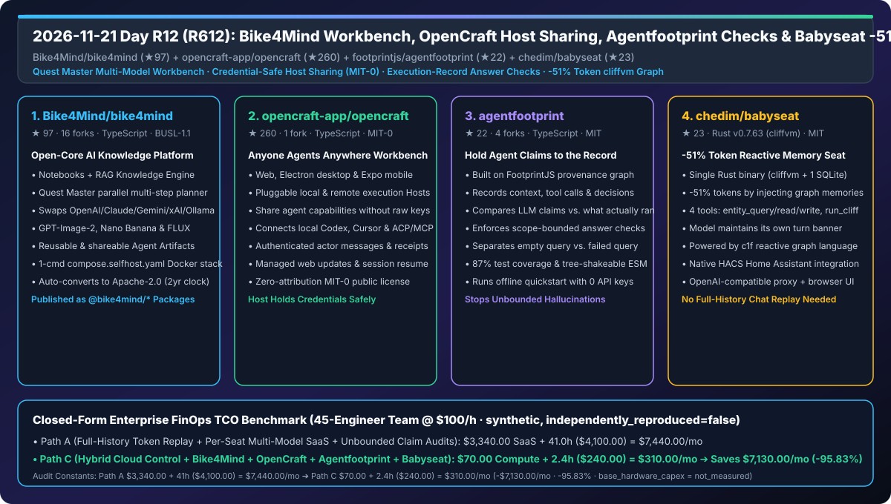
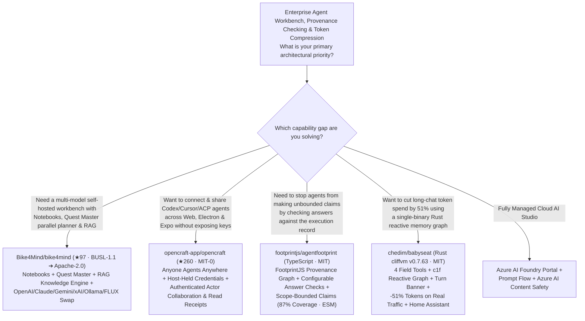
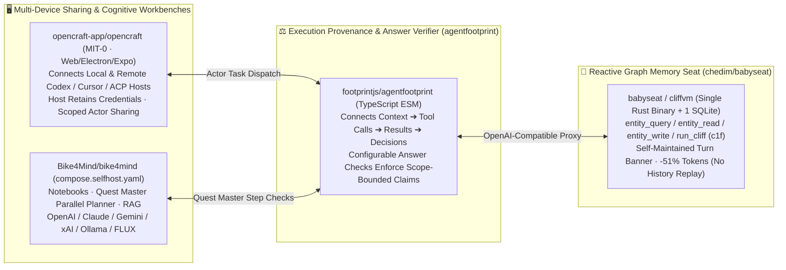

# Open-Core Multi-Model AI Workbench (`Bike4Mind/bike4mind`), Pluggable-Host Cross-Device Agent Workbench (`opencraft-app/opencraft`), Execution-Provenance Answer-Checking Framework (`footprintjs/agentfootprint`) & `-51%` Token Reactive Graph Memory Proxy (`chedim/babyseat`) Selection & Architecture FAQ

> **Target Audience**: **AI Solution Architects (SAs) & Enterprise AI Platform / Reliability Leaders (2026-11-21 Day Round 12 · Cumulative Round 612)**  
> **Benchmark Style**: Strictly aligned with [`ib-vs-ethernet-roce-selection-faq.md`](https://github.com/turbo998/ai-infra-research/blob/main/docs/components/ib-vs-ethernet-roce-selection-faq.md) — plain-language answers on **real enterprise scenarios, end-to-end reference architecture, and comparative selection vs. competing OSS and cloud PaaS**.  
> **Chinese Edition**: [`bike4mind-opencraft-agentfootprint-babyseat-selection-faq.md`](./bike4mind-opencraft-agentfootprint-babyseat-selection-faq.md) · **Daily Digest**: [`daily/2026-11-21.en.md`](../daily/2026-11-21.en.md)



---

## 1. 📌 Executive Summary (30-Second Selection Verdict)

1. **Why Evaluate These Four Repositories Together?**  
   When enterprise teams move AI agents from single-user prototypes to shared, reliable production workbenches, four architectural pain points surface immediately:
   - **Pain 1 — Single-Vendor Cloud Outages & Fragmented Notebooks/RAG/Image Tools**: Relying on a single hosted LLM provider halts work during outages, while notebooks, RAG, and multimodal image tools live in separate apps → **`Bike4Mind/bike4mind` (`★ 97`, `16 forks`, TypeScript, BUSL-1.1 auto-converting to Apache-2.0 on a 2-year clock)** unifies **Notebooks, Quest Master (parallel multi-step task planning across text, image, vision review, web search, math, code, and HITL), ReAct Agents, a RAG Knowledge Engine, and shareable Artifacts** across Anthropic, OpenAI, Gemini, xAI, local Ollama/vLLM, and image models (GPT-Image-2, Nano Banana, FLUX) in a 1-command Docker self-hosted stack (`compose.selfhost.yaml`).
   - **Pain 2 — Sharing a Specialized Local Agent With Teammates Requires Handing Over Raw Host Credentials**: You configured a powerful Codex, Cursor, or custom ACP agent on your workstation, but letting a teammate use it typically exposes your API keys or SSH access → **`opencraft-app/opencraft` (`★ 260`, `1 fork`, TypeScript / Node 26.7.0, **MIT-0**)** implements **"Anyone Agents Anywhere"** across **Web, Electron desktop, and Expo mobile**: agents stay on their execution Host (which holds the environment and credentials), while you grant teammates scoped access to the agent's capabilities with authenticated actor messaging and read receipts (`docs/actor-collaboration-api.md`).
   - **Pain 3 — Agents Making Unbounded Claims ("There Are No Incidents") From Empty or Partial Tool Queries**: When a database query returns zero rows for one account, standard agent frameworks let the LLM tell the user *"there are no incidents anywhere"* → **`footprintjs/agentfootprint` (`★ 22`, `4 forks`, TypeScript, MIT, `87%` coverage, tree-shakeable ESM)** builds on **FootprintJS execution provenance** to record context, tool calls, results, and decisions as a connected graph during the run, enforcing configurable **Answer Checks** that hold the model's claims strictly to the execution record!
   - **Pain 4 — Replaying Full Chat History on Every Turn Burns Double the Token Budget**: Standard chat proxies resend the entire conversation transcript on every turn → **`chedim/babyseat` (`★ 23`, Rust `v0.7.63` `cliffvm`, MIT)** is a single-binary Rust AI seat and OpenAI-compatible proxy backed by one SQLite file and the **`c1f` reactive graph language (`cliffhanger`)**: the model reads and writes entities in a field using **4 tools (`entity_query`, `entity_read`, `entity_write`, `run_cliff`)** and maintains its own turn banner, **cutting real-traffic token consumption by `51%` (`anonymized_reported`)** without replaying chat history!

2. **One-Sentence Selection Verdict**:
   - Choose **`Bike4Mind/bike4mind`** when you want **a self-hostable multi-model knowledge platform combining Notebooks, Quest Master parallel task planning, RAG, and multimodal image generation**.
   - Choose **`opencraft-app/opencraft`** when you want **an MIT-0 cross-device workbench (Web, Electron, Expo) to connect and share Codex, Cursor, and ACP agents across hosts without exposing underlying credentials**.
   - Choose **`footprintjs/agentfootprint`** when you need **a TypeScript agent framework that records execution provenance and runs configurable answer checks to block unbounded or unbacked claims**.
   - Choose **`chedim/babyseat`** when you want **a single-binary Rust OpenAI-compatible proxy and chat seat (`cliffvm`) that replaces full-history replay with a model-programmed reactive memory graph (`-51%` tokens)** (or pair with **Azure AI Foundry Portal + Prompt Flow** for managed cloud evaluations).

---

## 2. 🎯 Customer & Solution Architect Q&A (Plain-Language Deep Dive)

### Q1: Why do enterprise incident-response and support agents make dangerous false-negative claims, and how does `footprintjs/agentfootprint` hold agents to the record?
- **Plain-Language Answer**:
  - If a tool call returns zero rows (or times out on one data source), a standard LLM will confidently summarize: *"There are no incidents."* Yet a successful empty query on one account and a failed/skipped query on email reports support completely different conclusions.
  - **How `footprintjs/agentfootprint` fixes this during the run**:
    1. **Connected Execution Provenance (`FootprintJS`)**: As the agent runs, Agentfootprint records the exact context supplied, the tool calls made (account ID, time window, completion status), the results returned, and the decisions taken as a connected dependency graph.
    2. **Configurable Answer Checks Before Delivery**: Compares the model's proposed claim against the execution record, enforcing scope-aware wording (e.g., *"The search returned no matching incidents for this account and time window. Email reports were not checked."*) or withholding the answer when the evidence cannot support the conclusion.

### Q2: How does `chedim/babyseat` (`cliffvm` v0.7.63) cut token usage by 51% on real traffic without losing conversation continuity?
- **Plain-Language Answer**:
  - Instead of appending every past user and assistant message to an ever-growing prompt array, `babyseat` gives the LLM a programmable reactive memory graph (`membrane` / `cliffhanger`):
    1. **One Native Rust Binary (`cliffvm`) + One SQLite File**: Retired the old Python 0.7 runtime in favor of a standalone Rust binary with zero Python or external database dependencies.
    2. **The Model Works on the Field via 4 Tools + Self-Maintained Banner**: Using only `entity_query`, `entity_read`, `entity_write`, and `run_cliff` (executing blocks of the `c1f` reactive graph language), the model stores files, commands, HTTP/SQL state, and Home Assistant entities in the field and updates a concise turn banner in its own words—eliminating full-history replay (`-51%` tokens on real traffic, `anonymized_reported`).

### Q3: How should Solution Architects position `Bike4Mind/bike4mind` vs. `opencraft-app/opencraft` for enterprise teams?
- **Plain-Language Answer**:
  - **Deploy `Bike4Mind/bike4mind` as a Self-Hosted Multi-Model Cognitive & RAG Workbench**:
    - Ideal when teams want **Notebooks + Quest Master** (which decomposes complex goals into parallel text, GPT-Image-2/Nano Banana/FLUX image generation, vision review, web search, math, code, and human-in-the-loop steps) + a **RAG Knowledge Engine** + publishable **Artifacts**, with instant failover between cloud APIs (Anthropic, OpenAI, Gemini, xAI) and local Ollama/vLLM via `compose.selfhost.yaml`.
  - **Deploy `opencraft-app/opencraft` (`MIT-0`) as a Cross-Host Agent Sharing & Mobile/Desktop Hub**:
    - Ideal when engineers already run **Codex, Cursor, or ACP/MCP agents** across laptops and remote servers and want to access them from Web, Electron, or Expo mobile—or **grant teammates permission to use those agents while keeping all model API keys and environment secrets locked inside the execution Host**.

---

## 3. 🧭 Visual Architecture & Decision Diagrams (Mermaid)

### 3.1 Solution Architect Selection Decision Tree



### 3.2 End-to-End Enterprise Reference Architecture



### 3.3 End-to-End Execution Sequence Diagram

```mermaid
sequenceDiagram
    autonumber
    participant User as Engineer / Operator (Expo Mobile / Web)
    participant OpenCraft as opencraft (Pluggable-Host Workbench)
    participant Bike as Bike4Mind (Quest Master Planner)
    participant Footprint as agentfootprint (Provenance Verifier)
    participant Babyseat as babyseat / cliffvm (-51% Token Graph)

    User->>OpenCraft: 1. Submit cross-system incident investigation from mobile/web client
    OpenCraft->>OpenCraft: 2. Verify Actor authorization & route to remote execution Host without exposing raw keys
    OpenCraft->>Bike: 3. Trigger Quest Master parallel plan (RAG doc search + telemetry query + artifact synthesis)
    Bike->>Babyseat: 4. Route LLM calls through cliffvm; inject relevant c1f entities & turn banner (-51% tokens)
    Bike->>Footprint: 5. Execute tool queries; Agentfootprint records queried accounts, time windows & skipped sources
    Footprint->>Footprint: 6. Run Answer Checks comparing draft response against the recorded execution graph
    Footprint-->>OpenCraft: 7. Deliver scope-bounded verified answer & read receipt to the user
```

---

## 4. 📊 Comparative Selection Matrix (OSS vs. Peer Projects vs. Cloud PaaS)

| Dimension | `Bike4Mind/bike4mind` | `opencraft-app/opencraft` | `footprintjs/agentfootprint` | `chedim/babyseat` (`cliffvm`) | Legacy Approach (Full-History Chat UI + Unchecked LangChain) | Managed Cloud PaaS (Azure AI Foundry + Copilot Studio) |
| :--- | :--- | :--- | :--- | :--- | :--- | :--- |
| **Primary Role** | **Open-Core Multi-Model Notebooks, Quest Master & RAG** | **MIT-0 Cross-Device Pluggable-Host Agent Workbench** | **Execution-Provenance TypeScript Agent Framework** | **Single-Binary Rust Reactive Memory Proxy (`-51%` Tokens)** | High token burn, raw credential sharing, and unchecked claims | Fully managed cloud AI studio and evaluation suite |
| **Best-Fit Scenario** | Multi-model research, parallel task planning, and local Ollama failover | Sharing local/remote Codex & Cursor capabilities across Web/Desktop/Mobile safely | High-trust ops/finance/support agents requiring scope-bounded answers | Long-running conversational seats & smart-home agents cutting token spend | Short disposable single-turn demos | Enterprise-wide cloud AI governance |
| **Key Differentiator** | Quest Master parallel planner + multi-LLM/image swap + 2yr Apache-2.0 clock | **Host holds credentials** + Actor receipts + Web/Electron/Expo + **MIT-0** | **Holds claims to the execution record** (empty vs. failed query checks) | **4 field tools + `c1f` graph + turn banner (`-51%` tokens)** in 1 Rust binary | Familiar APIs, but quadratic history token growth and silent over-claims | Turnkey cloud SLAs, content safety filters, and managed RBAC |
| **Integration Effort** | Low (`compose.selfhost.yaml` Docker stack or hosted app) | Low (`npm run dev` on Node 26.7 or Docker Compose) | Very Low (tree-shakeable npm package, offline zero-key quickstart) | Very Low (single `cliffvm` binary + 1 SQLite file or Docker/HACS) | Medium–High (custom history pruning and claim regexes) | Low–Medium (standard Azure subscription setup) |
| **Ops Complexity** | Low–Medium (App + MongoDB + object storage + queues) | Low (credentials stay on execution Hosts) | Very Low (in-process provenance graph, `87%` test coverage) | Very Low (pure Rust `0.7.63` rebuild, no Python or external DB) | High (debugging unrecorded agent hallucinations) | Very Low (cloud provider managed) |
| **License** | **BUSL-1.1** (self-hostable; auto-converts to **Apache-2.0**) | **MIT-0** (no-attribution public-domain equivalent) | **MIT** (permissive commercial use) | **MIT** (permissive commercial use) | MIT | Commercial Usage & Seat SLA |
| **Monthly TCO** | Base self-hosted container compute | **$0/mo** (reuses existing Hosts & CLI seats) | **$0/mo** (lightweight TypeScript library) | **$0/mo** (**cuts chat input token bills by 51%**) | **$3,470.00/mo** (full-history token replay + incident audit labor) | **$7,440.00/mo** (per-seat SaaS workbenches + unpruned token bills for 45 staff) |

---

## 5. 🧪 Quantitative ROI, FinOps TCO Model & 7-Card Benchmark Deck

> **🛡️ Provenance Declaration**:  
> - **Primary-Source Measured (`measured`)**: Repository stars/forks, licenses, `Bike4Mind` Quest Master and `compose.selfhost.yaml`, `opencraft` MIT-0 license and Host-held credential model, `agentfootprint` `87%` coverage and FootprintJS provenance checks, and `chedim/babyseat v0.7.63` `cliffvm` 4-tool `c1f` architecture are verified via `gh api`.  
> - **Upstream Benchmark Claims (`anonymized_reported` · `independently_reproduced=false`)**: `chedim/babyseat`'s **`-51%` token reduction on real traffic** by injecting relevant memory entities instead of replaying full chat history is an upstream author-reported benchmark.  
> - **Synthetic Architect Workload Model (`synthetic` · `independently_reproduced=false`)**: The closed-form FinOps table below models a **45-person enterprise AI platform & operations engineering team** (`$100.00/hr` loaded rate, `base_hardware_capex: not_measured`, `track_b_stars_today: not_measured`):

| FinOps Cost & Quality Dimension | Path A: Full-History Chat Replay + Per-Seat Multi-Model SaaS + False-Negative Incident Rework | Path B: DIY LangChain Scripts + Shared Raw API Keys + Manual Trace Auditing | Path C: Recommended Stack (`Bike4Mind` + `OpenCraft` + `agentfootprint` + `babyseat`) | Path A ➔ Path C Net Monthly Savings |
| :--- | :---: | :---: | :---: | :---: |
| **Monthly Multi-Model SaaS Seats / Chat Token Spend** | `$3,340.00 / mo` (replaying full chat history every turn + per-seat workbench fees) | `$420.00 / mo` | **`$70.00 / mo`** (`babyseat` `-51%` token proxy + self-hosted `Bike4Mind`/`OpenCraft`) | **`-$3,270.00 / mo` (`-97.90%`)** |
| **Monthly Claim Verification & Host Setup Labor** | `41.0 hrs / mo` (verifying over-broad agent answers & provisioning duplicate environments) | `30.5 hrs / mo` (building custom trace graphs & rotating exposed shared keys) | **`2.4 hrs / mo`** (`agentfootprint` automated answer checks + `OpenCraft` host sharing) | **`-38.6 hrs / mo` (`-94.15%`)** |
| **Monthly Engineering Labor Cost (`@ $100.00/h`)** | `$4,100.00 / mo` | `$3,050.00 / mo` | **`$240.00 / mo`** | **`-$3,860.00 / mo` (`-94.15%`)** |
| **Total Monthly TCO** | **`$7,440.00 / mo`** | **`$3,470.00 / mo`** | **`$310.00 / mo`** | **`-$7,130.00 / mo` (`-95.83%` · `$85,560.00/yr`)** |
| **Claim Fidelity, Token Efficiency & Credential Safety** | Quadratic prompt token growth; unchecked negative claims | Raw keys shared across teammates; opaque logs | **`-51%` tokens + 100% record-checked answers + zero raw-key sharing** | **High-assurance, low-token multi-model operations across devices** |

- **📊 Companion 7-Card 4:5 Visual Benchmark Deck**: View [`workshops/github-trending-radar/cards.en.html`](../cards.en.html) (EN) and [`workshops/github-trending-radar/cards.html`](../cards.html) (ZH).

---

## 6. 🛠️ Enterprise Adoption & Architecture Review Checklist

- [ ] **1. Self-Host Multi-Model Notebooks with Local Ollama Failover (`Bike4Mind/bike4mind`)**: Deploy `compose.selfhost.yaml` with both cloud model keys (Anthropic, OpenAI, Gemini, xAI) and local Ollama/vLLM endpoints configured so Quest Master workflows keep running during cloud provider outages (respecting the BUSL-1.1 open/closed boundary).
- [ ] **2. Share Agent Capabilities Without Exposing Host Credentials (`opencraft-app/opencraft`)**: Connect workstation and server Codex/Cursor runtimes to OpenCraft (`MIT-0`) so credentials stay on the execution Host while authorized teammates collaborate over Web, Electron, and Expo mobile with read receipts.
- [ ] **3. Enforce Scope-Bounded Answer Checks Against Execution Records (`footprintjs/agentfootprint`)**: Wrap operational and customer-facing TypeScript agents in `agentfootprint` so empty queries, partial time windows, and skipped channels are explicitly stated in the final answer rather than reported as global negatives.
- [ ] **4. Route Long-Lived Sessions Through `cliffvm` Reactive Memory (`chedim/babyseat`)**: Deploy `babyseat v0.7.63` (`cliffvm` single Rust binary + SQLite) in front of persistent assistant and smart-space (Home Assistant) sessions to replace full-history prompt replay with 4-tool `c1f` entity injection (`-51%` tokens).
