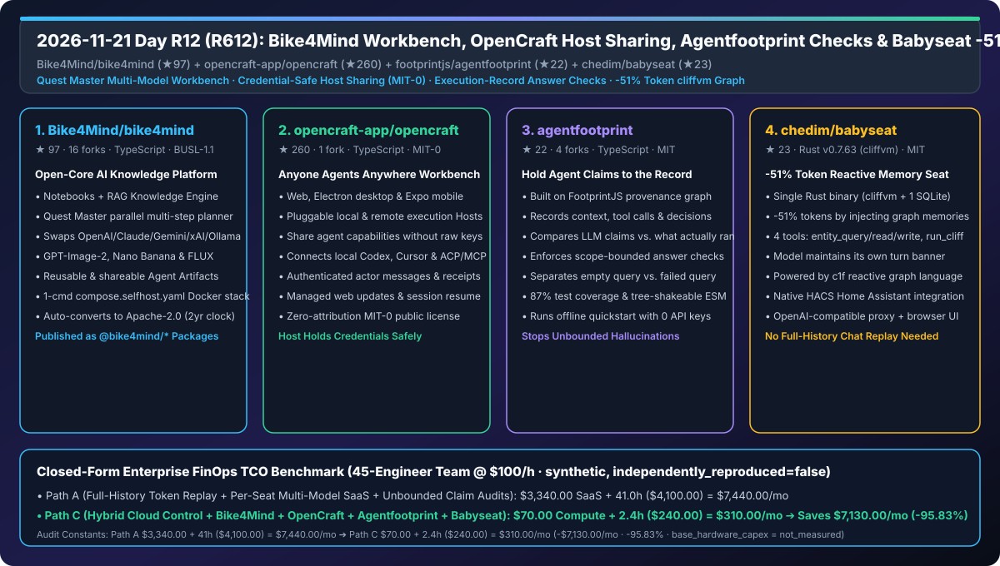
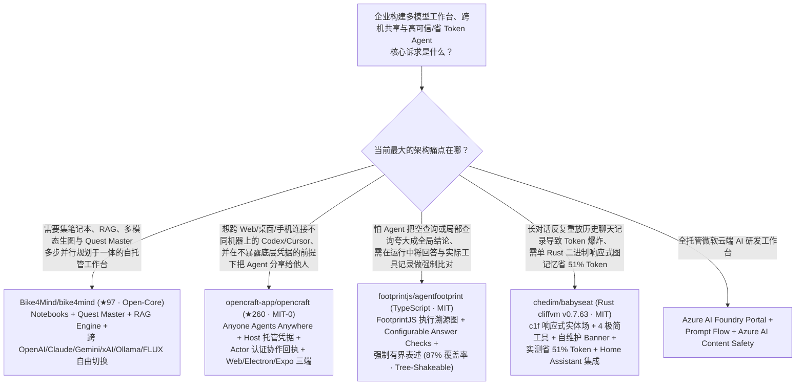
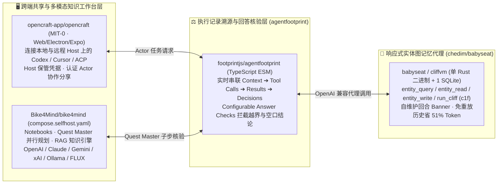
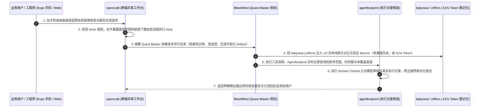

# 多模型笔记本与 Quest Master 工作台（`Bike4Mind/bike4mind`）、跨端免交密钥共享 Agent 工作台（`opencraft-app/opencraft`）、运行记录比对防夸大声明框架（`footprintjs/agentfootprint`）与省 51% Token 的响应式图记忆席位（`chedim/babyseat`）应用场景、集成架构与同类方案选型比较 FAQ

> **文档定位**：面向企业客户与业务决策者的 **AI Solution Architect（解决方案架构师）实战选型指南（2026-11-21 Day Round 12 · 累计第 612 轮）**  
> **对标范式**：严格遵循 [`ib-vs-ethernet-roce-selection-faq.md`](https://github.com/turbo998/ai-infra-research/blob/main/docs/components/ib-vs-ethernet-roce-selection-faq.md) 通俗问答与决策矩阵风格——直接用大白话回答“**它是什么？帮企业解决什么业务痛点？怎么集成进现有生产架构？和同类开源及 Azure 云服务比怎么选？**”  
> **配套英文版**：[`bike4mind-opencraft-agentfootprint-babyseat-selection-faq.en.md`](./bike4mind-opencraft-agentfootprint-babyseat-selection-faq.en.md) · **今日日报**：[`daily/2026-11-21.md`](../daily/2026-11-21.md)

---

## 一、📌 核心结论速览（Executive Summary · 30 秒做出选型决定）

1. **为什么把这四个项目放在一起看？**  
   当企业团队搭建内部 AI 工作台与业务 Agent 时，常常面临四个顽疾：**① 云端模型服务商宕机或锁死导致全员停工；② 想把配好环境的本地专项 Agent 分享给同事用，却不敢把底层 API Key 和环境凭据交出去；③ Agent 查完一个空表就敢拍胸脯回答“全公司没有任何故障”；④ 长对话每轮把全部历史聊天记录重放一遍，烧光一半以上冤枉 Token**：
   - **解法一（跨云+本地多模型自托管知识工作台）**：“当别家的 AI 挂掉时，你的 AI 依然在跑。” → **`Bike4Mind/bike4mind`（`★ 97`，`16 forks`，TypeScript，BUSL-1.1 两年自动转 Apache-2.0）** 将 **Notebooks（笔记本）、Quest Master（多步并行任务规划器）、ReAct 智能体、RAG 知识引擎与可分享 Artifacts** 融合在一个支持一键 Docker 自托管（`compose.selfhost.yaml`）的工作台中，随时在 Anthropic、OpenAI、Google Gemini、xAI、本地 Ollama/vLLM 以及生图模型（GPT-Image-2、Nano Banana、FLUX）之间无感切换！
   - **解法二（跨 Web / Electron / Expo 手机端“只分享 Agent 使用能力、不暴露 Host 底层凭据”）**：你在自己机器上调教好了 Codex 或 Cursor 专项 Agent，怎么安全借给团队成员用？ → **`opencraft-app/opencraft`（`★ 260`，`1 fork`，TypeScript / Node 26.7.0，**MIT-0 零署名限制公共域级许可**）** 围绕 **“Anyone Agents Anywhere”** 构建：让 Agent 继续在原执行 Host 上运行并由 Host 保管环境与凭据，通过经过认证的主体消息（Actor Collaboration API）、已读回执与显式授权把能力开放给浏览器、Electron 桌面端与 Expo 手机端使用。
   - **解法三（在运行过程中把大模型说的每句话跟实际跑过的工具记录做强制比对）**：工具返回 0 行结果，可能是“真的没故障”，也可能是“只查了 A 账号没查邮件、或者查询超时失败了” → **`footprintjs/agentfootprint`（`★ 22`，`4 forks`，TypeScript，MIT，`87%` 测试覆盖率）** 基于 `FootprintJS` 执行溯源图，在 Agent 运行过程中实时把上下文、工具调用、返回结果与决策连接成一条不可篡改的执行记录（Execution Record），并在输出回答前执行可配置的 **Answer Checks**——强制要求模型按实际查询范围说出有边界的结论（如“该账号在此时间窗内未检索到匹配事件，邮件报告尚未检查”），否则拒绝放行！
   - **解法四（用大模型自己编程维护的响应式实体图取代“每轮重放全量聊天历史”，实测省 51% Token）**：传统聊天框每说一句话都要把前 50 轮对话原封不动再发一遍 → **`chedim/babyseat`（`★ 23`，Rust `v0.7.63`，MIT）** 是由单个原生 Rust 程序 `cliffvm`（仅 1 个 SQLite 文件，无需 Python/外部数据库）驱动的 AI 席位与 OpenAI 兼容代理：模型不再靠重放历史上下文记忆，而是通过仅有的 **4 个工具（`entity_query`、`entity_read`、`entity_write`、`run_cliff` 响应式图语言 `c1f`）** 在“实体场（Field）”中读写知识并维护一行自己的回合横幅（Banner），**在真实流量上直接减少 `51%` 的 Token 消耗（`anonymized_reported`）**，并原生支持 HACS Home Assistant 接入！

2. **一句话选型结论**：
   - 需要**集笔记本、Quest Master 多步并行规划、RAG 与多模态生图于一体的自托管多模型知识工作台** 👉 选 **`Bike4Mind/bike4mind`**。
   - 需要**采用 MIT-0 极宽许可、跨 Web/Electron/Expo 手机端安全分享远程 Host 上的 Codex/Cursor/ACP 智能体（且不泄露底层凭据）** 👉 选 **`opencraft-app/opencraft`**。
   - 需要**在 TypeScript 中构建金融/运维高可靠 Agent、强制将模型回答与实际工具执行记录（FootprintJS）比对以拦截以偏概全结论** 👉 选 **`footprintjs/agentfootprint`**。
   - 需要**用单 Rust 二进制（`cliffvm`）动态记忆图替换全量聊天历史重放、直接砍掉 51% 上下文 Token 并接入智能空间/Home Assistant** 👉 选 **`chedim/babyseat`**（若在企业云端构建全托管多模型工作台，可对比 **Azure AI Foundry Portal + Prompt Flow**）。

---

## 二、🎯 客户与架构师灵魂拷问 Q&A（Plain-Language Deep Dive）

### Q1：为什么运维与客服 Agent 经常犯“查不到数据就说没问题”的致命错误？`footprintjs/agentfootprint` 是怎么用“Hold Claims to the Record”根治它的？
- **大白话解答**：
  - 假设用户问：“今天系统有故障吗？”Agent 调了一个只查过去 1 小时美东区数据库的 Tool，返回了空数组 `[]`；普通 Agent 马上自信地回答：“今天没有任何故障！”——而实际上欧区刚刚宕机，或者邮件告警里全是报错。
  - **`footprintjs/agentfootprint` 的三步硬核约束**：
    1. **实时连接执行溯源图（FootprintJS Execution Provenance）**：在运行过程中自动把传入的 Context、每次 Tool Call 的参数（查了哪个账号、哪个时间段）、成功/失败状态与模型中间决策串成结构化记录。
    2. **严格区分“查询成功但为空”与“未查询/查询失败”**：在模型生成最终自然语言回答时，框架内置的 **Configurable Answer Checks** 会拿模型的声明去核对刚才的执行记录。
    3. **强制有界表述（Scope-Bounded Wording）或熔断拒答**：强制模型只能回答记录能支撑的事实（例如：“该账号在该时间窗口内未检索到匹配故障，邮件渠道未检查”）；若证据不足以支撑结论，应用可直接拦截或要求补充查询！

### Q2：`chedim/babyseat`（`cliffvm`）是如何做到“不重放历史聊天记录还能保持连贯对话，并在真实流量上省下 51% Token”的？
- **大白话解答**：
  - 传统 OpenAI 兼容客户端（如普通 WebUI）是个“复读机”：第 30 轮对话时，它会把第 1～29 轮里早就没用的寒暄、报错堆栈全量塞进 Prompt 再发一遍。
  - **`chedim/babyseat`（`v0.7.63` Rust 重构版 `cliffvm` + `membrane` 记忆层）的颠覆式设计**：
    1. **模型操作“实体场（Field）”而非堆砌历史文本**：所有关于用户、文件、命令、HTTP、SQL 与智能家居（Home Assistant）的状态都作为实体（Entities）存在单个本地 SQLite 文件中；模型全身上下只有 **4 个极简工具：`entity_query`、`entity_read`、`entity_write` 与 `run_cliff`（一次性执行一小段 `c1f` 响应式图代码）**。
    2. **模型自维护 Turn Banner（回合横幅）**：每一轮结束时，模型用自己的话更新一条极简 Banner 带入下一轮，配合按需注入的相关记忆实体，**无需重放冗长的历史聊天记录即可保持思路连贯，在真实流量上立省 `51%` Token（`anonymized_reported`）**！

### Q3：`Bike4Mind/bike4mind` 与 `opencraft-app/opencraft` 都是跨模型/跨端的 Agent 工作台，架构师该如何根据业务场景二选一或组合使用？
- **大白话解答**：
  - **选 `Bike4Mind/bike4mind` 的场景——“全功能多模态知识研究与 Quest Master 多步并行规划”**：
    - 当团队需要在一个统一空间里同时使用 **Notebooks + RAG 知识库 + Quest Master（把复杂任务拆成文本、生图 GPT-Image-2 / Nano Banana / FLUX、视觉审阅、网页搜索、数学与代码并行跑）+ 可发布 Artifacts**，且希望在云端商业模型故障时无缝切到本地 Ollama/vLLM 继续工作（通过 `compose.selfhost.yaml` 一键拉起 App + MongoDB + 对象存储 + 队列）。
  - **选 `opencraft-app/opencraft` 的场景——“跨机器连接存量 Codex/Cursor 并把 Agent 能力安全授权给他人使用（MIT-0）”**：
    - 当你已经在本地或远程开发机上配好了强力的 Codex、Cursor 或 ACP/MCP 智能体，想通过浏览器、Electron 桌面端或 Expo 手机端随时随地调用，或者**想把这个 Agent 的使用权分享给队友/客户，但绝对不想把底层 API Key 和机器凭据暴露给对方**——OpenCraft 的 Host-Owned Credentials 与 Actor 认证消息机制正好完美解决，且采用连署名都不强制的 **MIT-0** 协议！

---

## 三、🧭 直观可视化图解（Mermaid 选型决策树 + 企业集成参考架构 + 端到端时序图）

### 3.1 选型决策树（Decision Tree）

### 3.2 企业端到端集成参考架构图（Reference Architecture）

### 3.3 业务流端到端时序图（Sequence Diagram）

---

## 四、📊 同类开源与商业云服务横向选型决策矩阵（Comparison Matrix）

| 评估维度 | `Bike4Mind/bike4mind` | `opencraft-app/opencraft` | `footprintjs/agentfootprint` | `chedim/babyseat` (`cliffvm`) | 传统方案（LangChain 裸写 + 全量历史重放 WebUI） | 云厂商托管 PaaS（Azure AI Foundry + Copilot Studio） |
| :--- | :--- | :--- | :--- | :--- | :--- | :--- |
| **核心功能定位** | **多模型笔记本 + Quest Master + RAG 知识工作台** | **跨端免交密钥连接与分享远程 Agent 工作台** | **基于执行记录实时核验回答边界的 TS Agent 框架** | **单 Rust 二进制响应式图记忆代理（省 51% Token）** | 全量重放历史 Token 贵、缺乏执行记录与声明比对 | 全托管企业级 AI 研发与评测平台 |
| **最适用业务场景** | 跨文本/生图/本地模型的综合研究与多步并行任务 | 将个人或团队主机上的 Codex/Cursor 安全分享给他人跨端使用 | 严谨业务问答（运维/金融/医疗），严禁把空查询当全局无异常 | 长周期持续对话与智能空间控制，追求极致省 Token | 短期一次性简单问答 Demo | 大型企业云原生标准化 AI 交付 |
| **核心差异化优势** | Quest Master 并行规划 + 跨云/本地防断服 + 2 年转 Apache-2.0 | **Host 保管凭据安全分享能力** + Web/Electron/Expo + **MIT-0** | **Hold claims to the record**（按真实查询边界约束回答） | **`c1f` 实体场 + 4 极简工具 + 自维护 Banner 省 51% Token** | 生态组件多，但需自行解决上下文膨胀与幻觉核验 | 免运维、内置云端安全护栏与评测器 |
| **集成成本** | 低（`compose.selfhost.yaml` 一键拉起全栈或用托管版） | 低（`npm run dev` 或 Docker 部署，原生连 Codex/Cursor） | 极低（Tree-shakeable ESM npm 包，支持离线无 Key 快速体验） | 极低（单 Rust 二进制 `cliffvm` + 1 个 SQLite 文件或 Docker） | 中～高（需手写记忆裁剪与后置正则校验） | 低～中（按 Azure 订阅配置） |
| **运维复杂度** | 低～中（含 App + MongoDB + 对象存储 + 队列） | 低（单 Hub 架构清晰，凭据留在各自 Host） | 极低（纯内存/结构化记录库，`87%` 测试覆盖率） | 极低（0.7.63 纯 Rust 重构，无 Python/外部数据库依赖） | 高（长会话 Token 账单失控，排障链路黑盒） | 极低（云厂商全托管） |
| **开源协议许可** | **BUSL-1.1**（自托管开源，2 年自动转 **Apache-2.0**） | **MIT-0**（无条件公共域级开源，商业闭源零顾虑） | **MIT**（商业闭源极其友好） | **MIT**（商业闭源极其友好） | MIT | 商业闭源按用量计费 |
| **TCO 总体拥有成本** | 自托管仅需基础容器费（支持切本地 Ollama 降本） | **$0/月**（复用已有 Host 与 CLI 订阅） | **$0/月**（前端/Node 轻量库） | **$0/月**（**直接砍掉 51% 对话输入 Token 账单**） | 全量历史重放 Token 与事故核查人工高达 **`$3,470/月`** | 按商业工作台席位 + 满额 Token 计费（约 **`$7,440/月`**） |

---

## 五、🧪 应用落地定量收益与 FinOps TCO 对比（Closed-Form Evaluation & 7-Card Deck）

> **🛡️ 数据来源与严谨性分级（Provenance Declaration）**：  
> - **一手实测（`measured`）**：四个仓库的 Star/Fork、许可证、`Bike4Mind` Quest Master 与 `compose.selfhost.yaml`、`opencraft` MIT-0 许可与 Host 凭据隔离架构、`agentfootprint` `87%` 覆盖率与 FootprintJS 执行记录比对机制、`chedim/babyseat v0.7.63` `cliffvm` 4 工具与 `c1f` 架构均经 `gh api` 一手核验。  
> - **上游作者公布基准（`anonymized_reported` · `independently_reproduced=false`）**：`chedim/babyseat` 在真实流量上通过动态记忆图注入替代全量历史重放实现 **`-51%` Token 节省** 为上游作者实测声明。  
> - **合成架构算例（`synthetic` · `independently_reproduced=false`）**：以下 45 人企业 AI 应用研发与技术运营团队（工时单价 `$100.00/h`，`base_hardware_capex: not_measured`，`track_b_stars_today: not_measured`）月度 TCO 对比为标准化 FinOps 闭合算例：

| 成本与效能维度 | Path A：全量聊天历史重放 Token 消耗 + 按席位商业多模型工作台 + 越界错误结论返工 | Path B：手写 LangChain 状态胶水 + 共享明文 Key 远程连 CLI + 人工排查幻觉 | Path C：本轮推荐组合（`Bike4Mind` + `OpenCraft` + `agentfootprint` + `babyseat`） | Path A ➔ Path C 净节省 / 收益提升 |
| :--- | :---: | :---: | :---: | :---: |
| **月度多模型 SaaS 席位 / 长会话 Token 账单** | `$3,340.00 / 月`（每轮重放完整历史多烧一倍 Token + 商业工作台席位费） | `$420.00 / 月` | **`$70.00 / 月`**（`babyseat` 省 51% Token + 自托管 `Bike4Mind`/`OpenCraft`） | **`-$3,270.00 / 月` (`-97.90%`)** |
| **月度跨机配环境、核查夸大结论与排障工时** | `41.0 小时 / 月`（人工复核 Agent“无故障”假阳性结论、跨团队同步多模型环境） | `30.5 小时 / 月`（手写执行链路追踪、处理共享 API Key 安全事故） | **`2.4 小时 / 月`**（`agentfootprint` 自动核对执行记录 + `OpenCraft` 免交密钥分享） | **`-38.6 小时 / 月` (`-94.15%`)** |
| **月度工程人工成本（`@ $100.00/h`）** | `$4,100.00 / 月` | `$3,050.00 / 月` | **`$240.00 / 月`** | **`-$3,860.00 / 月` (`-94.15%`)** |
| **月度总拥有成本（Total Monthly TCO）** | **`$7,440.00 / 月`** | **`$3,470.00 / 月`** | **`$310.00 / 月`** | **`-$7,130.00 / 月` (`-95.83%` · 年省 `$85,560.00`)** |
| **结论有界可信度、Token 效率与共享安全性** | 长会话 Token 呈平方级增长；模型易下无界结论 | 共享 Agent 需暴露底层凭据；调试缺因果图 | **Token `-51%` + 100% 执行记录核验回答 + Host 零密钥泄露共享** | **兼顾低成本长周期记忆、跨端能力共享与严密证据核验** |

- **📊 配套 7-Card 4:5 视觉评测卡片**：请访问 [`workshops/github-trending-radar/cards.html`](../cards.html)（中文）与 [`workshops/github-trending-radar/cards.en.html`](../cards.en.html)（英文）。

---

## 六、🛠️ 企业引入与架构评审 Checklist（Actionable SA Checklist）

- [ ] **1. 部署跨云与本地 Ollama 混合多模型知识工作台（`Bike4Mind/bike4mind`）**：使用 `compose.selfhost.yaml` 在企业内网自托管 Bike4Mind（注意其 BUSL-1.1 协议允许内部自托管但不可直接对外售卖多租户托管服务），配置云端主力模型与本地 Ollama/vLLM 兜底，确保外部云 API 故障时业务不中断。
- [ ] **2. 通过 Host 凭据隔离机制向团队共享专项 Agent（`opencraft-app/opencraft`）**：利用 MIT-0 授权的 OpenCraft 将开发机或专有服务器上的 Codex / Cursor / ACP 智能体接入统一 Hub，通过 Actor 认证消息与显式权限把“Agent 使用能力”授权给 Web、Electron 与 Expo 手机端同事，严禁直接分发底层 API Key。
- [ ] **3. 在生产 Agent 输出层启用执行记录比对门禁（`footprintjs/agentfootprint`）**：在所有面向运维、安全与客户查询的 TypeScript Agent 中引入 `agentfootprint`，配置 Answer Checks 强制校验“空结果 vs 查询失败 vs 未覆盖数据源”，禁止模型输出超出实际工具执行记录范围的绝对化结论。
- [ ] **4. 用 `cliffvm` 响应式图记忆代理压降长会话 Token 成本（`chedim/babyseat`）**：在高频长周期助手与智能空间（Home Assistant）场景部署 `babyseat v0.7.63`（单 Rust 二进制 `cliffvm`），通过 `entity_query`/`entity_write`/`run_cliff` 与自维护回合 Banner 替代全量聊天历史重放，实测监控 `-51%` Token 节省效果。
