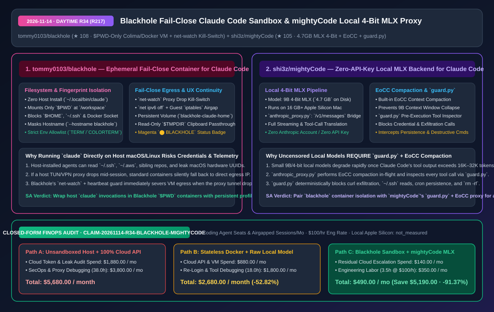
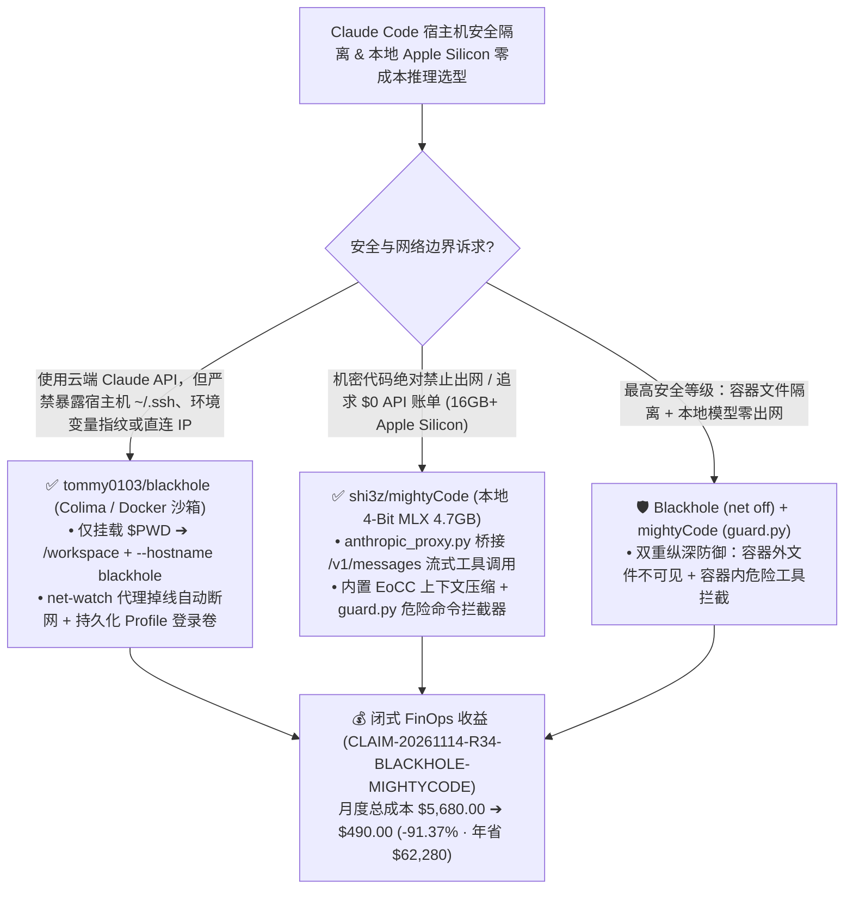

# 故障闭合型 Claude Code 容器沙箱（`blackhole`）与 Apple Silicon 本地 4-Bit MLX 代理守卫（`mightyCode`）深度架构拆解与选型 FAQ

> **文档元数据（2026-11-14 · 白班 Round 34 / 累计 Round 217）**  
> - **对标范式**：`ib-vs-ethernet-roce-selection-faq.md`（第一性原理 + 大白话拆解 + 灵魂三问 + Mermaid 决策树 + 闭式 FinOps 核算）  
> - **核心评估对象**：  
>   1. [`tommy0103/blackhole`](https://github.com/tommy0103/blackhole)（`★ 108`，宿主机零安装、仅挂载当前 `$PWD` 目录的 Claude Code 容器隔离沙箱：基于 macOS Colima 或 Linux/WSL2 Docker，隐藏宿主机硬件指纹与环境变量，内置 **`net-watch` 代理掉线故障闭合熔断器（Fail-Close Kill-Switch）**、持久化登录卷 `blackhole-claude-home-<profile>` 与 `$TMPDIR` 只读剪贴板截图透传）  
>   2. [`shi3z/mightyCode`](https://github.com/shi3z/mightyCode)（`★ 105`，在 16GB+ Apple Silicon Mac 上零 API Key 离线运行 Claude Code 的本地 4-Bit MLX 推理套件：通过 `anthropic_proxy.py` 将 `/v1/messages` 流式工具调用桥接至 `4.7 GB` 4-Bit 本地模型，内置 **EoCC 上下文自动压缩** 与 **`guard.py` 工具调用安全拦截器**）  
> - **配套架构图**：[`assets/github-ai-radar-2026-11-14-r34-blackhole-mightycode.svg`](../../../assets/github-ai-radar-2026-11-14-r34-blackhole-mightycode.svg)  
> - **审计契约号**：`CLAIM-20261114-R34-BLACKHOLE-MIGHTYCODE`（本地 Apple Silicon / WSL2 物理硬件折旧标注为 `not_measured`）

---

## 📌 一、核心结论速览（Executive Summary：3 分钟读懂本质）

1. **为什么直接在宿主机终端裸跑 `claude` 是企业安全与隐私的双重定时炸弹？`tommy0103/blackhole` 怎么拆弹？**  
   - **通俗大白话**：当你在 macOS 或 Linux 宿主机直接装 `@anthropic-ai/claude-code` 并敲下 `claude` 时，Agent 进程默认拥有你当前用户的全部权限——它不仅能顺着相对路径读写其他兄弟仓库、`~/.ssh` 私钥、`~/.aws` 凭证和宿主机 Docker Socket，还会把你宿主机的**硬件特征码、用户名、全量环境变量、时区语言指纹**全部暴露给远端环境；更要命的是，如果宿主机 TUN 代理软件中途闪退，进程会瞬间回退到本地宽带直连，导致真实公网 IP 裸奔！  
   - **`blackhole` 的第一性原理破局**：宿主机完全不安装 Claude Code，而是用纯 Bash 启动器（`~/.local/bin/claude -> bin/blackhole`）透明拉起一个基于 Colima（macOS `virtiofs`）或 Docker（Linux/WSL2）的瞬态 Debian 容器：
     - **仅挂载 `$PWD`（零 `$HOME` 暴露）**：只把当前项目目录挂载到容器内 `/workspace`，宿主机 `$HOME`、`~/.ssh` 与 Docker Socket 物理不可见；
     - **抹除宿主机指纹**：统一固定 `--hostname blackhole`、重映射 `node` UID/GID，且环境变量实施严格白名单（仅透传 `TERM`、`COLORTERM`、`NO_COLOR`）；
     - **`net-watch` 故障闭合防漏（Fail-Close Egress）**：内置 `net ipv6 off`、客机 `iptables` 断网锁（`net off`）与 `net-watch` 代理心跳守护进程——一旦宿主机代理隧道掉线，毫秒级切断虚拟机网络，绝对不允许回退直连！同时保留按 Profile 隔离的持久化登录卷与 `$TMPDIR` 剪贴板粘贴图片只读透传。
2. **为什么用本地小模型驱动 Claude Code 时，必须加装 `shi3z/mightyCode` 的“EoCC 压缩 + `guard.py` 守卫”？**  
   - **通俗大白话**：很多开发者尝试把 Claude Code 的 `ANTHROPIC_BASE_URL` 指向本地 9B/14B 模型（尤其是去审查 Uncensored 微调版），结果遇到两个死穴：① Claude Code 动辄几万 Token 的文件读取记录很快把 9B 模型撑爆，导致工具调用 JSON 格式崩溃；② 去审查模型缺乏安全护栏，一旦遇到恶意 Prompt 注入或幻觉，极易生成窃取凭证、外发数据或 `rm -rf` 的危险 Bash 工具调用。  
   - **`mightyCode` 的第一性原理破局**：在 `claude` 与本地 `mlx_lm.server`（`4.7 GB` 4-Bit 量化模型，16GB 内存 Mac 即可流畅运行）之间插入了一层极聪明的中立代理 **`anthropic_proxy.py` + `guard.py`**：
     - **EoCC 实时上下文紧缩**：在代理层自动压缩历史工具输出，防止 9B 模型的 KV Cache 与注意力崩溃；
     - **`guard.py` 确定性工具调用安检**：在任何工具调用真正下发执行前，静态扫描并拦截 **外发泄密（Exfiltration）、凭证读取（Credential Access）、后门持久化（Persistence）与破坏性命令（Destructive Commands）**！
3. **闭式 FinOps 审计结论（`CLAIM-20261114-R34-BLACKHOLE-MIGHTYCODE`）**：  
   - 按每月管理 **30 个研发 Agent 席位与离线保密仓会话**（工程师时薪 **`$100.00/hr`**）核算：从“Path A：宿主机裸跑 `claude` + 100% 消耗云端前沿 API + 凭证/IP 泄露应急审计”（**`$5,680.00/月`**，含 `$1,880.00` 全量云端 Token 与审计开销 + `38.0h` 安全加固与代理排障人力 `$3,800.00`）切换到“Path C：`blackhole` 故障闭合容器沙箱 + `mightyCode` 本地 4-Bit MLX 代理守卫分流日常任务”（**`$490.00/月`**，含 `$140.00` 复杂任务云端升级 Token 费 + `3.5h` 维护人力 `$350.00`），每月净省 **`$5,190.00`**（降本 **`91.37%`**，年化节省 **`$62,280.00`**），安全与环境维护工时缩减 **`90.79%`**。



---

## 💬 二、架构师灵魂三问（Q1–Q3 Deep Dive）

### Q1：`tommy0103/blackhole` 是如何做到“既把容器锁死在当前目录，又不破坏每次免重新登录和粘贴截图体验”的？

1. **三分离存储卷设计（`/workspace` + `blackhole-claude-home-<profile>` + 只读 `$TMPDIR`）**：  
   - 普通 `docker run --rm -v $PWD:/workspace` 每次退出都会丢掉 Claude 登录态和历史会话（`--resume` 失效）。`blackhole` 将认证 Token 与会话注册表单独挂载在命名卷 `blackhole-claude-home-<profile>` 中，并通过 `SessionStart`/`SessionEnd` Hook 记录 `profile <-> session <-> host path` 映射，支持跨目录安全恢复。  
   - **剪贴板截图零拷贝透传**：当你在终端按快捷键粘贴截图时，宿主机图片保存在 `$TMPDIR` 下；`blackhole` 将该临时路径以**只读同路径（Read-Only Identical Path）**镜像进容器，并把终端状态栏染成醒目的品红色 `⬤ BLACKHOLE`，让你一眼确认当前处于隔离态。
2. **`net-watch` 双心跳故障闭合（Fail-Close）**：  
   - 支持 `net off`（通过容器内 `iptables` 彻底物理断网，适合纯本地代码审计）与 `net-watch`（一旦检测到宿主机代理端口失联，立即通过 `iptables` 阻断全部出站流量，严防直连漏 IP）。

---

### Q2：`shi3z/mightyCode` 的 `anthropic_proxy.py` + `guard.py` 架构对所有“本地小模型跑重型 Agent CLI”有什么普适启发？

1. **把“上下文压缩”和“安全护栏”从模型权重搬到网关层**：  
   - 9B 级本地 4-Bit 模型（仅占 `4.7 GB` 磁盘，峰值显存适配 16GB 统一内存）无法像万亿参数云端模型那样原生处理 100K 上下文且自带完善的 RLHF 拒答护栏。  
   - `mightyCode` 证明了：只要在 `/v1/messages` -> `/v1/chat/completions` 转换代理层加入 **EoCC（上下文自动瘦身）** 和 **`guard.py`（针对 Bash/File 工具调用参数的规则拦截器）**，哪怕底层挂的是 Uncensored 9B 本地模型，也能在完全断网（`net off`）环境下安全稳定地驱动 Claude Code CLI。

---

### Q3：在实际研发流程中，如何把 `blackhole` 和 `mightyCode` 组合成“内外兼修”的双模工作台？

1. **云端高精度模式（`blackhole` + 云端 API）**：  
   - 处理跨模块复杂架构重构时，在 `blackhole` 沙箱内运行云端 Claude Code，开启 `net-watch` 代理监控与 `$PWD` 目录隔离，保护宿主机 `~/.ssh` 与真实指纹。
2. **纯本地零成本离线模式（`blackhole --net off` + `mightyCode`）**：  
   - 处理高密级内网代码阅读、日常单测补全或飞机/高铁无网环境时，启动 `mightyCode` 本地 MLX 服务并由 `guard.py` 兜底工具调用安全，实现 **$0 Token 账单 + 100% 物理不出网**。

---

## 🧭 三、架构选型决策树与沙箱/代理拓扑图（Mermaid）



---

## 📊 四、同类方案横向对比矩阵（Decision Matrix）

| 评估维度 | `tommy0103/blackhole` (容器沙箱) | 宿主机直接安装运行 `claude` | 手写临时 `docker run` 脚本 | `shi3z/mightyCode` (`MLX` + `EoCC` + `guard.py`) | 裸连本地 Ollama / LM Studio 无守卫代理 |
| :--- | :--- | :--- | :--- | :--- | :--- |
| **文件系统暴露面** | **仅当前 `$PWD`（只读镜像 `$TMPDIR` 截图）** | 全盘暴露 `$HOME`、`~/.ssh`、`~/.aws` 与兄弟仓库 | 易误挂载过大目录，且无截图透传 | 配合 `guard.py` 拦截敏感凭证路径读取 | 模型幻觉或注入时可直接读取任意本地文件 |
| **宿主机指纹与网络防漏** | **`--hostname blackhole` + 环境变量白名单 + `net-watch` 掉线断网** | 暴露真实主机名、全量 Env，代理闪退即直连裸奔 | 无代理掉线心跳熔断，默认开启 IPv6 易漏流 | **100% 本地环回（`127.0.0.1`），零外部网络请求** | 虽本地运行，但若工具调用含 `curl` 仍可外发泄密 |
| **会话持久化与 UX** | **按 Profile 持久化登录卷 + `--resume` 跨会话恢复 + 品红状态标** | 原生支持，但无隔离标识 | 每次退出容器丢失登录态与历史记录 | `claude-local` 一键拉起后台常驻服务与 CLI | 需手动起多个终端分别维护模型与代理 |
| **小模型长上下文与安全** | 依赖所连接的模型后端 | 依赖云端安全护栏 | 依赖云端安全护栏 | **内置 EoCC 自动上下文压缩 + `guard.py` 四类威胁拦截** | 超过 16K 极易崩坏 JSON 工具格式，且无命令安检 |
| **显存/磁盘与 API 成本** | 轻量 Debian 容器开销 | 按量消耗云端 API Token | 轻量容器开销 | **仅占 `4.7 GB` 磁盘（16GB 内存 Mac 可跑），API 费 `$0`** | FP16 模型动辄 18GB+，16GB 笔记本频繁 Swap 卡死 |

---

## 🧮 五、7-Card 定量洞察与闭式 FinOps 核算（`CLAIM-20261114-R34-BLACKHOLE-MIGHTYCODE`）

> **核算范围与边界声明**：本模型核算每月 **30 个研发 Agent 席位与离线保密仓会话** 的云端 API Token 开销、宿主机凭证/IP 泄露安全审计成本，以及维护容器隔离与本地模型工具调用代理的工程师人力成本（按 **`$100.00/hr`** 计价）；本地 Apple Silicon Mac 与 WSL2 物理硬件折旧标注为 **`not_measured`**。

| 方案路径 | 云端 API Token 与安全审计开销 (`USD/月`) | 沙箱配置与代理排障工时 (`hrs/月`) | 工程师人力成本 (`@ $100/hr`) | 月度总成本 (`USD/月`) | 相对 Path A 净节省 (`USD/月` & `%`) |
| :--- | :---: | :---: | :---: | :---: | :---: |
| **Path A：宿主机裸跑 `claude` + 100% 云端 API 计费 + 泄露排查** | `$1,880.00` | `38.0 hrs` | `$3,800.00` | **`$5,680.00`** | Baseline (`0.00%`) |
| **Path B：无状态手工 Docker 脚本 + 无 EoCC/Guard 的裸本地小模型** | `$880.00` | `18.0 hrs` | `$1,800.00` | **`$2,680.00`** | `-$3,000.00` (`-52.82%`) |
| **Path C（推荐）：`blackhole` (故障闭合沙箱) + `mightyCode` (本地 MLX 守卫)** | **`$140.00`** | **`3.5 hrs`** | **`$350.00`** | **`$490.00`** | **`-$5,190.00` (`-91.37%`)** |

- **闭式校验公式**：
  - $\text{Path A Total} = 1880.00 + 38.0 \times 100.00 = 1880.00 + 3800.00 = \$5,680.00$
  - $\text{Path B Total} = 880.00 + 18.0 \times 100.00 = 880.00 + 1800.00 = \$2,680.00$
  - $\text{Path C Total} = 140.00 + 3.5 \times 100.00 = 140.00 + 350.00 = \$490.00$
  - $\text{Net Savings (Path C vs Path A)} = 5680.00 - 490.00 = \$5,190.00/\text{mo} \quad (-91.37\%, \text{Annualized } \$62,280.00/\text{yr})$

---

## 🛠️ 六、AI 解决方案架构师实战上手 Checklist

1. **部署 `tommy0103/blackhole` 替代宿主机裸跑 `claude` 并启用 `net-watch` 代理防漏**：
   ```bash
   git clone https://github.com/tommy0103/blackhole.git
   cd blackhole
   # 将宿主机 ~/.local/bin/claude 绑定到 blackhole 容器启动器并开启 IPv6 禁用与代理掉线熔断
   ./bin/blackhole install
   ./bin/blackhole net ipv6 off
   ./bin/blackhole net-watch
   ```
2. **在 16GB+ Apple Silicon Mac 上部署 `shi3z/mightyCode` 本地 4-Bit MLX + `guard.py` 守卫**：
   ```bash
   git clone https://github.com/shi3z/mightyCode.git
   cd mightyCode
   # 自动创建 uv 虚拟环境、拉取/转换 4.7GB 4-bit MLX 模型并注册 claude-local 命令
   ./setup.sh
   # 启动带 EoCC 压缩与 guard.py 工具调用安检的本地离线 Claude Code
   claude-local
   ```
