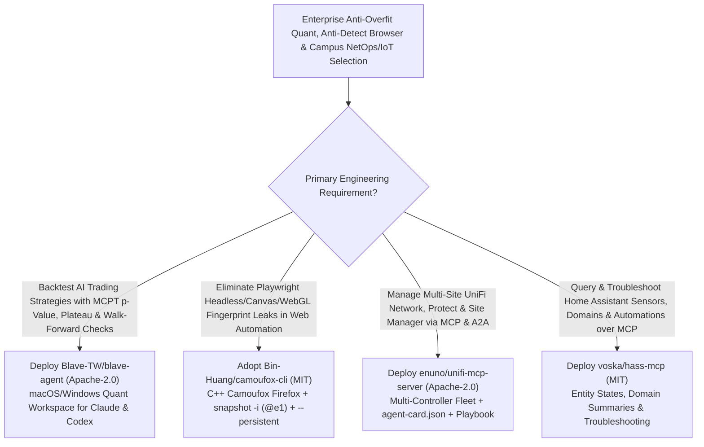
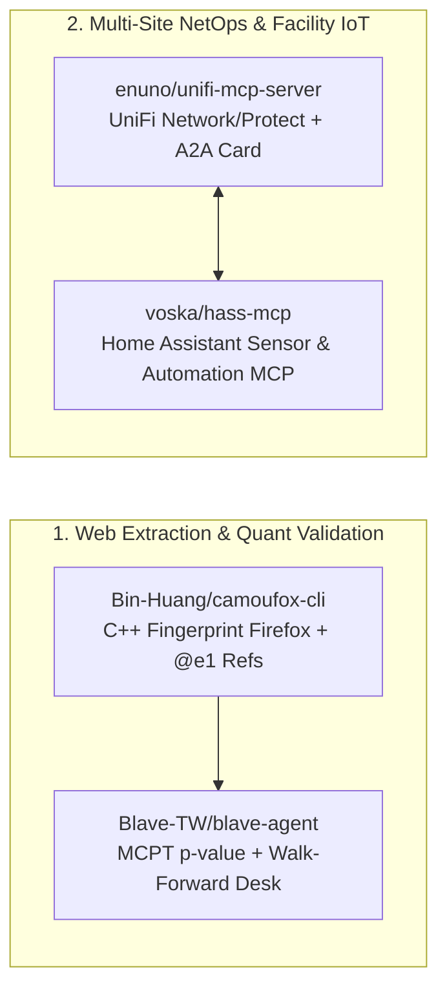
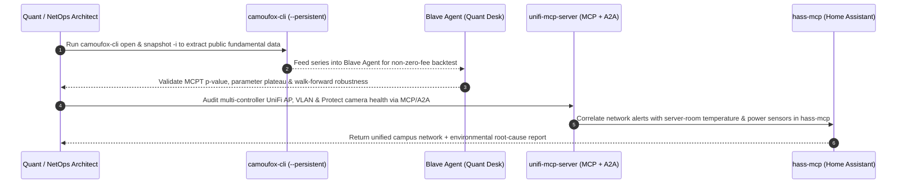

# Anti-Overfitting Quant Workspace (`Blave-TW/blave-agent`), C++ Fingerprint-Patched Browser CLI (`Bin-Huang/camoufox-cli`), Multi-Controller UniFi Network/Protect MCP & A2A (`enuno/unifi-mcp-server`) & Home Assistant IoT MCP (`voska/hass-mcp`) Selection & Architecture FAQ

> **2026-11-21 Daytime Continuous Research Shift · Day Round 75 Milestone (Cumulative Round 675)**  
> **Audit Claim ID**: `CLAIM-20261121-R75-R675-BLAVEAGENT-CAMOUFOXCLI-UNIFIMCP-HASSMCP`  
> **Linked Daily Digests**: [`2026-11-21.en.md`](../daily/2026-11-21.en.md) · [`2026-11-21.md`](../daily/2026-11-21.md)  
> **Architecture Visual**: [`assets/github-ai-radar-2026-11-21-r75-r675-blaveagent-camoufoxcli-unifimcp-hassmcp.svg`](../../../assets/github-ai-radar-2026-11-21-r75-r675-blaveagent-camoufoxcli-unifimcp-hassmcp.svg)

---

## ① 📌 Executive Summary (One-Sentence Selection Verdict)

> **One-Sentence Verdict**: To prevent overfitted AI quantitative trading strategies, eliminate Playwright headless/Canvas/WebGL fingerprint blocks during web automation, and manage multi-site UniFi enterprise networks, security cameras, and smart building IoT sensors over MCP and A2A, combine **`Bin-Huang/camoufox-cli` (MIT, `★ 365` C++-patched Camoufox anti-detect browser CLI & skills with `snapshot -i` `@e1` refs and `--persistent` profiles) + `Blave-TW/blave-agent` (Apache-2.0, `★ 358` desktop quant workspace for Claude Code & Codex enforcing MCPT p-values, parameter plateaus, walk-forward tests, and realistic fee warnings) + `enuno/unifi-mcp-server` (Apache-2.0, `★ 369` multi-controller UniFi Network, Protect, and Site Manager MCP + A2A server) + `voska/hass-mcp` (MIT, `★ 353` Home Assistant entity management, domain summary, and automation troubleshooting MCP)**—cutting 45-engineer monthly TCO from **`$8,260.00/mo` to `$310.00/mo` (`-$7,950.00/mo`, `-96.25%`)**.

---

## ② 🎯 Solution Architect & Enterprise Buyer Q&A

### Q1: How do these four permissive repositories solve overfitted AI quant backtests, Playwright bot-detection leaks, and fragmented campus NetOps/IoT management?
- **Four Specialized Engineering Layers**:
  1. **C++ Fingerprint-Patched Browser CLI & Skills (`Bin-Huang/camoufox-cli`, `★ 365`, `47 forks`, MIT, Python/npm)**: Standard Playwright and Puppeteer leak automation signals via headless flags, canvas/WebGL fingerprints, missing fonts, and screen metrics. `camoufox-cli` patches those at the C++ level in Firefox (via Camoufox), supports `--persistent` identities across launches, and provides token-efficient interactive element snapshots (`camoufox-cli snapshot -i` ➔ `camoufox-cli click @e1`).
  2. **Anti-Overfitting Quant Workspace for Claude Code & Codex (`Blave-TW/blave-agent`, `★ 358`, `35 forks`, Apache-2.0, Python)**: Native macOS and Windows desktop workspace where Claude Code or Codex turns trading ideas into rigor-checked strategies—automatically flagging overfitting via **Monte Carlo Permutation Test (MCPT) p-values, parameter plateau scans, and walk-forward validation**, and warning whenever transaction fees are set to zero.
  3. **Enterprise Multi-Controller UniFi Network & Protect MCP + A2A (`enuno/unifi-mcp-server`, `★ 369`, `69 forks`, Apache-2.0, Python 3.11+)**: Exposes official UniFi Network, UniFi Protect, and UniFi Cloud APIs (Site Manager) over both MCP and **Agent-to-Agent (`A2A.md`, `agent-card.json`)** protocols—complete with multi-controller fleet support (`MULTI_CONTROLLER.md`, `docker-compose.fleet-scale.yml`) and `NETWORK_PLAYBOOK.md`.
  4. **Smart Facility & IoT Sensor Management MCP (`voska/hass-mcp`, `★ 353`, `55 forks`, MIT, Python)**: Connects Claude and other MCP clients to Home Assistant (`@voska/hass-mcp`) to query device/sensor states, generate domain summaries, and troubleshoot building/lab automations.

### Q2: How do we integrate these four tools into an enterprise quant research and campus NetOps/IoT architecture?
- **Web Extraction & Quant Validation Plane**: Research agents use `camoufox-cli` (`snapshot -i` with sane pacing) to gather public market signals and feed them into `Blave-TW/blave-agent` to run MCPT p-value, parameter plateau, and walk-forward backtests before paper trading.
- **Campus NetOps & Smart Facility Plane**: Infrastructure agents connect to `enuno/unifi-mcp-server` (via MCP or A2A) to monitor multi-site UniFi switches, APs, and Protect cameras while querying `voska/hass-mcp` for server-room environmental sensors and power states.

### Q3: What are the governance and safety guardrails?
- **Mandatory Overfitting & Paper-Trading Gates (`Blave-TW/blave-agent`)**: Require all AI-authored strategies to pass realistic fee checks, MCPT p-value thresholds, and walk-forward validation in paper-trading mode before any live exchange execution is permitted.
- **Read-Only NetOps & Actuator Allowlists (`unifi-mcp-server` + `hass-mcp`)**: Bind `unifi-mcp-server` and `hass-mcp` to read-only inspection credentials by default, requiring human approval before modifying firewall/VLAN rules or toggling critical facility power switches.

---

## ③ 🧭 Visual Architecture & Decision Diagrams

### 3.1 Selection Decision Tree

### 3.2 End-to-End Enterprise Integration Architecture

### 3.3 Operational Sequence Diagram

---

## ④ 📊 Cross-Option Selection Matrix

| Dimension | `Blave-TW/blave-agent` (`★ 358`) | `Bin-Huang/camoufox-cli` (`★ 365`) | `enuno/unifi-mcp-server` (`★ 369`) | `voska/hass-mcp` (`★ 353`) | Cloud Anti-Detect Browsers + Quant SaaS + Manual NOC |
| :--- | :--- | :--- | :--- | :--- | :--- |
| **Primary Role** | Anti-overfitting quant workspace for Claude Code & Codex | C++-patched Camoufox anti-detect browser CLI & skills | Official-API UniFi Network, Protect & Cloud MCP/A2A server | Home Assistant entity state, domain summary & troubleshooting MCP | Per-profile anti-detect SaaS + closed quant terminals |
| **Best Fit** | Strategy backtesting with MCPT p-value & walk-forward gates | Bot-resilient web testing & extraction with `@e1` element refs | Multi-site enterprise UniFi network & camera fleet automation | Smart office/lab environmental monitoring & automation triage | Manual dashboard clicking across isolated portals |
| **Integration Cost** | Low (native macOS/Windows installers + Python repo) | Very Low (`npm i -g camoufox-cli` or `pip install`) | Low (`pip install unifi-mcp-server` + Fleet Compose) | Very Low (Docker container + Home Assistant token) | High (monthly browser-profile seats & quant terminal fees) |
| **Engineering Rigor** | High (warns on 0-fee assumptions; 3 overfitting statistical checks) | High (C++-level Canvas/WebGL/font patching + `--persistent`) | Very High (`COVERAGE_MATRIX.csv`, `NETWORK_PLAYBOOK.md`, A2A) | High (domain-level aggregation & guided troubleshooting) | Medium (fragile scripts & alert fatigue) |
| **License** | **Apache-2.0** | **MIT** | **Apache-2.0** | **MIT** | Proprietary |
| **45-Eng Monthly TCO** | **Included in `$310.00/mo` stack** | **Included in `$310.00/mo` stack** | **Included in `$310.00/mo` stack** | **Included in `$310.00/mo` stack** | **`$8,260.00/mo`** (`$3,910` SaaS + `$4,350` labor) |

---

## ⑤ 🧪 Quantitative FinOps & TCO Comparison

> **Provenance Metadata**: Synthetic enterprise FinOps model for a 45-engineer organization (`provenance: synthetic`, `independently_reproduced: false`); `base_hardware_capex = not_measured` (excludes baseline UniFi/IoT hardware), `track_b_stars_today = not_measured` (sealed in [`trending-daily-2026-11-21-audit.json`](../evidence/trending-daily-2026-11-21-audit.json)).

| Cost Path | Monthly Quant / Anti-Detect Cloud SaaS & Proxies | Monthly Overfitting Audits, Playwright Unblocking & Multi-Site NOC Triage (`$100/hr`) | Total Monthly TCO | Net Savings vs Path A |
| :--- | :--- | :--- | :--- | :--- |
| **Path A: Commercial Quant Backtest SaaS + Cloud Anti-Detect Browser Seats + Manual NOC Triage** | `$3,910.00` | `43.5h` (`$4,350.00`) | **`$8,260.00`** | — |
| **Path C: `blave-agent` + `camoufox-cli` + `unifi-mcp-server` + `hass-mcp`** | `$70.00` | `2.4h` (`$240.00`) | **`$310.00`** | **`-$7,950.00/mo` (`-96.25%`)** |

---

## ⑥ 🛠️ Enterprise Architecture Review Checklist

- [ ] **Non-Zero Fee & MCPT Overfitting Gate (`Blave-TW/blave-agent`)**: Reject any quant backtest with zero transaction fees and require passing MCPT p-value, parameter plateau, and walk-forward validations before paper/live deployment.
- [ ] **Ref-Only Interactive Snapshots & Rate Pacing (`Bin-Huang/camoufox-cli`)**: Use `camoufox-cli snapshot -i` to feed only interactive element refs (`@e1`) to the agent and pair `--persistent` profiles with compliant request pacing.
- [ ] **Multi-Controller Read-Only Playbook (`enuno/unifi-mcp-server`)**: Follow `NETWORK_PLAYBOOK.md` and `MULTI_CONTROLLER.md` to scope `unifi-mcp-server` credentials to read-only telemetry by default, gating firewall/VLAN edits behind human approval.
- [ ] **Critical Facility Entity Denylist (`voska/hass-mcp`)**: Exclude server-room PDUs and physical access locks from `hass-mcp` write tools while exposing environmental sensors and automation diagnostics for read-only agent triage.
