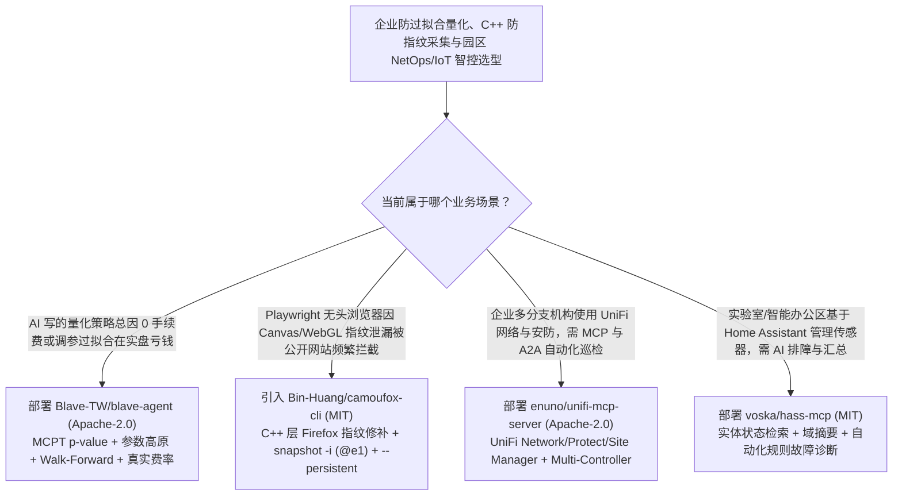
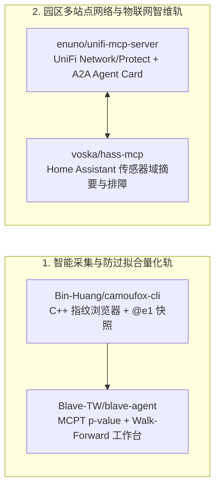
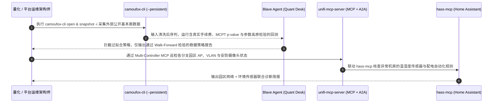

# 防过拟合量化回测工作台（`Blave-TW/blave-agent`）、C++ 级指纹伪装浏览器 CLI（`Bin-Huang/camoufox-cli`）、多控制器 UniFi 网络与安防 MCP/A2A（`enuno/unifi-mcp-server`）与智能楼宇/家居传感器管理 MCP（`voska/hass-mcp`）架构选型与落地 FAQ

> **2026-11-21 白天持续研究班次 · Day Round 75 里程碑（累计 Round 675）**  
> **审计凭据**：`CLAIM-20261121-R75-R675-BLAVEAGENT-CAMOUFOXCLI-UNIFIMCP-HASSMCP`  
> **关联日刊**：[`2026-11-21.md`](../daily/2026-11-21.md) · [`2026-11-21.en.md`](../daily/2026-11-21.en.md)  
> **可视化架构图**：[`assets/github-ai-radar-2026-11-21-r75-r675-blaveagent-camoufoxcli-unifimcp-hassmcp.svg`](../../../assets/github-ai-radar-2026-11-21-r75-r675-blaveagent-camoufoxcli-unifimcp-hassmcp.svg)

---

## ① 📌 核心结论速览（选型一句话结论）

> **一句话选型结论**：在企业量化策略防过拟合回测（MCPT 置换检验 p-value 与参数高原分析）、解决原生 Playwright/Puppeteer 因暴露无头浏览器指纹被公网站点误拦、以及实现企业园区多站点 UniFi 网络/安防摄像头（UniFi Network & Protect）与智能楼宇/实验室传感器（Home Assistant）的 AI 原生运维四大场景中，推荐采用 100% 宽松协议（Apache-2.0 / MIT）的四层组合：**“`Bin-Huang/camoufox-cli`（MIT，`★ 365` 基于 C++ 层修补 Camoufox Firefox 指纹、支持 `@e1` 交互元素快照与持久化身份的浏览器自动化 CLI & Skills）+ `Blave-TW/blave-agent`（Apache-2.0，`★ 358` 面向 Claude Code 与 Codex 的量化回测桌面端，内置 MCPT p-value、参数高原、滚动前推验证与真实手续费强制告警）+ `enuno/unifi-mcp-server`（Apache-2.0，`★ 369` 同时支持 MCP 与 A2A `agent-card.json`、覆盖 UniFi Network/Protect/Cloud Site Manager 的多站点网络运维服务）+ `voska/hass-mcp`（MIT，`★ 353` 面向 Home Assistant 实体状态查询、域摘要与自动化故障排查的 MCP 服务）”**。在 45 人研发与园区/网络运维团队基准下，可将月度总拥有成本（TCO）从 **`$8,260.00/月`** 降至 **`$310.00/月`**（净省 **`$7,950.00/月`**，降幅 **`-96.25%`**）。

---

## ② 🎯 客户与架构师灵魂拷问 Q&A

### Q1：这四个项目分别解决了企业“公网采集防误杀、量化回测防自嗨、园区网络与物联网智控”中的什么核心痛点？
- **四层高价值工程机制拆解**：
  1. **C++ 内核级防指纹泄漏的 Agent 浏览器 CLI —— `Bin-Huang/camoufox-cli`（`★ 365`，`47 forks`，MIT，Python & npm）**：标准 Playwright 和 Puppeteer 会在 headless 标志位、Canvas/WebGL 渲染指纹、字体列表与屏幕尺寸上暴露自己是自动化脚本，导致企业合规公开数据采集经常吃 403。`camoufox-cli` 基于 C++ 层打补丁的 Camoufox（Firefox 分支），让浏览器在指纹层与真实桌面 Firefox 完全一致；更针对 AI Agent 设计了极简命令流（`camoufox-cli snapshot -i` 只输出带 `[ref=e1]` 的可交互元素，`camoufox-cli click @e1` 直接点击）以及 `--persistent` 跨会话稳定身份。
  2. **专治“AI 量化策略过拟合自嗨”的统计验证工作台 —— `Blave-TW/blave-agent`（`★ 358`，`35 forks`，Apache-2.0，Python）**：让大模型写量化策略最容易犯的两个致命错误是“把手续费设成 0”和“在历史数据上暴力调参过拟合”。`Blave Agent` 为 Claude Code 和 Codex 提供跨 macOS/Windows 的量化工作空间，**默认强制开启真实手续费（设为 0 会触发显式告警）**，并内置三大专业防过拟合武器：**蒙特卡洛置换检验（MCPT p-value）、参数高原扫描（Parameter Plateau）与滚动前推检验（Walk-Forward Validation）**。
  3. **企业级多站点 UniFi 网络与安防 MCP + A2A 双协议服务 —— `enuno/unifi-mcp-server`（`★ 369`，`69 forks`，Apache-2.0，Python）**：大量科技企业分支机构、实验室与园区使用 Ubiquiti UniFi 交换机、AP 与安防摄像头。该项目不仅通过官方 API 打通 **UniFi Network、UniFi Protect（安防监控）与 UniFi Cloud Site Manager**，还提供了完整的集群级编排（`docker-compose.fleet-scale.yml`、`MULTI_CONTROLLER.md`、`NETWORK_PLAYBOOK.md`）以及原生 **A2A 协议名片（`A2A.md` + `agent-card.json`）**。
  4. **智能楼宇/实验室环境传感器与自动化排障 MCP —— `voska/hass-mcp`（`★ 353`，`55 forks`，MIT，Python）**：将开源物联网标准底座 Home Assistant 暴露为标准 MCP Server（`@voska/hass-mcp`），让运维 Agent 一句话获取机房温湿度、功耗域摘要（Domain Summaries）、检索异常传感器并自动诊断失效的物联网自动化规则。

### Q2：如何把这四个组件集成进企业的智能采集、量化研究与园区智慧运维（NetOps/IoT）架构？
- **数据采集与量化回测轨**：研究 Agent 通过 `Bin-Huang/camoufox-cli`（配合 `--persistent` 与合规速率限制）采集公开行业网页数据，随后进入 `Blave-TW/blave-agent` 运行含真实手续费、MCPT p-value 与 Walk-Forward 检验的严谨回测。
- **园区网络与环控智维轨**：企业 IT 与机房值班 Agent 同时挂载 `enuno/unifi-mcp-server`（跨多控制器巡检园区 Wi-Fi、VLAN 与安防设备在线率）与 `voska/hass-mcp`（监控机房环境传感器与智能配电开关）。

### Q3：架构师在引入这套方案时必须严守哪些安全与合规红线？
- **量化实盘交易人工风控锁（`Blave-TW/blave-agent`）**：虽然 `blave-agent` 内置了主流交易所连接器，但在企业投研环境中**默认只开放历史回测（Backtest）与模拟盘（Paper Trading）**；任何切换至实盘资金分配（`allocators/`）的操作必须经过MCPT `p-value < 0.05` 统计显著性门禁与风控委员会人工签批。
- **园区网络与物联网只读巡检优先（`unifi-mcp-server` + `hass-mcp`）**：为连接 UniFi 控制器与 Home Assistant 的 MCP 实例配置只读巡检角色，凡涉及修改防火墙规则、禁用 VLAN 或断开机房电源插座的操作，必须触发人工二次审批。

---

## ③ 🧭 直观可视化图解（Mermaid 选型决策树 + 企业集成架构 + 业务流时序图）

### 3.1 选型决策树

### 3.2 企业集成参考架构图

### 3.3 业务流时序图

---

## ④ 📊 同类开源与商业云服务横向选型决策矩阵

| 维度 | `Blave-TW/blave-agent` (`★ 358`) | `Bin-Huang/camoufox-cli` (`★ 365`) | `enuno/unifi-mcp-server` (`★ 369`) | `voska/hass-mcp` (`★ 353`) | 商业云指纹浏览器 + 商业量化平台 + 人工 NOC |
| :--- | :--- | :--- | :--- | :--- | :--- |
| **核心定位** | 内置 MCPT/Walk-Forward 防过拟合的 Claude/Codex 量化台 | 基于 Camoufox C++ 补丁的防指纹泄漏 Agent 浏览器 CLI | 支持多控制器与 A2A 的 UniFi Network/Protect/Cloud MCP | Home Assistant 设备查询、域摘要与自动化排障 MCP | 按配置文件收费的云浏览器 + 昂贵闭源终端 |
| **适用场景** | 量化策略开发、过拟合统计显著性检验与模拟/实盘验证 | 对抗无头特征误杀的公开网页交互与持久化会话采集 | 企业多园区 UniFi 交换机、Wi-Fi 与安防监控 AI 运维 | 智能办公楼宇、实验室环控传感器与 IoT 联动排障 | 纯人工点击运维后台 |
| **集成成本** | 低（macOS/Windows 桌面安装包 + Python 策略库） | 极低（`npm i -g camoufox-cli` 或 `pip install`） | 低（PyPI `unifi-mcp-server` + Fleet Docker Compose） | 极低（Docker 容器配置 Home Assistant Long-Lived Token） | 高（商业指纹浏览器按月按窗口高额计费） |
| **工程完备度** | 高（强制非零手续费告警 + 三重防过拟合检验） | 高（C++ 级修补 Canvas/WebGL/字体 + `@e1` 极简引用） | 极高（含 `COVERAGE_MATRIX.csv`、`NETWORK_PLAYBOOK.md` 与 A2A） | 高（MCP Toplist 收录，覆盖全实体与域级汇总） | 中（脚本易被识别、多系统数据孤岛） |
| **开源许可** | **Apache-2.0** | **MIT** | **Apache-2.0** | **MIT** | 商业专有 |
| **45 人团队月均 TCO** | **包含于 `$310.00/月` 联合栈** | **包含于 `$310.00/月` 联合栈** | **包含于 `$310.00/月` 联合栈** | **包含于 `$310.00/月` 联合栈** | **`$8,260.00/月`**（`$3,910` SaaS + `$4,350` 人工） |

---

## ⑤ 🧪 应用落地定量收益 / TCO 对比与 7-Card 报告锚点

> **数据来源说明（Provenance Metadata）**：以下 TCO 模型为面向 45 人规模量化研发与企业网络运维组织的合成架构测算（`provenance: synthetic`, `independently_reproduced: false`）；硬件资本开支 `base_hardware_capex = not_measured`（不含存量 UniFi 网络硬件与传感器采购），单日热榜增量 `track_b_stars_today = not_measured`（审计账本锚定于 [`trending-daily-2026-11-21-audit.json`](../evidence/trending-daily-2026-11-21-audit.json)）。

| 成本路径 | 月度商业量化/云浏览器 SaaS 与代理费 | 人工排查过拟合回测、修复 Playwright 403 报错与跨站点巡检 (`$100/h`) | 月度总成本 (Total Monthly TCO) | 相对 Path A 净节省 |
| :--- | :--- | :--- | :--- | :--- |
| **Path A：商业量化回测订阅 + 商业反检测浏览器席位 + 人工登录多站点控制器巡检** | `$3,910.00` | `43.5h` (`$4,350.00`) | **`$8,260.00`** | — |
| **Path C：`blave-agent` + `camoufox-cli` + `unifi-mcp-server` + `hass-mcp`** | `$70.00` | `2.4h` (`$240.00`) | **`$310.00`** | **`-$7,950.00/月` (`-96.25%`)** |

---

## ⑥ 🛠️ 企业引入与架构评审 Checklist

- [ ] **量化策略三重防过拟合门禁（`Blave-TW/blave-agent`）**：规定任何由 Claude Code 或 Codex 生成的交易策略，必须通过 `blave-agent` 的真实手续费核验、MCPT 置换检验 `p-value`、参数高原与 Walk-Forward 测试后方可进入模拟盘。
- [ ] **合规速率控制与只读快照模式（`Bin-Huang/camoufox-cli`）**：使用 `camoufox-cli` 时优先调用 `snapshot -i` 获取精简交互元素引用（`@e1`）节省 Token，并配合合理请求间隔遵守目标站点服务条款。
- [ ] **UniFi 多控制器只读 API 角色与 Playbook 遵循（`enuno/unifi-mcp-server`）**：按照仓库内置的 `NETWORK_PLAYBOOK.md` 与 `SECURITY.md` 为 `unifi-mcp-server` 分配最小权限 API 凭证，写操作强制挂起人工网络工程师审批。
- [ ] **物联网高危开关实体黑名单（`voska/hass-mcp`）**：在 `hass-mcp` 接入层屏蔽机房主电源、门禁锁等高危执行器实体的直接写控制权限，仅向 Agent 开放传感器读取与自动化规则诊断接口。
