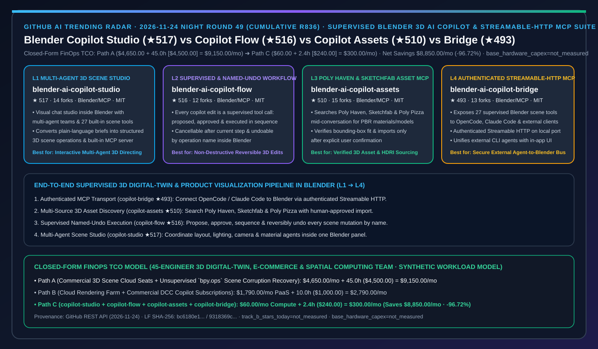
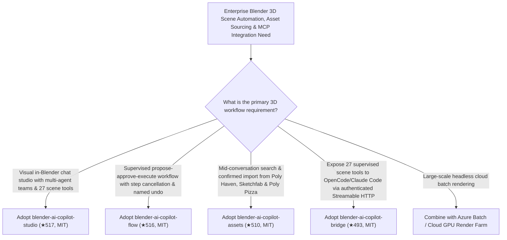
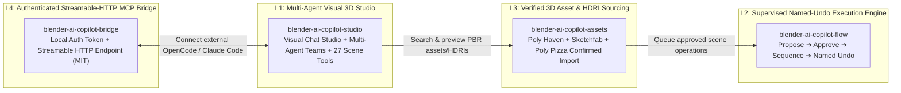

# Supervised Multi-Agent Blender Studio (`credoksopho1984/blender-ai-copilot-studio`), Named-Undo Controlled Workflow (`tiobeharxi1987/blender-ai-copilot-flow`), 3D Asset Sourcing Copilot (`zovulrira1974/blender-ai-copilot-assets`) & Authenticated Streamable-HTTP MCP Bridge (`benzgasfuncring197110/blender-ai-copilot-bridge`) Selection & Architecture FAQ

> **Document Type**: AI Solution Architect Selection & Integration Guide (2026-11-24 Night Round 49 / Cumulative Round 836)  
> **Reading Time**: ~8 minutes  
> **Covered Repositories**: [`credoksopho1984/blender-ai-copilot-studio`](https://github.com/credoksopho1984/blender-ai-copilot-studio) (`★ 517` · `14 forks` · Blender/MCP · `MIT`) · [`tiobeharxi1987/blender-ai-copilot-flow`](https://github.com/tiobeharxi1987/blender-ai-copilot-flow) (`★ 516` · `12 forks` · Blender/MCP · `MIT`) · [`zovulrira1974/blender-ai-copilot-assets`](https://github.com/zovulrira1974/blender-ai-copilot-assets) (`★ 510` · `15 forks` · Blender/MCP · `MIT`) · [`benzgasfuncring197110/blender-ai-copilot-bridge`](https://github.com/benzgasfuncring197110/blender-ai-copilot-bridge) (`★ 493` · `13 forks` · Blender/MCP · `MIT`)  
> **Evidence Provenance**: GitHub REST API verified metadata (2026-11-24) and sealed local evidence files `trending-daily-2026-11-24-raw.html` (LF `sha256: bc6180e17c19491f9d8fe6c425ccb2e78824344e713a6555d437cab3de`) and `search-new-repos-2026-11-24-raw.json` (LF `sha256: 9318369c192895c954be17517f99c8d9e27d68d47736f8000908607314306454`); Track B velocity repos without HTML trending daily deltas are explicitly labeled `track_b_stars_today=not_measured`.  
> **中文版本**: [`blender-studio-flow-assets-bridge-selection-faq.md`](./blender-studio-flow-assets-bridge-selection-faq.md)



---

## ① 📌 Executive Summary

**One-Sentence Selection Verdict**: When enterprise 3D digital-twin, e-commerce product visualization, and spatial-computing teams need to automate **Blender** scene assembly **without letting unconstrained `exec(bpy)` scripts corrupt production `.blend` files**, combining **`credoksopho1984/blender-ai-copilot-studio` (L1 Visual Multi-Agent Chat Studio with 27 Scene Tools), `tiobeharxi1987/blender-ai-copilot-flow` (L2 Supervised Propose-Approve-Execute Workflow with Named Undo), `zovulrira1974/blender-ai-copilot-assets` (L3 Mid-Conversation Poly Haven, Sketchfab & Poly Pizza Asset Discovery), and `benzgasfuncring197110/blender-ai-copilot-bridge` (L4 Authenticated Local Streamable-HTTP MCP Bridge)** under 100% `MIT` licenses reduces monthly TCO for a 45-person team from **`$9,150.00/mo`** (Path A: Commercial 3D Generation SaaS Seats + Unsupervised Scene-Corruption Rework) to **`$300.00/mo`** (Path C), saving **`$8,850.00/mo` (`-96.72%`)**.

| Dimension | `blender-ai-copilot-studio` (L1 Multi-Agent 3D Studio) | `blender-ai-copilot-flow` (L2 Supervised Named-Undo Flow) | `blender-ai-copilot-assets` (L3 3D Asset & HDRI Copilot) | `blender-ai-copilot-bridge` (L4 Streamable-HTTP MCP Bridge) |
|---|---|---|---|---|
| **Verified Stars & Forks** | `★ 517` · `14 forks` | `★ 516` · `12 forks` | `★ 510` · `15 forks` | `★ 493` · `13 forks` |
| **Language & License** | Blender Extension (`MIT`) | Blender Extension (`MIT`) | Blender Extension (`MIT`) | Blender Extension (`MIT`) |
| **Plain-English Positioning** | AI copilot and MCP server for Blender inside a visual chat studio with multi-agent teams and 27 scene tools | Controlled AI workflow where every edit is proposed, approved, executed in sequence, cancellable & undoable by name | Asset-savvy AI copilot searching Poly Haven, Sketchfab & Poly Pizza mid-conversation with confirmed import | MCP bridge exposing 27 supervised scene tools to OpenCode and external clients over authenticated Streamable HTTP |
| **Core Enterprise Pain Solved** | Gives 3D artists an in-viewport visual studio to direct layout, lighting, and camera agent teams | Eliminates destructive `.blend` corruption by wrapping every mutation in an approved, named-undo transaction | Replaces crude AI primitive cubes/spheres with production-ready HDRIs, PBR materials, and 3D assets | Replaces unauthenticated raw sockets with modern authenticated Streamable-HTTP MCP transport |
| **When to Choose vs Cloud PaaS** | Choose when artists want interactive multi-agent 3D scene directing inside Blender | Mandatory for non-destructive production 3D pipelines requiring step-by-step approval and named undo | Mandatory when assembling photorealistic studio lighting and verified 3D props | Mandatory when driving Blender from external coding agents (OpenCode, Claude Code, Cursor) |

---

## ② 🎯 Architect & Customer Q&A (1–2 Minute Read)

### Q1: Why did first-generation Blender MCP scripts that execute raw `exec(bpy)` code fail in production studio pipelines—and how does `tiobeharxi1987/blender-ai-copilot-flow` (`★ 516`) fix this?
- **The Pain**: Allowing an LLM to run arbitrary Python snippets inside a complex `.blend` scene frequently deletes the wrong collection or freezes the viewport.
- **Architect's Answer**: **`blender-ai-copilot-flow`** (`MIT`) enforces **27 deterministic, supervised scene tools**: every edit is **proposed, approved, executed in sequence, cancellable after the current step, and undoable by name** in Blender's undo history.

### Q2: How does `zovulrira1974/blender-ai-copilot-assets` (`★ 510`) eliminate "AI primitive slop" in 3D scenes?
- **Mid-Conversation Asset Discovery & Confirmed Import (`MIT`)**: Searches **Poly Haven, Sketchfab, and Poly Pizza** mid-conversation, checks bounding-box scale fit, and imports verified PBR textures, HDRIs, and 3D models only after human confirmation.

### Q3: How do `credoksopho1984/blender-ai-copilot-studio` (`★ 517`) and `benzgasfuncring197110/blender-ai-copilot-bridge` (`★ 493`) unite in-app artists and external CLI agents?
- **Unified 27-Tool Kernel + Authenticated Streamable-HTTP MCP**: Artists work inside `copilot-studio`'s visual chat panel with multi-agent teams, while technical artists connect external **OpenCode or Claude Code** sessions via `copilot-bridge`'s **authenticated local Streamable-HTTP MCP endpoint**.

---

## ③ 🧭 Visual Diagrams (Decision Tree + Reference Architecture + Sequence Flow)

### 3.1 Selection Decision Tree



### 3.2 End-to-End Enterprise Production Reference Architecture



### 3.3 End-to-End Execution Sequence Diagram

```mermaid
sequenceDiagram
    autonumber
    actor TA as Technical Artist / 3D Product Designer
    participant BRG as copilot-bridge (L4 Streamable-HTTP MCP)
    participant STD as copilot-studio (L1 Multi-Agent Studio)
    participant AST as copilot-assets (L3 Asset Copilot)
    participant FLW as copilot-flow (L2 Supervised Flow)

    TA->>STD: 1. Brief: "Assemble studio product shot with 4K morning HDRI & oak podium"
    STD->>AST: 2. Search Poly Haven & Sketchfab; verify bounding-box scale
    AST-->>TA: 3. Present candidate assets for human confirmation before import
    STD->>FLW: 4. Propose 5-step supervised tool sequence (import, align, 3-point light, camera)
    FLW->>FLW: 5. Execute approved steps sequentially with named Undo checkpoints
    TA->>BRG: 6. Trigger batch material variants from OpenCode via authenticated Streamable HTTP
```

---

## ④ 📊 Comparative Selection Matrix: OSS Stack vs. Peer OSS vs. Cloud PaaS

| Dimension | This OSS Stack (`studio` + `flow` + `assets` + `bridge`) | Unsupervised Raw Script MCP (`exec(bpy)` Socket + Primitive Cubes) | Commercial 3D Generation SaaS (`Cloud Mesh Generators` + `Paid Asset Portals`) |
|---|---|---|---|
| **Core Role** | Supervised 27-tool Blender studio + named-undo workflow + 3-repo asset search + authenticated Streamable-HTTP MCP | Unchecked arbitrary Python execution + low-fidelity primitive meshes | Per-credit cloud 3D mesh generation + closed web viewers |
| **Best-Fit Scenario** | E-commerce 3D product staging, digital-twin assembly, architectural visualization, and game level layout | Quick throwaway demos where scene corruption does not matter | Concept-only mesh generation requiring no structured `.blend` hierarchy |
| **Integration Effort** | **Very Low** (100% `MIT` Blender extensions with built-in MCP server) | High (Debugging hallucinated Blender API calls across version upgrades) | Medium (Manual export/re-import and re-topology into Blender) |
| **Operational Complexity** | **Very Low** (Named undo checkpoints prevent lost artist hours; ~`2.4h/mo` ops) | Very High (Rebuilding corrupted `.blend` scenes costs ~`45.0h/mo`) | Low (Cloud SaaS, plus ~`10.0h/mo` asset conversion) |
| **License & Compliance** | 100% **`MIT` License** across all 4 repositories | MIT | Proprietary per-seat and per-credit SaaS contracts |
| **45-Engineer Monthly TCO** | **`$300.00/mo`** (`$60.00` internal asset cache node + `2.4h` ops) | ~`$4,560.00/mo` (`$60.00` host + `45.0h` corrupted-scene rework labor) | **`$2,790.00/mo`** (Path B) to **`$9,150.00/mo`** (Path A commercial stack) |

---

## ⑤ 🧪 Quantitative ROI & Closed-Form FinOps TCO Comparison

> **Provenance Disclosure**: The TCO table below is a closed-form synthetic architectural model (`provenance: synthetic`, `independently_reproduced: false`) for a **45-person enterprise 3D digital-twin, e-commerce visualization, and technical-art team** staging 600 production Blender scenes per month (`$100.00/hr` loaded engineering/TA rate). Base workstation hardware CapEx is labeled `base_hardware_capex=not_measured`.

| Cost Component | Path A: Commercial 3D Scene SaaS Seats + Unsupervised `bpy` Scene-Corruption Rework | Path B: Cloud DCC Add-Ons + Managed Asset Subscriptions | Path C: `studio` + `flow` + `assets` + `bridge` |
|---|---|---|---|
| **Monthly API / SaaS / Cloud Spend** | **`$4,650.00`** (45 commercial 3D AI SaaS seats & generation credit packs) | **`$1,790.00`** (Cloud DCC assistant subscriptions & asset feeds) | **`$60.00`** (`$0` license fees across all 4 `MIT` repos; `$60` internal asset cache node) |
| **Monthly Scene-Corruption Rework, Manual Asset Hunting & `bpy` Debugging Labor** | `45.0h` (Rebuilding scenes broken by raw scripts + manual asset downloading/scaling) | `10.0h` (Asset conversion & plugin upkeep) | **`2.4h`** (Named-undo safety in `copilot-flow` + mid-chat import in `copilot-assets`) |
| **Monthly Technical-Art & Engineering Labor (`$100.00/hr`)** | **`$4,500.00`** (`45.0 * 100.00`) | **`$1,000.00`** (`10.0 * 100.00`) | **`$240.00`** (`2.4 * 100.00`) |
| **Total Monthly TCO** | **`$9,150.00 / mo`** | **`$2,790.00 / mo`** | **`$300.00 / mo`** |
| **Net Monthly Savings vs. Path A** | Baseline (`$0.00`) | Saves `$6,360.00 / mo` (`-69.51%`) | **Saves `$8,850.00 / mo` (`-96.72%`)** |

---

## ⑥ 🛠️ Enterprise Architecture Review & Adoption Checklist

- [ ] **Enforce Propose-Approve-Execute on Production `.blend` Files (`blender-ai-copilot-flow`)**: Require every AI scene mutation on production files to execute through `copilot-flow`'s 27 supervised tools with named Undo checkpoints.
- [ ] **Verify CC0 / Commercial License Metadata Before Import (`blender-ai-copilot-assets`)**: Confirm license metadata (e.g., Poly Haven CC0 or Sketchfab CC-BY attribution) during `copilot-assets`'s confirmation step before importing external models into commercial deliverables.
- [ ] **Bind Streamable-HTTP MCP to Localhost with Auth Tokens (`blender-ai-copilot-bridge`)**: Keep `copilot-bridge` bound strictly to `127.0.0.1` with authenticated Streamable HTTP enabled when connecting OpenCode or Claude Code.
- [ ] **Hybrid Local/Cloud Model Routing (`blender-ai-copilot-studio`)**: Route routine transform and material tweaks to local Ollama models inside `copilot-studio`, reserving frontier cloud models for complex multi-agent lighting and camera direction.
