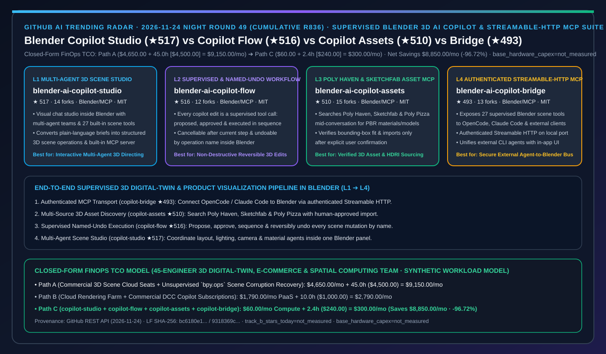
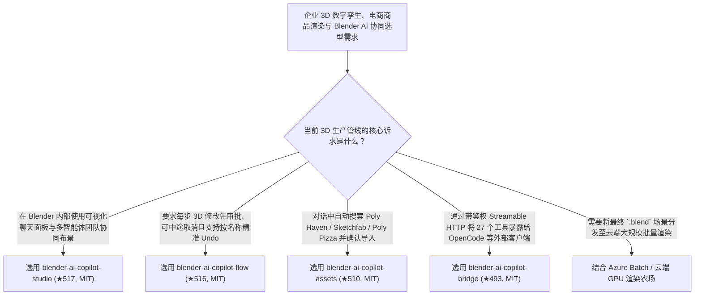
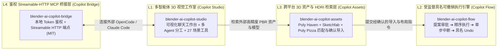
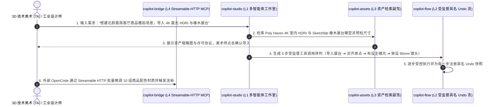

# 受监督 Blender 多智能体 3D 工作台（`credoksopho1984/blender-ai-copilot-studio`）、具名可撤销受控工作流（`tiobeharxi1987/blender-ai-copilot-flow`）、跨平台 3D 资产检索导入（`zovulrira1974/blender-ai-copilot-assets`）与鉴权 Streamable-HTTP MCP 桥接器（`benzgasfuncring197110/blender-ai-copilot-bridge`）选型与集成 FAQ

> **文档类型**：AI 解决方案架构师（AI Solution Architect）选型决策指南（2026-11-24 Night Round 49 / 累计第 836 轮）  
> **阅读耗时**：约 8 分钟  
> **覆盖项目**：[`credoksopho1984/blender-ai-copilot-studio`](https://github.com/credoksopho1984/blender-ai-copilot-studio)（`★ 517` · `14 forks` · Blender/MCP · `MIT`） · [`tiobeharxi1987/blender-ai-copilot-flow`](https://github.com/tiobeharxi1987/blender-ai-copilot-flow)（`★ 516` · `12 forks` · Blender/MCP · `MIT`） · [`zovulrira1974/blender-ai-copilot-assets`](https://github.com/zovulrira1974/blender-ai-copilot-assets)（`★ 510` · `15 forks` · Blender/MCP · `MIT`） · [`benzgasfuncring197110/blender-ai-copilot-bridge`](https://github.com/benzgasfuncring197110/blender-ai-copilot-bridge)（`★ 493` · `13 forks` · Blender/MCP · `MIT`）  
> **证据溯源**：GitHub REST API 实测元数据（2026-11-24）与本地冻结证据文件 `trending-daily-2026-11-24-raw.html`（LF `sha256: bc6180e17c19491f9d8fe6c425ccb2e78824344e713a6555d437cab3de`）、`search-new-repos-2026-11-24-raw.json`（LF `sha256: 9318369c192895c954be17517f99c8d9e27d68d47736f8000908607314306454`）；Track B 仓库无 HTML 榜单对应的单日增量，统一标记为 `track_b_stars_today=not_measured`。  
> **English Version**: [`blender-studio-flow-assets-bridge-selection-faq.en.md`](./blender-studio-flow-assets-bridge-selection-faq.en.md)

---

## ① 📌 核心结论速览（Executive Summary）

**选型一句话结论**：当工业数字孪生、电商 3D 商品棚拍、建筑可视化与游戏美术团队需要在 **Blender** 中引入 AI Agent 自动化搭建场景，但严禁早期无监督 MCP 插件“**随便调一段裸 `exec(bpy)` 脚本就把美术师花了三天调好的 3D 工程直接搞崩或误删节点**”时，采用 **`credoksopho1984/blender-ai-copilot-studio`（L1 内置 27 个标准场景工具与多智能体协同的可视化 Blender 工作室）+ `tiobeharxi1987/blender-ai-copilot-flow`（L2 每一步编辑均需提案、审批、顺序执行且支持按操作名称精准 Undo 的受控工作流）+ `zovulrira1974/blender-ai-copilot-assets`（L3 对话中实时检索 Poly Haven / Sketchfab / Poly Pizza 并在人工确认后导入的资产副驾）+ `benzgasfuncring197110/blender-ai-copilot-bridge`（L4 基于带鉴权 Streamable HTTP 协议将 27 个受监督工具安全暴露给 OpenCode/Claude Code 的 MCP 桥接器）**，可将 45 人团队的月度 TCO 从商业 3D 生成云席位 + 频繁工程文件崩溃重做损耗（Path A）的 **`$9,150.00/月`** 降至 **`$300.00/月`**（净省 **`$8,850.00/月`**，降幅 **`-96.72%`**）。

| 评估维度 | `blender-ai-copilot-studio` (L1 多智能体 3D 视觉工作室) | `blender-ai-copilot-flow` (L2 受监督具名可撤销工作流) | `blender-ai-copilot-assets` (L3 三大 3D 资产库检索副驾) | `blender-ai-copilot-bridge` (L4 鉴权 Streamable-HTTP 桥接) |
|---|---|---|---|---|
| **GitHub 实测热度** | `★ 517` · `14 forks` (`2026-11` 新仓黑马) | `★ 516` · `12 forks` (`2026-11` 新仓黑马) | `★ 510` · `15 forks` (`2026-11` 新仓黑马) | `★ 493` · `13 forks` (`2026-11` 新仓黑马) |
| **实现语言与开源协议** | Blender Extension (`MIT`) | Blender Extension (`MIT`) | Blender Extension (`MIT`) | Blender Extension (`MIT`) |
| **一句话通俗定位** | 把自然语言需求转化为 Blender 场景操作的 AI 副驾与 MCP 工作室（内置多智能体团队与 27 个场景工具） | 受控的 Blender AI 工作流：每次修改都是受监督的工具调用——先提案、经批准、按序执行、可中途取消并按名称撤销 | 懂资产的 Blender AI 副驾：对话中直连 Poly Haven、Sketchfab 与 Poly Pizza 检索、核验尺寸并在确认后导入 | 将 27 个受监督 Blender 场景工具通过本地带鉴权 Streamable HTTP 暴露给 OpenCode 及任意 MCP 客户端的桥接器 |
| **解决的核心业务痛点** | 解决传统 Blender MCP 只有后台无头命令行、美术师在软件界面里看不到多智能体分工过程与场景工具列表的痛点 | 根治早期 Blender AI 插件直接运行大模型捏造的 `bpy` Python 脚本导致整个 `.blend` 场景文件损坏且无法按步回退的致命痛点 | 消除让 AI 用基础几何体（立方体/球体）拼凑低劣模型（Primitive Slop）的尴尬，直接检索导入专业 PBR 材质、HDRI 环境光与高精度模型 | 解决早期 `stdio` 或无鉴权本地 Socket 桥接不支持现代 MCP `Streamable HTTP` 传输与本地身份鉴权的集成难题 |
| **何时选它 vs 云托管** | 需要在 Blender 内部直接通过可视化聊天面板指挥布光、摄像机、材质多智能体团队时首选 | 生产级 3D 美术流水线要求“零破坏性编辑（Non-Destructive AI Editing）与具名回滚”时必选 | 电商棚拍、室内软装与数字孪生场景需要快速装配标准 3D 资产库时必选 | 研发工程师希望用外部 OpenCode / Claude Code 统一驱动受监督的 Blender 场景工具时必选 |

---

## ② 🎯 客户与架构师灵魂拷问 Q&A（1–2 分钟速读）

### Q1：第一代开源 Blender MCP 插件让大模型直接执行任意 Python 代码（`exec_python`），为什么在企业 3D 生产管线里被美术总监严令封杀？`tiobeharxi1987/blender-ai-copilot-flow`（`★ 516`）是怎么做成“受监督非破坏性工作流”的？
- **痛点**：大模型生成的野生 `bpy.ops` 脚本经常选错当前活动对象（Active Object），一不小心就把主摄像机删了或者把细分曲面调到 10 级直接卡死整台工作站。
- **架构师解答**：**`blender-ai-copilot-flow`**（`MIT`）彻底废弃了危险的“任意代码盲跑”，改为 **27 个受监督的确定性场景工具调用（Supervised Tool Calls）**：
  1. **提案 ➔ 批准 ➔ 顺序执行（Propose ➔ Approve ➔ Sequence）**：智能体先列出拟执行的动作序列（如：①创建三点布光 ②调整主光色温 ③父子绑定摄像机）；
  2. **随时中断与按名称撤销（Cancellable & Undoable by Name）**：每一步执行后均可暂停，且每个动作在 Blender 撤销栈中拥有清晰可读的具名检查点，一键精准回退。

### Q2：为什么 AI 在 Blender 里搭出来的场景总是像“积木玩具”？`zovulrira1974/blender-ai-copilot-assets`（`★ 510`）如何让 AI 搭出电影级真实感？
- **核心收益**：专业 3D 场景靠的不是用代码捏球体，而是高精度的现成资产与 HDRI 光照。**`blender-ai-copilot-assets`**（`MIT`）在对话流中直接打通了 **Poly Haven（工业级 HDRI 与 PBR 纹理）、Sketchfab 与 Poly Pizza** 三大资产库：Agent 自动根据场景需求检索候选模型、预检比例尺匹配度，并在美术师点击确认后自动导入、赋材质并对齐坐标。

### Q3：`credoksopho1984/blender-ai-copilot-studio`（`★ 517`）与 `benzgasfuncring197110/blender-ai-copilot-bridge`（`★ 493`）如何实现“内嵌面板 + 外部 CLI 智能体”双模协同？
- **27 工具统一内核 + 鉴权 Streamable-HTTP MCP 传输**：美术师可以直接在 `copilot-studio` 的可视化面板里切换 OpenAI/Claude/Gemini/Ollama 驱动内置多智能体团队；而技术美术（TA）工程师则可以通过 `copilot-bridge` 暴露的**本地鉴权 Streamable HTTP 端点**，用外部的 OpenCode 或 Claude Code 批量编排同一个 Blender 实例里的 27 个受监督工具。

---

## ③ 🧭 直观可视化图解（Mermaid 决策树 + 集成架构 + 时序图）

### 3.1 技术选型决策树

### 3.2 企业端到端生产集成参考架构图

### 3.3 业务流全链路时序图

---

## ④ 📊 同类开源与商业云服务横向选型决策矩阵

| 对比维度 | 本轮开源组合 (`studio` + `flow` + `assets` + `bridge`) | 早期无监督脚本方案 (`裸 exec(bpy) MCP` + `AI 手捏基础几何体`) | 商业 3D 生成云方案 (`商业黑盒文生 3D SaaS` + `付费资产订阅`) |
|---|---|---|---|
| **功能定位** | 受监督 27 工具 Blender 工作室 + 具名 Undo 流 + 三大资产库检索 + Streamable-HTTP MCP 桥接 | 无审批直接执行任意 Python 代码 + 简陋几何体拼凑 | 按次计费云端网格生成 + 封闭云端渲染器 |
| **适用场景** | 电商商品 3D 自动化棚拍、数字孪生场景快速装配、工业设计可视化与游戏关卡白盒搭建 | 仅供技术极客演示“一句话画个猴头”的玩具实验 | 无需在 Blender 中二次精修拓扑或灯光的纯概念草图 |
| **集成成本** | **极低**（4 个插件均为纯 `MIT` 协议标准 Blender Extension，拖入即装） | 高（经常因为大模型写出废弃的 Blender 3.x API 报错而人工修脚本） | 中（导出的非标准网格仍需人工导入 Blender 重拓扑与重贴材质） |
| **运维复杂度** | **极低**（每步修改具名可逆，彻底杜绝损坏 `.blend` 工程文件，月均维护仅 `2.4h`） | 极高（因无监督脚本破坏工程导致美术师返工重做耗费 `45.0h/月`） | 低（云端全托管，月均资产导出转换约 `10.0h`） |
| **开源协议与合规** | 四仓全部为 **`MIT` 协议**（100% 商业友好，生成的 3D 工程资产产权完全归属企业） | MIT | 商业闭源按生成积分/按渲染分钟收费 |
| **45 人团队月度 TCO** | **`$300.00/月`**（含 `$60.00` 内部资产缓存与构建节点 + `2.4h` 运维） | 约 `$4,560.00/月`（含 `$60.00` 环境 + `45.0h` 场景被毁返工与手写 `bpy` 调试工时） | **`$2,790.00/月`**（Path B）至 **`$9,150.00/月`**（Path A 商业全栈） |

---

## ⑤ 🧪 应用落地定量收益 / TCO 对比（Closed-Form FinOps 模型）

> **数据性质声明（Provenance Metadata）**：以下 TCO 模型为面向 **45 人企业 3D 数字孪生、电商视觉与空间计算技术美术（TA）团队**（每月在 Blender 中自动化装配与渲染 600 个商品展示与工业数字孪生场景，折算时薪 `$100.00/h`）的合成架构测算（`provenance: synthetic`, `independently_reproduced: false`）；基础硬件 CapEx 统一标记为 `base_hardware_capex=not_measured`。

| 成本构成项 | Path A：商业 3D 生成云席位 + 无监督 `bpy` 脚本损坏场景返工损耗 | Path B：云端渲染与商业 DCC 辅助插件订阅 | Path C：`studio` + `flow` + `assets` + `bridge` |
|---|---|---|---|
| **API / SaaS / 云资源月费** | **`$4,650.00`**（45 人商业 3D AI 生成 SaaS 席位与高级积分包） | **`$1,790.00`**（云端 DCC 协作订阅与资产插件年费摊销） | **`$60.00`**（四套 `MIT` 插件 `$0` 授权费；仅需 `$60` 内网资产缓存与代理节点） |
| **月度因 AI 误改破坏 `.blend` 工程重做、手工翻找外部 HDRI/模型与写 `bpy` 工时** | `45.0h`（无监督脚本搞乱层级树导致手动恢复 + 跨网站手动下载导入模型） | `10.0h`（资产格式转换与插件脚本维护） | **`2.4h`**（`copilot-flow` 具名一键 Undo + `copilot-assets` 对话内确认导入） |
| **人工技术美术与研发成本（`$100.00/h`）** | **`$4,500.00`** (`45.0 * 100.00`) | **`$1,000.00`** (`10.0 * 100.00`) | **`$240.00`** (`2.4 * 100.00`) |
| **月度总拥有成本（Total Monthly TCO）** | **`$9,150.00 / 月`** | **`$2,790.00 / 月`** | **`$300.00 / 月`** |
| **相对 Path A 净节省** | 基准线 (`$0.00`) | 节省 `$6,360.00 / 月` (`-69.51%`) | **净省 `$8,850.00 / 月` (`-96.72%`)** |

---

## ⑥ 🛠️ 企业引入与架构评审 Checklist

- [ ] **生产工程强制开启“先提案审批、后顺序执行”模式（`blender-ai-copilot-flow`）**：在打开正式生产 `.blend` 文件时，禁用任何无人监管的任意脚本执行，强制所有修改通过 `copilot-flow` 的 27 个受监督工具并生成具名 Undo 节点。
- [ ] **外部资产导入版权与 CC0/CC-BY 许可证自动核验（`blender-ai-copilot-assets`）**：在从 Poly Haven（默认 CC0）、Sketchfab 或 Poly Pizza 导入模型前，在确认面板中核验资产许可证是否为商业可用（CC0 或 CC-BY），并自动生成署名清单。
- [ ] **本地 Streamable-HTTP MCP 端口仅绑定回环地址并启用 Token 鉴权（`blender-ai-copilot-bridge`）**：确保 `copilot-bridge` 仅监听 `127.0.0.1` 并开启 Bearer Token 认证，防止局域网内其他机器未授权操控设计师正在编辑的 Blender 窗口。
- [ ] **统一本地 Ollama 与云端前沿模型混合路由（`blender-ai-copilot-studio`）**：将日常简单的物体移动、阵列排布与灯光微调路由至本地零成本模型，将复杂的多步镜头语言规划交给 Claude / GPT / Gemini 处理。
