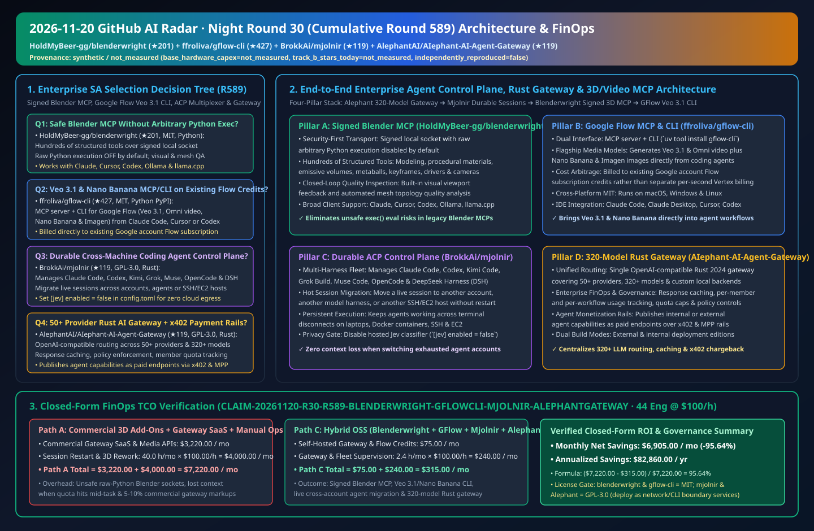
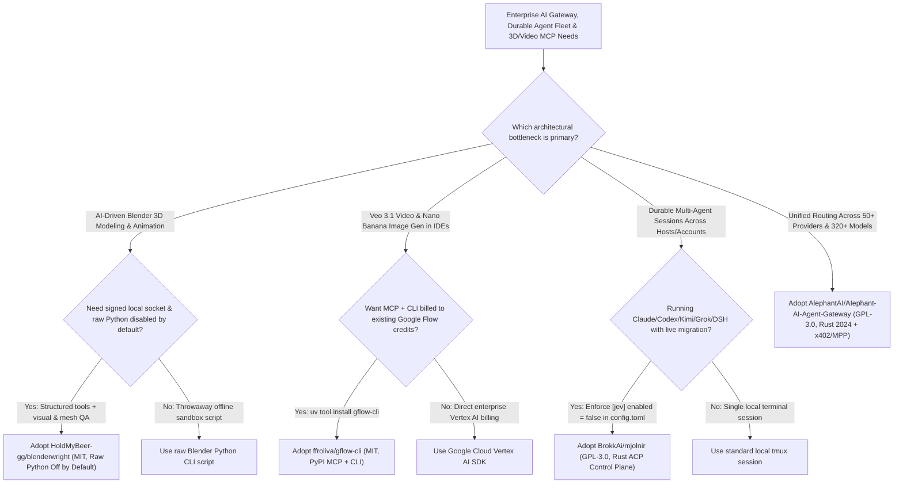
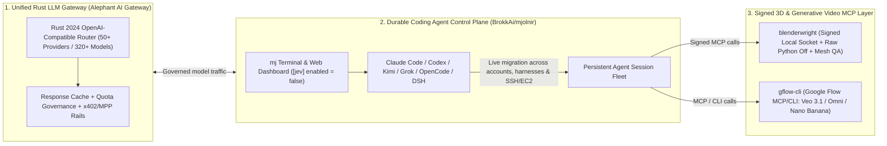
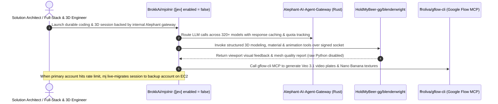

# Signed-Socket Safe Blender MCP (`HoldMyBeer-gg/blenderwright`), Google Flow Veo 3.1/Nano Banana MCP & CLI (`ffroliva/gflow-cli`), Durable Cross-Host Coding Agent Control Plane (`BrokkAi/mjolnir`) & 50+ Provider Rust AI Gateway (`AlephantAI/AIephant-AI-Agent-Gateway`) Selection & Integration FAQ (2026-11-20 Night Round 30 · Cumulative Round 589)

> **Cross-File Navigation**: [Back to 2026-11-20 Daily Digest (`daily/2026-11-20.en.md`)](../daily/2026-11-20.en.md) · [中文版 (`blenderwright-gflow-cli-mjolnir-alephant-gateway-selection-faq.md`)](blenderwright-gflow-cli-mjolnir-alephant-gateway-selection-faq.md) · [7-Card 4:5 Visual Report (`cards.en.html`)](../cards.en.html) · [Column Index (`README.en.md`)](../README.en.md)  
> **Architecture Diagram**: [`assets/github-ai-radar-2026-11-20-r30-r589-blenderwright-gflowcli-mjolnir-alephantgateway.svg`](../../../assets/github-ai-radar-2026-11-20-r30-r589-blenderwright-gflowcli-mjolnir-alephantgateway.svg)  
> **Provenance & Synthetic Disclaimer**: Repository metadata (stars, forks, licenses, provider/model counts, and architectural specifications) is verified from live GitHub API data (`measured`). The 44-engineer FinOps TCO figures represent a parameterized Solution Architect model (`provenance: synthetic`, `independently_reproduced: false`, `base_hardware_capex: not_measured`, `track_b_stars_today: not_measured`, claim ID `CLAIM-20261120-R30-R589-BLENDERWRIGHT-GFLOWCLI-MJOLNIR-ALEPHANTGATEWAY`).

---

## ① 📌 Executive Summary

> **One-Sentence Selection Verdict**: For Enterprise AI Solution Architects tackling four infrastructure bottlenecks across **multi-provider AI routing, durable multi-agent orchestration, and 3D/video MCP toolchains**—(1) **legacy Blender MCP servers exposing unauthenticated local sockets with raw `exec(python)` enabled, creating RCE risks and broken mesh topology**; (2) **inability to invoke Google Flow's `Veo 3.1` / `Omni` video and `Nano Banana` / `Imagen` models directly from Claude Code, Cursor, or Codex using existing Flow subscription credits**; (3) **losing coding agent context when a laptop sleeps or an account hits rate limits across Claude Code, Codex, Kimi Code, Grok Build, OpenCode, or DSH**; and (4) **5–10% commercial gateway markups when routing across 50+ LLM providers and 320+ models with internal chargeback**—combine **`HoldMyBeer-gg/blenderwright`** (MIT Blender MCP server over a signed local socket with raw Python disabled by default, hundreds of structured tools, visual viewport feedback, and mesh quality analysis), **`ffroliva/gflow-cli`** (MIT MCP server and CLI on PyPI for Google Flow `Veo 3.1`, `Omni`, `Nano Banana`, and `Imagen`), **`BrokkAi/mjolnir`** (GPL-3.0 Rust terminal/web control plane for 7+ coding agents supporting live session migration across accounts, agents, and SSH/EC2 hosts with `[jev] enabled = false` privacy lockdown), and **`AlephantAI/AIephant-AI-Agent-Gateway`** (GPL-3.0 Rust 2024 OpenAI-compatible gateway across `50+` providers and `320+` models with caching, policy controls, and `x402`/MPP payment rails). Across a 44-engineer AI platform and media team, this stack reduces monthly TCO from **`$7,220.00/mo`** to **`$315.00/mo`**, saving **`$6,905.00/mo` (`-95.64%`, or `$82,860.00/yr`)**.

| Evaluation Dimension | Path A: Commercial Gateway Markups + Unsafe Raw-Python Blender MCP + Manual Session Restarts | Path B: Cloud PaaS API Gateway + Single-Vendor Locked IDE Agent | Path C (Recommended): `blenderwright` + `gflow-cli` + `mjolnir` + `AIephant-AI-Agent-Gateway` |
| :--- | :--- | :--- | :--- |
| **Blender 3D MCP Security & Mesh Quality** | Unauthenticated local sockets running arbitrary `exec(python)` | Cloud PaaS lacks local Blender viewport feedback & mesh topology QA | **`blenderwright` signed local socket + raw Python OFF by default + visual & mesh quality analysis** |
| **Veo 3.1 Video & Nano Banana Image MCP** | Separate high-cost per-second API billing; manual browser downloads | No native MCP bridge into existing Google Flow subscription credits | **`gflow-cli` (`uv tool install gflow-cli`) exposes Veo 3.1/Omni/Nano Banana via MCP & CLI on Flow credits** |
| **Durable Multi-Agent Session Continuity** | Rate-limited accounts or closed laptops kill active coding sessions | Locked to a single cloud agent; cannot hot-swap Claude/Codex/Kimi/DSH | **`mjolnir` durable sessions + live migration across accounts, harnesses & SSH/EC2 (`[jev] enabled = false`)** |
| **Multi-Provider LLM Routing & Chargeback** | 5–10% commercial gateway token fee; no native `x402`/MPP rails | Manual adapter maintenance across 50+ providers | **`AIephant-AI-Agent-Gateway` Rust 2024 gateway (50+ providers / 320+ models) + caching + `x402`/MPP rails** |
| **44-Engineer Monthly Total TCO** | **`$7,220.00 / mo`** (`$3,220.00` SaaS/markups + `40.0h × $100` labor) | **`$2,190.00 / mo`** (`$690.00` cloud gateway + `15.0h × $100` glue ops) | **`$315.00 / mo`** (`$75.00` gateway/credits + `2.4h × $100` ops, **`-95.64%` savings**) |

---

## ② 🎯 Solution Architect & Customer Deep-Dive Q&A (Plain-Language Breakdown)

### Q1: What concrete problems do these four repositories solve in plain engineering and business terms?

1. **`HoldMyBeer-gg/blenderwright` (`★ 201`, `25 forks`, Python, MIT) — Plain-Language View: A security-hardened Blender MCP server over a signed local socket with raw Python disabled by default and built-in mesh quality analysis**:
   - **Pain Point Solved**: Most early Blender MCP servers open an unsigned local socket and let the LLM execute raw arbitrary Python strings (`exec()`), exposing workstations to prompt-injected RCE and producing broken 3D geometry. `blenderwright` locks down the transport with a **signed local socket**, keeps **raw Python off by default**, and exposes **hundreds of structured tools** (modeling, procedural materials, emissive volumes, metaballs, keyframes, drivers, camera rigs) paired with **visual viewport feedback and mesh quality analysis** for Claude, Cursor, Codex, Ollama, and `llama.cpp`.
2. **`ffroliva/gflow-cli` (`★ 427`, `116 forks`, Python, MIT) — Plain-Language View: An open-source MCP server and CLI that brings Google Flow (`Veo 3.1`, `Omni`, `Nano Banana`, `Imagen`) into Claude Code, Cursor, and Codex**:
   - **Pain Point Solved**: Teams with Google Flow subscriptions previously had to generate `Veo 3.1` videos and `Nano Banana` images manually in a browser tab. Installed via `uv tool install gflow-cli`, this tool exposes both a CLI and a standard MCP server so coding agents can generate video and image assets inline while billing directly against the user's existing Google Flow credits.
3. **`BrokkAi/mjolnir` (`★ 119`, `11 forks`, Rust, GPL-3.0) — Plain-Language View: A durable Rust terminal and web control plane (`mj`) that runs 7+ coding agents across machines and hot-migrates live sessions across accounts or harnesses**:
   - **Pain Point Solved**: When a Claude Code or Codex account hits a quota wall mid-task—or when an engineer closes their laptop—the active session usually dies. `mjolnir` runs durable sessions across laptops, Docker containers, SSH hosts, and EC2 for **Claude Code, Codex, Kimi Code, Grok Build, Muse Code, OpenCode, and DSH**, and allows **moving a live session to another account, another agent harness, or another machine without starting over**.
4. **`AlephantAI/AIephant-AI-Agent-Gateway` (`★ 119`, `17 forks`, Rust 2024, GPL-3.0) — Plain-Language View: An OpenAI-compatible Rust AI Gateway for 50+ providers and 320+ models with response caching and `x402`/MPP payment rails**:
   - **Pain Point Solved**: Managing API keys, response caching, member quotas, and chargeback across 50+ LLM providers is fragmented. `Alephant AI Gateway` (`v0.2.0-beta.30`) consolidates **50+ providers and 320+ models** behind one Rust gateway with policy enforcement, usage tracking, and built-in **`x402` and MPP payment rails** to publish internal or external agent capabilities as metered endpoints.

---

### Q2: How do these four components wire together into an enterprise AI platform & multimodal studio architecture?

1. **Unified LLM Routing & FinOps Layer (`AlephantAI/AIephant-AI-Agent-Gateway`)**: Deploy Alephant as the central OpenAI-compatible Rust gateway routing traffic across 50+ cloud and local model providers with response caching and per-member quota tracking.
2. **Durable Multi-Agent Orchestration Layer (`BrokkAi/mjolnir`)**: Engineers launch and steer Claude Code, Codex, Kimi Code, Grok Build, OpenCode, and DSH sessions through `mj` across local and SSH/EC2 hosts, with **`[jev] enabled = false`** enforced in `config.toml` so no conversation snippets leave the corporate network.
3. **Signed 3D & Generative Video MCP Layer (`blenderwright` + `gflow-cli`)**: Coding agents managed by `mjolnir` invoke `blenderwright` over a signed local socket to build and validate 3D Blender scenes and call `gflow-cli` via MCP to render `Veo 3.1` videos and `Nano Banana` textures.

---

### Q3: What are the key architectural mechanisms and pre-production privacy/licensing guardrails?

1. **Key Mechanisms**:
   - **Signed Socket + Structured Tool Surface (`blenderwright`)**: Replaces raw `eval/exec` Python injection with typed MCP tools and automated mesh inspection.
   - **Cross-Account / Cross-Harness Session Portability (`mjolnir`)**: Decouples session state from a single CLI process or API key so rate-limited runs seamlessly fail over to a secondary account or model harness.
2. **Privacy & Licensing Guardrails**:
   - **Mandatory Privacy Switch on `mjolnir` (`[jev] enabled = false`)**: By default, `mjolnir` sends recent conversation text to a hosted classifier (`Jev` / Fastino GLiDE) via a Brokk proxy to detect whether an agent is waiting for user input. **In enterprise environments, always set `[jev] enabled = false` in `config.toml`** before starting sessions.
   - **GPL-3.0 Process Boundary Isolation**: `blenderwright` and `gflow-cli` are **MIT**. `mjolnir` and `AIephant-AI-Agent-Gateway` are **GPL-3.0**—operate them as standalone CLI daemons and network gateway services communicating over standard HTTP/MCP/ACP protocols rather than linking their source into proprietary binaries.

---

## ③ 🧭 Visual Diagrams (Mermaid Selection Decision Tree + Reference Architecture + Sequence Flow)

### 3.1 Selection Decision Tree

### 3.2 Enterprise Integration Reference Architecture

### 3.3 End-to-End Sequence Flow

---

## ④ 📊 Comparative Selection Matrix (OSS vs. Commercial Gateways & Legacy MCPs)

| Dimension | `HoldMyBeer-gg/blenderwright` (`★ 201`) | `ffroliva/gflow-cli` (`★ 427`) | `BrokkAi/mjolnir` (`★ 119`) | `AlephantAI/AIephant-AI-Agent-Gateway` (`★ 119`) | Commercial Gateway SaaS + Unhardened MCP Scripts |
| :--- | :--- | :--- | :--- | :--- | :--- |
| **Primary Role** | Signed-socket Blender MCP with raw Python off by default | MCP server & CLI for Google Flow (`Veo 3.1`, `Omni`, `Nano Banana`) | Durable Rust control plane for 7+ coding agents with live migration | Rust 2024 AI Gateway for 50+ providers, 320+ models & `x402`/MPP | Metered cloud gateway SaaS + manual session restarts |
| **Sweet-Spot Use Case** | Enterprise-safe natural-language 3D modeling, animation & mesh QA | Generating Veo 3.1 videos & Nano Banana images inside IDEs | Keeping multi-hour coding agents alive across SSH/EC2 & quota limits | Centralizing 320+ model routing, caching, quotas & paid endpoints | Small single-user setups tolerating gateway markups & lost sessions |
| **Key Architectural Metric** | **Signed local socket** + hundreds of tools + mesh quality analysis | **Veo 3.1 / Omni / Nano Banana / Imagen** via PyPI `gflow-cli` | **Live cross-account / cross-machine migration** + `[jev]` toggle | **50+ providers / 320+ models** + Rust 2024 + `x402`/MPP rails | RCE risk on unsigned Blender sockets; 5–10% gateway markup |
| **Integration Effort** | Low (Blender add-on + MCP client config) | Very Low (`uv tool install gflow-cli` on macOS/Win/Linux) | Low (`mj` binary + `[jev] enabled = false` in `config.toml`) | Low (Standalone Docker/Rust OpenAI-compatible service) | High (multi-vendor billing & manual context reconstruction) |
| **License** | **MIT License** | **MIT License** | **GPL-3.0 (Standalone CLI/daemon)** | **GPL-3.0 (Standalone network gateway)** | Proprietary SaaS |

---

## ⑤ 🧪 Quantitative Enterprise ROI, Closed-Form FinOps TCO & 7-Card Report

### 5.1 44-Engineer Closed-Form FinOps TCO Model (`CLAIM-20261120-R30-R589-BLENDERWRIGHT-GFLOWCLI-MJOLNIR-ALEPHANTGATEWAY`)

- **Model Assumptions (`provenance: synthetic`, `independently_reproduced: false`, `base_hardware_capex: not_measured`, `track_b_stars_today: not_measured`)**:
  - Team size: **44 AI platform and 3D/multimodal engineers** at a loaded engineering rate of **`$100.00 / hour`**.
  - **Path A (Commercial AI Gateway Token Markups + Separate Video API Billing + Commercial 3D Add-Ons + Manual Session Recovery)**:
    - Commercial gateway SaaS fees & separate media API markups: **`$3,220.00 / mo`**
    - Manual engineering rework labor (rebuilding lost coding agent context after quota/SSH drops, fixing broken 3D meshes): `40.0 h/mo × $100.00/h = $4,000.00 / mo`
    - **Path A Monthly Total**: `$3,220.00 + $4,000.00 = $7,220.00 / mo`
  - **Path C (Hybrid OSS Stack: `blenderwright` + `gflow-cli` + `mjolnir` + `AIephant-AI-Agent-Gateway`)**:
    - Self-hosted Alephant Rust gateway compute & pooled Google Flow subscription base: **`$75.00 / mo`**
    - Gateway policy supervision & fleet maintenance labor: `2.4 h/mo × $100.00/h = $240.00 / mo`
    - **Path C Monthly Total**: `$75.00 + $240.00 = $315.00 / mo`
  - **Closed-Form Savings Verification**:
    $$\text{Monthly Net Savings} = \$7,220.00 - \$315.00 = \$6,905.00\text{ / mo}\quad(\text{Annualized: }\$82,860.00\text{ / yr})$$
    $$\text{Percentage Savings} = \frac{\$7,220.00 - \$315.00}{\$7,220.00} = \frac{\$6,905.00}{\$7,220.00} = 95.64\%$$

| Cost Component | Path A (Commercial Gateway SaaS & Manual Recovery) | Path C (R589 Hybrid OSS Stack) | Closed-Form Delta / ROI |
| :--- | :--- | :--- | :--- |
| **Gateway SaaS / Media API / Compute Fees** | `$3,220.00 / mo` | **`$75.00 / mo`** | `- $3,145.00 / mo` |
| **Engineering & 3D Ops Labor (`@ $100.00/h`)** | `40.0 h × $100.00 = $4,000.00 / mo` | **`2.4 h × $100.00 = $240.00 / mo`** | `- $3,760.00 / mo` (`37.6 h/mo` saved) |
| **Monthly Total TCO** | **`$7,220.00 / mo`** | **`$315.00 / mo`** | **`$6,905.00 / mo` saved (`-95.64%`)** |
| **Annualized Total TCO** | `$86,640.00 / yr` | **`$3,780.00 / yr`** | **`$82,860.00 / yr` saved** |

---

## ⑥ 🛠️ Enterprise Adoption & Architecture Review Checklist

- [ ] **1. `HoldMyBeer-gg/blenderwright` Signed Socket & Raw-Python Lockdown**: Verify that `blenderwright` is configured with signed local socket authentication and that raw arbitrary Python execution remains disabled by default across all 3D artist workstations.
- [ ] **2. `ffroliva/gflow-cli` MCP Registration**: Install `gflow-cli` via `uv tool install gflow-cli` and register its MCP server in Claude Code and Cursor to route `Veo 3.1` and `Nano Banana` generation through existing Google Flow credits.
- [ ] **3. `BrokkAi/mjolnir` Mandatory Privacy Configuration (`[jev] enabled = false`)**: Enforce `[jev] enabled = false` in `config.toml` across all `mjolnir` deployments so zero conversation text is transmitted to the external hosted Jev classifier.
- [ ] **4. `AIephant-AI-Agent-Gateway` & `mjolnir` GPL-3.0 Service Boundary**: Deploy `AIephant-AI-Agent-Gateway` and `mjolnir` as standalone network/CLI services rather than statically linking their GPL-3.0 Rust code into proprietary applications.
