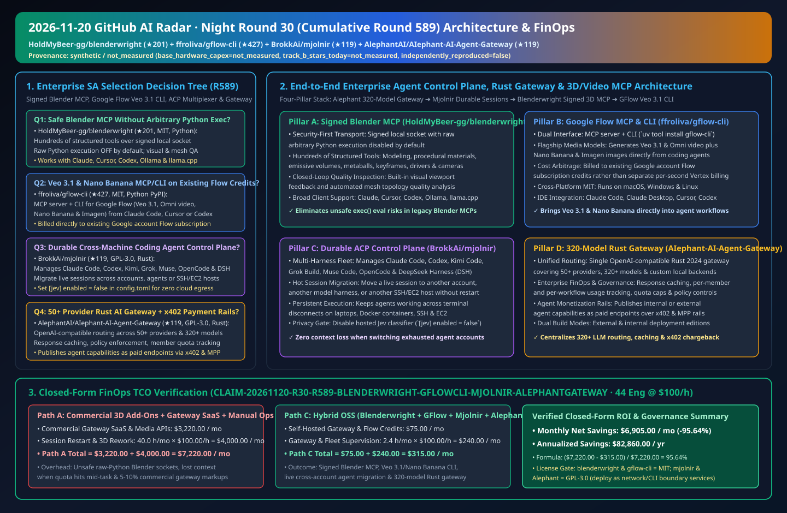
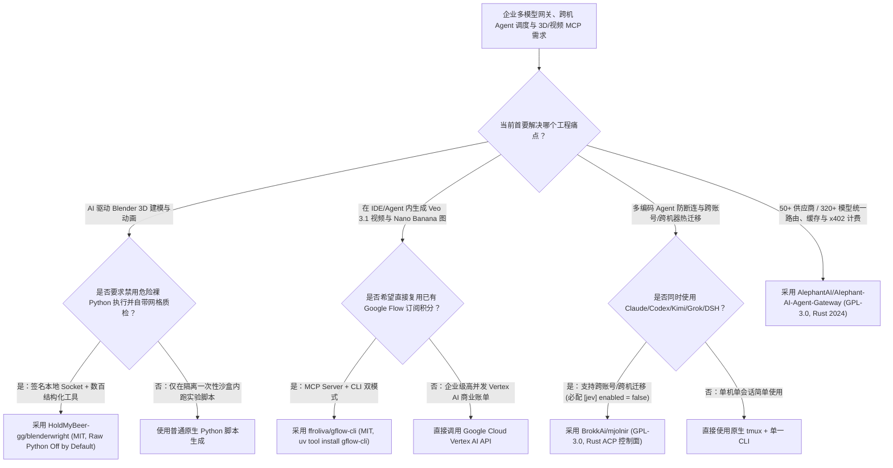
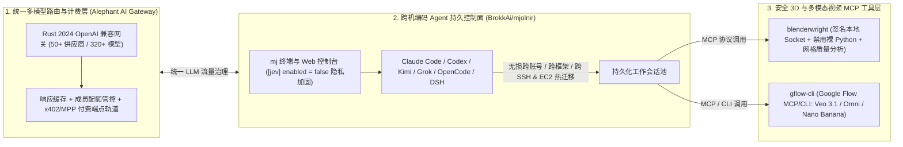
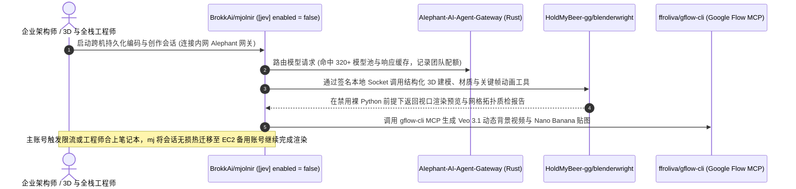

# 签名本地套接字安全 Blender MCP（`HoldMyBeer-gg/blenderwright`）、Google Flow Veo 3.1/Nano Banana MCP 与 CLI（`ffroliva/gflow-cli`）、跨账号/跨机器编码 Agent 持久化控制面（`BrokkAi/mjolnir`）与 50+ 供应商 320+ 模型 Rust AI 网关（`AlephantAI/AIephant-AI-Agent-Gateway`）架构选型与集成 FAQ（2026-11-20 Night Round 30 · 累计 Round 589）

> **跨文件导航**：[返回 2026-11-20 当日全景日报 (`daily/2026-11-20.md`)](../daily/2026-11-20.md) · [English Version (`blenderwright-gflow-cli-mjolnir-alephant-gateway-selection-faq.en.md`)](blenderwright-gflow-cli-mjolnir-alephant-gateway-selection-faq.en.md) · [查看 7-Card 4:5 评测报告 (`cards.html`)](../cards.html) · [返回专栏主索引 (`README.md`)](../README.md)  
> **本轮架构大图**：[`assets/github-ai-radar-2026-11-20-r30-r589-blenderwright-gflowcli-mjolnir-alephantgateway.svg`](../../../assets/github-ai-radar-2026-11-20-r30-r589-blenderwright-gflowcli-mjolnir-alephantgateway.svg)  
> **数据溯源与口径声明（Provenance & Synthetic Disclaimer）**：本报告中实时采集的 GitHub 仓库元数据（Stars、Forks、License、支持模型/框架数与 README 架构规范）为 `measured`；针对 44 人企业 AI 平台与多模态研发团队的 FinOps TCO 测算参数属于架构师参数化测算模型（`provenance: synthetic`，`independently_reproduced: false`，`base_hardware_capex: not_measured`，`track_b_stars_today: not_measured`，审计契约号 `CLAIM-20261120-R30-R589-BLENDERWRIGHT-GFLOWCLI-MJOLNIR-ALEPHANTGATEWAY`）。

---

## ① 📌 核心结论速览（Executive Summary）

> **一句话选型结论**：面向企业 AI 解决方案架构师（SA）在构建**企业级多模型 AI 网关、多 Coding Agent 跨机持久化调度与 3D/视频 MCP 创作工具链**时的四大工程痛点——① **早期 Blender MCP 直接暴露未鉴权的本地 Socket 并允许大模型执行任意原生 Python（`exec()`），既极易引发远程代码执行（RCE）风险，又经常生成拓扑破损的废网格**；② **团队已购买 Google Flow 订阅额度，却无法在 Claude Code、Cursor 或 Codex 终端里直接通过 MCP 调用 `Veo 3.1`、`Omni` 视频与 `Nano Banana` 生图**；③ **同时运行 Claude Code、Codex、Kimi Code、Grok Build、OpenCode、DSH 等多个编码 Agent 时，一旦某个账号配额用尽或关闭笔记本终端，会话上下文就彻底丢失，无法平滑迁移到另一台 SSH/EC2 机器或另一个模型账号**；④ **企业内部对接 50+ 家模型供应商与 320+ 个模型时缺乏统一的高性能 Rust 路由、缓存、配额审计与 `x402`/MPP 内部计费结算网关**——建议将 **`HoldMyBeer-gg/blenderwright`**（基于签名本地 Socket 且默认关闭原生 Python 执行的 MIT Blender MCP Server，内置数百个结构化建模/材质/动画工具与网格质量分析）、**`ffroliva/gflow-cli`**（MIT 协议的 Google Flow MCP Server 与 CLI，直接复用现有 Google 账号 Flow 额度在任意 MCP 客户端生成 `Veo 3.1` 视频与 `Nano Banana` 图像）、**`BrokkAi/mjolnir`**（Rust 编写的 ACP 编码 Agent 终端与 Web 控制面，支持将运行中的会话无缝热迁移至不同账号、不同 Agent 框架或远程 SSH/EC2 主机）与 **`AlephantAI/AIephant-AI-Agent-Gateway`**（Rust 2024 编写的 OpenAI 兼容 AI 网关，覆盖 `50+` 供应商、`320+` 模型，内置缓存、策略控制与 `x402`/MPP 付费端点发布）组合为**企业级 Agent 调度网关与多模态 MCP 底座四件套**。在 44 人研发与多模态团队模型下，该组合可将月度总拥有成本（TCO）从 **`$7,220.00/月`** 降至 **`$315.00/月`**，净省 **`$6,905.00/月`（`-95.64%`，年省 `$82,860.00`）**。

| 评估维度 | 方案 A：商业 AI 网关按量抽成 + 裸 Socket 危险 Blender 插件 + 手工重启断连 Agent | 方案 B：云原生托管 PaaS（Azure APIM + 单一绑定 IDE 插件） | 方案 C（推荐）：`blenderwright` + `gflow-cli` + `mjolnir` + `AIephant-AI-Agent-Gateway` |
| :--- | :--- | :--- | :--- |
| **Blender 3D MCP 安全性与建模质量** | 早期开源插件开放无签名端口且允许任意 `exec(python)`，存在严重安全隐患 | 云端无本地 Blender 实时视口反馈与网格拓扑质量自检 | **`blenderwright` 签名本地 Socket + 默认禁用裸 Python + 数百结构化工具 + 视觉与网格质量分析** |
| **Veo 3.1 / Nano Banana 视频图像调用** | 按秒单独购买高价商业 API，无法复用已有的 Google Flow 订阅点数 | 需手动打开浏览器网页端逐条输入提示词并手动下载素材 | **`gflow-cli` 一条命令（`uv tool install gflow-cli`）挂载 MCP/CLI，直接消耗已有 Flow 额度生成视频与图像** |
| **多编码 Agent 跨账号/跨机持久化** | 账号限流或合上笔记本即断连，换账号/换机器必须从头复述上下文 | 锁定单一云厂商 Agent，不支持 Claude/Codex/Kimi/Grok/DSH 混合编排 | **`mjolnir` 持久会话守护 + 不中断热迁移至新账号/新框架/SSH/EC2（可关闭 `[jev]` 云端分类器保隐私）** |
| **多供应商 LLM 路由、缓存与内部计费** | 商业网关按 Token 抽成 5%–10%，无原生 `x402`/MPP Agent 能力变现轨道 | 配置 50+ 异构供应商协议转换繁琐，缺乏开箱即用 Agent 级配额账本 | **`AIephant-AI-Agent-Gateway` Rust 2024 高性能路由（50+ 供应商 / 320+ 模型）+ 响应缓存 + `x402`/MPP 轨道** |
| **44 人团队月度总成本（TCO）** | **`$7,220.00 / 月`**（`$3,220.00` 商业抽成/API + `40.0h × $100` 人工） | **`$2,190.00 / 月`**（`$690.00` 云网关 + `15.0h × $100` 人工适配） | **`$315.00 / 月`**（`$75.00` 自建算力/额度 + `2.4h × $100` 运维，**净省 `95.64%`**） |

---

## ② 🎯 客户与架构师灵魂拷问 Q&A（通俗解构）

### Q1：这四个开源项目各自解决什么痛点？用大白话怎么向业务方和工程团队解释？

1. **`HoldMyBeer-gg/blenderwright`（`★ 201`，`25 forks`，Python，MIT）——用大白话讲：它是“默认关掉危险裸 Python 执行、带签名通道和网格质检的企业级安全版 Blender MCP 服务器”**：
   - **解决什么痛点**：很多架构师测过早期的 Blender MCP，它们本质上是在本地开一个没密码的 Socket，让大模型直接往 Blender 里扔一段拼凑的 Python 脚本执行——不仅有严重的本地提权与任意代码执行风险，而且大模型自己瞎写的顶点坐标经常破面穿模。`blenderwright` 走的是完全不同的专业路线：① 采用**签名本地套接字（Signed local socket）**且**默认关闭原生任意 Python 执行（Raw Python off by default）**；② 暴露了**数百个经过验证的结构化 3D 工具**（建模、材质、体积发光尾焰、Metaball 烟雾、关键帧、Drivers 驱动器与镜头调度）；③ 内置**视口视觉反馈与网格拓扑质量分析（Mesh quality analysis）**，让 Claude、Cursor、Codex 甚至本地 Ollama / `llama.cpp` 都能安全稳定地产出航天飞机发射动画级别的专业 3D 工程！
2. **`ffroliva/gflow-cli`（`★ 427`，`116 forks`，Python，MIT）——用大白话讲：它是“让你在 Claude Code、Cursor 或命令行里直接调用 Google Flow 生成 `Veo 3.1` 视频和 `Nano Banana` 图片的 MCP 神器”**：
   - **解决什么痛点**：Google Labs 的 Flow 工作台支持最顶尖的 `Veo 3.1`、`Omni` 视频生成与 `Nano Banana` / `Imagen` 生图，但以前只能人工在网页里点按操作，没法嵌入 Agent 自动化流水线。通过 `uv tool install gflow-cli` 安装后，它既是一个终端 CLI，又是一个标准 MCP Server，让你的 Coding Agent 在写前端页面或做分镜时直接生成视频与高精配图，而且**费用直接扣你自己的 Google 账号 Flow 订阅积分**，无需额外开通昂贵的企业云端按秒计费账单。
3. **`BrokkAi/mjolnir`（`★ 119`，`11 forks`，Rust，GPL-3.0）——用大白话讲：它是“管理 Claude Code、Codex、Kimi、Grok、OpenCode、DSH 等所有主流 Coding Agent 的不掉线总控台——甚至能把跑到一半的会话直接搬家到另一个账号或另一台服务器上接着跑”**：
   - **解决什么痛点**：重度使用 Coding Agent 的团队每天都会遇到两个崩溃瞬间：一是某个 Claude 或 Codex 账号突然触发 5 小时配额上限，做到一半的任务卡死；二是下班合上笔记本电脑，正在跑的长任务直接断掉。`mjolnir`（命令 `mj`）用 Rust 实现了一套支持 **Agent Client Protocol (ACP)** 的后台守护与 Web/终端总控面：每个会话可以跑在本机、Docker 容器、任意 SSH 远端服务器或 AWS EC2 上，关掉终端依然继续干活；最惊艳的是**无损热迁移（Live Session Migration）**——当 A 账号限流或本机算力不足时，你可以直接把当前会话切换到 B 账号、切换到另一个 Agent 框架（如从 Claude Code 切到 Codex / Kimi Code / DeepSeek Harness）或迁往 EC2，完全不用重头开始！
4. **`AlephantAI/AIephant-AI-Agent-Gateway`（`★ 119`，`17 forks`，Rust 2024，GPL-3.0）——用大白话讲：它是“一个二进制文件打通 50+ 供应商与 320+ 大模型、还自带 `x402` 与 MPP 微支付变现通道的 Rust AI 网关”**：
   - **解决什么痛点**：企业内部既有 OpenAI、Anthropic、Gemini，又有本地 vLLM/Ollama 和各种垂直 Agent，如何统一管理成员配额、缓存重复请求并把内部优秀 Agent 对外发布成按次收费 API？`Alephant AI Gateway`（`v0.2.0-beta.30`，Rust 2024 编写）提供了完全兼容 OpenAI 协议的统一入口，连接 **50+ 家供应商与 320+ 个模型**，内置响应缓存、策略强制执行、全链路可观测性，并原生支持通过 **`x402` 与 MPP 支付轨道**将 Agent 能力直接发布为付费端点。

---

### Q2：这四个项目在企业 AI 研发与多模态创作平台中如何串联成端到端架构？

1. **统一模型路由与配额治理层（`AlephantAI/AIephant-AI-Agent-Gateway`）**：在企业内网部署 Alephant Rust 网关，统一纳管 50+ 云端与本地模型供应商，开启语义/精确响应缓存与按团队成员/工作流的 Token 预算上限。
2. **多 Agent 持久会话与跨账号容灾层（`BrokkAi/mjolnir`）**：工程师通过 `mj` 启动 Claude Code、Codex、Kimi Code、Grok Build 或 DeepSeek Harness 会话并指向 Alephant 网关；在配置文件 `config.toml` 中显式设置 **`[jev] enabled = false`**（关闭默认发往外部 `Jev` 分类代理的会话状态检测，确保企业代码上下文 100% 不出内网）；当单账号限流或需转入后台长跑时，一键将会话热迁移至备用账号或远端 SSH/EC2 容器。
3. **安全 3D 与多模态视频 MCP 执行层（`blenderwright` + `gflow-cli`）**：由 `mjolnir` 托管的 Agent 通过 MCP 协议调用本地签名 Socket 保护的 `blenderwright` 生成经过网格拓扑校验的 3D 场景与动画，并调用 `gflow-cli` 生成 `Veo 3.1` 视频与 `Nano Banana` 贴图素材。

---

### Q3：这套架构的核心技术机制与落地上线前必须注意的隐私/许可证红线是什么？

1. **核心机制亮点**：
   - **`blenderwright` 的“去 `exec()` 结构化安全边界”**：彻底封堵了提示词注入借由 Blender Python 控制台穿透宿主机操作系统的攻击面。
   - **`mjolnir` 的跨运行时会话状态序列化**：将会话历史、环境快照与终端流解耦，使得跨账号、跨 Agent 框架（Claude ⇄ Codex ⇄ DSH）和跨主机迁移成为一等公民操作。
2. **上线前必须严守的隐私与开源许可证红线（Privacy & License Gate）**：
   - **🚨 `BrokkAi/mjolnir` 默认外发隐私开关必关（`[jev] enabled = false`）**：根据 `mjolnir` 官方 README 明确披露，默认配置下它会将近期对话文本发送给托管在外部代理上的 `Jev` 分类器（Fastino GLiDE）以判断 Agent 是否在等待人工输入。**企业内网部署时，必须在 `config.toml` 中强制写入 `[jev] enabled = false`（或在 Settings → Privacy 中关闭）**，阻断一切对话文本外发！
   - **GPL-3.0 独立进程/网络服务隔离原则**：`blenderwright` 与 `gflow-cli` 均为宽松的 **MIT 协议**；而 `BrokkAi/mjolnir` 与 `AlephantAI/AIephant-AI-Agent-Gateway` 采用 **GPL-3.0 协议**——企业应将后两者作为独立的命令行工具或独立容器网络网关运行（通过标准 HTTP / SSH / ACP 协议通信），切勿将其 Rust 源码静态链接进企业闭源商业软件中。

---

## ③ 🧭 直观可视化图解（Mermaid 选型决策树 + 集成架构图 + 业务时序图）

### 3.1 选型决策树（Selection Decision Tree）

### 3.2 企业集成参考架构图（Enterprise Reference Architecture）

### 3.3 端到端业务流时序图（End-to-End Sequence Flow）

---

## ④ 📊 同类开源与商业云服务横向选型决策矩阵

| 对比维度 | `HoldMyBeer-gg/blenderwright` (`★ 201`) | `ffroliva/gflow-cli` (`★ 427`) | `BrokkAi/mjolnir` (`★ 119`) | `AlephantAI/AIephant-AI-Agent-Gateway` (`★ 119`) | 商业网关 SaaS + 传统未签名 MCP + 手工重启会话 |
| :--- | :--- | :--- | :--- | :--- | :--- |
| **核心功能定位** | 签名本地 Socket 且默认禁用裸 Python 的安全 Blender MCP | Google Flow（Veo 3.1 / Omni / Nano Banana）MCP 与 CLI | 支持 7+ 主流编码 Agent 跨账号/跨机热迁移的 Rust 控制面 | 支持 50+ 供应商、320+ 模型与 `x402`/MPP 的 Rust AI 网关 | 按量抽成的云网关 + 人工盯屏运维 |
| **最佳适用场景** | 企业安全合规要求下的自然语言 3D 建模、动画与网格质检 | 在 Claude Code/Cursor/Codex 中直接复用 Flow 额度生视频与图 | 长时间跨机运行多编码 Agent、需在账号限流时无缝接力 | 企业内部统一收敛 320+ 模型路由、缓存与 Agent 能力计费 | 仅偶尔跑单次短任务、不介意商业网关抽成的个人用户 |
| **关键性能/架构指标** | **签名 Socket + 禁用 `exec()`** + 视口视觉反馈 + 网格质量分析 | **支持 Veo 3.1 / Omni / Nano Banana / Imagen** + PyPI 一键安装 | **跨账号/跨框架/跨 SSH & EC2 热迁移** + `[jev] enabled = false` | **Rust 2024 架构** + 50+ 供应商 / 320+ 模型 + `x402`/MPP 轨道 | 裸 Python Socket 易被注入；账号限流即丢失全部任务进度 |
| **集成与运维复杂度** | 低（Blender 插件 + 标准 MCP 配置） | 极低（`uv tool install gflow-cli` 跨平台支持） | 低（单 Rust 二进制 `mj` + 配置 `config.toml` 关闭 Jev） | 低（独立容器部署 OpenAI 兼容网关端点） | 高（多平台账单分散、人工恢复中断会话耗时） |
| **开源协议（License）** | **MIT License** | **MIT License** | **GPL-3.0（作为独立 CLI/守护进程使用）** | **GPL-3.0（作为独立网关服务部署）** | 商业专有协议 |

---

## ⑤ 🧪 应用落地定量收益 / 闭式 FinOps TCO 对比与 7-Card 报告

### 5.1 44 人 AI 平台与多模态研发团队闭式 FinOps TCO 模型（`CLAIM-20261120-R30-R589-BLENDERWRIGHT-GFLOWCLI-MJOLNIR-ALEPHANTGATEWAY`）

- **测算基准设定（`provenance: synthetic`，`independently_reproduced: false`，`base_hardware_capex: not_measured`，`track_b_stars_today: not_measured`）**：
  - 团队规模：**44 名 AI 平台与 3D/多模态研发工程师**，综合人力工时成本 **`$100.00 / 小时`**。
  - **方案 A（商业 AI 网关按量抽成 + 独立商业视频 API 账单 + 商业 3D 插件订阅 + 会话中断人工重跑）**：
    - 商业网关抽成与额外按量视频/3D SaaS 费用：**`$3,220.00 / 月`**
    - 人工恢复因账号限流/断网中断的编码会话与修复破损 3D 网格工时：`40.0 小时/月 × $100.00/小时 = $4,000.00 / 月`
    - **方案 A 月度总计**：`$3,220.00 + $4,000.00 = $7,220.00 / 月`
  - **方案 C（混合开源组合：`blenderwright` + `gflow-cli` + `mjolnir` + `AIephant-AI-Agent-Gateway`）**：
    - 自托管 Alephant Rust 网关容器与复用已有 Google Flow 订阅基础费：**`$75.00 / 月`**
    - 网关策略维护与跨机 Agent 巡检人工工时：`2.4 小时/月 × $100.00/小时 = $240.00 / 月`
    - **方案 C 月度总计**：`$75.00 + $240.00 = $315.00 / 月`
  - **闭式净节省验算**：
    $$\text{Monthly Net Savings} = \$7,220.00 - \$315.00 = \$6,905.00\text{ / 月}\quad(\text{Annualized: }\$82,860.00\text{ / 年})$$
    $$\text{Percentage Savings} = \frac{\$7,220.00 - \$315.00}{\$7,220.00} = \frac{\$6,905.00}{\$7,220.00} = 95.64\%$$

| 成本分项 | 方案 A（商业网关抽成与人工恢复会话） | 方案 C（本轮 R589 开源四件套） | 闭式差额 / 收益 |
| :--- | :--- | :--- | :--- |
| **网关 SaaS / 视频 API / 容器费** | `$3,220.00 / 月` | **`$75.00 / 月`** | `- $3,145.00 / 月` |
| **工程与 3D 返工人工成本（`@ $100.00/h`）** | `40.0 h × $100.00 = $4,000.00 / 月` | **`2.4 h × $100.00 = $240.00 / 月`** | `- $3,760.00 / 月`（节省 `37.6 h/月`） |
| **月度总拥有成本（Monthly Total TCO）** | **`$7,220.00 / 月`** | **`$315.00 / 月`** | **净省 `$6,905.00 / 月`（`-95.64%`）** |
| **年度总拥有成本（Annualized TCO）** | `$86,640.00 / 年` | **`$3,780.00 / 年`** | **年省 `$82,860.00 / 年`** |

---

## ⑥ 🛠️ 企业引入与架构评审 Checklist

- [ ] **1. `HoldMyBeer-gg/blenderwright` 签名套接字与禁裸 Python 核验**：在 3D 工作站启用 `blenderwright`，验证本地 Socket 签名校验生效且 `raw Python execution` 保持默认关闭状态，杜绝未授权脚本执行。
- [ ] **2. `ffroliva/gflow-cli` MCP 挂载与配额监控**：通过 `uv tool install gflow-cli` 在 Claude Code / Cursor 中注册 Google Flow MCP Server，验证 `Veo 3.1` 与 `Nano Banana` 生成产物自动落盘且仅消耗绑定账号的 Flow 积分。
- [ ] **3. `BrokkAi/mjolnir` 隐私开关强制加固（`[jev] enabled = false`）**：在所有开发机与跳板机的 `mjolnir` `config.toml` 中强制写入 `[jev] enabled = false`，通过抓包确认零对话文本外发至外部 Jev 代理后，再启用跨账号/跨 SSH 会话热迁移。
- [ ] **4. `AIephant-AI-Agent-Gateway` 与 GPL-3.0 进程边界合规**：将 `AIephant-AI-Agent-Gateway` 与 `mjolnir` 作为独立容器/进程通过标准 OpenAI HTTP API 与终端协议接入，避免将 GPL-3.0 代码静态编译进企业闭源制品。
