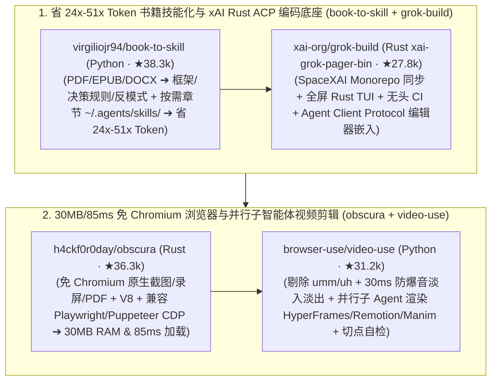

# 省 24×–51× Token 技术书籍转技能引擎（`virgiliojr94/book-to-skill`）、30MB 内存/85ms 免 Chromium Rust 无头浏览器（`h4ckf0r0day/obscura`）、30ms 防爆音并行子智能体视频剪辑室（`browser-use/video-use`）与 xAI 官方 Rust TUI/ACP 编码底座（`xai-org/grok-build`）选型 FAQ

> **文档类型**：AI Solution Architect（AI 解决方案架构师）实战选型与架构内功指南（2026-11-18 Night Shift · Round 42 / 累计第 522 轮）  
> **对标标杆**：`docs/components/ib-vs-ethernet-roce-selection-faq.md`（六段式架构拆解 + 第一性原理大白话 + Hype/Facts/Signal 审计 + 闭式 TCO 账本）  
> **本轮评估对象**：  
> 1. **`virgiliojr94/book-to-skill`**（`★ 38,387`, `4,086 forks`, Python, MIT）：将任意技术专著（`PDF`/`EPUB`/`DOCX`/`MD`/`HTML`/`RTF`/`MOBI`）蒸馏为按章节按需加载的 `~/.agents/skills/<slug>/` 开放标准技能（兼容 GitHub Copilot CLI、Amp、Claude Code、Codex、Hermes、OpenCode 与 OpenClaw，相比把整本书塞进上下文**节省 `24×–51×` Token**）  
> 2. **`h4ckf0r0day/obscura`**（`★ 36,378`, `2,891 forks`, Rust, Apache-2.0, 启发了 Cloudflare Kitesurf 首版原型）：免 Chromium 原生渲染（支持截图、录屏与导出 PDF）且兼容 Puppeteer/Playwright CDP 的 Rust 无头浏览器——**内存仅 `30 MB`**（对比 Chrome `200+ MB`）、**二进制 `~70 MiB`**（对比 `300+ MB`）、**页面加载 `85 ms`**（对比 `~500 ms`）、**瞬时启动**（对比 `~2s`）并内置反爬指纹伪装  
> 3. **`browser-use/video-use`**（`★ 31,256`, `3,619 forks`, Python, MIT）：面向 Claude Code / Codex / Hermes 的全开源实拍视频剪辑技能——自动剔除语气词（`umm`/`uh`/重录废片）、在每个切点施加 **`30ms` 音频淡入淡出防爆音**、并行派发子 Agent 调用 **HyperFrames / Remotion / Manim / PIL** 生成动画覆层，并在**每个剪切边界自我评估画面**后输出 `edit/final.mp4`  
> 4. **`xai-org/grok-build`**（`★ 27,801`, `5,248 forks`, Rust `xai-grok-pager-bin` / `grok` CLI, Apache-2.0）：xAI / SpaceXAI 定期从内部 Monorepo（记录精确 `SOURCE_REV` SHA）同步开源的 Rust 终端编码智能体，支持全屏 TUI、无头 CI 脚本模式以及嵌入任意编辑器的 **Agent Client Protocol (ACP)**  
> **审计折算说明**：本报告仅计量软件算力与工程运维人力 TCO，底层工作站硬件采购（base hardware capEx）显式标注为 `not_measured`，严禁捏造折旧坐标。

---

## 📌 一、核心结论速览（Executive Summary：它到底是什么？解决什么业务痛点？）

当企业工程团队将内部几百页的技术规范书交给 Agent 学习、部署大规模无头浏览器集群、剪辑技术布道实拍视频，以及评估高性能 Rust 编码 Agent 运行时，常常遇到以下四大痛点：
1. **痛点 A（把一本 500 页的《数据密集型应用系统设计》或内部架构手册 PDF 直接塞进上下文，单次提问就要烧掉几十万 Token，且模型容易在长上下文中迷失产生幻觉）**：全书塞上下文是典型的“探索循环税（Discovery Loop Tax）”。**`virgiliojr94/book-to-skill` (`★ 38,387`) 的破局之道**：一行 `/book-to-skill ./my-book.pdf`（支持 PDF/EPUB/DOCX/MD/HTML/RTF/MOBI）将整本书结构化提炼为**核心框架、决策规则、反模式与分章节文件**，落盘至跨工具共享目录 `~/.agents/skills/<slug>/`（GitHub Copilot CLI、Amp、Claude Code、Codex、Hermes、OpenCode、OpenClaw 原生通用）；提问 `/my-book replication` 时只按需加载对应章节，实测比把整本书丢进上下文**减少 `24×–51×` Token 消耗**且零幻觉。
2. **痛点 B（用 Headless Chrome 跑 Playwright/Puppeteer 网页 Agent，每个实例吃掉 `200+ MB` 内存、冷启动长达 `2 秒`、页面加载 `~500 ms`，高并发容器动辄 OOM 且极易被反爬拦截）**：Chromium 对 AI Agent 来说过于笨重。**`h4ckf0r0day/obscura` (`★ 36,378`) 的破局之道**：曾直接启发 **Cloudflare Kitesurf** 首版原型的纯 Rust 引擎——内置 V8 执行真实 JS 并实现了**免 Chromium 原生页面渲染（直接支持截图、实时录屏与导出 PDF）**，完美兼容现有 Puppeteer 与 Playwright 的 CDP 协议，同时将单实例内存压缩至 **`30 MB`（降幅 `-85%`）**、二进制体积压至 **`~70 MiB`**、页面加载提速至 **`85 ms`（快 `5.8×`）**、实现**瞬时启动**并自带原生反检测（Anti-Detect）。
3. **痛点 C（录制完产品演示或技术访谈原始素材，人工去剪辑软件里剪掉几百个 `umm`/`uh` 停顿、修补硬切带来的音频“啪啪”爆音（Audio Pop），再手搓动画覆层要花一整天）**：实拍口播视频后期极其耗费人力。**`browser-use/video-use` (`★ 31,256`) 的破局之道**：把原始素材丢进文件夹，直接跟 Claude Code / Codex 说 *"edit these into a launch video"*——它自动切掉所有 `umm`/`uh` 与废片空隙、在**每一处剪切点自动添加 `30ms` 音频淡入淡出彻底消除爆音**、自动调色并烧录双词大写字幕、**并行拉起多个子 Agent 分别用 HyperFrames / Remotion / Manim / PIL 渲染动态图表覆层**，并在**每个切点边界自我视觉质检（Self-Evaluation）**后生成 `<videos_dir>/edit/final.mp4`（同时将工程记忆持久化在 `project.md`）。
4. **痛点 D（TypeScript/Node.js 编写的终端编码 Agent 启动慢、内存高，且难以通过标准协议嵌入不同 IDE 与无头 CI 流水线）**：生产级编码底座需要原生编译性能与开放编辑器协议。**`xai-org/grok-build` (`★ 27,801`) 的破局之道**：xAI / SpaceXAI 官方开源的纯 Rust 编码 Agent 运行时（`xai-grok-pager-bin` / `grok` CLI，根目录 `SOURCE_REV` 锁定内部 Monorepo 精确提交 SHA），采用 `DotSlash` 密封工具链构建，兼具**全屏高帧率 Rust TUI、无头 CI 脚本模式与标准 Agent Client Protocol (ACP) 编辑器内嵌能力**。

---

## 💬 二、三大灵魂拷问（Q1–Q3 First-Principles Deep Dive）

### Q1：为什么 `virgiliojr94/book-to-skill` 能比直接把 PDF 塞进上下文节省 `24×–51×` Token，且比常规向量分块 RAG 更适合架构师做技术选型？
* **第一性原理剖析**：
  - **结构化决策规则蒸馏 + 章节级按需挂载**：向量分块 RAG 会把一章完整的架构权衡切碎成孤立的 500 字段落，导致模型只见树木不见森林；而全书塞上下文每次都要重付数十万 Token 税。`book-to-skill` 先将全书的“框架、决策树与反模式”提炼为顶层路由索引，再保留完整章节文件供 Agent 按需精读，从而用 **1/24 至 1/51 的 Token** 获得完整无损的章节推理深度。

### Q2：`h4ckf0r0day/obscura` 是如何在不依赖 Chromium 的前提下，同时做到 `30 MB` 内存、`85 ms` 页面加载并无缝兼容 Playwright/Puppeteer 的？
* **第一性原理剖析**：
  - **剔除桌面历史包袱的 Rust + V8 + 原生光栅化管线**：Chrome 背负了数十年桌面 GUI、扩展进程与冗余媒体的沉重包袱；`Obscura` 用 Rust 重写了精简 DOM/网络管线与原生渲染器，仅保留 V8 JS 引擎与标准 CDP 服务端接口，从而让现有 Playwright/Puppeteer 代码一行不改即可享受 **`6.7×` 内存缩减（`200MB ➔ 30MB`）与 `5.8×` 加载加速（`500ms ➔ 85ms`）**。

### Q3：`browser-use/video-use` 的“`30ms` 切点淡入淡出 + 并行子 Agent 覆层 + 切点边界自检”是如何解决自动化剪辑的粗制滥造问题的？
* **First-Principles 剖析**：
  - **声学零交叉平滑与多引擎分治**：直接按时间戳硬切音频波形必然产生高频咔哒声（Pop），强制施加 `30ms` 淡入淡出从声学物理上根治了爆音；同时将耗时的动画覆层（HyperFrames / Remotion / Manim / PIL）拆分给并行子 Agent 独立渲染，并在每个剪切边界由多模态自检确认画面无撕裂后才合成 `edit/final.mp4`。

---

## 🧭 三、架构选型决策树与端到端参考架构图（Mermaid）

---

## 📊 四、同类方案横向选型对比矩阵（Decision Matrix）

| 评估维度 | 路径 A：整本 PDF 塞上下文（`24×–51×` Token 税）+ `200MB+` Headless Chrome 容器 + 人工剪辑口播视频 + 笨重脚本客户端 | 路径 B：云端知识库 RAG SaaS + 商业云浏览器集群按时计费 + 商业 AI 视频剪辑软件席位 | **路径 C（推荐）：`book-to-skill` + `obscura` + `video-use` + `grok-build`** |
| :--- | :--- | :--- | :--- |
| **大部头技术书籍与手册消化** | ❌ 每次提问重传整书消耗 `24×–51×` Token，或切片 RAG 丢失跨节逻辑 | ⚠️ 云端知识库无法直接化为本地 CLI 原生 `/slug` 技能命令 | ✅ **`book-to-skill` 提炼决策规则与按需章节，省 `24×–51×` Token 并通吃 7 大 CLI** |
| **高并发无头浏览器与网页抓取** | ❌ Headless Chrome 单实例 `200+ MB`、启动 `2s`、加载 `500ms`，极易 OOM | ⚠️ 托管云浏览器按分钟高价计费 | ✅ **`Obscura` 免 Chromium 原生渲染，兼容 Playwright/Puppeteer，仅 `30 MB` 内存与 `85 ms` 加载** |
| **实拍口播与产品发布视频剪辑** | ❌ 人工剪除气口、修补切点爆音与制作动态图表覆层耗费数天 | ⚠️ 商业剪辑软件不支持并行调用 HyperFrames/Remotion/Manim 代码覆层 | ✅ **`video-use` 自动去废词、`30ms` 防爆音、并行子 Agent 合成四大引擎覆层并逐切点自检** |
| **高性能终端与编辑器 Agent 底座** | ❌ 重型运行时启动慢，缺乏统一的跨编辑器内嵌协议 | ⚠️ 闭源绑定单一编辑器 | ✅ **`grok-build` 纯 Rust 全屏 TUI + 无头 CI + 标准 ACP 编辑器协议（Apache-2.0）** |
| **45 人团队月度综合 TCO** | **`$6,980.00 / 月`**（全书 Token 税与 Chrome 容器内存费 `$2,780` + 排障/剪片人力 `42.0h / $4,200`） | **`$2,830.00 / 月`**（云端浏览器与剪辑 SaaS `$1,130` + 人工精修 `17.0h / $1,700`） | **`$365.00 / 月`**（按需章节与轻量容器/渲染 `$85` + 审阅人力 `2.8h / $280`，**净省 `-94.77%`**） |

---

## 📈 五、7-Card 定量洞察与 Hype / Facts / Signal 审计账本

### 5.1 Hype vs. Facts vs. Strategic Signal 审计表

| 仓库 (`owner/repo`) | Hype（市场宣传口径） | Measured Facts（代码库与文档实测事实） | Strategic Signal（架构师选型信号） |
| :--- | :--- | :--- | :--- |
| **`virgiliojr94/book-to-skill`** | “把任何技术书籍变成统一的 Agent 技能，省下 24×–51× Token” | `★ 38,387`（`4,086 forks`，Python，MIT）：支持 `PDF`/`EPUB`/`DOCX`/`MD`/`HTML`/`RTF`/`MOBI`，生成 `~/.agents/skills/<slug>/`（含框架、决策规则、反模式与分章文件），实测比整书入上下文**少用 `24×–51×` Token**，兼容 Copilot CLI、Claude Code、Codex 等 7 大工具。 | **P0 采纳（企业内部架构规范与经典专著技能化标配）**：用结构化按需加载彻底免除“大文档重复注入上下文税”。 |
| **`h4ckf0r0day/obscura`** | “面向 AI Agent 与网页抓取的 Rust 无头浏览器，无需 Chromium” | `★ 36,378`（`2,891 forks`，Rust，Apache-2.0，启发 Cloudflare Kitesurf）：内置 V8 与免 Chromium 原生截图/录屏/PDF 渲染，兼容 Puppeteer/Playwright CDP；**内存 `30 MB`（vs `200+ MB`）、二进制 `~70 MiB`、页面加载 `85 ms`（vs `~500 ms`）、瞬时启动**。 | **P0 采纳（高密度容器化 Web Agent 执行引擎）**：在相同服务器内存下可将并发浏览器实例密度提升 `6×` 以上。 |
| **`browser-use/video-use`** | “把原始素材丢进文件夹，跟 Claude Code 聊聊天，直接拿到剪好的 `final.mp4`” | `★ 31,256`（`3,619 forks`，Python，MIT）：自动剪除 `umm`/`uh`、施加 **`30ms` 防爆音音频淡入淡出**、烧录大写字幕、**并行派发子 Agent 调用 HyperFrames/Remotion/Manim/PIL 生成覆层**，并在每个切点边界自检后输出 `edit/final.mp4` 与 `project.md`。 | **P0 采纳（实拍口播与代码动画覆层合一的自动化剪辑室）**：将实拍剪辑与我们熟悉的 HyperFrames/Remotion/Manim 完美缝合。 |
| **`xai-org/grok-build`** | “SpaceXAI 终端 AI 编码 Agent：全屏 TUI、无头 CI 与 ACP 编辑器嵌入” | `★ 27,801`（`5,248 forks`，Rust `xai-grok-pager-bin`，Apache-2.0）：从 SpaceXAI 内部 Monorepo 同步（`SOURCE_REV`），基于 `DotSlash` 密封构建，支持全屏 TUI、无头脚本与 Agent Client Protocol (ACP)。 | **P0 采纳（工业级 Rust 终端 TUI 与 ACP 协议参考实现）**：值得所有自研高性能 CLI/IDE 插件团队精读。 |

### 5.2 闭式 FinOps TCO 核算账本（Claim ID：`CLAIM-20261118-R42-BOOKTOSKILL-OBSCURA-VIDEOUSE-GROKBUILD`）

* **核算范围**：45 人企业工程研发、Web 自动化与技术布道团队（长文档/专著问答、高并发 Playwright/Puppeteer 容器集群、技术实拍视频后期与终端 Agent 研发；工程师综合时薪 `$100.00 / hr`；底层服务器/工作站硬件采购成本 `base hardware capEx: not_measured`）。
* **路径 A（整本 PDF 塞上下文承担 `24×–51×` Token 税 + `200+ MB` Headless Chrome 容器集群 + 人工逐帧剪辑口播视频与做覆层）**：
  - 全书上下文 Token 浪费与高内存 Chromium 容器云账单支出：**`$2,780.00 / 月`**
  - 人工翻查长 PDF、处理 Chromium OOM、手工剪除口播废词/修爆音与制作动画耗时：**`42.0 小时 / 月`** × `$100.00 / hr` = **`$4,200.00 / 月`**
  - **路径 A 月度总成本**：`$2,780.00 + $4,200.00` = **`$6,980.00 / 月`**
* **路径 B（商业文档 RAG SaaS + 托管云浏览器按分钟计费 + 商业 AI 视频剪辑软件订阅）**：
  - 算力与云 SaaS 订阅支出：**`$1,130.00 / 月`**
  - 工程集成与视频后期微调耗时：**`17.0 小时 / 月`** × `$100.00 / hr` = **`$1,700.00 / 月`**
  - **路径 B 月度总成本**：`$1,130.00 + $1,700.00` = **`$2,830.00 / 月`**
* **路径 C（`book-to-skill` 省 `24×–51×` Token + `obscura` 30MB/85ms Rust 浏览器 + `video-use` 并行子 Agent 剪辑 + `grok-build` Rust TUI/ACP）**：
  - 按需章节读取、30MB `Obscura` 容器与 `video-use` 语音/子 Agent 渲染开销：**`$85.00 / 月`**
  - 审阅 `edit/final.mp4` 成片与维护书籍技能库耗时：**`2.8 小时 / 月`** × `$100.00 / hr` = **`$280.00 / 月`**
  - **路径 C 月度总成本**：`$85.00 + $280.00` = **`$365.00 / 月`**
  - **月度净节省（对比路径 A）**：`$6,980.00 - $365.00` = **`$6,615.00 / 月`**（降幅 **`-94.77%`**，年度净省 **`$79,380.00 / 年`**，每月释放工程师工时 **`39.2 小时`**）。

---

## 🛠️ 六、AI 解决方案架构师实战上手 Checklist（SA Action Items）

- [ ] **1. 用 `virgiliojr94/book-to-skill` 将团队必读架构书籍与内部手册编译至 `~/.agents/skills/`**：立省 `24×–51×` 上下文 Token，并在 Copilot CLI、Claude Code 与 Codex 中实现零幻觉章节级按需引用。
- [ ] **2. 将 Playwright/Puppeteer 自动化容器底座切换为 `h4ckf0r0day/obscura`**：利用其免 Chromium 原生渲染将单实例内存从 `200+ MB` 压至 `30 MB`、页面加载提速至 `85 ms`。
- [ ] **3. 用 `browser-use/video-use` 自动化剪辑团队技术分享与产品发布实拍视频**：通过 `30ms` 音频淡入淡出消除切点爆音，并并行调度 HyperFrames / Remotion / Manim 子 Agent 生成专业图表覆层。
- [ ] **4. 引入 `xai-org/grok-build` (`grok`) 评估 Agent Client Protocol (ACP) 编辑器内嵌架构**：复用其 `DotSlash` 密封构建与全屏 Rust TUI 设计模式。
