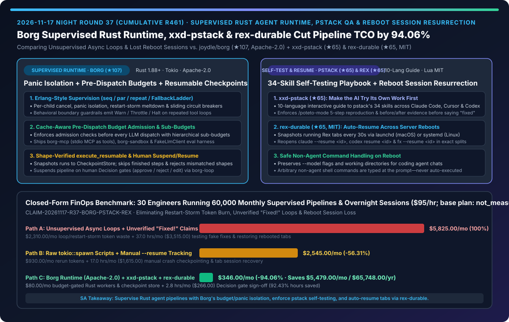
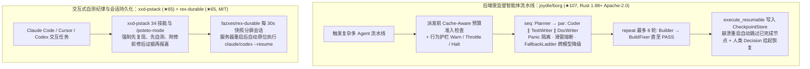

# Rust 监督式容错智能体运行时（`joydle/borg`）与 34 技能先自测再报喜教程及重启会话复活器（`xxd-pstack` & `rex-durable`）架构选型 FAQ

> **文档类型**：AI Solution Architect（AI 解决方案架构师）实战选型指南（六段式标准 FAQ）  
> **所属轮次**：2026-11-17 Night Round 37（Cumulative Round 461）  
> **追踪目标**：
> - **`joydle/borg`**（`★ 107`，Rust 1.88+ / Tokio，7 Crate 工作区：`borg`, `borg-macros`, `borg-loop`, `borg-tracing`, `borg-mcp`, `borg-sandbox`, `borg-tools`，`MIT OR Apache-2.0`）：面向 Rust 生产环境的 Erlang 级监督式（Supervised）智能体运行时，支持 `seq / par / repeat / FallbackLadder` 组合、子任务 Panic 隔离、防重启风暴熔断、派发前预算准入（Pre-Dispatch Budget Admission）与校验拓扑形状的断点续跑（`execute_resumable`）
> - **`nevertoday/xxd-pstack`**（`★ 65`，10 语种 `pstack` 34 技能实战手册，适配 Claude Code / Cursor / Codex）& **`fazxes/rex-durable`**（`★ 65`，Lua / macOS `launchd` & Linux `systemd`，`MIT`）：强制 AI 改完代码先自己跑通验证并附上修前修后证据的 34 技能体系（`xxd-pstack`），配合每 30 秒快照并在服务器重启后秒级原地复活所有 `claude --resume` / `codex resume` 终端标签页的 `rex-durable`  
> **计量审计 ID**：`CLAIM-20261117-R37-BORG-PSTACK-REX`（底层大模型基础 API 订阅标记为 `not_measured`）

---

## 📌 一、核心结论速览（Executive Summary）

1. **为什么企业后端团队与平台架构师在把多智能体流水线（如“规划 → 并行写代码/写单测/写文档 → 循环编译修复 → 审查”）推向 7×24 小时无人值守生产环境时，常遭遇“一个子任务崩溃拖垮整条流水线、死循环刷爆预算、AI 没自测就谎报‘已修好’、以及宿主机重启后十几个终端会话全变空白 Shell”四大痛点？**
   - **生产级异步编排的脆弱性痛点**：用普通脚本或无监督异步协程跑并行子 Agent 时，一旦某个子 Agent 触发 Panic 或上游 API 502，要么把整个父进程带崩，要么陷入无限重试风暴（Restart Storm）和重复调同一个工具的死循环；且进程崩溃后重跑时无法跳过前面已成功的耗钱步骤。
   - **人机协同的“假修好”与“重启失忆”痛点**：日常开发中 AI 常跳过复现直接改代码，然后骗你说“已修复”（打开一看还是坏的，来回拉扯五轮浪费一下午）；而当远端开发机重启后，Rex 终端虽然恢复了窗口分屏，里面的 12 个 Claude Code 与 Codex 会话却全部退回空白命令行。
   - **架构师黄金组合（`joydle/borg` Apache-2.0 + `xxd-pstack` + `rex-durable` MIT）**：在后端高并发 Agent 编排层采用 **`joydle/borg`**（Rust 1.88+ 监督树隔离 Panic、滑窗熔断器、每次派发前预扣子预算、行为级 `Warn / Throttle / Halt` 死循环拦截，以及校验管线拓扑形状的 `execute_resumable` 断点恢复）；在工程纪律与方法论层推广 **`nevertoday/xxd-pstack`**（10 种语言拆解 `pstack` 34 个技能，用 `/poteto-mode` 强制先复现、自测拿证据再报喜）；在长驻终端守护层安装 **`fazxes/rex-durable`**（每 30 秒记录分屏状态，重启后自动在原目录带原 `--model` 参数执行 `claude --resume <id>` 与 `codex resume <id>`）。
2. **闭式 FinOps 量化收益（30 名后端与平台工程师、每月运行 60,000 次受监督多智能体构建/修复流水线与长驻过夜终端会话，综合时薪 `$95.00/hr`）**：
   - 从 **Path A（无监督异步循环 + AI“假修好”反复拉扯与重启丢会话，`$5,825.00/月`）** 切换至 **Path C（`borg` Rust 监督运行时 + `xxd-pstack` 自测纪律 + `rex-durable` 会话复活，`$346.00/月`）**，每月净省 **`$5,479.00/月`（降幅 `-94.06%`，年化节省 `$65,748.00/年`）**，死循环账单止损、人工验证假修复与重启后挨个翻找会话 ID 恢复工时从 `37.0 小时/月` 降至 `2.8 小时/月`（节省 **`92.43%`**）。

---

## 💬 二、灵魂拷问 Q1–Q3（大白话拆解应用场景与架构本质）

### Q1：`joydle/borg` 是如何把 Erlang/OTP 级别的容错监督树、派发前预算准入与拓扑校验断点恢复带入 Rust 智能体编排的？
- **大白话本质定义**：`borg`（`MIT OR Apache-2.0`，Rust 1.88+ / Tokio，7 大模块 Crate）是**“不会因为一个子 Agent 抽风而全盘崩溃、不会超支预算、且崩了能接着上次断点跑的工业级 Rust 智能体发动机”**。
- **四大核心工程能力**：
  1. **声明式流水线原语 + 进程级 Panic 隔离与熔断**：通过 `seq`、`par`、`repeat`、`Branch`、`FallbackLadder`（跨模型降级梯队）组合复杂流水线（如 `Planner → par(Coder, TestWriter, DocWriter) → repeat(8, PASS, Builder → BuildFixer) → Reviewer`）；取消父任务会干净终止所有嵌套子 Agent 与在途请求，而 `par` 中任何一个子任务发生 Panic **绝不会拖垮兄弟节点**，并内置防重启风暴熔断（Restart-Storm Meltdown）与滑窗断路器。
  2. **边界行为护栏（`Warn / Throttle / Halt`）+ 派发前预算准入（Budget Admission）**：在每一轮 Agent Loop 边界自动检测重复工具调用或空转纯文本轮次；在每次真正向大模型发请求前执行**计入缓存折扣（Cache-Aware）的总预算与子预算（Sub-Budgets）准入检查**。
  3. **校验拓扑形状的断点续跑（`execute_resumable`）与人机挂起（`borg-loop`）**：每步或每轮自动将状态快照写入三方法 `CheckpointStore`（崩溃重跑时直接跳过已完成步骤，且如果代码改了流水线结构会自动拒绝不匹配的旧快照防错乱）；遇到需要人类拍板的节点直接挂起持久化，等人类传入 `Decision`（`approve / reject / edit`）后原地恢复。
  4. **零 API Key 测试套件（`FakeLlmClient` & `ScriptedAgent`）+ 原生 MCP/沙盒**：自带 `borg-mcp`（将任意 stdio MCP 转为强类型工具）、`borg-sandbox` 与免密钥单元测试框架。

### Q2：`nevertoday/xxd-pstack` 与 `fazxes/rex-durable` 分别如何治好 AI“没试过就说修好了”与“服务器重启后满屏对话灰飞烟灭”的痛点？
- **`nevertoday/xxd-pstack`（把 `pstack` 34 个技能拆解为 10 语种零门槛实战体系）**：
  - 针对开发者最痛恨的“AI 说已修复、一打开还是坏的、改个按钮顺手改乱十几个文件、新开对话又踩昨天的坑”，系统拆解了 34 个标准技能与 `/poteto-mode` 工作流——强制 Agent 按**“先看懂复现 → 拆解打勾清单 → 限制改动范围 → 自己跑通验证 → 提交修前修后对比证据”**五步法交活，支持一键让跑通整晚自动化任务。
- **`fazxes/rex-durable`（服务器重启后秒级复活 12+ 个 Claude Code / Codex 会话的守护神，`MIT`）**：
  - 装上后作为 macOS `launchd` 或 Linux `systemd` 后台服务静默运行，每 30 秒记录每个 Rex 终端标签页与分屏里正在跑的程序；
  - 当机器或 Rex 服务重启后，自动在原有的标签页、分屏和工作目录下精准执行 `claude --resume <id>`、`codex resume <id>` 或 `fx --resume <id>`（连 `--model` 等启动参数都原样保留）；
  - **极佳的安全边界**：对于普通非 Agent 的命令（如 `rm` 或部署脚本），重启后只把命令文字敲在提示符上但**绝不自动按回车执行**，把最终执行权留给人类！

### Q3：企业 AI 架构师如何把这三者组合进高可靠研发平台？
- **高并发后台智能体服务层（`joydle/borg`）**：使用 Rust `borg` 编写企业内部 CI 自动修构建、文档生成与代码审查流水线，开启子预算限额与 `CheckpointStore` 断点续跑；
- **工程师交互式终端与方法论层（`xxd-pstack` + `rex-durable`）**：全员装载 `pstack` 34 技能杜绝“未自测假报喜”，并在远端开发机部署 `rex-durable` 确保跨夜长会话永不因机器重启丢失。

---

## 🧭 三、端到端集成参考架构与选型决策树（Mermaid）

---

## 📊 四、同赛道方案横向选型对比矩阵（Decision Matrix）

| 评估维度 | 方案 A：无监督异步脚本 + 裸 Prompt 修 Bug + 重启丢终端 | 方案 B：手写 `tokio::spawn` 重试 + 手工记 Session ID | **方案 C（推荐）：`borg` (Apache-2.0) + `xxd-pstack` + `rex-durable` (MIT)** |
| :--- | :--- | :--- | :--- |
| **并行子 Agent Panic 隔离与防死循环烧钱** | ❌ 单个子任务 Panic 带崩全局；死循环重复调工具烧光余额 | ⚠️ 手写超时难以处理重启风暴与跨模型降级梯队 | ✅ **Erlang 级监督树隔离 Panic、防重启风暴熔断、行为护栏 `Halt` 与派发前预算准入** |
| **长流水线崩溃断点续跑与拓扑安全** | ❌ 第 7 步挂掉需从第 1 步全量重跑，白交双倍 Token | ⚠️ 简单缓存容易在流水线结构改动后读出脏状态 | ✅ **`execute_resumable` 自动跳过已完成步骤，且自动拒绝拓扑形状已改变的旧快照** |
| **消灭 AI“嘴上说修好了、一跑还是坏的”** | ❌ 来回拉扯 5 轮耗费整个下午，还顺手改坏相邻文件 | ⚠️ 靠开发者每次手打长串提醒 | ✅ **`xxd-pstack` 10 语种 34 技能体系（`/poteto-mode`）强制先自测并交付前后对比证据** |
| **服务器/终端重启后的多会话原地恢复** | ❌ 重启后 12 个分屏全变空 Shell，丢失 `--model` 与会话 ID | ❌ 需人工在历史日志里翻找 UUID 挨个敲 `--resume` | ✅ **`rex-durable` 秒级原地恢复 `claude/codex/fx --resume`，且普通 Shell 命令只回填不乱跑** |
| **月度总拥有成本（TCO，30 人 / 6 万次流水线）** | **`$5,825.00 / 月`**（含 `$2,310` 死循环/重跑 Token + `37.0h` 假修复返工） | **`$2,545.00 / 月`**（含 `$930` 冗余 Token + `17.0h` 手工恢复） | **`$346.00 / 月`**（**净省 `-94.06%`**，仅 `$80` 预算受控 Worker + `2.8h` 挂起决策签批） |

---

## 🧮 五、7-Card 定量洞察与闭式 FinOps 核算（`CLAIM-20261117-R37-BORG-PSTACK-REX`）

> **核算范围与边界声明**：面向 30 名后端与平台工程师团队，每月运行 **60,000 次受监督多智能体构建/修复流水线与过夜长驻终端会话**（综合时薪 `$95.00/hr`；底层大模型基础 API 订阅标记为 `not_measured`）：

$$\text{Total Monthly TCO} = \text{Loop/Restart-Storm Token Spend} + (\text{Fake-Fix Rework \& Reboot Recovery Hours} \times \$95.00)$$

| 成本构成项 | Path A：无监督异步循环 + 假修好返工 | Path B：手写 `tokio::spawn` + 手记 ID | **Path C：`borg` + `xxd-pstack` + `rex-durable`** |
| :--- | :---: | :---: | :---: |
| **月度死循环/崩溃全量重跑 Token 与存储开销** | `$2,310.00` | `$930.00` | **`$80.00`** |
| **月度验证“假修好”、排查崩溃与重启找会话工时** | `37.0 hrs` | `17.0 hrs` | **`2.8 hrs`**（直降 **`92.43%`**） |
| **月度后端与平台工程师人工成本（`@ $95.00/hr`）** | `$3,515.00` | `$1,615.00` | **`$266.00`** |
| **月度总拥有成本（Monthly TCO）** | **`$5,825.00`** | **`$2,545.00`**（`-56.31%`） | **`$346.00`**（**`-94.06%`**） |
| **相对 Path A 净节省（月度 / 年化）** | 基线（`$0.00`） | `$3,280.00 / 月`（`$39,360/年`） | **`$5,479.00 / 月`（`$65,748.00 / 年`）** |

---

## ✅ 六、AI 解决方案架构师实战上手 Checklist（SA Action Checklist）

- [ ] **Step 1 — 引入 `joydle/borg`（`tag = "v1.0.0"`）编排生产级 Rust 智能体流水线**：注意从 GitHub 仓库拉取 `borg`（勿与 crates.io 同名无关包混淆），先用内置免密钥 `FakeLlmClient`（`cargo run -p borg --example dogfood --features testing`）验证 `seq / par / repeat` 与 Panic 隔离。
- [ ] **Step 2 — 开启派发前预算准入（Sub-Budgets）与 `execute_resumable` 断点持久化**：为每条 `borg` 流水线绑定数据库 `CheckpointStore`、跨模型 `FallbackLadder` 与重复工具调用 `Halt` 护栏。
- [ ] **Step 3 — 组织全员学习 `xxd-pstack` 34 技能并启用 `/poteto-mode` 自测门禁**：要求所有研发与产品人员按 `xxd-pstack` 规范，强制 Agent 在声称“已修复”前完成自测并附上修前修后对比证据。
- [ ] **Step 4 — 在所有 Rex 终端宿主机安装 `fazxes/rex-durable` 服务**：执行 `./install.sh --add-to-config` 开启 30 秒自动快照，确保服务器重启后 `claude --resume` 与 `codex resume` 原位秒级恢复。
