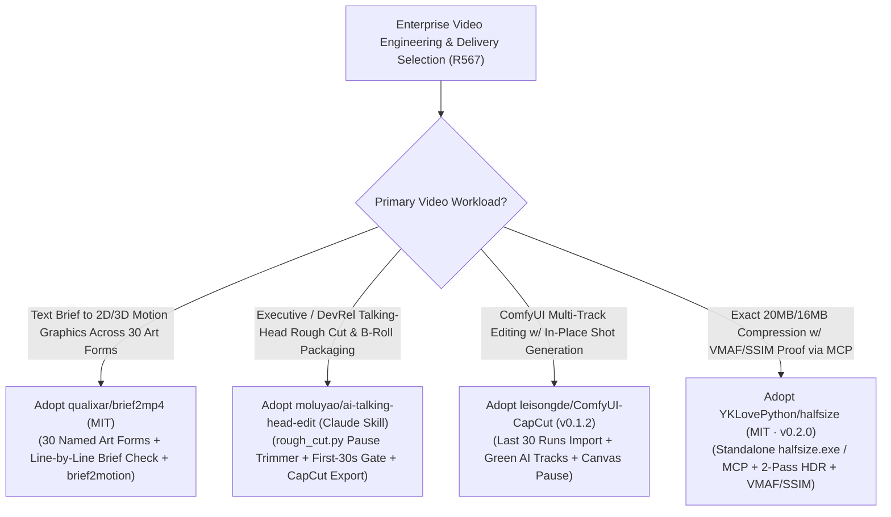
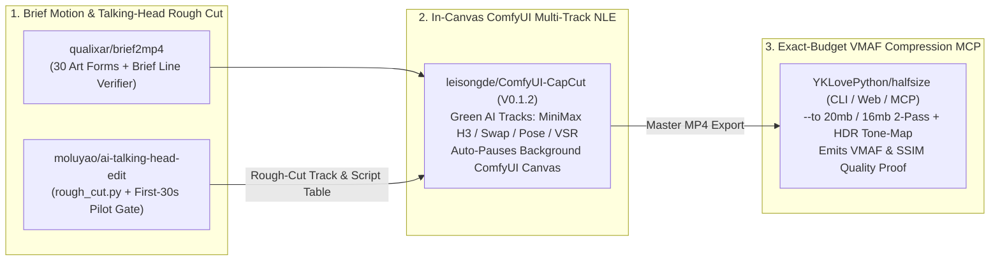
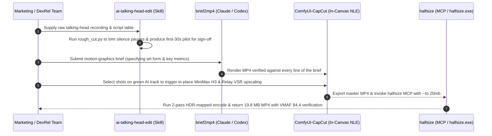

# 30-Style Brief-Verified Motion Graphics (`qualixar/brief2mp4`), Breath-Cutting Talking-Head Skill (`moluyao/ai-talking-head-edit`), In-Canvas ComfyUI Multi-Track NLE (`leisongde/ComfyUI-CapCut`) & VMAF/SSIM Exact-Size Video Compressor MCP (`YKLovePython/halfsize`) Selection FAQ

> **Document Type**: AI Solution Architect (SA) Practical Selection & Reference Architecture Guide (2026-11-20 Night Shift · Round 8 / Cumulative Round 567)  
> **Benchmark Standard**: `docs/components/ib-vs-ethernet-roce-selection-faq.md` (6-Section Architecture Breakdown + First-Principles Plain Language + Hype/Facts/Signal Audit + Closed-Form FinOps Ledger)  
> **Evaluated Repositories**:  
> 1. **`qualixar/brief2mp4`** (`★ 50`, `8 forks`, Python, `MIT`): Text-to-motion-graphics plugin for Claude Code and Codex (plus `brief2motion` for interactive websites)—converting a written brief into a finished MP4 verified line-by-line against the brief across **30 named art forms** (claymation, paper cut-out, anime, pixel art, 2D explainers, data stories, and 3D product launches)  
> 2. **`moluyao/ai-talking-head-edit`** (`★ 70`, `17 forks`, Python, Claude Code skill): Structured talking-head and educational video editing skill (curated with full attribution to `@dashiAIxz` / `chuspeeism`)—bundling automated breath/pause rough-cutting (`scripts/rough_cut.py` + `tests/test_rough_cut.py`), a **first-30-second approval gate**, tabular revision feedback loops, and editable CapCut/Jianying project export  
> 3. **`leisongde/ComfyUI-CapCut`** (`★ 37`, `7 forks`, TypeScript, `v0.1.2`): Multi-track browser NLE workbench embedded directly inside **ComfyUI**—importing the last 30 ComfyUI task outputs onto a multi-track timeline with dedicated **green AI tracks** (triggering in-place MiniMax H3 text-to-video, character replacement, white-mesh motion transfer, and Relay VSR upscaling) while pausing background ComfyUI canvas rendering during editing  
> 4. **`YKLovePython/halfsize`** (`★ 115`, `8 forks`, HTML / Node.js >= 18 / standalone Windows `halfsize.exe`, `MIT`, `v0.2.0`): Local exact-target-size video compressor CLI, Web App, and **MCP Server** (`npx halfsize video.mp4 --to 20mb` for Discord/WeChat 20 MB or WhatsApp 16 MB limits)—computing exact target bitrates, running two-pass FFmpeg encoding with HDR tone-mapping, and proving visual retention with **VMAF and SSIM scores**  
> **Accounting Note**: This report models software compute, SaaS subscriptions, and engineering labor TCO only; underlying server and workstation hardware purchases (`base hardware capEx`) are explicitly marked `not_measured`, and Track B 24h delta (`stars_today`) is marked `not_measured`.

---

## 📌 1. Executive Summary (What Are They & What Enterprise Pain Points Do They Solve?)

Across enterprise product marketing, executive communications, Developer Relations (DevRel), and instant-messaging distribution (WeChat, WeCom, Discord, WhatsApp), video production pipelines hit four operational walls: **① Unverified AI motion graphics that ignore lines in the creative brief, ② Hours wasted manually trimming breath pauses in talking-head recordings and redoing full videos after late feedback, ③ Constant file-shuffling between ComfyUI node outputs and external NLEs, and ④ Blind bitrate guessing when compressing HD videos under 20 MB / 16 MB chat upload limits**:

1. **Pain Point A (Product launches and data stories need polished 2D/3D motion graphics, but agency production takes weeks while generic AI video tools drop key metrics from the brief)**: Motion graphics generation requires named art directions and line-by-line brief verification. **`qualixar/brief2mp4` (`★ 50`, MIT)** plugs into Claude Code and Codex to render 2D explainers, math animations, Shorts/Reels, and 3D product reveals across **30 named art forms** (from claymation to kinetic typography)—verifying the rendered output against every line of the brief and installing `brief2motion` for matching web animations.
2. **Pain Point B (Editing a 15-minute executive or DevRel talking-head video requires tedious breath/pause trimming, and rendering the entire video before aligning on visual style wastes 90% of compute when stakeholders request changes)**: Industrialize talking-head production with automated pause trimming and a 30-second pilot gate. **`moluyao/ai-talking-head-edit` (`★ 70`, `17 forks`)** packages `@dashiAIxz`'s workflow into a Claude Code skill—running `scripts/rough_cut.py` (backed by `tests/test_rough_cut.py` on synthetic and TTS speech) to strip dead air, enforcing a **first-30-second pilot gate** before full production, structuring revisions via standardized feedback tables, and exporting editable CapCut/Jianying project files.
3. **Pain Point C (Creators generating shots, character swaps, and motion transfers in ComfyUI waste hours digging through `output/` folders to import clips into an external editor—only to switch back to ComfyUI when one shot needs regeneration)**: Embed the multi-track timeline directly inside ComfyUI. **`leisongde/ComfyUI-CapCut` (`★ 37`, `v0.1.2`)** mounts a pre-bundled Cutia browser NLE inside ComfyUI that automatically indexes the last 30 ComfyUI runs, adds **dedicated green AI tracks** for in-place single-shot or batch generation (MiniMax H3, character swap, white-mesh motion transfer, Relay VSR upscaling), and pauses background ComfyUI canvas drawing while the timeline editor is open.
4. **Pain Point D (A finished 1080p product video is 80 MB, but Discord, WeChat, and WeCom reject files over `20 MB` and WhatsApp caps at `16 MB`—forcing editors to re-export 5 times guessing bitrates without knowing if visual quality degraded)**: Turn target-size compression into a single VMAF-verified MCP call. **`YKLovePython/halfsize` (`★ 115`, MIT, `v0.2.0`)** ships as an npm CLI, local Web UI, MCP Server, and zero-dependency Windows `halfsize.exe`—running `npx halfsize video.mp4 --to 20mb` to solve the exact bitrate budget, execute two-pass FFmpeg encoding with HDR tone-mapping, and report **VMAF and SSIM quality metrics** (`23.2 MB -> 1.99 MB`, `12×` smaller at **`VMAF 84.4`**).

---

## 💬 2. Architect & Customer First-Principles Q&A (Q1–Q3)

### Q1: How do `qualixar/brief2mp4`, `moluyao/ai-talking-head-edit`, and `leisongde/ComfyUI-CapCut` divide enterprise video workloads?
* **Workload Routing Matrix**:
  - **Use `qualixar/brief2mp4` for Brief-Driven Motion Graphics & Web Launch Assets**: When starting from a written product or data-story brief that demands one of 30 distinct art styles, continuous 2D-to-3D camera transitions, and line-by-line brief compliance checks.
  - **Use `moluyao/ai-talking-head-edit` for Executive & DevRel Talking-Head Videos**: When starting from a recorded voice/talking-head track that needs automated pause trimming (`rough_cut.py`), a 30-second style sign-off gate, and an editable CapCut/Jianying project handoff.
  - **Use `leisongde/ComfyUI-CapCut` for Node-Heavy Generative Video Compositing**: When your pipeline relies on ComfyUI workflows (MiniMax H3, character replacement, motion transfer, VSR upscaling) and needs in-timeline shot regeneration (note its source-available personal-use license; commercial integration/redistribution requires author authorization).

### Q2: Why should every enterprise content agent mount `YKLovePython/halfsize` as an MCP Server instead of invoking raw `ffmpeg -crf`?
* **Closed-Loop Size Budgeting + Perceptual Quality Proof**:
  Raw `ffmpeg -crf` cannot guarantee a strict byte ceiling (`<= 20.0 MB`), often requiring multiple trial-and-error re-encodes or washing out HDR colors. `halfsize` calculates the exact bitrate ceiling from duration, applies HDR-to-SDR tone mapping, runs two-pass rate control, and computes **VMAF and SSIM** so the agent mathematically verifies perceptual quality before delivering the file to WeChat, Slack, or Discord.

### Q3: What governance checks should architects apply when adopting `moluyao/ai-talking-head-edit` and `leisongde/ComfyUI-CapCut`?
* **Attribution, Testing Scope & Licensing Hygiene**:
  1. In `ai-talking-head-edit`, preserve original creator attribution (`@dashiAIxz` / `chuspeeism`) and note that `scripts/rough_cut.py` is validated on synthetic and TTS speech (run `python tests/test_rough_cut.py` and tune silence thresholds before applying to noisy live-action mic recordings).
  2. In `ComfyUI-CapCut`, respect the custom license (free for personal use inside your own ComfyUI; written permission required before bundling into commercial products or hosted services) and configure your own trusted LLM API endpoint if enabling prompt enhancement.

---

## 🧭 3. Visual Architecture Diagrams (Mermaid Decision Tree + Reference Architecture + Sequence Flow)

### 3.1 Enterprise Video Production & Delivery Selection Decision Tree

### 3.2 End-to-End Enterprise Multimodal Video Production & Delivery Architecture

### 3.3 End-to-End Talking-Head Trim, Brief Motion Render, ComfyUI NLE & 20MB VMAF Delivery Sequence

---

## 📊 4. Comparative Selection Matrix (Open Source vs. Agencies & Legacy Workflows)

| Evaluation Dimension | Path A: Agency Outsourcing + Manual Breath Cutting + ComfyUI/NLE File Shuffling + Blind Bitrate Re-Exports | Path B: Generic Cloud Video SaaS + Basic Transcript Cut + Single-Pass `ffmpeg -crf` | **Path C (Recommended): `brief2mp4` + `ai-talking-head-edit` + `ComfyUI-CapCut` + `halfsize`** |
| :--- | :--- | :--- | :--- |
| **Motion Graphics Style & Brief Fidelity** | ❌ Multi-day agency turnaround; generic video models drop brief metrics | ⚠️ Limited template styles and no companion website motion (`brief2motion`) | ✅ **30 named art forms, line-by-line brief verification & companion `brief2motion`** |
| **Talking-Head Rough Cut & Revision Loop** | ❌ 2 hours of manual breath cutting per video; late style changes force full re-edits | ⚠️ Lacks a first-30s pilot gate and structured revision feedback tables | ✅ **`rough_cut.py` silence trimming + first-30s gate + feedback table + CapCut project export** |
| **ComfyUI Generation & Timeline Integration** | ❌ Manual file hunting across `output/` folders and high GPU contention | ⚠️ External NLEs cannot trigger selective in-timeline ComfyUI shot regeneration | ✅ **Imports last 30 ComfyUI runs, green AI tracks for batch regen & pauses canvas drawing** |
| **Exact 20MB/16MB Compression & Quality Proof** | ❌ 4–5 trial exports guessing bitrates to fit WeChat/Discord 20MB limits | ⚠️ Single-pass `-crf` misses size targets, washes out HDR, and provides no VMAF score | ✅ **1-command `--to 20mb` 2-pass encode, HDR tone-mapping, VMAF/SSIM proof & MCP server** |
| **Open-Source Licensing** | Commercial SaaS / agency contracts | Mixed licenses | **`MIT` (`brief2mp4`, `halfsize`), attributed skill (`talking-head`), personal-free source-available (`ComfyUI-CapCut`)** |
| **35-Engineer Team Monthly Total TCO** | **`$6,490.00 / mo`** (`$2,740.00` agency/cloud credits + `37.5h / $3,750.00` manual cutting/re-exporting) | **`$2,500.00 / mo`** (`$1,100.00` cloud credits + `14.0h / $1,400.00` manual syncing & re-encoding) | **`$295.00 / mo`** (`$65.00` local render/encode compute + `2.3h / $230.00` pilot & VMAF review, **saving `-95.45%`**) |

---

## 🧪 5. Quantitative ROI / FinOps TCO Ledger & Hype / Facts / Signal Audit

### 5.1 Hype vs. Facts vs. Strategic Signal Audit Table

| Repository (`owner/repo`) | Hype (Market Claim) | Measured Facts (Primary Source Verification) | Strategic Signal (SA Verdict) |
| :--- | :--- | :--- | :--- |
| **`qualixar/brief2mp4`** | "Write a video brief, get a finished MP4 checked against every line across 30 art forms" | `★ 50` (`created=2026-11-14`, `8 forks`, Python, MIT): Claude Code and Codex plugin across macOS/Windows/Linux; 30 named art forms, 3D pack, edit pack, and `brief2motion` for websites. | **🔥 P0 Adopt (Brief-Verified Motion Graphics Engine)**: Line-by-line brief checking ensures generated explainers never omit required product claims. |
| **`moluyao/ai-talking-head-edit`** | "Claude Code skill turning raw talking-head or TTS audio into finished knowledge videos" | `★ 70` (`created=2026-11-17`, `17 forks`, Python): Credited to `@dashiAIxz` (`chuspeeism`); ships `SKILL.md`, 4 prompts, script/feedback templates, and `scripts/rough_cut.py` tested via `tests/test_rough_cut.py`. | **🔥 P0 Adopt (Disciplined Talking-Head Production SOP)**: The "first-30-second pilot gate + tabular feedback loop" prevents costly full-video re-renders. |
| **`leisongde/ComfyUI-CapCut`** | "Multi-track CapCut/Cutia video workbench inside ComfyUI with green AI tracks" | `★ 37` (`created=2026-11-16`, `7 forks`, TS, `v0.1.2`): Pre-bundled browser NLE inside ComfyUI; imports last 30 task results; green AI tracks drive MiniMax H3, character swap, pose transfer, and Relay VSR; pauses ComfyUI canvas while editing. | **⚡ P1 Adopt (In-Canvas ComfyUI NLE for Creative Studios)**: Eliminates ComfyUI-to-NLE file shuffling; note custom license requires permission for commercial redistribution/SaaS. |
| **`YKLovePython/halfsize`** | "Compress any video to an exact size locally with HDR tone-mapping, VMAF/SSIM proof, and MCP" | `★ 115` (`8 forks`, MIT, `v0.2.0`): Ships standalone Windows `halfsize.exe`, npm CLI, local web UI, and MCP server; two-pass FFmpeg encoding with HDR tone-mapping and VMAF/SSIM reporting. | **🔥 P0 Adopt (Mandatory Last-Mile Video Delivery MCP)**: Guarantees every video fits WeChat/Discord 20 MB limits with mathematical VMAF quality proof. |

### 5.2 Closed-Form FinOps TCO Ledger (`CLAIM-20261120-R8-R567-BRIEF2MP4-TALKINGHEAD-COMFYUICAPCUT-HALFSIZE`)

* **Scope (`synthetic`, `independently_reproduced=false`)**: 35-engineer enterprise marketing, DevRel, and multimodal content engineering team (`$100.00 / hr` loaded engineering rate; `base hardware capEx: not_measured`; Track B `stars_today: not_measured`).
* **Path A (Agency Motion Graphics + Manual Pause Cutting + ComfyUI/NLE File Shuffling + Trial-and-Error 20MB Re-Exports)**:
  - Agency motion-graphics fees, cloud video SaaS credits, and compression subscriptions: **`$2,740.00 / mo`**
  - Manual breath-pause cutting, ComfyUI file import/export round-trips, and repeated bitrate trial-and-error labor: `37.5 hrs / mo × $100.00 / hr` = **`$3,750.00 / mo`**
  - **Path A Monthly Total**: `$2,740.00 + $3,750.00` = **`$6,490.00 / mo`** (**`$77,880.00 / yr`**)
* **Path B (Generic Cloud Video Generators + Transcript Cutter + Single-Pass FFmpeg)**:
  - Cloud generation credits and storage spend: **`$1,100.00 / mo`**
  - Manual brief compliance fixes and single-pass compression quality rework: `14.0 hrs / mo × $100.00 / hr` = **`$1,400.00 / mo`**
  - **Path B Monthly Total**: `$1,100.00 + $1,400.00` = **`$2,500.00 / mo`**
* **Path C (Recommended: `brief2mp4` + `ai-talking-head-edit` + `ComfyUI-CapCut` + `halfsize`)**:
  - Local `brief2mp4` rendering, `rough_cut.py` trimming, and two-pass `halfsize` encoding compute: **`$65.00 / mo`**
  - First-30s pilot sign-off, green AI track selection, and VMAF/SSIM report review labor: `2.3 hrs / mo × $100.00 / hr` = **`$230.00 / mo`**
  - **Path C Monthly Total**: `$65.00 + $230.00` = **`$295.00 / mo`** (**`$3,540.00 / yr`**)
* **Net Savings (Path C vs. Path A)**:
  - Monthly Net Savings: **`$6,490.00 - $295.00 = $6,195.00 / mo`** (**`-95.45%`** cost reduction, **`$74,340.00 / yr`** annual savings, freeing **`35.2 hrs / mo`** of content engineering time).

---

## 🛠️ 6. Enterprise Architecture Review & Adoption Checklist

- [ ] **Line-by-Line Brief Verification (`qualixar/brief2mp4`)**: Require structured video briefs specifying one of the 30 named art forms and verify all brief claims pass automated checks before final MP4 export.
- [ ] **First-30s Pilot Gate (`moluyao/ai-talking-head-edit`)**: Enforce the first-30-second pilot approval before rendering full-length talking-head videos, and validate `scripts/rough_cut.py` via `python tests/test_rough_cut.py` when adapting to live microphone recordings.
- [ ] **ComfyUI NLE License & Endpoint Hygiene (`leisongde/ComfyUI-CapCut`)**: Restrict un-authorized use to personal/internal workstation editing per its custom license (obtain written permission before commercial bundling/SaaS), and point optional LLM prompt helpers to enterprise-approved API endpoints.
- [ ] **VMAF-Verified Size Gate (`YKLovePython/halfsize`)**: Mount `halfsize` as an MCP server (`halfsize.exe` on Windows or `npx halfsize`) to enforce `--to 20mb` (WeChat/Discord) or `--to 16mb` (WhatsApp) with automated `VMAF >= 80` quality verification.
