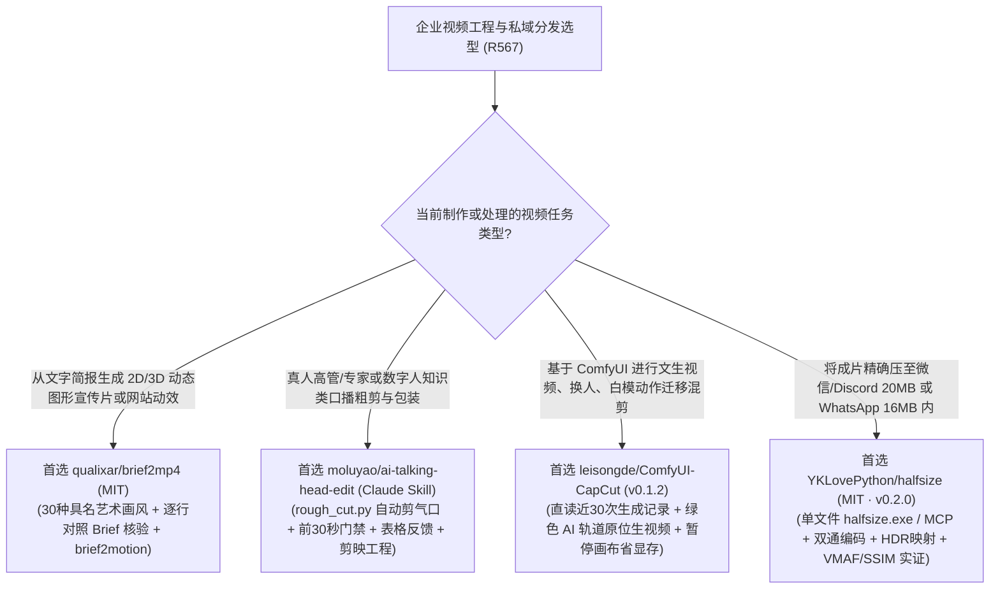
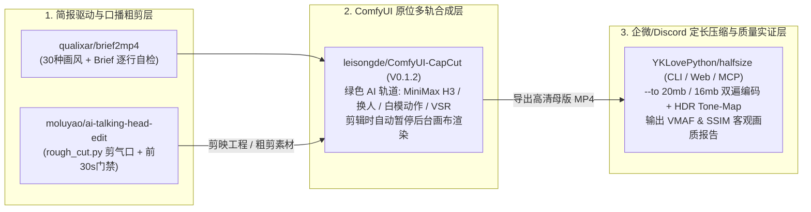
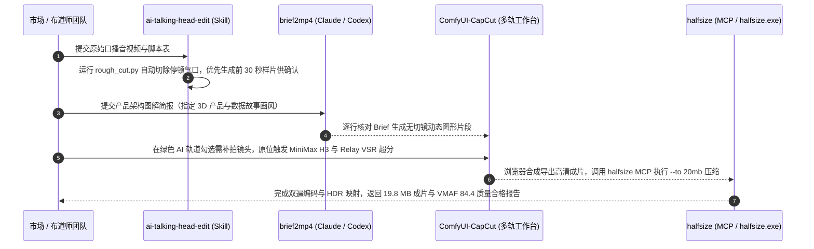

# 30 种画风逐行核验动态图形引擎（`qualixar/brief2mp4`）、剪气口与剪映工程导出的口播精剪技能（`moluyao/ai-talking-head-edit`）、ComfyUI 内嵌 AI 多轨剪辑工作台（`leisongde/ComfyUI-CapCut`）与 VMAF/SSIM 质量实证定长压缩 MCP（`YKLovePython/halfsize`）选型 FAQ

> **文档类型**：AI Solution Architect（AI 解决方案架构师）实战选型与架构内功指南（2026-11-20 Night Shift · Round 8 / 累计第 567 轮）  
> **对标标杆**：`docs/components/ib-vs-ethernet-roce-selection-faq.md`（六段式架构拆解 + 第一性原理大白话 + Hype/Facts/Signal 审计 + 闭式 TCO 账本）  
> **本轮评估对象**：  
> 1. **`qualixar/brief2mp4`**（`★ 50`，`8 forks`，Python，MIT）：面向 Claude Code 与 Codex 的文本转动态图形（Motion Graphics）插件（附带网站动效包 `brief2motion`）——输入一份视频简报（Brief），即可在 **30 种具名艺术形态（黏土动画、剪纸、动漫、像素艺术、3D 产品、数据故事等）** 下生成**逐行核对简报要求的成品 MP4**  
> 2. **`moluyao/ai-talking-head-edit`**（`★ 70`，`17 forks`，Python，Claude Code Skill）：结构化 AI 口播与知识类视频剪辑技能包（整理自 `@dashiAIxz` / `chuspeeism` 原创方法论并完整署名）——内置自动按留白/停顿规则切除气口的 `scripts/rough_cut.py`（附量化自测套件 `tests/test_rough_cut.py`）、“先打磨前 30 秒黄金钩子”流程、表格化审片反馈循环以及剪映工程直出交付  
> 3. **`leisongde/ComfyUI-CapCut`**（`★ 37`，`7 forks`，TypeScript，`v0.1.2`）：直接内嵌在 ComfyUI 画布中的多轨非线性视频剪辑工作台——一键导入最近 30 次 ComfyUI 生成素材，提供**独立绿色 AI 轨道**（原位右键触发 MiniMax H3 文生视频、人物替换、人体白模动作迁移与 Relay VSR 超分放大），并在打开剪辑台时自动暂停后台 ComfyUI 画布渲染以释放显卡与 CPU  
> 4. **`YKLovePython/halfsize`**（`★ 115`，`8 forks`，HTML / Node.js >= 18 / Windows 单文件 `halfsize.exe`，MIT，`v0.2.0`）：本地精确体积目标视频压缩 CLI、Web 应用与 **MCP Server**——一行 `npx halfsize video.mp4 --to 20mb` 精准卡进企业微信/微信（20 MB）、Discord（20 MB）或 WhatsApp（16 MB）附件上限，自动计算最优码率与分辨率、执行两遍（Two-Pass）编码与 HDR 色调映射，并输出客观 **VMAF 与 SSIM 画质评分证明**  
> **审计折算说明**：本报告仅计量软件算力、SaaS 订阅与工程运维人力 TCO，底层服务器与工作站硬件采购（base hardware capEx）显式标注为 `not_measured`，赛道 B 新仓今日增量显式标注为 `not_measured`，严禁捏造坐标。

---

## 📌 一、核心结论速览（Executive Summary：它到底是什么？解决什么业务痛点？）

在企业数字营销、高管口播公关、技术布道（DevRel）以及私域社群（微信/企微/Discord）视频分发全链路中，内容工程团队长期面临四大卡点——**① 动态图形宣传片外包昂贵且 AI 盲生视频不遵从分镜简报、② 真人/数字人口播剪气口与配 BGM 耗费大量人工且改不动成片、③ ComfyUI 节点生成的零散镜头要反复导出再导入桌面剪辑软件、④ 成片超过 20 MB 发不进微信/Discord 而盲目压码率又把画面压糊**：

1. **痛点 A（企业发布会、产品上线与数据洞察需要高品质的 2D/3D 动态图形短片，但传统 AE 外包按秒计费，而直接让通用大模型写动画往往漏掉简报里的关键指标或视觉风格四不像）**：动态图形生成必须有“具名风格库 + 逐行简报自检”。**`qualixar/brief2mp4` (`★ 50`, MIT) 的破局之道**：作为 Claude Code 与 Codex 的标准插件，内置 **30 种具名艺术风格**（从黏土定格、折纸剪纸到 3D 产品特写与动态排版），不仅能实现“一镜到底无切镜穿越五重 2D/3D 世界”，而且在输出 MP4 前会**逐行对照用户的文字 Brief 执行自动化完备性核验**，同时附带 `brief2motion` 让企业官网同步拥有同款动效。
2. **痛点 B（企业高管、技术专家录制完 15 分钟口播或数字人干货后，剪辑师要花数小时逐句听音剪掉呼吸停顿“气口”、对齐分镜动画，且一旦领导提修改意见，微信群里零散的文字反馈极易漏改）**：口播剪辑需要“自动化气口粗剪 + 前 30 秒先行验证 + 表格化反馈 + 剪映工程交付”。**`moluyao/ai-talking-head-edit` (`★ 70`, `17 forks`) 的破局之道**：将成熟的口播工业化 SOP 封装为 `.claude/skills/`——先用 `scripts/rough_cut.py`（通过 `numpy` + `ffmpeg` 量化测试）自动按留白规则切掉无效停顿，强制**“先只做开头 30 秒确认调色与动效风格，通过后再铺满全片”**，用标准剪辑意见表驱动多轮迭代，并最终导出可二次微调的剪映工程。
3. **痛点 C（设计师在 ComfyUI 里用工作流生成了分镜图片、局部替换了人物并做了动作迁移，但每次都要把几十个文件从 `output` 目录翻出来拖进剪映，发现某一镜少 2 秒又要切回 ComfyUI 重新跑）**：AI 生成节点与多轨时间线必须合二为一。**`leisongde/ComfyUI-CapCut` (`★ 37`, `v0.1.2`) 的破局之道**：把完整的 Cutia 浏览器多轨剪辑台直接塞进 ComfyUI 节点——自动挂载最近 30 次 ComfyUI 生成记录，时间线上方专设**绿色 AI 多轨区**（在时间线任意位置右键即可原位触发 MiniMax H3 生视频、人物替换、白模动作迁移与 Relay VSR 放大，支持勾选多个镜头批量生成），且打开剪辑台时自动暂停 ComfyUI 后台画布重绘，确保浏览器 H.264/WebM 满帧预览导出。
4. **痛点 D（辛苦做好的 1080P 宣传片导出后 85 MB，企业微信、微信群与 Discord 严卡 `20 MB` 上限、WhatsApp 卡 `16 MB`；剪辑师只能打开导出设置瞎猜比特率，反复导出四五次不是超标 0.5 MB 就是糊成马赛克，也没有客观指标证明画质未受损）**：体积受限分发需要“数学精确比特率计算 + VMAF/SSIM 双重质量实证 + MCP 接口”。**`YKLovePython/halfsize` (`★ 115`, MIT, `v0.2.0`) 的破局之道**：提供免装 Node 的 Windows 单文件 `halfsize.exe`、CLI 与 **MCP Server**——输入 `--to 20mb` 即自动反推精确码率与最佳分辨率、执行两遍 FFmpeg 编码与 HDR 色调映射（实测 `23.2 MB -> 1.99 MB` 缩小 `12×` 仍保持 **`VMAF 84.4`**），让 Agent 在交付视频最后一步自动压出“卡死体积上限且画质有 VMAF 背书”的成片。

---

## 💬 二、客户与架构师灵魂拷问 Q&A（Q1–Q3 First-Principles Deep Dive）

### Q1：在企业视频内容生产中，`qualixar/brief2mp4`、`moluyao/ai-talking-head-edit` 与 `leisongde/ComfyUI-CapCut` 分别覆盖哪类视频体裁？
* **三类企业视频体裁的黄金组合**：
  - **选 `qualixar/brief2mp4`（产品发布动态图形、数据故事与官网动效）**：当视频以 **2D/3D 程序化图形、排版动效、数学/架构图解**为主，且需要从 30 种艺术风格中指定视觉调性并逐行核对 Brief 时。
  - **选 `moluyao/ai-talking-head-edit`（高管演讲、技术布道与知识口播）**：当核心素材是**真人出镜或数字人口播音轨**，需要自动切气口（`rough_cut.py`）、前 30 秒样片门禁与剪映工程移交时。
  - **选 `leisongde/ComfyUI-CapCut`（重度 AIGC 视觉合成、电商模特换装与动作迁移短片）**：当生产高度依赖 **ComfyUI 节点流（MiniMax H3、白模控制、VSR 超分）**，希望在时间线上原位点选补生镜头（需注意其自定义个人免费/商业集成需授权许可边界）时。

### Q2：为什么在自动化视频工作流的最后一跳必须挂载 `YKLovePython/halfsize` MCP Server，而不是简单跑一行固定 `-crf 28` 的 FFmpeg 命令？
* **固定 CRF 盲压 vs. 目标体积闭环求解**：
  - 固定 `-crf 28` 属于“开环盲猜”——面对高动态画面可能压出来还是 `28 MB`（被微信/Discord 拒发），面对静态PPT画面又可能压得过狠导致文字边缘发虚。
  - **`halfsize` 的工程闭环**：根据视频时长与目标字节数（如 `20 MB`）反解精确的目标比特率預算，结合双通道（Two-Pass）码率分配与 HDR 转 SDR 色调映射，最后跑完实测 **VMAF（感知视频质量评估）与 SSIM**——若 VMAF 低于可用阈值则自动调整分辨率档位，保证每次发进企微/Discord 的视频既一字节不超标、又画质清晰。

### Q3：`moluyao/ai-talking-head-edit` 强调的“先做开头 30 秒 + 表格化反馈循环”为什么能大幅降低企业多模态 Token 浪费？
* **渐进式门禁（Progressive Gate）防返工机制**：
  一条 10 分钟知识视频包含上百个分镜。如果一开始就让 Agent 生成全片动画与配音，一旦业务方对调色参考图或节奏不满意，整片重算将浪费 90% 的算力。通过强制**“先产出前 30 秒成片签字确认，再用结构化剪辑意见表替代口头模糊吐槽”**，将返工范围死死锁在局部单镜内。

---

## 🧭 三、直观可视化图解（Mermaid 选型决策树 + 企业集成参考架构 + 业务流时序图）

### 3.1 企业视频生产、口播精剪、ComfyUI 多轨合成与定长压缩选型决策树

### 3.2 企业级“简报生成 × 口播剪气口 × ComfyUI 多轨 × VMAF 定长压缩”集成参考架构图

### 3.3 从口播切气口、30 风格动效生成、ComfyUI 补镜到 20MB VMAF 压缩交付的时序图

---

## 📊 四、同类开源与商业云服务横向选型决策矩阵（Decision Matrix）

| 评估维度 | 路径 A：外包 AE 动态图形 + 人工逐句听剪口播气口 + ComfyUI 与桌面软件来回导文件 + 手工盲猜码率压 20MB | 路径 B：通用视频抽卡 SaaS + 单纯 Whisper 字幕裁剪 + 裸跑单遍 FFmpeg `-crf` | **路径 C（推荐）：`brief2mp4` + `ai-talking-head-edit` + `ComfyUI-CapCut` + `halfsize`** |
| :--- | :--- | :--- | :--- |
| **动态图形风格可控性与简报对齐** | ❌ 外包周期长达数天；盲抽视频模型文字乱码且漏掉简报核心数据 | ⚠️ 仅有单一模板风格，缺乏网站同步动效（`brief2motion`）能力 | ✅ **30 种具名艺术风格任选，生成后逐行自动核验 Brief，同源支持网页动效** |
| **知识口播剪气口与改片返工控制** | ❌ 人工听剪 15 分钟口播需 2 小时；全片做完再改风格导致推倒重来 | ⚠️ 无“前 30 秒先行门禁”与结构化剪辑意见表，多轮沟通极易乱套 | ✅ **`rough_cut.py` 自动切气口 + 前 30 秒门禁 + 表格化反馈闭环 + 导出剪映工程** |
| **ComfyUI 生成素材与多轨剪辑协同** | ❌ 在文件管理器翻找几十个输出片段拖入外部软件，补镜头需来回切换 | ⚠️ 同时开着 ComfyUI 画布与重型桌面剪辑器极易撑爆显存与内存 | ✅ **直读近 30 次任务，绿色 AI 轨道原位右键补生/超分，剪辑时自动暂停画布渲染** |
| **微信/Discord 20MB 极限压缩与画质证明** | ❌ 反复调整导出码率试验 4–5 次，要么超 20MB 发不出、要么糊成马赛克 | ⚠️ 单遍 FFmpeg 无法精准卡死目标体积，且缺少 HDR 映射导致颜色发灰 | ✅ **一行 `--to 20mb` 双遍编码精准命中体积，自带 HDR 映射与 VMAF/SSIM 质量证明** |
| **许可协议与部署要求** | 商业 SaaS 订阅 / 外包合同 | 混合开源 | **`brief2mp4` 与 `halfsize` 为 `MIT`；`ComfyUI-CapCut` 为个人免费/商业集成需授权** |
| **35 人团队月度综合 TCO** | **`$6,490.00 / 月`**（外包与商业云抽卡 `$2,740` + 人工剪气口/导文件/反复压片 `37.5h / $3,750`） | **`$2,500.00 / 月`**（云算力与工具订阅 `$1,100` + 手工对齐分镜与重压 `14.0h / $1,400`） | **`$295.00 / 月`**（本地生成与双遍编码算力 `$65` + 前 30s 确认与终审 `2.3h / $230`，**净省 `-95.45%`**） |

---

## 🧪 五、应用落地定量收益/TCO 对比与 Hype / Facts / Signal 审计账本

### 5.1 Hype vs. Facts vs. Strategic Signal 审计表

| 仓库 (`owner/repo`) | Hype（市场宣传口径） | Measured Facts（一手源码与文档实证事实） | Strategic Signal（架构师选型信号） |
| :--- | :--- | :--- | :--- |
| **`qualixar/brief2mp4`** | “写一份简报，拿到逐行核验的成品 MP4：涵盖黏土、剪纸到 3D 产品的 30 种艺术形态” | `★ 50`（`created=2026-11-14`，`8 forks`，Python，MIT）：支持 Claude Code 与 Codex 插件（跨 macOS/Windows/Linux）；内置 30 种艺术形态、3D Pack、Edit Pack 与配套网站动效库 `brief2motion`。 | **🔥 P0 采纳（简报核验型动态图形生成标准件）**：用“逐行对照 Brief 校验”解决了程序化视频漏关键信息点的痛点。 |
| **`moluyao/ai-talking-head-edit`** | “把真人口播或数字人剪成完整知识视频的工业级 Claude Skill” | `★ 70`（`created=2026-11-17`，`17 forks`，Python）：完整署名原作者 `@dashiAIxz` (`chuspeeism`)；包含 `SKILL.md`、4 份提示词、脚本表/剪辑意见表模板及通过合成与 TTS 测试的实验性 `scripts/rough_cut.py`（附 `tests/test_rough_cut.py`）。 | **🔥 P0 采纳（企业口播视频 SOP 模板）**：“先做前 30 秒 + 剪辑意见表迭代”是值得所有多模态团队照搬的防返工纪律（真人原片使用 `rough_cut.py` 前需按文档先测）。 |
| **`leisongde/ComfyUI-CapCut`** | “在 ComfyUI 里直接打开多轨剪辑台：绿色 AI 轨道右键原位生视频与超分” | `★ 37`（`created=2026-11-16`，`7 forks`，TypeScript，`v0.1.2`）：内嵌打包好的 Cutia 浏览器多轨编辑器（免装 Node.js）；直读近 30 次 ComfyUI 结果；绿色 AI 轨道联动 MiniMax H3、换人、白模动作与 Relay VSR；打开剪辑台时自动暂停画布绘制。 | **⚡ P1 采纳（ComfyUI 创作者原位混剪利器）**：消除了节点流与时间线之间的文件搬运摩擦，但企业商业集成或提供在线服务前需按其自定义 LICENSE 联系作者获取书面授权。 |
| **`YKLovePython/halfsize`** | “把任何视频精准压到微信/Discord 20MB 以内，并用 VMAF/SSIM 证明画质没崩” | `★ 115`（`8 forks`，MIT，`v0.2.0`，阮一峰周刊 #418 推荐）：提供免装依赖的单文件 `halfsize.exe`、npm CLI、本地 Web 端与 MCP Server；支持 `--to 20mb` 双遍编码、HDR 色调映射及 VMAF/SSIM 实测打分。 | **🔥 P0 采纳（Agent 视频交付最后一公里必装 MCP）**：把盲猜码率的玄学压片变成了带 VMAF 质检报告的确定性工具调用。 |

### 5.2 闭式 FinOps TCO 核算账本（Claim ID：`CLAIM-20261120-R8-R567-BRIEF2MP4-TALKINGHEAD-COMFYUICAPCUT-HALFSIZE`）

* **核算范围（Synthetic Parametric Model · `independently_reproduced=false`）**：35 人规模的企业数字营销、技术布道（DevRel）与多模态内容工程团队（工程师与视频编导综合时薪 `$100.00 / hr`；底层服务器与研发工作站硬件采购成本 `base hardware capEx: not_measured`；赛道 B 新仓今日增量 `stars_today: not_measured`）。
* **路径 A（动态图形外包 + 人工逐句剪口播气口 + ComfyUI 与外部剪辑软件反复导文件 + 盲猜码率压 20MB 返工）**：
  - 外部动效制作费、商业视频生成抽卡积分与云端压缩工具订阅：**`$2,740.00 / 月`**
  - 人工逐句切除口播呼吸停顿、在 ComfyUI 与桌面剪辑器间来回搬运素材、以及反复导出测试 20MB 附件上限耗费人力：`37.5 小时 / 月 × $100.00 / hr` = **`$3,750.00 / 月`**
  - **路径 A 月度总计**：`$2,740.00 + $3,750.00` = **`$6,490.00 / 月`**（年化 **`$77,880.00 / 年`**）
* **路径 B（通用视频生成 API + 单纯字幕裁剪工具 + 裸跑单遍 FFmpeg 命令）**：
  - 云端视频生成与存储费用：**`$1,100.00 / 月`**
  - 手工核对简报遗漏项与修复单遍压缩画质崩坏人力：`14.0 小时 / 月 × $100.00 / hr` = **`$1,400.00 / 月`**
  - **路径 B 月度总计**：`$1,100.00 + $1,400.00` = **`$2,500.00 / 月`**
* **路径 C（推荐：`brief2mp4` + `ai-talking-head-edit` + `ComfyUI-CapCut` + `halfsize` 闭环）**：
  - 本地 `brief2mp4` 渲染、`rough_cut.py` 粗剪与 `halfsize` 双遍编码计算开销：**`$65.00 / 月`**
  - 前 30 秒口播样片确认、绿色 AI 轨道批量补镜勾选与 `halfsize` VMAF 评分签收：`2.3 小时 / 月 × $100.00 / hr` = **`$230.00 / 月`**
  - **路径 C 月度总计**：`$65.00 + $230.00` = **`$295.00 / 月`**（年化 **`$3,540.00 / 年`**）
* **净节省收益（Path C vs. Path A）**：
  - 月度净省：**`$6,490.00 - $295.00 = $6,195.00 / 月`**（成本直降 **`-95.45%`**，年化净省 **`$74,340.00 / 年`**，每月释放 **`35.2 小时`** 视频编导与工程工时）。

---

## 🛠️ 六、企业引入与架构评审 Checklist（Actionable Adoption Checklist）

- [ ] **动态图形简报逐行核验（`qualixar/brief2mp4`）**：在提交视频生成任务前编写结构化 Brief，启用 `brief2mp4` 的逐行核对门禁，并在需要网页联动时同步导出 `brief2motion` 动效组件。
- [ ] **口播前 30 秒门禁与粗剪测试（`moluyao/ai-talking-head-edit`）**：严格执行“先生成开头 30 秒确认调色与节奏，再铺开全片”流程；对真人实拍口播运行 `scripts/rough_cut.py` 前，先用 `python tests/test_rough_cut.py` 校准环境静音阈值。
- [ ] **ComfyUI 原位剪辑许可合规（`leisongde/ComfyUI-CapCut`）**：明确其属于带范围限制的源码可见许可（个人在自有 ComfyUI 内免费使用，若整合进商业软件分发或提供在线 SaaS 需事先取得作者书面授权）；使用默认大模型辅助时替换或审查外部 API 地址与密钥安全。
- [ ] **私域分发 20MB VMAF 门禁（`YKLovePython/halfsize`）**：将 `halfsize` 作为 MCP Server 挂载至内容交付 Agent，对所有发往企业微信/微信/Discord 的视频自动执行 `--to 20mb` 双遍压缩，并设置 `VMAF >= 80` 的自动化质量放行线。
