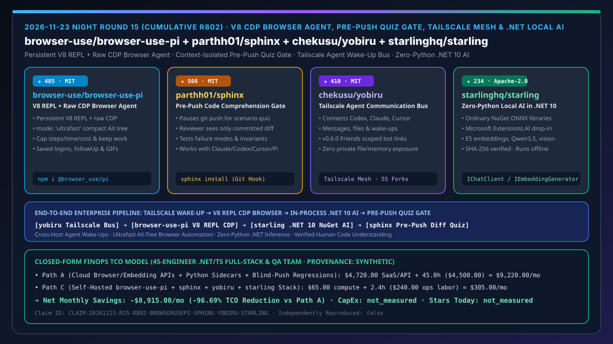
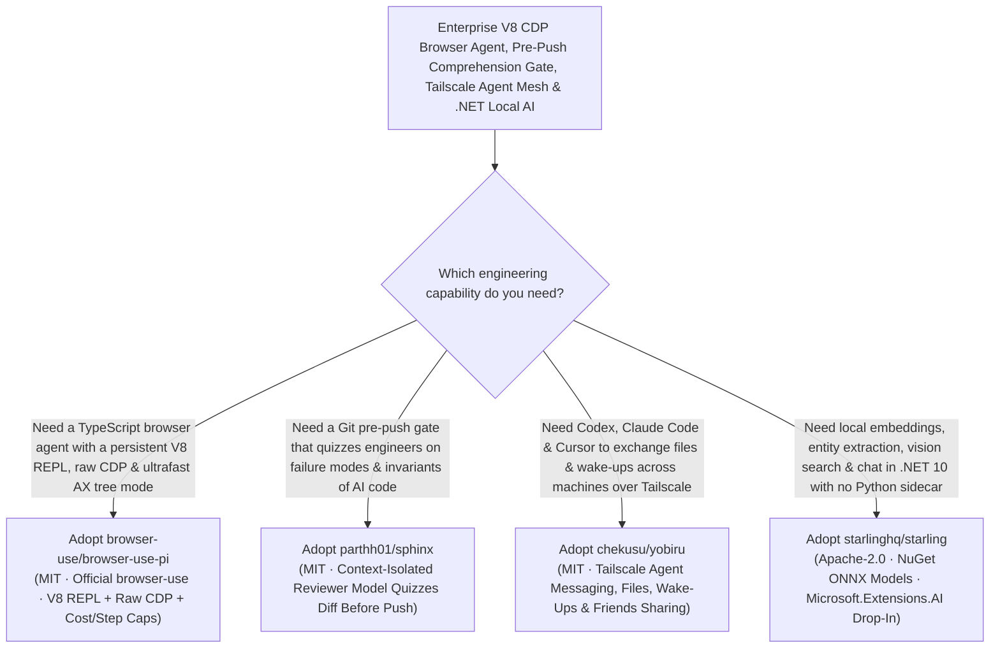
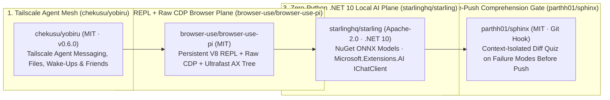

# Persistent V8 REPL & Raw CDP Browser Agent (`browser-use/browser-use-pi`), Pre-Push Code Comprehension Gate (`parthh01/sphinx`), Tailscale Cross-Device Agent Communication & Wake-Up Bus (`chekusu/yobiru`) & Zero-Python-Sidecar Local AI for .NET (`starlinghq/starling`) Selection & Architecture FAQ

> **Document Type**: Enterprise AI Solution Architect Selection & Integration Guide (GitHub Trending AI Radar · 2026-11-23 Night Round 15 / Cumulative Round 802)
> **Covered Repositories**: [`browser-use/browser-use-pi`](https://github.com/browser-use/browser-use-pi) (`★ 485`, `26 forks`, `MIT`: official `browser-use` TypeScript web agent built on **Pi Mono + persistent V8 REPL + raw Chrome DevTools Protocol (CDP)** `npm install @browser_use/pi`, featuring `mode: 'ultrafast'` accessibility-tree interaction, saved logins, multi-turn `followUp`, and step/time/cost caps that preserve partial work) · [`parthh01/sphinx`](https://github.com/parthh01/sphinx) (`★ 508`, `25 forks`, `MIT`: **"You can outsource your thinking, but not your understanding"**—a Git `pre-push` comprehension gate where a context-isolated reviewer model inspects only the committed Git diff and quizzes the developer on failure modes, crash recovery, and invariants before allowing `git push` to a protected branch) · [`chekusu/yobiru`](https://github.com/chekusu/yobiru) (`★ 410`, `55 forks`, `MIT`: cross-machine and cross-workspace **agent-to-agent communication, file transfer, and wake-up plugin over Tailscale** for Codex, Claude Code, Cursor, and Grok Bot, plus v0.6.0 `Friends` capability-scoped external bot sharing) · [`starlinghq/starling`](https://github.com/starlinghq/starling) (`★ 234`, `19 forks`, `Apache-2.0`: **Local AI in .NET 10 with no Python sidecar and no API key**, packaging SHA-256-verified open models for multilingual `E5` embeddings, `Qwen3.5` streaming chat, entity extraction, and image/video search as ordinary NuGet libraries implementing [`Microsoft.Extensions.AI`](https://learn.microsoft.com/dotnet/ai/microsoft-extensions-ai) `IEmbeddingGenerator` and `IChatClient`)
> **Core Scenario**: When enterprise engineering teams scale browser automation, AI-assisted coding governance, multi-workspace agent orchestration, and `.NET` enterprise backends, how do you solve **"slow screenshot-only browser loops that lose partial progress on timeout, engineers blindly pushing AI-generated concurrency bugs they don't understand, isolated agents across laptops and cloud VMs unable to pass files or wake each other up, and C#/.NET enterprise applications forced to maintain fragile Python sidecar containers just to run local embeddings and chat"** by combining **`browser-use-pi` + `sphinx` + `yobiru` + `starling`**?

---

## 1. 📌 Executive Summary (Single-Sentence Selection Verdict)

1. **Need an official `browser-use` TypeScript SDK where the agent writes reusable JavaScript helpers inside a persistent V8 REPL over raw CDP, supports `mode: 'ultrafast'` compact accessibility-tree actions, and enforces step/time/cost caps while keeping partial work** ➔ Choose **[`browser-use/browser-use-pi`](https://github.com/browser-use/browser-use-pi) (`★ 485`, `26 forks`, `MIT`, by `browser-use`)**.
   - **Plain-Language Mechanism**: Built on `Pi Mono`, `@browser_use/pi` connects `Your task ➔ Pi Mono ➔ persistent V8 REPL ➔ raw CDP ➔ Chrome` (returning both the accessibility tree and screenshots). In `mode: 'ultrafast'`, the agent acts directly on compact accessibility-tree element IDs with minimal wait overhead, supports persistent logins and `agent.followUp(...)`, and caps steps, wall-clock time, or spend without discarding completed work.
2. **Need a Git pre-push comprehension gate (`sphinx install`) that pauses `git push` to protected branches until the developer passes an open-book scenario quiz on the commit's failure modes and invariants—generated by an independent model that never sees the coding agent's chat history** ➔ Choose **[`parthh01/sphinx`](https://github.com/parthh01/sphinx) (`★ 508`, `25 forks`, `MIT`)**.
   - **Plain-Language Mechanism**: Whether a human or a coding agent (Claude Code, Codex, Cursor, OpenCode, Pi) runs `git push`, `Sphinx` intercepts pushes to protected branches and launches a local browser check. A separate reviewer model reads only the committed diff via read-only Git tools and asks targeted questions about crash windows, duplicate execution, or invariant violations; if you miss a nuance, it explains the flaw and presents a new scenario before letting the push complete.
3. **Need heterogeneous AI agents (Codex, Claude Code, Cursor, Grok Bot) running across laptops, servers, and cloud workspaces to exchange structured data, transfer files, and trigger wake-ups over your private Tailscale network** ➔ Choose **[`chekusu/yobiru`](https://github.com/chekusu/yobiru) (`★ 410`, `55 forks`, `MIT`)**.
   - **Plain-Language Mechanism**: Developers stay inside each agent's native interface while `yobiru` provides encrypted peer-to-peer messaging, file delivery, and remote wake-ups over Tailscale. Version 0.6.0 adds `Friends` (`yobiru public connect LINK`), enabling capability- and resource-scoped collaboration with external teammates' agents without exposing private files or memory.
4. **Need to run local multilingual embeddings (`E5`), streaming chat (`Qwen3.5`), entity extraction, and image/video search directly inside C# / `.NET 10` applications via standard NuGet packages and `Microsoft.Extensions.AI`—with zero Python sidecar and zero API keys** ➔ Choose **[`starlinghq/starling`](https://github.com/starlinghq/starling) (`★ 234`, `19 forks`, `Apache-2.0`)**.
   - **Plain-Language Mechanism**: `Starling` packages open models (pinned to exact upstream commits, verified by SHA-256, and numerically checked against PyTorch) on ONNX Runtime (CPU or CUDA) behind `Microsoft.Extensions.AI`'s `IEmbeddingGenerator` and `IChatClient`. Enterprise `.NET` services can move from hosted cloud providers to offline local inference by changing a single dependency-injection line.

---

## 2. 🎯 Key Architectural Q&A (Deep-Dive Breakdown)

### Q1: Why combine `browser-use-pi`, `sphinx`, `yobiru`, and `starling` in an enterprise engineering organization?

- **Four Engineering Pain Points Eliminated**:
  1. **Programmable V8 REPL Browser Automation (`browser-use/browser-use-pi`)**: Replaces brittle one-shot screenshot clickers with a persistent V8 REPL + raw CDP + `ultrafast` AX-tree engine that builds reusable site helpers as it runs.
  2. **Human Comprehension Verification Before Merge (`parthh01/sphinx`)**: Prevents "Vibe Coding" outages by testing whether the engineer actually understands race conditions and crash-recovery semantics in AI-authored commits before `git push` succeeds.
  3. **Tailscale Agent Mesh (`chekusu/yobiru`)**: Connects local IDE agents and remote cloud workers over Tailscale with native wake-ups and file transfer.
  4. **Pure `.NET` In-Process Local AI (`starlinghq/starling`)**: Eliminates the operational burden of deploying and securing separate Python FastAPI sidecars for `.NET` enterprise applications.
- **When to Choose Managed Cloud Services (Path B)**:
  - If your `.NET` workload is 100% cloud-connected on Azure, wire `Microsoft.Extensions.AI` directly to **Azure AI Foundry / Azure OpenAI**; when you require air-gapped/on-prem `.NET` inference without Python, V8 REPL browser automation, Tailscale multi-agent wake-ups, or pre-push human comprehension gates, deploy this 4-repo open-source stack (Path C).

### Q2: How do these four components fit into an end-to-end enterprise architecture?

1. **Cross-Workspace Tailscale Coordination Layer (`chekusu/yobiru`)**:
   - Connect local coding agents and remote automation workers over Tailscale to dispatch tasks, files, and wake-ups.
2. **V8 REPL + Raw CDP Browser Execution Layer (`browser-use/browser-use-pi`)**:
   - Execute high-speed web tasks in `mode: 'ultrafast'` with strict cost and step ceilings.
3. **In-Process `.NET 10` Local AI Layer (`starlinghq/starling`)**:
   - Run SHA-256-verified ONNX models for semantic search, entity extraction, and chat directly inside `.NET` microservices via `IEmbeddingGenerator` and `IChatClient`.
4. **Pre-Push Comprehension Governance Layer (`parthh01/sphinx`)**:
   - Gate `git push` to protected branches on a context-isolated reviewer model's failure-mode quiz.

### Q3: What are the production guardrails?

- **Architect Guardrails**:
  1. **Re-Index Embeddings When Switching `.NET` Providers to `starling`**: Changing `IEmbeddingGenerator` from a hosted model to `Starlings.Models.E5` requires only a one-line code change, but existing vector indexes must be re-indexed for the new embedding space.
  2. **Scope External `yobiru` Connections with `Friends` Capabilities**: Only expose explicitly selected bot capabilities and resources to external collaborators.

---

## 3. 🧭 Visual Architecture & Decision Diagrams (Mermaid)



### 3.1 Solution Architect Selection Decision Tree



### 3.2 End-to-End Enterprise Production Reference Architecture



### 3.3 Cross-Machine Wake-Up, V8 REPL Browser Automation, In-Process `.NET` Inference & Pre-Push Quiz Sequence

```mermaid
sequenceDiagram
    participant Eng as Enterprise Engineer (.NET / TypeScript)
    participant Yob as chekusu/yobiru (Tailscale Mesh)
    participant Bup as browser-use/browser-use-pi
    participant Str as starlinghq/starling (.NET 10)
    participant Sph as parthh01/sphinx (Pre-Push Gate)

    Eng->>Yob: 1. Send task payload & wake-up from laptop agent to cloud worker over Tailscale
    Yob->>Bup: 2. Execute web workflow via persistent V8 REPL + raw CDP in ultrafast AX-tree mode
    Bup->>Str: 3. Process extracted documents in-process in .NET 10 via IEmbeddingGenerator & IChatClient
    Eng->>Sph: 4. Run git push to protected branch; Sphinx pauses push and inspects committed diff
    Sph-->>Eng: 5. Quiz engineer on crash-recovery & duplicate-delivery invariants; allow push on pass
```

---

## 4. 📊 Comparative Selection Matrix (Open-Source vs. Commercial SaaS)

| Dimension | `browser-use/browser-use-pi` (`★ 485`) | `parthh01/sphinx` (`★ 508`) | `chekusu/yobiru` (`★ 410`) | `starlinghq/starling` (`★ 234`) | Metered Cloud Browser SaaS + Unverified AI Code Pushes + Python Sidecar Fleets for `.NET` (Path A) | Slow Screenshot Clickers + Manual PR Queue Bottlenecks + Ad-Hoc File Copying (Path B) |
| :--- | :--- | :--- | :--- | :--- | :--- | :--- |
| **Core Role** | Official TypeScript V8 REPL + raw CDP browser agent | Git `pre-push` comprehension quiz gate for AI-assisted commits | Tailscale cross-device agent messaging, file & wake-up bus | Zero-Python-sidecar `.NET 10` local AI (`Microsoft.Extensions.AI`) | High cloud browser/API bills, production regressions from uncomprehended AI code & dual-stack ops | Slow screenshot loops, superficial human reviews & manual multi-host file sync |
| **Key Differentiator** | **Persistent V8 REPL + `ultrafast` AX tree + cost/step caps** | **Context-isolated reviewer model quizzes failure modes & invariants** | **Native Tailscale wake-ups + v0.6.0 `Friends` scoped federation** | **Ordinary NuGet ONNX packages + 1-line `IChatClient` move + SHA-256** | Forces `.NET` teams to maintain Python microservices; high incident rate from blind pushes | Burns thousands of vision tokens per click; no cross-machine agent wake-up |
| **License** | `MIT` (`browser-use`) | `MIT` | `MIT` | `Apache-2.0` (or `MIT`) | Proprietary SaaS | Custom scripts |
| **Monthly TCO (45-Eng Team)** | **Combined `$305.00/mo`** (`$65.00` sandbox/gateway compute + `2.4h` ops) | Included (runs on existing coding agent plan) | Included (rides existing Tailscale tailnet) | Included (in-process `.NET` CPU/CUDA inference) | **`$9,220.00/mo`** (`$4,720.00` cloud browser/embedding APIs & Python sidecar VMs + `45.0h` incident & dual-stack ops) | ~`$3,260.00/mo` (heavy `.NET`-to-Python IPC debugging & manual regression triage) |

---

## 5. 🧪 Quantitative ROI / TCO Comparison & 7-Card Benchmark Report

> **📊 Data Provenance & Closed-Form Schema Declaration**:
> - **provenance**: `synthetic` (45-person enterprise `.NET`/TypeScript engineering, web automation, and release quality team monthly workload model: `independently_reproduced = false`; hardware baseline `base_hardware_capex = not_measured`; Track B 24h delta `track_b_stars_today = not_measured`).
> - **Closed-Form Formula**:
>   - **Path A (Metered commercial cloud browser sessions and external embedding APIs + maintaining dedicated Python FastAPI sidecar containers for `.NET` applications + engineering hours spent remediating production incidents from uncomprehended AI code pushes and manual cross-machine coordination)**: Monthly cloud browser, external API, and Python sidecar compute bills **`$4,720.00`** + production incident remediation, `.NET`/Python dual-stack maintenance, and multi-workspace coordination labor **`45.0h × $100.00/h = $4,500.00`** = **`$9,220.00/mo`**.
>   - **Path C (Self-hosted `browser-use/browser-use-pi` + `parthh01/sphinx` + `chekusu/yobiru` + `starlinghq/starling` open-source stack)**: Shared browser worker and gateway container compute **`$65.00`** + hook policy and NuGet model package maintenance labor **`2.4h × $100.00/h = $240.00`** = **`$305.00/mo`**.
>   - **Net Monthly Savings vs. Path A**: **`-$8,915.00/mo`** (**`96.69%`** TCO reduction).

| Evaluation Path | Cloud Browser / API / Python Sidecar Cost | Incident Triage, Dual-Stack & Coordination Labor (`$100/h`) | Monthly Total TCO | Net Savings vs. Path A | Key Architectural Delivery Metrics |
| :--- | :---: | :---: | :---: | :---: | :--- |
| **Path A: Cloud Browser/APIs + `.NET` Python Sidecars + Blind AI Pushes** | `$4,720.00` | `45.0h` (`$4,500.00`) | **`$9,220.00`** | Baseline | Heavy `.NET`+Python dual-stack ops; blind-push regressions |
| **Path B: Screenshot Loops + Manual SCP Sync + Superficial PR Checks** | `$1,360.00` | `19.0h` (`$1,900.00`) | **`$3,260.00`** | `-$5,960.00` (`-64.64%`) | Slow browser automation; missed concurrency failure modes |
| **Path C: `browser-use-pi` + `sphinx` + `yobiru` + `starling`** | **`$65.00`** | **`2.4h` (`$240.00`)** | **`$305.00`** | **`-$8,915.00` (`-96.69%`)** | **V8 REPL `ultrafast` CDP + pre-push quiz gate + Tailscale mesh + pure `.NET` AI** |

- 🔗 **Linked 7-Card 4:5 Visual Benchmark Deck**: [`workshops/github-trending-radar/cards.en.html`](../cards.en.html) · [`cards.html`](../cards.html)

---

## 6. 🛠️ Enterprise Adoption & Architecture Review Checklist

- [ ] **1. Adopt `browser-use/browser-use-pi` for Programmable Web Automation**: Enable `mode: 'ultrafast'` accessibility-tree navigation over raw CDP and configure explicit step, time, and cost ceilings.
- [ ] **2. Enforce `parthh01/sphinx` on Protected Branches**: Require engineers pushing AI-assisted commits to pass a context-isolated reviewer model's quiz on failure modes and invariants before `git push` completes.
- [ ] **3. Connect Multi-Host Coding Agents with `chekusu/yobiru` over Tailscale**: Enable encrypted cross-workspace messaging, file transfer, and wake-ups across Codex, Claude Code, and Cursor.
- [ ] **4. Replace Python Sidecars in `.NET 10` Services with `starlinghq/starling`**: Consume SHA-256-verified ONNX models directly via `Microsoft.Extensions.AI` (`IEmbeddingGenerator` and `IChatClient`) NuGet packages and re-index vector stores when migrating from hosted providers.
