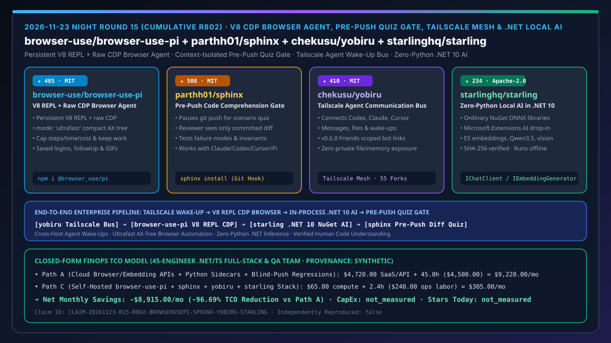
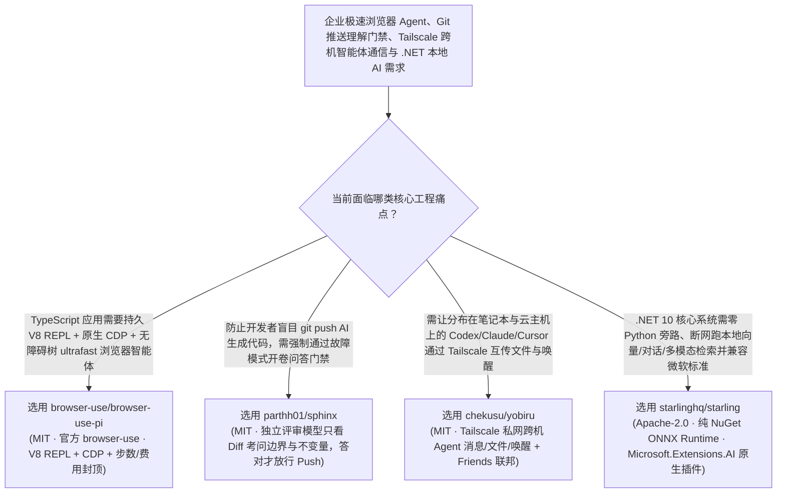
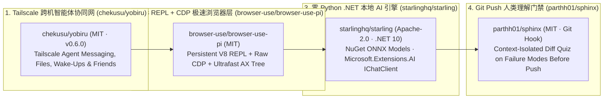
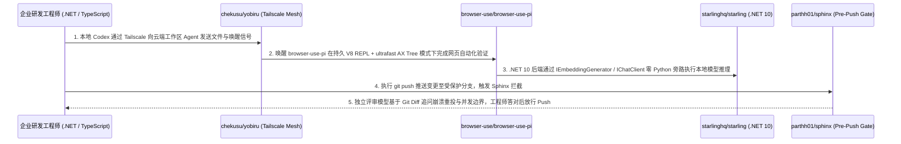

# 基于持久 V8 REPL 与原生 CDP 的极速无障碍树浏览器智能体（`browser-use/browser-use-pi`）、Git Push 前强制人工回答故障场景理解测试的代码门禁（`parthh01/sphinx`）、基于 Tailscale 的跨主机异构智能体文件/唤醒通信网（`chekusu/yobiru`）与零 Python 旁路原生对接 `Microsoft.Extensions.AI` 的 .NET 本地模型库（`starlinghq/starling`）选型与集成架构 FAQ

> **文档类型**：企业 AI 解决方案架构师（AI Solution Architect）选型决策指南（GitHub Trending AI 雷达 2026-11-23 Night Round 15 / 累计第 802 轮）
> **覆盖项目**：[`browser-use/browser-use-pi`](https://github.com/browser-use/browser-use-pi)（`★ 485`、`26 forks`、`MIT`：官方 `browser-use` 团队基于 `Pi Mono` 打造的 TypeScript 浏览器智能体 `npm install @browser_use/pi`，打通**持久化 V8 REPL + 原生 Chrome DevTools Protocol (CDP) + 无障碍树（AX Tree）`ultrafast` 极速模式**，支持步数/时长/预算硬顶与半途成果保留）· [`parthh01/sphinx`](https://github.com/parthh01/sphinx)（`★ 508`、`25 forks`、`MIT`：主打“**你可以外包思考，但不能外包理解**”的 Git `pre-push` 理解力门禁，在开发者或智能体向受保护分支执行 `git push` 时，由**完全不看历史对话、只看 Diff** 的独立评审模型针对并发故障、崩溃重投等边界场景向人类提问，答对才放行推送）· [`chekusu/yobiru`](https://github.com/chekusu/yobiru)（`★ 410`、`55 forks`、`MIT`：基于私有 **Tailscale** 网络的跨设备/跨云工作区异构智能体通信与唤醒插件，让笔记本上的 Codex、服务器上的 Claude Code 与手机端的 Grok Bot 互传消息、结构化数据、文件并触发唤醒，v0.6.0 新增 `Friends` 细粒度外部智能体联邦互联）· [`starlinghq/starling`](https://github.com/starlinghq/starling)（`★ 234`、`19 forks`、`Apache-2.0`：**零 Python Sidecar、零 API Key 的 .NET 10 原生本地 AI 模型库**，将经 SHA-256 校验的 E5 多语言向量、Qwen3.5 流式对话、实体抽取及图文视频检索封装为标准 NuGet 包，一行代码无缝接入微软官方 [`Microsoft.Extensions.AI`](https://learn.microsoft.com/dotnet/ai/microsoft-extensions-ai) 的 `IEmbeddingGenerator` 与 `IChatClient`）
> **核心场景**：当企业研发与平台团队推进全栈 AI 工程化时，面对**“传统浏览器 Agent 靠全屏截图点按又慢又容易因超时丢弃已完成进度、工程师盲目 `git push` AI 生成的复杂并发代码却根本不懂崩溃恢复边界导致生产事故、散落在本地笔记本与远端云开发机上的异构 Agent 无法安全传文件与互相唤醒、以及企业存量 C#/.NET 核心业务系统想用本地模型却被迫额外维护一套脆弱的 Python FastAPI 旁路服务”**四大痛点，如何通过 **Browser-Use-Pi + Sphinx + Yobiru + Starling** 构建可控、可懂、互联、原生的企业工程体系？

---

## 一、📌 核心结论速览（选型一句话结论）

1. **想在 TypeScript/Node/Bun 应用中内嵌官方 `browser-use` 浏览器智能体，既要让 Agent 在持久化 V8 REPL 里直接写 JS 调原生 CDP 并边跑边沉淀复用函数，又要开启 `ultrafast` 紧凑无障碍树（AX Tree）极速模式与费用/步数封顶保护** ➔ 选 **[`browser-use/browser-use-pi`](https://github.com/browser-use/browser-use-pi)（`★ 485`，`26 forks`，`MIT`）**。
   - **通俗原理**：不同于每步都走慢速 HTTP 截图问答的传统方案，`browser-use-pi` 采用 **`Task ➔ Pi Mono ➔ 持久 V8 REPL ➔ 原生 CDP ➔ Chrome（回传 AX Tree + 截图）`** 闭环：智能体在持久 V8 沙箱中实时编写并累积针对目标站点的专用辅助函数；开启 `mode: 'ultrafast'` 后直接对紧凑无障碍树节点 ID 高速操作，且支持保存登录态、多轮 `followUp` 以及设置步数/时间/成本上限（触顶时完整保留已完成的部分成果）。
2. **想彻底治理“Vibe Coding 盲目推送综合症”——防止工程师看都不看就把 Claude Code / Codex / Cursor 写出的数百行代码直接 `git push` 到生产分支，强制要求人类在推送前通过“故障模式与不变量开卷小测验”** ➔ 选 **[`parthh01/sphinx`](https://github.com/parthh01/sphinx)（`★ 508`，`25 forks`，`MIT`）**。
   - **通俗原理**：执行 `sphinx install` 挂载全局 Git Hook 后，每当人类或编码 Agent 向受保护分支执行 `git push` 时，推送会暂停并弹出本地问答页。一个**完全隔离于原编码对话上下文**的独立 Reviewer 模型仅通过只读 Git 工具审阅本次 Commit Diff，专门挑出“Worker 提交事务后在 ACK 前崩溃是否会重复执行？”等行为边界、故障恢复与系统不变量问题考问开发者；答错会给出原理解释并换一道新场景题重考，答对后同一个 `git push` 才会继续放行！
3. **想让分布在不同开发机、云服务器与手机上的异构智能体（Codex、Claude Code、Cursor、Grok Bot）在各自的原生界面里通过企业私有 Tailscale 内网互发结构化数据、传输文件、请求唤醒，或通过细粒度授权链接与合作伙伴的 Agent 安全对话** ➔ 选 **[`chekusu/yobiru`](https://github.com/chekusu/yobiru)（`★ 410`，`55 forks`，`MIT`）**。
   - **通俗原理**：无需把所有 Agent 塞进同一个第三方网页聊天室，你依然在终端用 Claude Code、在 IDE 用 Cursor；`yobiru` 在底层通过你的 Tailscale 虚拟局域网打通点对点消息、文件投递与任务完成自动唤醒（Wake-up）。v0.6.0 新增的 `Friends` 机制支持按单个能力与单个资源生成分享链接（绝不暴露私有文件或记忆），让外部协作者的 Agent 与你指定的 Bot 联邦协作。
4. **想在企业级 C# / .NET 10 生产系统中直接运行多语言向量检索（E5）、流式对话（Qwen3.5）、实体抽取与图像/视频搜索，既不要额外部署 Python 旁路容器（No Python Sidecar），又要一行代码无缝兼容微软官方 `Microsoft.Extensions.AI` 标准接口** ➔ 选 **[`starlinghq/starling`](https://github.com/starlinghq/starling)（`★ 234`，`19 forks`，`Apache-2.0`）**。
   - **通俗原理**：许多企业核心 ERP/金融后台是纯 `.NET` 技术栈，以前为了跑一个 Embedding 或小模型不得不额外维护一套 Python 微服务。`Starling` 将开源模型打包为标准 NuGet 库（基于 ONNX Runtime CPU/CUDA 运行，每个模型锁定上游 Commit、校验 SHA-256 并与原始 PyTorch 输出对齐验证），原生实现 `Microsoft.Extensions.AI` 的 `IEmbeddingGenerator` 与 `IChatClient`——只需改一行依赖注入代码，就能从云端托管 API 切换为完全断网可用的本地 `.NET` 模型推理！

---

## 二、🎯 客户与架构师灵魂拷问 Q&A（深度架构拆解）

### Q1：在企业研发团队中，为什么光有代码扫描（Linter / SAST）不够，还必须在 `git push` 挂载 `parthh01/sphinx`？

- **静态扫描 vs 人类架构理解门禁的本质区别**：
  1. **AI 生成的代码往往语法完美、单测全绿，但隐含致命的分布式并发/幂等漏洞**：正如 `sphinx` 官方案例所示，AI 写出的后台队列代码在正常路径下完全正确，但“先 Commit 业务操作、后发队列 ACK”的顺序在进程崩溃或可见性超时（Visibility Timeout）下会导致重复扣款。静态 Linter 永远抓不出这类业务语义缺陷。
  2. **切断“生成者自我辩护偏差”**：`sphinx` 的出题模型严禁读取生成该段代码时的聊天上下文，只看最终 Git Diff，通过开卷情景追问逼迫负责合并代码的工程师真正读懂故障边界。
- **何时直接选用微软官方云托管组件（Path B）？**
  - 若 `.NET` 团队全部运行在 Azure 云端且无需离线部署，可直接通过 `Microsoft.Extensions.AI` 对接 **Azure AI Foundry / Azure OpenAI**；若需断网/私有化 `.NET` 零 Python 依赖推理（或从 Azure 平滑切回本地 E5/Qwen3.5）、跨设备 Tailscale 智能体协同、V8 REPL 极速浏览器操控以及 Git 推送前的人类理解门禁，则引入本轮四合一开源栈（Path C）。

### Q2：典型企业级“跨端唤醒协同 (`yobiru`) ➔ 持久 V8 极速浏览器采集 (`browser-use-pi`) ➔ `.NET` 原生本地向量/对话处理 (`starling`) ➔ 人类理解门禁放行 (`sphinx`)”参考架构怎么搭？

1. **跨主机 Tailscale 智能体通信与唤醒层（`chekusu/yobiru`）**：
   - 将本地开发机的 Cursor/Codex 与云端工作区的自动化 Agent 通过 Tailscale 组网，支持大文件直传与异步任务完成唤醒。
2. **持久 V8 REPL + 原生 CDP 极速网页交互层（`browser-use/browser-use-pi`）**：
   - 云端 Agent 调用 `@browser_use/pi`（开启 `mode: 'ultrafast'` 无障碍树模式与预算硬顶），在持久 V8 REPL 中编写复用脚本完成外部系统核验。
3. **零 Python 旁路 `.NET 10` 本地 AI 推理层（`starlinghq/starling`）**：
   - 企业核心 `.NET` 后端通过 NuGet 引入 `Starlings.Models`，基于 `IEmbeddingGenerator` 与 `IChatClient` 在本地 ONNX Runtime 上完成多语言文档语义检索、图像/视频检索与流式问答。
4. **Git 推送前独立模型理解力测试门禁层（`parthh01/sphinx`）**：
   - 当 Agent 或开发者尝试将代码变更 `git push` 至受保护分支时，`sphinx` 拦截推送并针对幂等性、异常回滚与边界条件发起开卷问答，验证通过后放行入库。

### Q3：这套架构的落地红线与注意事项是什么？

- **架构师落地红线**：
  1. **从云端 Embedding 切换至 `starling` 本地 E5 模型时必须重建向量索引（Re-indexing）**：虽然 `IEmbeddingGenerator` 调用代码仅需改一行，但不同模型的向量空间不兼容，切勿混用新旧向量库。
  2. **`yobiru` 跨组织互联必须使用 `Friends` 显式能力白名单**：对外部合作伙伴仅开放单 Bot 绑定与指定资源权限，严禁共享本地私有文件系统。

---

## 三、🧭 直观可视化图解（Mermaid 决策树 + 集成架构 + 时序图）

### 3.1 架构师选型决策树

### 3.2 企业端到端生产集成参考架构图

### 3.3 跨机唤醒、V8 REPL 极速网页操作、`.NET` 本地语义处理与 Git Push 理解测验时序图

---

## 四、📊 同类开源与商业云服务横向选型决策矩阵

| 对比维度 | `browser-use/browser-use-pi` (`★ 485`) | `parthh01/sphinx` (`★ 508`) | `chekusu/yobiru` (`★ 410`) | `starlinghq/starling` (`★ 234`) | 商业云浏览器按分钟计费 + 盲推 AI 代码引发线上回滚 + 自建 Python 旁路微服务集群 (Path A) | 传统逐帧截图脚本 + 人工拉会做 Code Review + 手工 SCP 拷文件 (Path B) |
| :--- | :--- | :--- | :--- | :--- | :--- | :--- |
| **核心能力定位** | 持久 V8 REPL + 原生 CDP + `ultrafast` AX Tree 浏览器智能体 | Git `pre-push` 独立模型代码故障边界理解测验门禁 | 基于 Tailscale 的跨主机异构 Agent 消息/文件/唤醒网 | 零 Python 旁路、原生实现 `Microsoft.Extensions.AI` 的 `.NET` 本地模型库 | 昂贵的云浏览器时长账单、因不理解 AI 代码导致的生产故障与双语言栈运维开销 | 慢速截图脚本、冗长的人工评审排队与割裂的多机协作 |
| **核心技术突破** | **智能体在 V8 REPL 边跑边写辅助函数 + `ultrafast` 无障碍树** | **评审模型不看原对话只看 Diff，专考崩溃恢复与并发不变量** | **复用 Tailscale 内网跨机唤醒 + `Friends` 按资源细粒度联邦** | **普通 NuGet 包直跑 ONNX + 一行代码切换 `IChatClient` + SHA-256 校验** | `.NET` 团队被迫额外部署和监控一套 Python FastAPI 容器；盲推代码故障率高 | 全屏截图每步耗费数千 Token；跨设备传上下文全靠人工复制粘贴 |
| **开源协议** | `MIT`（browser-use 官方） | `MIT` | `MIT` | `Apache-2.0`（或 `MIT`） | 闭源商业 SaaS | 内部零散脚本 |
| **月度 TCO（45 人团队）** | **组合仅 `$305.00/月`**（`$65.00` 轻量容器与网关分摊 + `2.4h` 维护） | 同左（复用现有 Claude/Codex 额度） | 同左（直走现有 Tailscale 内网） | 同左（进程内本地推理零 API 费） | **`$9,220.00/月`**（`$4,720.00` 云浏览器/向量 API/Python 旁路容器账单 + `45.0h` 盲推事故抢修与跨栈排障） | 约 `$3,260.00/月`（大量 `.NET` 与 Python 跨进程序列化排障及人工回归工时） |

---

## 五、🧪 应用落地定量收益/TCO 对比与 7-Card 报告

> **📊 数据来源与闭式核算声明（Provenance & Closed-Form Schema）**：
> - **provenance**: `synthetic`（基于 45 人企业全栈 `.NET`/TypeScript 研发、Web 自动化与代码质量工程团队月度工作负载模型：`independently_reproduced = false`；硬件采购基线 `base_hardware_capex = not_measured`；Track B 单日增量 `track_b_stars_today = not_measured`）。
> - **核算公式**：
>   - **Path A（按分钟购买高价商业云浏览器与外部 Embedding API + 为 `.NET` 业务系统额外维护一套 Python Sidecar 微服务集群 + 工程师未读懂 AI 生成代码盲目推送引发线上并发事故抢修与多机手工同步工时）**：月度商业云浏览器、外部向量 API 与冗余 Python 容器账单 **`$4,720.00`** + 线上并发故障抢修、`.NET`/Python 双栈联调与多机协作人工 **`45.0h × $100.00/h = $4,500.00`** = **`$9,220.00/月`**。
>   - **Path C（自建 `browser-use/browser-use-pi` + `parthh01/sphinx` + `chekusu/yobiru` + `starlinghq/starling` 开源全栈）**：本地浏览器沙箱与内网网关分摊成本 **`$65.00`** + 门禁策略与 NuGet 模型包升级维护人工 **`2.4h × $100.00/h = $240.00`** = **`$305.00/月`**。
>   - **净节省（Net Savings vs Path A）**：**`-$8,915.00/月`**（成本降低 **`96.69%`**）。

| 评估方案 | 云浏览器 / 外部向量 API / Python 旁路容器成本 | 故障抢修、双栈联调与多机协同人工（`$100/h`） | 月度总 TCO | 相对 Path A 净节省 | 关键架构交付指标 |
| :--- | :---: | :---: | :---: | :---: | :--- |
| **Path A：商业云浏览器 + `.NET` 挂 Python 旁路容器 + 无理解门禁盲推** | `$4,720.00` | `45.0h` (`$4,500.00`) | **`$9,220.00`** | Baseline | 双语言栈运维沉重；AI 生成代码盲推易引发并发事故 |
| **Path B：慢速截图脚本 + 手工跨机拷文件 + 人工抽查 PR** | `$1,360.00` | `19.0h` (`$1,900.00`) | **`$3,260.00`** | `-$5,960.00` (`-64.64%`) | 浏览器交互延迟高；代码审查流于表面命名而非故障边界 |
| **Path C：`browser-use-pi` + `sphinx` + `yobiru` + `starling`** | **`$65.00`** | **`2.4h` (`$240.00`)** | **`$305.00`** | **`-$8,915.00` (`-96.69%`)** | **V8 REPL `ultrafast` 浏览器 + Push 理解门禁 + Tailscale 互联 + 纯 `.NET` 本地 AI** |

- 🔗 **关联 7-Card 4:5 视觉评测报告**：[`workshops/github-trending-radar/cards.html`](../cards.html) · [`cards.en.html`](../cards.en.html)

---

## 六、🛠️ 企业引入与架构评审 Checklist

- [ ] **1. 在 TypeScript 自动化服务中集成 `browser-use/browser-use-pi`**：启用持久 V8 REPL 与 `mode: 'ultrafast'` 无障碍树模式，并显式配置步数、时长与预算硬顶。
- [ ] **2. 在研发团队终端统一安装 `parthh01/sphinx` 全局 Git `pre-push` 门禁**：确保任何由 AI 辅助生成并推送到受保护分支的代码变更，提交者必须通过独立模型关于故障恢复与不变量的场景问答。
- [ ] **3. 基于企业 Tailscale 网络部署 `chekusu/yobiru`**：打通开发机与云端工作区之间 Codex、Claude Code 与 Cursor 的文件互传与异步唤醒，跨团队协作统一走最小权限的 `Friends` 绑定。
- [ ] **4. 在 `.NET 10` 核心服务中引入 `starlinghq/starling` NuGet 模型包**：通过标准 `Microsoft.Extensions.AI`（`IEmbeddingGenerator` / `IChatClient`）在进程内直接运行 SHA-256 校验的本地 ONNX 模型，彻底下线冗余的 Python Sidecar 容器。
