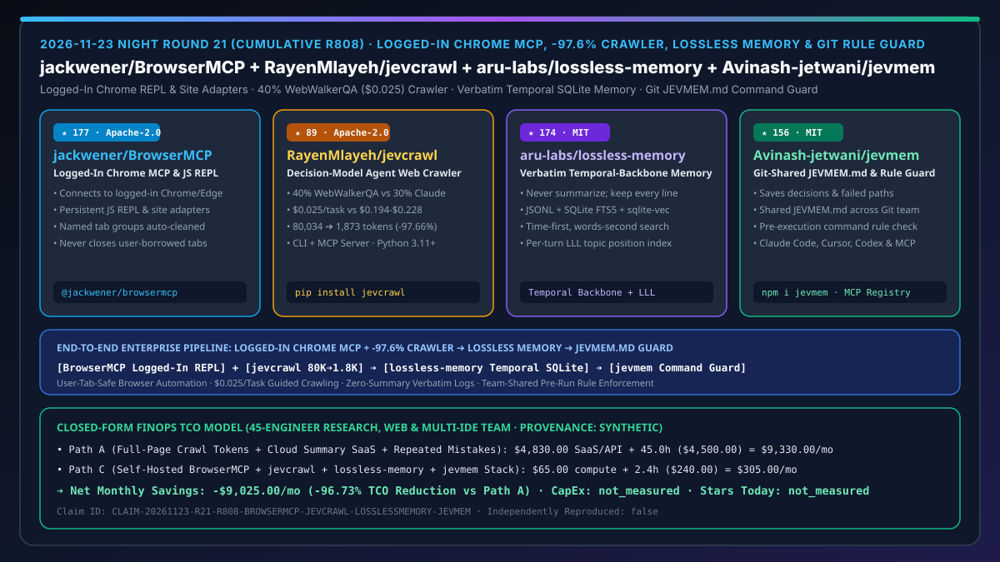
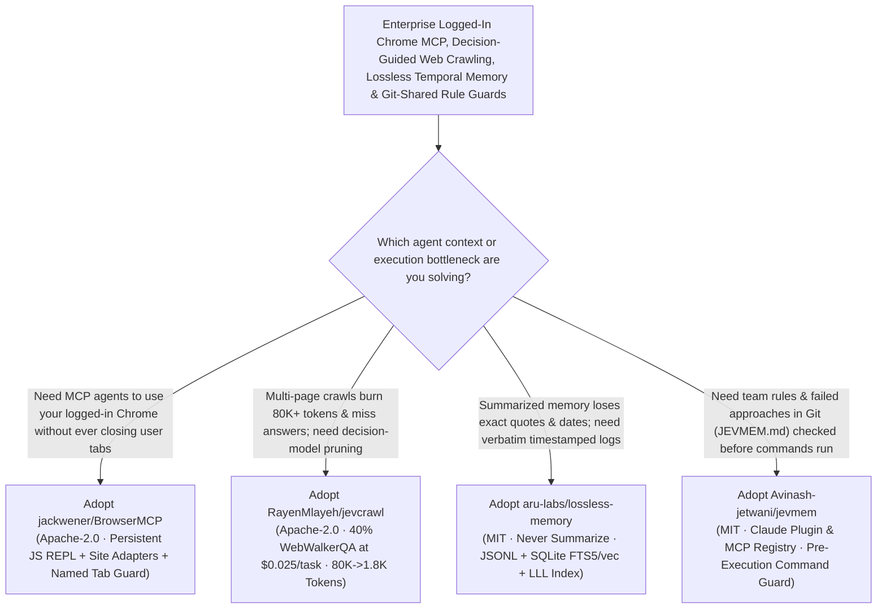
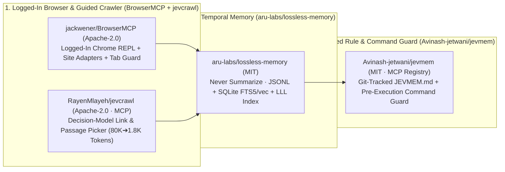

# Logged-In Chrome Persistent JS REPL & Site Adapters (`jackwener/BrowserMCP`), Decision-Model-Guided `-97.6%` Token Web Crawler (`RayenMlayeh/jevcrawl`), Zero-Summarization Temporal-Backbone Long-Term Memory (`aru-labs/lossless-memory`) & Git-Shared `JEVMEM.md` Rule Guard (`Avinash-jetwani/jevmem`) Selection & Architecture FAQ

> **Document Type**: Enterprise AI Solution Architect Selection & Integration Guide (GitHub Trending AI Radar · 2026-11-23 Night Round 21 / Cumulative Round 808)
> **Covered Repositories**: [`jackwener/BrowserMCP`](https://github.com/jackwener/BrowserMCP) (`★ 177`, `17 forks`, `Apache-2.0`: browser MCP service `@jackwener/browsermcp` connected directly to your already-logged-in Chrome, Edge, or Brave via a local host and extension, offering a persistent JavaScript REPL, reusable site adapters, and named tab groups that never close user-borrowed tabs) · [`RayenMlayeh/jevcrawl`](https://github.com/RayenMlayeh/jevcrawl) (`★ 89`, `8 forks`, `Apache-2.0`: decision-model-guided web crawler and MCP server `pip install jevcrawl` that scores every link and passage—achieving **`40%` accuracy on WebWalkerQA (`54%` answer-page hit rate) at `$0.025/task`** vs. `30%` at `$0.194` for Claude-picks-every-link and `8%` at `$0.228` for BFS Crawl4AI, shrinking 6 pages from **`80,034 tokens ➔ 1,873 tokens`** in `8.3s`) · [`aru-labs/lossless-memory`](https://github.com/aru-labs/lossless-memory) (`★ 174`, `16 forks`, `MIT`: **"Never summarize, keep every line, and put a timestamp on everything"**—local JSONL + SQLite `FTS5` + `sqlite-vec` temporal-backbone memory that searches by time first, words second, and injects a compact `LLL` topic-position index on every turn) · [`Avinash-jetwani/jevmem`](https://github.com/Avinash-jetwani/jevmem) (`★ 156`, `8 forks`, `MIT`, Official Anthropic Claude Plugin Directory & MCP Registry `io.github.Avinash-jetwani/jevmem`: saves project decisions, rules, and failed approaches into a single Git-tracked `JEVMEM.md` shared across Claude Code, Cursor, and Codex, and **checks agent commands against those rules before they run**)
> **Core Scenario**: When enterprise engineering teams rely on coding and research agents every day, how do you solve **"headless browsers repeatedly failing corporate SSO/MFA or accidentally closing the user's active browser tabs, web crawlers dumping 80K+ boilerplate tokens into the main LLM at `$0.20+/query`, lossy summarization memory erasing exact historical quotes and numbers, and teammates' agents in Claude Code, Cursor, and Codex repeating the same failed approaches"** by combining **`BrowserMCP` + `jevcrawl` + `lossless-memory` + `jevmem`**?

---

## 1. 📌 Executive Summary (Single-Sentence Selection Verdict)

1. **Need MCP agents (Claude Code, Codex, OpenCode, Cursor, Claude Desktop, DeepSeek Harness `dsh`, Pi) to operate your already-logged-in Chrome/Edge/Brave tabs via a persistent JS REPL and reusable site adapters—without ever closing tabs borrowed from the user** ➔ Choose **[`jackwener/BrowserMCP`](https://github.com/jackwener/BrowserMCP) (`★ 177`, `17 forks`, `Apache-2.0`)**.
   - **Plain-Language Mechanism**: Paired with the Chrome Web Store `BrowserMCP Connector`, `@jackwener/browsermcp` gives agents a persistent JavaScript workspace inside your active logged-in session, packages verified APIs as reusable site adapters, groups agent-created tabs for clean teardown, and strictly protects user-owned tabs from ever being closed during session cleanup.
2. **Need an agent web crawler and MCP server that finds the answer page `2×` more often than Crawl4AI (`40%` vs. `30%` for Claude on WebWalkerQA) while cutting crawl token volume by `97.66%` (`80,034 ➔ 1,873 tokens`) at `$0.025/task` (`7.8×–9.1×` cheaper)** ➔ Choose **[`RayenMlayeh/jevcrawl`](https://github.com/RayenMlayeh/jevcrawl) (`★ 89`, `8 forks`, `Apache-2.0`)**.
   - **Plain-Language Mechanism**: Instead of feeding every crawled page to a frontier LLM or paying a frontier LLM to pick every link, `jevcrawl` uses a fast decision model to score links and passages so your agent's LLM reads only the exact passage that answers its question.
3. **Need a local long-term memory layer (`JSONL` + SQLite `FTS5` + `sqlite-vec`) that never summarizes, timestamps every line, filters by time expression before ranking by keywords/vectors, and injects a "where we are" (`LLL`) index every turn to survive context compaction** ➔ Choose **[`aru-labs/lossless-memory`](https://github.com/aru-labs/lossless-memory) (`★ 174`, `16 forks`, `MIT`)**.
   - **Plain-Language Mechanism**: Built on the principle that *"summaries are a map; the log is the territory,"* `lossless-memory` stores every utterance, action, and chunk verbatim on a Temporal Backbone, resolves queries like `"Yesterday evening, about the budget"` by restricting the time window first and ranking within it, and returns chronological, unsummarized lines.
4. **Need project decisions, coding rules, and failed approaches saved into a single Git-tracked `JEVMEM.md` file across Claude Code, Cursor, and Codex—with an active pre-execution guard that checks agent commands against those rules before they run** ➔ Choose **[`Avinash-jetwani/jevmem`](https://github.com/Avinash-jetwani/jevmem) (`★ 156`, `8 forks`, `MIT`, Official Claude Plugin Directory & MCP Registry)**.
   - **Plain-Language Mechanism**: `jevmem` complements per-user local memory by committing team-wide architectural decisions and known dead ends into `JEVMEM.md` in your repo, stripping common secrets before scoring, and blocking commands that violate project rules before execution.

---

## 2. 🎯 Key Architectural Q&A (Deep-Dive Breakdown)

### Q1: Why combine `lossless-memory` and `jevmem` with `BrowserMCP` and `jevcrawl` instead of using standard RAG summaries and raw BFS web crawlers?

- **Four Architectural Advantages**:
  1. **Authenticated Browser Automation Without Tab Destruction (`jackwener/BrowserMCP`)**: Reuses existing Chrome SSO sessions with persistent JS REPL state and verified site adapters while keeping user tabs safe.
  2. **Decision-Model Crawl Pruning (`RayenMlayeh/jevcrawl`)**: Compresses 80K-token multi-page crawls down to 1.8K answer tokens (`$0.025/task`, `40%` WebWalkerQA accuracy).
  3. **Verbatim Temporal Recall (`aru-labs/lossless-memory`)**: Preserves 100% of raw lines with timestamps (`FTS5` + `sqlite-vec` + `LLL` pointer) so exact numbers and rationale are never lost to summarization drift.
  4. **Git-Committed Team Guardrails (`Avinash-jetwani/jevmem`)**: Shares `JEVMEM.md` across Claude Code, Cursor, and Codex and actively blocks rule-violating commands before execution.
- **When to Choose Managed Cloud Services (Path B)**:
  - For single-turn public web search and basic cloud chat history, use **Bing Search API + Hosted Copilot Memory**; for authenticated Chrome tab MCP, `-97.6%` token multi-hop crawling, lossless timestamped local memory, and Git-shared pre-execution command guards, deploy this 4-repo open-source stack (Path C).

### Q2: How do these four components integrate into an enterprise developer & research workflow?

1. **Authenticated Browser & Site Adapter Layer (`jackwener/BrowserMCP`)**:
   - Connect coding and research agents to logged-in internal portals via Chrome extension + local host.
2. **Decision-Guided Deep Web Crawl Layer (`RayenMlayeh/jevcrawl`)**:
   - Crawl external technical documentation via `jevcrawl` MCP, returning only high-signal answer passages.
3. **Verbatim Temporal Memory Layer (`aru-labs/lossless-memory`)**:
   - Append all raw dialogue and extracted facts with timestamps into local JSONL + SQLite (`FTS5` + `sqlite-vec`) and inject the `LLL` topic index each turn.
4. **Team-Shared Rule & Command Guard Layer (`Avinash-jetwani/jevmem`)**:
   - Persist validated project rules and failed approaches into Git-tracked `JEVMEM.md` and gate every agent command before execution.

### Q3: What are the key production guardrails?

- **Architect Guardrails**:
  1. **Use Opt-In Per-Project Configuration for `jevmem`**: Ensure secret-stripping rules are active before scoring messages against external decision endpoints.
  2. **Promote Repeated `BrowserMCP` REPL Scripts into Explicit Site Adapters**: Once an authenticated workflow is verified, lock it down as a typed site adapter rather than running ad-hoc JS REPL code on every run.

---

## 3. 🧭 Visual Architecture & Decision Diagrams (Mermaid)



### 3.1 Solution Architect Selection Decision Tree



### 3.2 End-to-End Enterprise Production Reference Architecture



### 3.3 Authenticated Browser Action, Guided Passage Crawl, Lossless Temporal Archiving & Pre-Execution Guard Sequence

```mermaid
sequenceDiagram
    participant Dev as Enterprise Engineer (Claude Code / Cursor / Codex)
    participant Bmp as jackwener/BrowserMCP
    participant Jcr as RayenMlayeh/jevcrawl (MCP)
    participant Llm as aru-labs/lossless-memory
    participant Jmm as Avinash-jetwani/jevmem (JEVMEM.md)

    Dev->>Bmp: 1. Execute verified site adapter in logged-in Chrome (agent tabs isolated; user tabs protected)
    Dev->>Jcr: 2. Crawl external docs; decision model prunes 80,034 tokens down to 1,873 answer tokens ($0.0069)
    Jcr->>Llm: 3. Store verbatim lines with timestamps in JSONL + SQLite FTS5/vec; inject LLL topic pointer
    Dev->>Jmm: 4. Commit project decisions & failed approaches to Git-tracked JEVMEM.md
    Jmm-->>Dev: 5. Intercept and validate proposed agent commands against JEVMEM.md before execution
```

---

## 4. 📊 Comparative Selection Matrix (Open-Source vs. Commercial SaaS)

| Dimension | `jackwener/BrowserMCP` (`★ 177`) | `RayenMlayeh/jevcrawl` (`★ 89`) | `aru-labs/lossless-memory` (`★ 174`) | `Avinash-jetwani/jevmem` (`★ 156`) | Frontier-LLM Full-Site Crawling + Cloud Summarized Memory SaaS + Headless SSO Relogins (Path A) | Unprotected CDP Tab Scripts + BFS Crawl4AI Dumps + Unenforced `CLAUDE.md` Files (Path B) |
| :--- | :--- | :--- | :--- | :--- | :--- | :--- |
| **Core Role** | Logged-in Chrome MCP service with persistent JS REPL & site adapters | Decision-model-guided web crawler & passage selector MCP | Zero-summarization temporal-backbone memory (`JSONL`+`SQLite`) | Git-shared `JEVMEM.md` project memory & pre-execution command guard | High token waste on full-page crawls, lossy cloud summaries & repeated team mistakes | Accidental user tab closures, `8%` BFS crawl accuracy & ignored static rules |
| **Key Differentiator** | **Reuses logged-in Chrome + named tab cleanup + user tab protection** | **`40%` WebWalkerQA (`54%` page hit) at `$0.025/task` (`80K➔1.8K` tokens)** | **Keeps every line verbatim + time-first FTS5/vec + `LLL` pointer** | **Syncs failed approaches via Git `JEVMEM.md` + pre-command guard** | Frontier LLM link-picking costs `$0.194/task`; summarization erases exact past decisions | BFS crawling costs `$0.228/task` for `8%` accuracy; static markdown rules lack pre-run enforcement |
| **License** | `Apache-2.0` | `Apache-2.0` | `MIT` | `MIT` | Proprietary SaaS | Custom scripts |
| **Monthly TCO (45-Eng Team)** | **Combined `$305.00/mo`** (`$65.00` lightweight decision/scoring & local index + `2.4h` ops) | Included (`7.8×–9.1×` lower crawl token cost) | Included (100% local SQLite `FTS5` + `sqlite-vec`) | Included (shared via Git across all IDEs) | **`$9,330.00/mo`** (`$4,830.00` excess crawl tokens & cloud memory SaaS + `45.0h` SSO debugging & repeated-mistake rework) | ~`$3,280.00/mo` (frequent lost context details & cross-IDE rule drift rework) |

---

## 5. 🧪 Quantitative ROI / TCO Comparison & 7-Card Benchmark Report

> **📊 Data Provenance & Closed-Form Schema Declaration**:
> - **provenance**: `synthetic` (45-person enterprise AI engineering, technical research, and multi-IDE development team monthly workload model: `independently_reproduced = false`; hardware baseline `base_hardware_capex = not_measured`; Track B 24h delta `track_b_stars_today = not_measured`).
> - **Closed-Form Formula**:
>   - **Path A (Feeding 80K+ unfiltered crawl tokens into frontier LLMs + commercial cloud summarized-memory SaaS + engineering hours lost to headless SSO relogins, searching for details erased by lossy summaries, and teammates repeating failed approaches across different coding agents)**: Monthly excess web-crawl token spend and cloud memory SaaS bills **`$4,830.00`** + SSO relogin debugging, historical context recovery, and repeated-mistake rework labor **`45.0h × $100.00/h = $4,500.00`** = **`$9,330.00/mo`**.
>   - **Path C (Self-hosted `jackwener/BrowserMCP` + `RayenMlayeh/jevcrawl` + `aru-labs/lossless-memory` + `Avinash-jetwani/jevmem` open-source stack)**: Lightweight decision-model scoring and local storage compute **`$65.00`** + site adapter and `JEVMEM.md` rule curation labor **`2.4h × $100.00/h = $240.00`** = **`$305.00/mo`**.
>   - **Net Monthly Savings vs. Path A**: **`-$9,025.00/mo`** (**`96.73%`** TCO reduction).

| Evaluation Path | Crawl Token / Cloud Memory SaaS Cost | SSO Triage, Context Recovery & Rework Labor (`$100/h`) | Monthly Total TCO | Net Savings vs. Path A | Key Architectural Delivery Metrics |
| :--- | :---: | :---: | :---: | :---: | :--- |
| **Path A: Full-Page LLM Crawls + Lossy Cloud Summaries + Unchecked Commands** | `$4,830.00` | `45.0h` (`$4,500.00`) | **`$9,330.00`** | Baseline | `80K+` tokens/crawl; lossy summaries erase exact technical facts |
| **Path B: BFS Crawlers + Raw CDP Scripts + Static Unenforced Docs** | `$1,380.00` | `19.0h` (`$1,900.00`) | **`$3,280.00`** | `-$6,050.00` (`-64.84%`) | `8%` BFS WebWalkerQA accuracy; teammates repeat failed commands |
| **Path C: `BrowserMCP` + `jevcrawl` + `lossless-memory` + `jevmem`** | **`$65.00`** | **`2.4h` (`$240.00`)** | **`$305.00`** | **`-$9,025.00` (`-96.73%`)** | **Logged-in Chrome MCP + `-97.6%` crawl tokens + verbatim memory + `JEVMEM.md` guard** |

- 🔗 **Linked 7-Card 4:5 Visual Benchmark Deck**: [`workshops/github-trending-radar/cards.en.html`](../cards.en.html) · [`cards.html`](../cards.html)

---

## 6. 🛠️ Enterprise Adoption & Architecture Review Checklist

- [ ] **1. Connect MCP Agents to Logged-In Chrome via `jackwener/BrowserMCP`**: Package recurring portal workflows as explicit site adapters and rely on named tab groups so user-borrowed tabs are never closed.
- [ ] **2. Route Multi-Hop Web Research Through `RayenMlayeh/jevcrawl`**: Use decision-model link and passage selection to cut crawl tokens by `97.66%` (`80,034 ➔ 1,873`) while boosting WebWalkerQA accuracy to `40%`.
- [ ] **3. Preserve Verbatim Historical Context with `aru-labs/lossless-memory`**: Store every line with a timestamp in local JSONL + SQLite (`FTS5` + `sqlite-vec`) and inject the `LLL` topic index on every turn.
- [ ] **4. Enforce Team-Wide Decisions & Failed-Approach Guards with `Avinash-jetwani/jevmem`**: Commit `JEVMEM.md` to Git so Claude Code, Cursor, and Codex share project rules and validate commands before execution.
