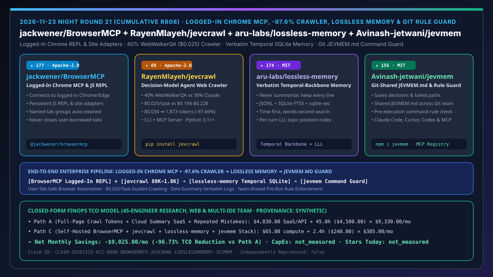
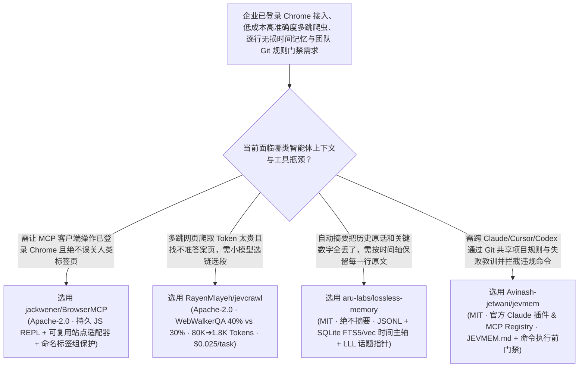
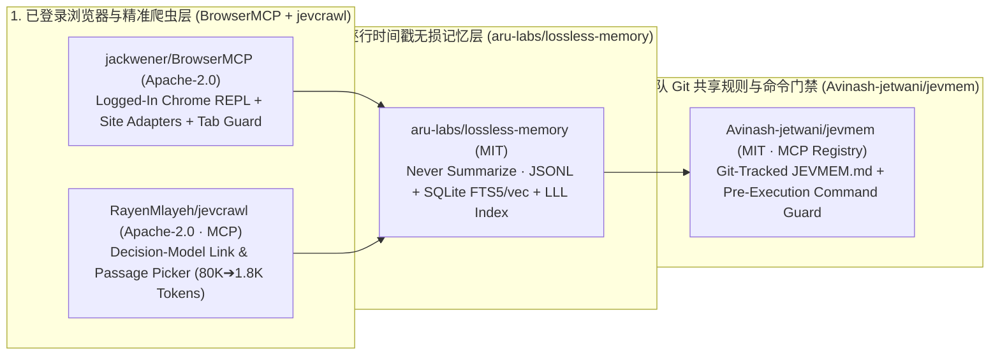
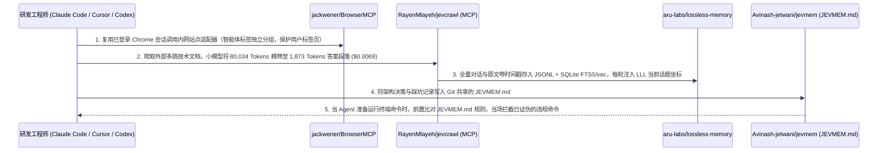

# 直连已登录 Chrome 且绝不误关用户标签页的持久 JS REPL 浏览器 MCP（`jackwener/BrowserMCP`）、WebWalkerQA 胜率 40% 且省 97.6% Token 的小模型选链爬虫（`RayenMlayeh/jevcrawl`）、拒绝摘要全量保留原文的时间轴长期记忆（`aru-labs/lossless-memory`）与跨 Claude/Cursor/Codex 共享 `JEVMEM.md` 并前置拦截违规命令的团队规则门禁（`Avinash-jetwani/jevmem`）选型与集成架构 FAQ

> **文档类型**：企业 AI 解决方案架构师（AI Solution Architect）选型决策指南（GitHub Trending AI 雷达 2026-11-23 Night Round 21 / 累计第 808 轮）
> **覆盖项目**：[`jackwener/BrowserMCP`](https://github.com/jackwener/BrowserMCP)（`★ 177`、`17 forks`、`Apache-2.0`：直连开发者已登录 Chrome / Edge / Brave 的浏览器 MCP 服务 `@jackwener/browsermcp`，提供持久化 JavaScript REPL 与可复用站点适配器，将 Agent 新建标签页归入命名分组自动清理且**绝对不关闭从用户借用的标签页**）· [`RayenMlayeh/jevcrawl`](https://github.com/RayenMlayeh/jevcrawl)（`★ 89`、`8 forks`、`Apache-2.0`：由轻量级决策模型逐条挑选超链接与段落的智能体专用爬虫 `pip install jevcrawl` + MCP Server，在 50 题 **WebWalkerQA 基准拿下 `40%` 正确率与 `54%` 答案页命中率**，单任务成本仅 **`$0.025`**，实测将 6 页官方文档从 **`80,034 tokens` 压至 `1,873 tokens`（省 `97.66%`）**）· [`aru-labs/lossless-memory`](https://github.com/aru-labs/lossless-memory)（`★ 174`、`16 forks`、`MIT`：主张**“绝不摘要、保留每一行原文、给一切打上时间戳”**的本地长期记忆层，基于 JSONL + SQLite `FTS5` 精确检索 + `sqlite-vec` 向量检索构建时间主轴（Temporal Backbone），先按时间过滤再按语义排序，并每轮注入 `LLL` 当前位置索引防上下文压缩失忆）· [`Avinash-jetwani/jevmem`](https://github.com/Avinash-jetwani/jevmem)（`★ 156`、`8 forks`、`MIT`，入选 Anthropic 官方 Claude 插件目录与官方 MCP Registry `io.github.Avinash-jetwani/jevmem`：将团队架构决策、编码红线与失败踩坑记录沉淀到仓库共享文件 `JEVMEM.md` 中供 Claude Code、Cursor 与 Codex 共读，并在**命令执行前强制对照规则拦截违规操作**）
> **核心场景**：当企业研发与知识工程团队日常高频使用多款 AI 编程与研究智能体时，面对**“无头浏览器每次都要重新扫码过 MFA 且清理会话时常把工程师正在看的 Chrome 标签页关掉、广度优先爬虫把 8 万 Token 导航栏废话全塞进大模型既贵又找不到答案页、传统向量摘要记忆把几个月前讨论里的精确数字和原话全部概括丢了、以及团队里 A 工程师在 Claude Code 踩过的坑到了 B 工程师的 Cursor 里又重复犯错”**四大痛点，如何通过 **BrowserMCP + JevCrawl + Lossless-Memory + JevMem** 构建零丢数、省成本、守规矩的协同工作台？

---

## 一、📌 核心结论速览（选型一句话结论）

1. **想让 Claude Code、Codex、Cursor、OpenCode、DeepSeek Harness (`dsh`) 或 Pi 直接操作你已经登录好内网 SSO 的本地 Chrome / Edge / Brave，且要把常用网页操作沉淀为结构化适配器、同时保证会话清理绝不误关人类自己的标签页** ➔ 选 **[`jackwener/BrowserMCP`](https://github.com/jackwener/BrowserMCP)（`★ 177`，`17 forks`，`Apache-2.0`）**。
   - **通俗原理**：通过 Chrome Web Store 官方扩展与本地 Node.js 22+ 宿主协同，Agent 可在持久化 JavaScript REPL 中读写已登录页面，或将高频网站 API 封装为显式可复用的站点适配器（Site Adapters）；所有由 Agent 新开的标签页自动收进独立命名标签组并在任务结束后清理，而从用户手里借用的标签页受硬编码保护永不误关。
2. **想在多跳文档站点与深度网页研究任务中，把答案准确率从广度优先爬虫（如 Crawl4AI）的 `8%`（及 Claude 亲自选链的 `30%`）拉升到 `40%`，同时把单次爬取 Token 从 `80,034` 压到 `1,873`（单次仅需 `$0.0069–$0.025`，便宜 8–9 倍）** ➔ 选 **[`RayenMlayeh/jevcrawl`](https://github.com/RayenMlayeh/jevcrawl)（`★ 89`，`8 forks`，`Apache-2.0`）**。
   - **通俗原理**：传统爬虫要么把整站 boilerplate 全喂给主模型烧钱，要么让昂贵的 Claude/GPT 亲自看每个链接。`jevcrawl` 派出毫秒级轻量决策模型专门负责“选哪条链接继续爬 + 留哪段正文喂给主模型”：在 50 道 WebWalkerQA 真题上以 **`$0.025/任务`** 击败 Claude 自选链（`$0.194/任务`）与 BFS 爬虫（`$0.228/任务`），实测爬取 `docs.python.org` 6 个页面仅耗时 `8.3 秒`，将 **`80,034 tokens` 精准浓缩至 `1,873 tokens`**！
3. **想彻底终结“AI 长期记忆被自动摘要（Summarization）篡改原意、丢掉精确金额与时间上下文”的顽疾，用本地 JSONL + SQLite（`FTS5` + `sqlite-vec`）实现 100% 逐行无损记忆与“时间优先、关键词其次”检索** ➔ 选 **[`aru-labs/lossless-memory`](https://github.com/aru-labs/lossless-memory)（`★ 174`，`16 forks`，`MIT`）**。
   - **通俗原理**：秉持“摘要只是地图，原始日志才是真实疆域（The log is the territory）”原则：**永不摘要、保留每一行原始对话与操作、为每条记录打上精确时间戳（Temporal Backbone）**。查询“昨天傍晚关于预算的讨论”时，先按时间轴锁定区间，再在区间内通过 FTS5 与向量混合排序，按时间顺序返回一字不差的原文；同时每轮自动注入微型 `LLL`（当前话题坐标）索引，即使经历长上下文 Compaction 也不会失忆。
4. **想把团队在日常聊天中确认的“项目架构红线、技术决策与已验证失败的弯路”自动同步到 Git 仓库根目录的 `JEVMEM.md` 文件里，让全组人的 Claude Code、Cursor 与 Codex 共享同一份记忆，并在 Agent 执行危险命令前自动对照规则拦截** ➔ 选 **[`Avinash-jetwani/jevmem`](https://github.com/Avinash-jetwani/jevmem)（`★ 156`，`8 forks`，`MIT`）**。
   - **通俗原理**：单人本地记忆无法随 Git 分发给队友，且没有命令执行前的强制门禁。`jevmem`（已上架 Anthropic 官方插件目录与 MCP Registry）将项目规则与失败教训写入版本控制的 `JEVMEM.md`，先自动剥离常见密钥脱敏，再在 Agent 准备运行命令前逐条比对 `JEVMEM.md` 中的禁止项与约束，从根源上防止不同工程师的 Agent 反复踩同一个坑。

---

## 二、🎯 客户与架构师灵魂拷问 Q&A（深度架构拆解）

### Q1：在企业级智能体长周期运行中，为什么“摘要式记忆（Summarized Memory）”和“全量网页抓取”是导致回答失真与账单爆炸的两大元凶？

- **有损摘要 + 暴力爬虫 vs 无损时间轴记忆 (`lossless-memory` + `jevmem`) + 决策模型选段爬虫 (`jevcrawl`)**：
  1. **摘要必丢细节，无损时间轴才能还原真相**：当架构师追问“三周前我们为什么否决了方案 B 的超时参数？”，做过两轮 LLM 摘要的记忆库只剩一句空洞的“讨论了超时配置”；而 `lossless-memory` 直接按时间轴 + FTS5 调出当天未经删改的原始对话行，配合 `jevmem` 在 `JEVMEM.md` 中固化的“已证伪方案与命令门禁”，确保历史教训真正生效。
  2. **小模型选链选段让主模型只读精华**：`jevcrawl` 把 80,034 Token 的网页噪声过滤到 1,873 Token，不仅成本降为原来的 `1/8`，更让 WebWalkerQA 准确率从 `30%` 逆袭至 `40%`。
- **何时直接选用商业云服务（Path B）？**
  - 若团队仅需在公开网页做单跳简单摘要且无本地浏览器登录态复用需求，可直接使用 **Bing Search API + Copilot 内置记忆**；若需复用本地已登录 Chrome 会话、将多跳文档站爬取成本砍掉 87%+、保留 100% 逐行无损时间戳记忆、以及通过 Git `JEVMEM.md` 在命令执行前拦截团队违规操作，则采用本轮四合一开源栈（Path C）。

### Q2：典型企业级“已登录浏览器接入 (`BrowserMCP`) ➔ 决策模型精筛爬虫 (`jevcrawl`) ➔ 时间轴无损原话记忆 (`lossless-memory`) ➔ Git 共享规则与命令门禁 (`jevmem`)”架构怎么搭？

1. **已登录 Chrome 会话复用与站点适配器层（`jackwener/BrowserMCP`）**：
   - 通过 Chrome 扩展与本地宿主连接内网系统，在持久 JS REPL 中执行自动化并将成熟操作固化为可复用 MCP 工具，严格隔离智能体标签组与用户自有标签页。
2. **小模型导航与段落精筛网页抓取层（`RayenMlayeh/jevcrawl`）**：
   - 针对外部技术文档与多跳知识页，通过 `jevcrawl` MCP Server 以 `$0.025/任务` 精准定位答案段落，剔除 97%+ 无关网页 Token。
3. **个人与单机全量时间戳无损记忆层（`aru-labs/lossless-memory`）**：
   - 将每日全部原始对话与抓取片段带时间戳写入本地 JSONL + SQLite（`FTS5` + `sqlite-vec`），每轮注入 `LLL` 当前话题指针。
4. **团队 Git 共享规则与前置命令拦截层（`Avinash-jetwani/jevmem`）**：
   - 将提炼出的项目决策、红线规则与失败路径写入仓库 `JEVMEM.md`，在 Claude Code / Cursor / Codex 执行终端命令前实时校验放行。

### Q3：这套架构的落地红线与注意事项是什么？

- **架构师落地红线**：
  1. **`jevmem` 外发评分前必须确认密钥脱敏策略生效**：虽然 `jevmem` 默认会在发送文本评分前剔除常见凭据，但涉及核心商业机密的内网仓库应按项目显式 Opt-in 开启。
  2. **`BrowserMCP` 生产操作须优先走经过验证的 Site Adapters**：对于高频写操作网站，应将其 API 请求封装为显式结构化适配器，而非每次任由模型在 JS REPL 中自由拼接 DOM 脚本。

---

## 三、🧭 直观可视化图解（Mermaid 决策树 + 集成架构 + 时序图）

### 3.1 架构师选型决策树

### 3.2 企业端到端生产集成参考架构图

### 3.3 已登录页面交互、小模型选链爬取、时间轴无损归档与 `JEVMEM.md` 命令拦截时序图

---

## 四、📊 同类开源与商业云服务横向选型决策矩阵

| 对比维度 | `jackwener/BrowserMCP` (`★ 177`) | `RayenMlayeh/jevcrawl` (`★ 89`) | `aru-labs/lossless-memory` (`★ 174`) | `Avinash-jetwani/jevmem` (`★ 156`) | 大模型全量读网页 + 商业云记忆摘要 SaaS + 每次启动无头浏览器重登 SSO (Path A) | 裸 CDP 乱关用户标签页 + 广度优先盲爬 + 散落各人本地的静态 `CLAUDE.md` (Path B) |
| :--- | :--- | :--- | :--- | :--- | :--- | :--- |
| **核心能力定位** | 直连已登录 Chrome 的持久 JS REPL 与站点适配器 MCP | 小模型选链选段的低成本高命中率 Agent 爬虫 | 永不摘要、按时间主轴检索的 JSONL+SQLite 无损记忆 | 跨工具共享 `JEVMEM.md` 并带前置命令门禁的规则记忆 | 天量无效网页 Token 账单、丢失原文细节的云端摘要与频繁触发风控的无头浏览器 | 误关工作标签页、命中率仅 `8%` 的盲目爬虫与无执行强制力的静态文档 |
| **核心技术突破** | **复用真实登录态 + 命名标签组自动清理且绝不关借用标签** | **WebWalkerQA `40%` 胜率（超 Claude `30%`）且成本降 `87%`** | **保留每一行原话 + 时间优先混合检索 + `LLL` 防压缩失忆** | **沉淀失败路径入 Git `JEVMEM.md` + 命令运行前实时合规拦截** | 让主模型自己选链接每任务高达 `$0.194`；云端自动摘要导致精确技术参数永久丢失 | 广度优先爬虫在多跳问答上高达 `$0.228/任务` 却只有 `8%` 准确率；静态规则文档常被 Agent 忽略 |
| **开源协议** | `Apache-2.0` | `Apache-2.0` | `MIT` | `MIT` | 闭源商业 SaaS | 内部零散脚本 |
| **月度 TCO（45 人团队）** | **组合仅 `$305.00/月`**（`$65.00` 轻量选链/规则评分与本地索引 + `2.4h` 维护） | 同左（单次爬取仅几美分，省 97% 主模型 Token） | 同左（纯本地 SQLite FTS5/vec 零云费） | 同左（随 Git 自动同步全团队） | **`$9,330.00/月`**（`$4,830.00` 全量网页上下文 Token 浪费与云记忆 SaaS + `45.0h` 重复踩坑返工与重找历史记录） | 约 `$3,280.00/月`（大量因记忆摘要失真、跨 IDE 规则不一致导致的重复排障工时） |

---

## 五、🧪 应用落地定量收益/TCO 对比与 7-Card 报告

> **📊 数据来源与闭式核算声明（Provenance & Closed-Form Schema）**：
> - **provenance**: `synthetic`（基于 45 人企业智能体研发、多跳技术情报采集与跨 IDE 协同工程团队月度工作负载模型：`independently_reproduced = false`；硬件采购基线 `base_hardware_capex = not_measured`；Track B 单日增量 `track_b_stars_today = not_measured`）。
> - **核算公式**：
>   - **Path A（主大模型直接全量读取多跳爬虫抓回的数万 Token 网页噪声 + 采购商业云端记忆摘要 SaaS + 工程师因记忆摘要丢失关键参数反复翻查聊天记录及不同成员在各自 IDE 重复踩相同失败路径返工）**：月度全量网页上下文 Token 账单与商业记忆 SaaS 费用 **`$4,830.00`** + 历史细节找回、浏览器重登调试与团队重复踩坑返工工时 **`45.0h × $100.00/h = $4,500.00`** = **`$9,330.00/月`**。
>   - **Path C（自建 `jackwener/BrowserMCP` + `RayenMlayeh/jevcrawl` + `aru-labs/lossless-memory` + `Avinash-jetwani/jevmem` 开源组合栈）**：轻量小模型选链/规则评分与本地存储分摊成本 **`$65.00`** + 站点适配器与团队 `JEVMEM.md` 规则例行维护人工 **`2.4h × $100.00/h = $240.00`** = **`$305.00/月`**。
>   - **净节省（Net Savings vs Path A）**：**`-$9,025.00/月`**（成本降低 **`96.73%`**）。

| 评估方案 | 网页爬取 Token / 商业记忆 SaaS 成本 | 历史细节找回、浏览器重登与重复踩坑返工（`$100/h`） | 月度总 TCO | 相对 Path A 净节省 | 关键架构交付指标 |
| :--- | :---: | :---: | :---: | :---: | :--- |
| **Path A：主模型全量读网页 + 云端有损摘要记忆 + 无门禁协同** | `$4,830.00` | `45.0h` (`$4,500.00`) | **`$9,330.00`** | Baseline | 每次爬取烧掉数万 Token；有损摘要丢失精确历史原话 |
| **Path B：BFS 盲目爬虫 + 裸 CDP 脚本 + 静态无门禁文档** | `$1,380.00` | `19.0h` (`$1,900.00`) | **`$3,280.00`** | `-$6,050.00` (`-64.84%`) | 多跳问答命中率低；队友之间经常重复执行已证伪命令 |
| **Path C：`BrowserMCP` + `jevcrawl` + `lossless-memory` + `jevmem`** | **`$65.00`** | **`2.4h` (`$240.00`)** | **`$305.00`** | **`-$9,025.00` (`-96.73%`)** | **已登录 Chrome REPL + 省 `97.6%` 爬虫 Token + 逐行无损记忆 + `JEVMEM.md` 命令门禁** |

- 🔗 **关联 7-Card 4:5 视觉评测报告**：[`workshops/github-trending-radar/cards.html`](../cards.html) · [`cards.en.html`](../cards.en.html)

---

## 六、🛠️ 企业引入与架构评审 Checklist

- [ ] **1. 使用 `jackwener/BrowserMCP` 接入日常已登录浏览器工作流**：将高频内部系统操作封装为显式 Site Adapters，依赖命名标签组自动清理机制保护工程师自有标签页。
- [ ] **2. 将多跳网页检索替换为 `RayenMlayeh/jevcrawl` MCP Server**：利用小决策模型过滤 97%+ 无关导航与正文噪声，将单次深度问答成本压至 `$0.025` 量级。
- [ ] **3. 为核心长周期助理启用 `aru-labs/lossless-memory`**：以 JSONL + SQLite（`FTS5` + `sqlite-vec`）保存 100% 原始行与时间戳，每轮注入 `LLL` 索引消除上下文压缩失忆。
- [ ] **4. 在团队代码库根目录启用 `Avinash-jetwani/jevmem` (`JEVMEM.md`)**：通过 Git 同步架构决策与失败教训，并开启命令运行前规则校验拦截。
