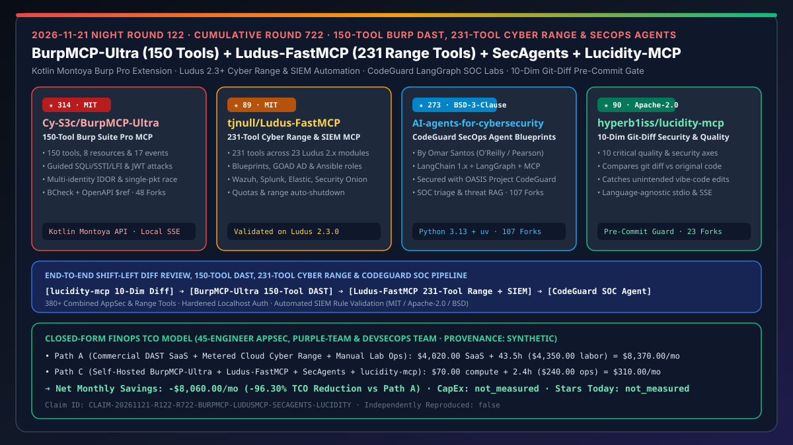
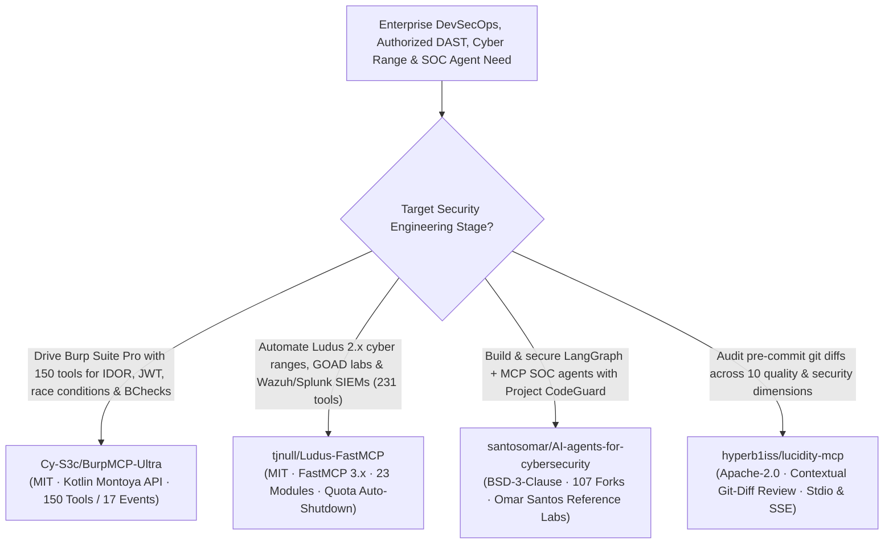
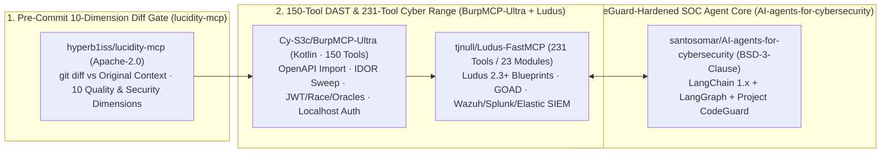
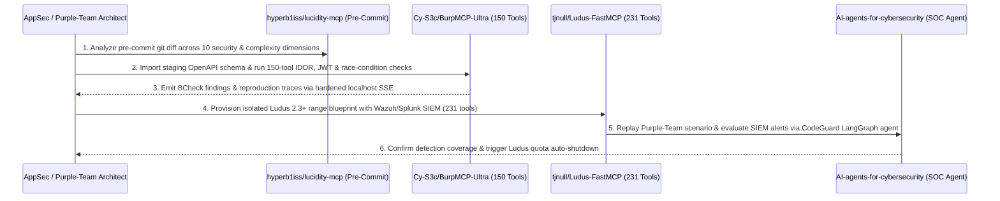

# 150-Tool Burp Suite Pro Pentest MCP (`Cy-S3c/BurpMCP-Ultra`), 231-Tool Cyber Range & SIEM MCP (`tjnull/Ludus-FastMCP`), CodeGuard SecOps Agent Blueprints (`santosomar/AI-agents-for-cybersecurity`) & 10-Dimension Git-Diff Review MCP (`hyperb1iss/lucidity-mcp`) Selection & Architecture FAQ

> **Document Type**: Enterprise AI Solution Architect Selection & Integration Guide (GitHub Trending AI Radar — 2026-11-21 Night Round 122 / Cumulative Round 722)
> **Covered Repositories**: [`Cy-S3c/BurpMCP-Ultra`](https://github.com/Cy-S3c/BurpMCP-Ultra) (`★ 314`, `48 forks`, `MIT` — native Kotlin Montoya API Burp Suite Professional extension exposing **150 tools, 8 resources & 17 event types** with BChecks, guided SQLi/SSTI/LFI probes, JWT/IDOR sweeps & single-packet race condition testing) · [`tjnull/Ludus-FastMCP`](https://github.com/tjnull/Ludus-FastMCP) (`★ 89`, `12 forks`, `MIT` — FastMCP 3.x server exposing **231 tools across 23 modules** for Ludus 2.x cyber ranges, GOAD labs & Wazuh/Splunk/Elastic/Security Onion SIEMs) · [`santosomar/AI-agents-for-cybersecurity`](https://github.com/santosomar/AI-agents-for-cybersecurity) (`★ 273`, `107 forks`, `BSD-3-Clause` — Omar Santos's LangChain 1.x, LangGraph & MCP cybersecurity labs secured with COSAI OASIS `Project CodeGuard`) · [`hyperb1iss/lucidity-mcp`](https://github.com/hyperb1iss/lucidity-mcp) (`★ 90`, `23 forks`, `Apache-2.0` — git-aware MCP server analyzing `git diff` changes against original code across 10 quality & security dimensions)
> **Core Scenario**: How enterprise AppSec, Red/Blue/Purple Team, and SOC architects build an end-to-end defensive and authorized-testing pipeline: **catching pre-commit regressions and security flaws across 10 dimensions (`lucidity-mcp`)**, **automating 150-tool dynamic API/IDOR/JWT/race-condition testing in Burp Suite Pro (`BurpMCP-Ultra`)**, **provisioning isolated AD + SIEM cyber ranges via 231 MCP tools (`Ludus-FastMCP`)**, and **operating CodeGuard-hardened LangGraph SOC agents (`AI-agents-for-cybersecurity`)**.

---

## 1. 📌 Executive Summary (One-Line Selection Verdict)

1. **Need to drive Burp Suite Professional programmatically from Claude Code or any MCP client across 150 tools (12x more than PortSwigger's 12-tool official plugin) covering IDOR sweeps, JWT attacks, guided injection oracles, single-packet race conditions, and BChecks** ➔ Choose **[`Cy-S3c/BurpMCP-Ultra`](https://github.com/Cy-S3c/BurpMCP-Ultra) (`★ 314`, `48 forks`, `MIT`)**.
   - **Plain-English Mechanism**: A single-JAR native **Kotlin** extension built on Burp's Montoya API with hardened token-secured localhost SSE transport and a real-time web dashboard. Exposes **150 tools, 8 resources, and 17 event types**—including 3-mode inline fuzzing (`FUZZ / Marker / Offset`), SQLi/SSTI/LFI guided probes, JWT attacks (`alg:none`, `RS ➔ HS`), cross-identity IDOR/privilege-escalation sweeps, full WebSocket lifecycle testing, single-packet race conditions, and OpenAPI/Swagger `$ref` imports.
2. **Need 231 MCP tools across 23 modules to automate Ludus 2.x cyber ranges, Active Directory labs (GOAD), Ansible Galaxy roles, and SIEM integrations (`Wazuh`, `Splunk`, `Elastic Stack`, `Security Onion`)** ➔ Choose **[`tjnull/Ludus-FastMCP`](https://github.com/tjnull/Ludus-FastMCP) (`★ 89`, `12 forks`, `MIT`)**.
   - **Plain-English Mechanism**: Built on `FastMCP 3.x` and validated against a live **Ludus 2.3.0** server, it covers every endpoint in the Ludus 2.x API: range lifecycle, reusable **Blueprints**, **Content Sources**, **Group RBAC**, **Red/Blue/Purple Team & Malware scenarios**, natural-language-to-YAML template generation, **SIEM provisioning**, and per-user/per-group **quotas with auto-shutdown**.
3. **Need production reference architectures and runnable Python 3.13 labs (`LangChain 1.x`, `LangGraph`, `MCP`) for building, securing, and operating cybersecurity agents aligned with COSAI OASIS `Project CodeGuard`** ➔ Choose **[`santosomar/AI-agents-for-cybersecurity`](https://github.com/santosomar/AI-agents-for-cybersecurity) (`★ 273`, `107 forks`, `BSD-3-Clause`)**.
   - **Plain-English Mechanism**: Authored by **Omar Santos** (companion to his O'Reilly and Pearson live trainings and books), this `107-fork` repository provides standalone modules for threat-intel RAG, multi-agent SOC triage, and agentic security guardrails validated with `Project CodeGuard`.
4. **Need a git-aware pre-commit MCP server (`stdio` & `SSE`) that compares `git diff` changes against original source context across 10 critical quality and security dimensions** ➔ Choose **[`hyperb1iss/lucidity-mcp`](https://github.com/hyperb1iss/lucidity-mcp) (`★ 90`, `23 forks`, `Apache-2.0`)**.
   - **Plain-English Mechanism**: Built with Python 3.13 and `uv`, `lucidity-mcp` prevents "vibe-coding" regressions by contrasting staged/unstaged Git diffs against the original baseline across 10 dimensions—catching accidental auth-check deletions, security vulnerabilities, and cyclomatic complexity spikes before commit.

---

## 2. 🎯 Architect & Customer Deep-Dive Q&A

### Q1: Why do static cloud scanners fail to catch multi-identity IDORs, single-packet race conditions, and broken SIEM detection rules—and how does this four-project stack close the loop?

- **Four-Stage AppSec & SecOps Closed Loop**:
  1. **Pre-Commit Contextual Diff Guard (`hyperb1iss/lucidity-mcp`)**: Catches unintended logic mutations and security regressions across 10 dimensions by comparing `git diff` against the original file context before a PR is even opened.
  2. **150-Tool Authorized Dynamic API & Race Testing (`Cy-S3c/BurpMCP-Ultra`)**: Static scanners cannot test whether replaying a coupon redemption in a single TCP packet double-spends credits or whether User A's token can read User B's tenant records. `BurpMCP-Ultra` imports OpenAPI `$ref` schemas into Burp Suite Pro and runs automated cross-identity IDOR sweeps, JWT checks, and single-packet race probes.
  3. **231-Tool Cyber Range & SIEM Rule Validation (`tjnull/Ludus-FastMCP`)**: Before deploying new Wazuh, Splunk, Elastic, or Security Onion detection rules to production, `Ludus-FastMCP` spins up an isolated Ludus 2.3+ blueprint (with auto-shutdown quotas) to verify that the SIEM actually alerts on the attack telemetry.
  4. **CodeGuard-Hardened SOC Agent Operations (`santosomar/AI-agents-for-cybersecurity`)**: Implements LangGraph 1.x + MCP SOC workflows hardened under COSAI OASIS `Project CodeGuard`.
- **When to Choose Managed Cloud Services (Path B)**:
  - For baseline dependency CVE alerts and standard static analysis inside GitHub repositories, **GitHub Advanced Security (GHAS) + Microsoft Defender for Cloud** provides a zero-maintenance cloud foundation.

### Q2: How do we wire an end-to-end DevSecOps, DAST & Cyber Range architecture combining all four projects?

1. **Pre-Commit 10-Dimension Code Review Gate (`hyperb1iss/lucidity-mcp`)**:
   - Attach `lucidity-mcp` (`stdio` or `SSE`) to developer coding agents so every `git diff` is audited across 10 security and quality dimensions prior to commit.
2. **Staging 150-Tool DAST & API Security Gate (`Cy-S3c/BurpMCP-Ultra`)**:
   - Load the `BurpMCP-Ultra` Kotlin JAR inside an authorized staging Burp Suite Pro instance (protected by localhost token auth) to run OpenAPI `$ref` imports, guided SQLi/SSTI/LFI probes, JWT checks, IDOR sweeps, and race-condition tests.
3. **231-Tool Cyber Range & SIEM Validation Plane (`tjnull/Ludus-FastMCP`)**:
   - Connect SecOps agents to `Ludus-FastMCP` to deploy reusable AD/Purple-Team Blueprints integrated with Wazuh, Splunk, Elastic Stack, or Security Onion, governed by group quotas and auto-shutdown policies.
4. **LangGraph + CodeGuard SOC Agent Plane (`santosomar/AI-agents-for-cybersecurity`)**:
   - Build and operate threat-hunting and incident-triage agents using Omar Santos's `LangChain 1.x + LangGraph + MCP + Project CodeGuard` reference patterns.

### Q3: What are the boundaries and authorization requirements of this stack?

- **Key Strengths**:
  - **100% Permissive Open Source (`MIT`, `Apache-2.0`, `BSD-3-Clause`)**.
  - **Massive Tool Depth**: `150` Burp Montoya tools + `231` Ludus 2.x range/SIEM tools + `10` Git-diff review dimensions.
- **Authorization & Security Boundaries**:
  - `BurpMCP-Ultra` (requires a licensed Burp Suite Professional installation) and `Ludus-FastMCP` must only be run against authorized staging targets and isolated cyber range networks, keeping `BurpMCP-Ultra`'s hardened localhost token authentication enabled at all times.

---

## 3. 🧭 Visual Architecture & Decision Diagrams

### 3.1 Solution Architect Selection Decision Tree

### 3.2 End-to-End Enterprise Reference Architecture

### 3.3 Pre-Commit Diff Audit, Burp 150-Tool Staging Sweep, Ludus Range Replay & SIEM Verification Sequence

---

## 4. 📊 Peer Open-Source vs Commercial Cloud Selection Matrix

| Dimension | `Cy-S3c/BurpMCP-Ultra` (`★ 314`) | `tjnull/Ludus-FastMCP` (`★ 89`) | `AI-agents-for-cybersecurity` (`★ 273`) | `hyperb1iss/lucidity-mcp` (`★ 90`) | Commercial DAST Cloud + Hosted Cyber Range SaaS (Path A) | Baseline Cloud SAST/SCA (Path B) |
| :--- | :--- | :--- | :--- | :--- | :--- | :--- |
| **Core Role** | 150-tool Kotlin Burp Suite Pro MCP extension | 231-tool Ludus 2.x cyber range & SIEM MCP | LangGraph + CodeGuard SecOps reference architecture | 10-dimension contextual `git diff` review MCP | Metered cloud DAST SaaS + per-hour hosted cyber range | GitHub Advanced Security / Defender |
| **Architectural Edge** | **150 tools (vs 12 official) + IDOR/JWT/race/BCheck** | **231 tools across 23 modules + 4 SIEM integrations** | **107 forks + COSAI OASIS `Project CodeGuard`** | **Contrasts `git diff` vs baseline to stop vibe-coding bugs** | Expensive per-hour cloud ranges & shallow black-box DAST | Static-only; cannot test live race conditions or SIEM ranges |
| **License** | `MIT` | `MIT` | `BSD-3-Clause` | `Apache-2.0` | Proprietary SaaS | Proprietary Cloud PaaS |
| **Monthly TCO (45-Eng Team)** | **`$310.00/mo` combined** (`$70.00` compute + `2.4h` ops) | Included in `$310.00/mo` stack | Included in `$310.00/mo` stack | Included in `$310.00/mo` stack | **`$8,370.00/mo`** (`$4,020.00` SaaS/range + `43.5h` labor) | `~$2,650.00/mo` (per-committer security seats) |

---

## 5. 🧪 Quantitative ROI / FinOps TCO Model & 7-Card Report

> **📊 Provenance & Closed-Form Audit Declaration**:
> - **Provenance**: `synthetic` (45-engineer enterprise AppSec, Purple-Team & DevSecOps workload model; `independently_reproduced = false`; `base_hardware_capex = not_measured`; `track_b_stars_today = not_measured`).
> - **Closed-Form Equations**:
>   - **Path A (Commercial Automated API DAST SaaS + Metered Cloud Cyber Range Hours + Manual SIEM Lab Provisioning, Manual IDOR/Race Testing & Manual Pre-Commit Diff Reviews)**: Monthly SaaS & cloud range spend **`$4,020.00`** + manual range setup & AppSec review labor **`43.5h × $100.00/h = $4,350.00`** = **`$8,370.00/mo`**.
>   - **Path C (Self-Hosted `Cy-S3c/BurpMCP-Ultra` + `tjnull/Ludus-FastMCP` + `santosomar/AI-agents-for-cybersecurity` + `hyperb1iss/lucidity-mcp`)**: Shared auto-shutdown range & container compute **`$70.00`** + blueprint & BCheck rule maintenance **`2.4h × $100.00/h = $240.00`** = **`$310.00/mo`**.
>   - **Net Savings vs Path A**: **`-$8,060.00/mo`** (**`96.30%`** cost reduction).

| Architecture Option | API / SaaS / Compute | AppSec & SecOps Labor (`$100/h`) | Total Monthly TCO | Net Savings vs Path A | Key Architectural Outcome |
| :--- | :---: | :---: | :---: | :---: | :--- |
| **Path A: Commercial DAST Cloud + Metered Cyber Range SaaS** | `$4,020.00` | `43.5h` (`$4,350.00`) | **`$8,370.00`** | Baseline | Days spent wiring SIEM labs; high per-hour range bills |
| **Path B: Cloud SAST Seats + Manual 12-Tool Burp Plugin** | `$1,450.00` | `12.0h` (`$1,200.00`) | **`$2,650.00`** | `-$5,720.00` (`-68.34%`) | Official plugin lacks 150-tool IDOR/JWT/race & 231-tool Ludus |
| **Path C: `BurpMCP-Ultra` + `Ludus` + `SecAgents` + `lucidity`** | **`$70.00`** | **`2.4h` (`$240.00`)** | **`$310.00`** | **`-$8,060.00` (`-96.30%`)** | **150 Burp tools + 231 Ludus/SIEM tools + 10-dim diff gate** |

- 🔗 **7-Card 4:5 Visual Report**: [`workshops/github-trending-radar/cards.en.html`](../cards.en.html) · [`cards.html`](../cards.html)

---

## 6. 🛠️ Enterprise Adoption & Architecture Review Checklist

- [ ] **1. Gate Pre-Commit Diffs with `hyperb1iss/lucidity-mcp`**: Run `lucidity-mcp` on `git diff` changes before commit to catch security vulnerabilities, unintended deletions, and complexity spikes across 10 dimensions.
- [ ] **2. Automate Authorized Staging DAST with `Cy-S3c/BurpMCP-Ultra`**: Load the Kotlin JAR in Burp Suite Pro with hardened localhost token auth to run 150 tools across OpenAPI `$ref` imports, cross-identity IDOR sweeps, JWT checks, and single-packet race probes.
- [ ] **3. Provision SIEM-Integrated Purple-Team Ranges with `tjnull/Ludus-FastMCP`**: Use the 231 tools against Ludus 2.3+ to deploy reusable Blueprints with Wazuh, Splunk, Elastic Stack, or Security Onion and enforce quota auto-shutdown.
- [ ] **4. Harden SOC Agents with `santosomar/AI-agents-for-cybersecurity`**: Adopt the LangChain 1.x + LangGraph + MCP reference patterns validated with COSAI OASIS `Project CodeGuard`.
