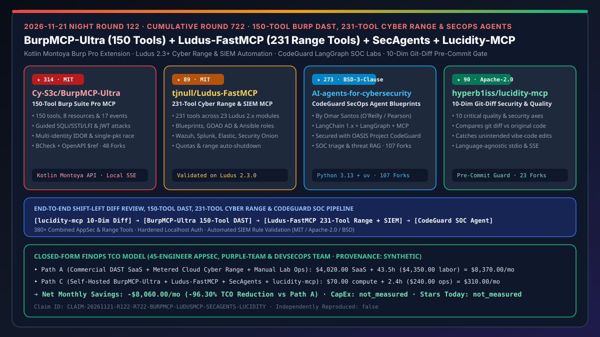
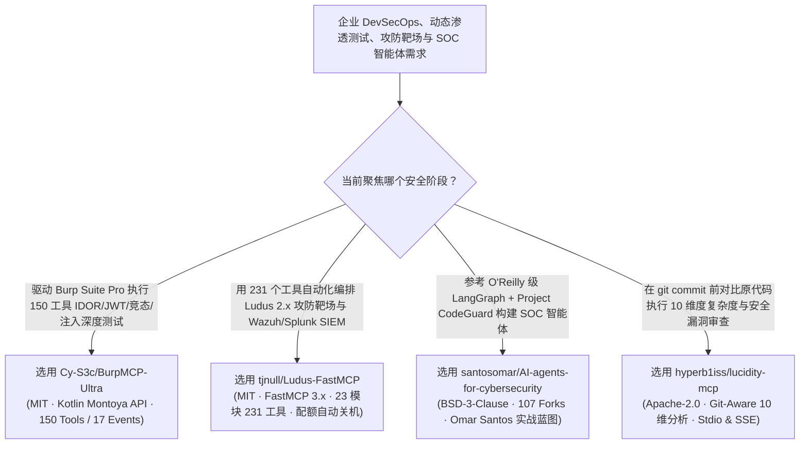
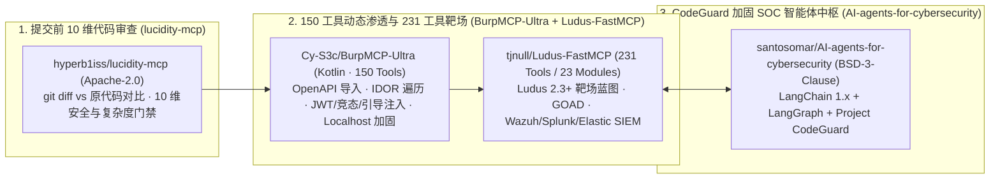
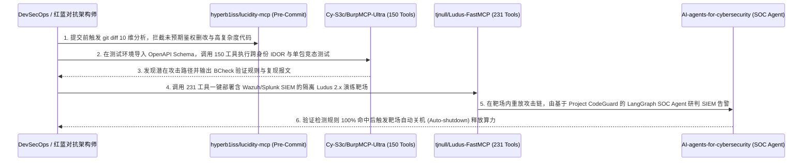

# Burp Suite 150 工具内嵌渗透 MCP（`Cy-S3c/BurpMCP-Ultra`）、231 工具网络靶场与 SIEM 编排 MCP（`tjnull/Ludus-FastMCP`）、Cisco 首席工程师安全智能体蓝图（`santosomar/AI-agents-for-cybersecurity`）与 10 维 Git Diff 预提交代码安全审查 MCP（`hyperb1iss/lucidity-mcp`）选型与集成架构 FAQ

> **文档类型**：企业 AI 解决方案架构师（AI Solution Architect）选型决策指南（GitHub Trending AI 雷达 2026-11-21 Night Round 122 / 累计第 722 轮）
> **覆盖项目**：[`Cy-S3c/BurpMCP-Ultra`](https://github.com/Cy-S3c/BurpMCP-Ultra)（`★ 314`、`48 forks`、`MIT`，基于 Kotlin Montoya API 暴露 **150 个工具 / 8 类资源 / 17 类事件**、支持 BCheck、SQLi/SSTI 引导探测、JWT/IDOR 越权扫描与单包竞争条件测试的 Burp Suite Pro 原生插件）· [`tjnull/Ludus-FastMCP`](https://github.com/tjnull/Ludus-FastMCP)（`★ 89`、`12 forks`、`MIT`，覆盖 Ludus 2.x 全部接口、提供 **23 个模块 231 个工具**并打通 Wazuh/Splunk/Elastic/Security Onion SIEM 与 GOAD 靶场的自动化 MCP）· [`santosomar/AI-agents-for-cybersecurity`](https://github.com/santosomar/AI-agents-for-cybersecurity)（`★ 273`、`107 forks`、`BSD-3-Clause`，O'Reilly 讲师 Omar Santos 出品、通过 COSAI OASIS `Project CodeGuard` 认证的 LangGraph + MCP 网络安全智能体实战架构库）· [`hyperb1iss/lucidity-mcp`](https://github.com/hyperb1iss/lucidity-mcp)（`★ 90`、`23 forks`、`Apache-2.0`，直接基于 `git diff` 与原代码上下文对比执行 10 大维度复杂度与安全漏洞预提交审查的轻量 MCP）
> **核心场景**：当企业 AppSec（应用安全）、红蓝对抗（Red/Blue/Purple Team）与研发安全（DevSecOps）团队希望引入 AI Agent 时，如何构建一条**从“提交前 `git diff` 10 维安全与质量门禁（`lucidity-mcp`）”➔“上线前 Burp Suite 150 工具自动化 IDOR/JWT/竞态条件动态渗透（`BurpMCP-Ultra`）”➔“231 工具自动化拉起 AD/SIEM 攻防演练靶场验证检测规则（`Ludus-FastMCP`）”➔“基于 CodeGuard 规范构建 SOC 运营智能体（`AI-agents-for-cybersecurity`）”**的完整企业级安全闭环？

---

## 一、📌 核心结论速览（选型一句话结论）

1. **想让 Claude Code 或安全 Agent 直接驱动 Burp Suite Professional 完成 API Schema 导入、多身份 IDOR 越权横扫、JWT 伪造（`alg:none` / `RS➔HS`）、单包竞争条件（Single-Packet Race Condition）与 BCheck 自定义扫描（远超官方仅 12 个工具的插件）** ➔ 选 **[`Cy-S3c/BurpMCP-Ultra`](https://github.com/Cy-S3c/BurpMCP-Ultra)（`★ 314`，`48 forks`，`MIT`）**。
   - **通俗原理**：PortSwigger 官方 MCP 插件仅有 12 个基础工具。`BurpMCP-Ultra` 是基于 Burp Montoya API 用 **Kotlin** 原生编写的单 JAR 插件，通过带 Token 鉴权的本地加固 SSE 通道暴露 **150 个结构化工具、8 类资源与 17 种事件**：涵盖三模式内联 Fuzzer（`FUZZ / Marker / Offset`）、SQLi/SSTI/LFI 引导式探测 Oracle、跨多登录态自动遍历 IDOR/提权漏洞、WebSocket 全生命周期测试、单包竞态攻击以及 OpenAPI/Swagger `$ref` 自动解析导入，并自带实时 Web 仪表盘。
2. **想用自然语言一键拉起包含 Active Directory（如 GOAD）、红蓝紫队演练剧本以及 Wazuh / Splunk / Elastic Stack / Security Onion 四大 SIEM 监控的完整虚拟攻防靶场（Cyber Range）** ➔ 选 **[`tjnull/Ludus-FastMCP`](https://github.com/tjnull/Ludus-FastMCP)（`★ 89`，`12 forks`，`MIT`）**。
   - **通俗原理**：由知名安全专家 `tjnull` 基于 `FastMCP 3.x` 打造，针对 **Ludus 2.x（已通过 Ludus `2.3.0` 实机全接口验证）** 暴露了 **23 个模块共 231 个工具**。它将繁琐的 Ansible Role 配置、靶场蓝图（Blueprints）导入导出、虚拟机控制台访问、用户组配额与自动关机（Auto-shutdown）以及四大主流 SIEM 探针部署全部变成一句话指令。
3. **想系统掌握如何用 Python 3.13 + LangChain 1.x + LangGraph + MCP 构建、加固并运营符合 OASIS `Project CodeGuard` 标准的企业级 SOC 安全智能体** ➔ 选 **[`santosomar/AI-agents-for-cybersecurity`](https://github.com/santosomar/AI-agents-for-cybersecurity)（`★ 273`，`107 forks`，`BSD-3-Clause`）**。
   - **通俗原理**：由思科杰出工程师、O'Reilly 畅销书作者 **Omar Santos** 维护（高达 `107 forks`）。不仅提供威胁情报 RAG、SOC 告警研判与多智能体协同的可独立运行脚本，还示范了如何围绕 **COSAI OASIS `Project CodeGuard`** 标准保护 AI Agent 自身免受攻击。
4. **想在工程师执行 `git commit` 前，让编码 Agent 基于 `git diff` 与原始代码上下文对比，从 10 个核心维度自动揪出“Vibe Coding 引入的隐蔽安全漏洞、未预期逻辑篡改与复杂度失控”** ➔ 选 **[`hyperb1iss/lucidity-mcp`](https://github.com/hyperb1iss/lucidity-mcp)（`★ 90`，`23 forks`，`Apache-2.0`）**。
   - **通俗原理**：同时支持本地 `stdio` 与网络 `SSE` 的轻量级代码质量与安全审查 MCP（Python 3.13 + `uv`）。它不只是看新增代码片段，而是将 `git diff` 与修改前的原始上下文进行比对（Contextual Analysis），按 10 大质量/安全维度生成结构化修复建议，把“AI 改 A 功能顺手删掉 B 鉴权判断”的常见事故拦在提交之前。

---

## 二、🎯 客户与架构师灵魂拷问 Q&A（深度架构拆解）

### Q1：为什么企业在做 AI 驱动的 DevSecOps 与攻防演练时，标准云端漏洞扫描器替代不了这套本地/内网 MCP 组合？

- **三大安全实战痛点与解方**：
  1. **业务逻辑越权（IDOR）与竞态漏洞无法靠静态规则扫出 ➔ `Cy-S3c/BurpMCP-Ultra`**：云端 SAST 扫不出“用普通用户 A 的 Token 替换管理员 B 的订单 ID 能否越权退款”或“并发单包重放能否双花优惠券”。`BurpMCP-Ultra` 的 150 个工具让 AI Agent 直接驱动本地 Burp Suite Pro 跨多身份做 Access-Control Sweep 与 Single-Packet Race Condition 验证。
  2. **SIEM 告警规则缺乏真实靶场回归验证 ➔ `tjnull/Ludus-FastMCP`**：SOC 团队写了新的 Wazuh/Splunk 检测规则后，不敢在生产网做真刀真枪的域控攻击测试。通过 `Ludus-FastMCP` 的 231 个工具，Agent 可在几分钟内拉起隔离的 Ludus 2.x + GOAD 靶场，重放红队场景并验证 SIEM 告警是否准确触发，演练完自动触发 Quota Auto-shutdown 省电省算力。
  3. **AI 写代码速度远超人工 Code Review 速度 ➔ `hyperb1iss/lucidity-mcp` + `AI-agents-for-cybersecurity`**：在研发侧用 `lucidity-mcp` 守住预提交 10 维 `git diff` 审查，在安全运营侧参考 Omar Santos 的 `Project CodeGuard` 架构构建自防御 SOC 智能体。
- **何时直接用云厂商托管方案（Path B）？**
  - 若企业仅需标准的依赖库 CVE 扫描与云配置合规检查，直接开启 **GitHub Advanced Security (GHAS) + Microsoft Defender for Cloud** 即可。

### Q2：典型企业级“预提交 10 维审查 (`lucidity`) + 150 工具动态渗透 (`BurpMCP-Ultra`) + 231 工具靶场演练 (`Ludus-FastMCP`) + SOC 智能体 (`Omar Santos Blueprints`)”架构怎么搭？

1. **左移预提交安全与质量门禁层（`hyperb1iss/lucidity-mcp`）**：
   - 在研发终端与 CI Pre-commit 阶段挂载 `lucidity-mcp`，对比 `git diff` 与原文件，针对安全漏洞、未预期逻辑删改与圈复杂度执行 10 维审查。
2. **准生产环境 150 工具 DAST 深度渗透层（`Cy-S3c/BurpMCP-Ultra`）**：
   - 在Staging环境将微服务 OpenAPI/Swagger `$ref` 导入 `BurpMCP-Ultra`（本地 Token 加固 SSE），由 AppSec Agent 自动执行 JWT 攻击测试、多身份 IDOR 遍历、SQLi/SSTI 引导探测与单包竞争条件测试。
3. **231 工具红蓝紫队靶场与 SIEM 联调层（`tjnull/Ludus-FastMCP`）**：
   - 通过 `Ludus-FastMCP` 自动编排 Ludus 2.3+ 虚拟靶场 Blueprints，部署 Wazuh / Splunk / Elastic Stack / Security Onion 探针，自动化运行攻防剧本并校准检测规则。
4. **SOC 智能体架构与 CodeGuard 防护底座（`santosomar/AI-agents-for-cybersecurity`）**：
   - 基于 LangGraph 1.x 与 `Project CodeGuard` 规范部署企业内部威胁狩猎、情报 RAG 与告警研判智能体。

### Q3：这套架构的适用边界与合规红线是什么？

- **核心优势**：
  - **全部采用宽松开源协议（`MIT`、`Apache-2.0`、`BSD-3-Clause`）**，所有渗透流量、源码 Diff 与靶场拓扑 100% 留在企业受控内网。
- **合规红线**：
  - `BurpMCP-Ultra`（需配合正版 Burp Suite Professional 许可）与 `Ludus-FastMCP` 仅限用于企业自有资产或获明确书面授权的测试环境与隔离靶场，且 `BurpMCP-Ultra` 默认绑定本地加固回环地址（Hardened Localhost Security），严禁将其 SSE 端口裸露至公网。

---

## 三、🧭 直观可视化图解（Mermaid 决策树 + 集成架构 + 时序图）

### 3.1 架构师选型决策树

### 3.2 企业端到端生产集成参考架构图

### 3.3 预提交 10 维审查、Burp 150 工具越权扫描、Ludus 靶场重放与 SIEM 规则闭环时序图

---

## 四、📊 同类开源与商业云服务横向选型决策矩阵

| 对比维度 | `Cy-S3c/BurpMCP-Ultra` (`★ 314`) | `tjnull/Ludus-FastMCP` (`★ 89`) | `AI-agents-for-cybersecurity` (`★ 273`) | `hyperb1iss/lucidity-mcp` (`★ 90`) | 商业自动化渗透云 + 商业靶场 SaaS (Path A) | 基础云原生 SAST/SCA (Path B) |
| :--- | :--- | :--- | :--- | :--- | :--- | :--- |
| **核心能力定位** | Burp Suite Pro 150 工具内嵌渗透 MCP | Ludus 2.x 231 工具网络靶场与 SIEM MCP | LangGraph + CodeGuard 网络安全智能体蓝图 | 基于 `git diff` 的 10 维代码质量与安全 MCP | 商业黑盒 DAST SaaS + 按小时计费商业云靶场 | GitHub Advanced Security / Defender |
| **核心技术突破** | **150 工具（远超官方 12 工具）+ IDOR/JWT/单包竞态** | **231 工具覆盖 Ludus 2.3 全接口 + 四大 SIEM 集成** | **107 Forks 实战检验 + COSAI `Project CodeGuard`** | **对比修改前后上下文识别“Vibe Coding 误删逻辑”** | 商业云靶场按节点小时极贵；黑盒 SaaS 难测内网复杂越权 | 仅做静态规则匹配，无动态竞态渗透与 AD 攻防靶场 |
| **开源协议** | `MIT` | `MIT` | `BSD-3-Clause` | `Apache-2.0` | 闭源商业 SaaS | 闭源云服务 |
| **月度 TCO（45 人团队）** | **组合仅 `$310.00/月`**（复用现有 Burp/Proxmox 算力 + 2.4h 运维） | 同左（`$70.00` 共享算力 + `$240.00` 人工） | 同左（开源架构参考零许可费） | 同左（本地 `uv` 运行零费用） | **`$8,370.00/月`**（`$4,020.00` 靶场/DAST 订阅 + `43.5h` 人工） | 约 `$2,650.00/月`（按活跃提交者席位计费） |

---

## 五、🧪 应用落地定量收益/TCO 对比与 7-Card 报告

> **📊 数据来源与闭式核算声明（Provenance & Closed-Form Schema）**：
> - **provenance**: `synthetic`（基于 45 人企业应用安全 AppSec、红蓝对抗与研发团队工作负载模型：`independently_reproduced = false`；硬件采购基线 `base_hardware_capex = not_measured`；Track B 单日增量 `track_b_stars_today = not_measured`）。
> - **核算公式**：
>   - **Path A（商业自动化 DAST/API 渗透 SaaS 订阅 + 商业托管云端网络靶场按时计费 + 安全工程师手工搭建 Wazuh/Splunk 演练环境、手工测试 IDOR/JWT 与人工逐行审查 PR）**：月度商业平台订阅 **`$4,020.00`** + 靶场搭建与手工渗透审查人工 **`43.5h × $100.00/h = $4,350.00`** = **`$8,370.00/月`**。
>   - **Path C（自建 `Cy-S3c/BurpMCP-Ultra` + `tjnull/Ludus-FastMCP` + `santosomar/AI-agents-for-cybersecurity` + `hyperb1iss/lucidity-mcp` 开源组合）**：内网靶场自动关机与轻量容器算力 **`$70.00`** + 扫描模板与靶场蓝图维护 **`2.4h × $100.00/h = $240.00`** = **`$310.00/mo`**。
>   - **净节省（Net Savings vs Path A）**：**`-$8,060.00/月`**（成本降低 **`96.30%`**）。

| 评估方案 | API / SaaS / 算力成本 | AppSec 与靶场运维人工（`$100/h`） | 月度总 TCO | 相对 Path A 净节省 | 关键架构交付指标 |
| :--- | :---: | :---: | :---: | :---: | :--- |
| **Path A：商业 DAST 平台 + 商业云靶场 + 手工渗透排障** | `$4,020.00` | `43.5h` (`$4,350.00`) | **`$8,370.00`** | Baseline | 手工搭 AD+SIEM 靶场耗数天；云靶场按小时计费昂贵 |
| **Path B：基础云端 SAST 席位 + 人工使用原生 Burp** | `$1,450.00` | `12.0h` (`$1,200.00`) | **`$2,650.00`** | `-$5,720.00` (`-68.34%`) | 官方 Burp MCP 仅 12 工具，缺乏 150 工具深度编排与靶场 |
| **Path C：`BurpMCP-Ultra` + `Ludus` + `SecAgents` + `lucidity`** | **`$70.00`** | **`2.4h` (`$240.00`)** | **`$310.00`** | **`-$8,060.00` (`-96.30%`)** | **150 工具 Burp 渗透 + 231 工具靶场/SIEM + 10 维 Diff 门禁** |

- 🔗 **关联 7-Card 4:5 视觉评测报告**：[`workshops/github-trending-radar/cards.html`](../cards.html) · [`cards.en.html`](../cards.en.html)

---

## 六、🛠️ 企业引入与架构评审 Checklist

- [ ] **1. 在编码终端启用 `hyperb1iss/lucidity-mcp` 守住预提交红线**：要求开发者在 `git commit` 前调用 `lucidity-mcp` 对 `git diff` 进行 10 维度质量与安全对比分析，拦截 Vibe Coding 导致的逻辑回退与安全隐患。
- [ ] **2. 为授权渗透测试工作站加载 `Cy-S3c/BurpMCP-Ultra`**：在 Burp Suite Professional 中加载单 JAR 插件，开启 Token 加固的 Localhost SSE 通道，利用 150 个工具自动化执行 OpenAPI 导入、多角色 IDOR 越权扫描、JWT 伪造与单包竞态测试。
- [ ] **3. 使用 `tjnull/Ludus-FastMCP` 自动化攻防靶场与 SIEM 验证**：对接企业内网 Ludus 2.3+ 服务器，通过 231 个工具一键部署含 GOAD 与 Wazuh/Splunk/Elastic/Security Onion 的演练蓝图，并开启配额限制与空闲自动关机（Auto-shutdown）。
- [ ] **4. 参照 `santosomar/AI-agents-for-cybersecurity` 加固 SOC 智能体**：采用 LangGraph 1.x 与 COSAI OASIS `Project CodeGuard` 规范设计威胁情报 RAG 与告警自动分诊流水线。
