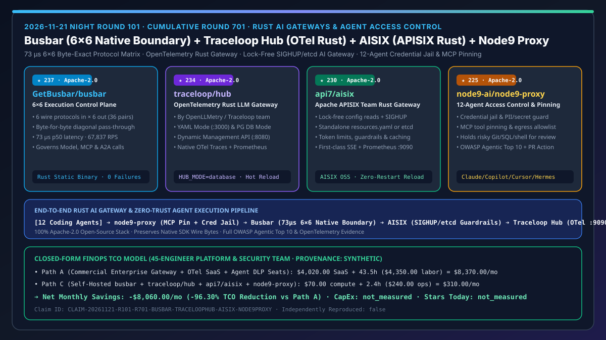
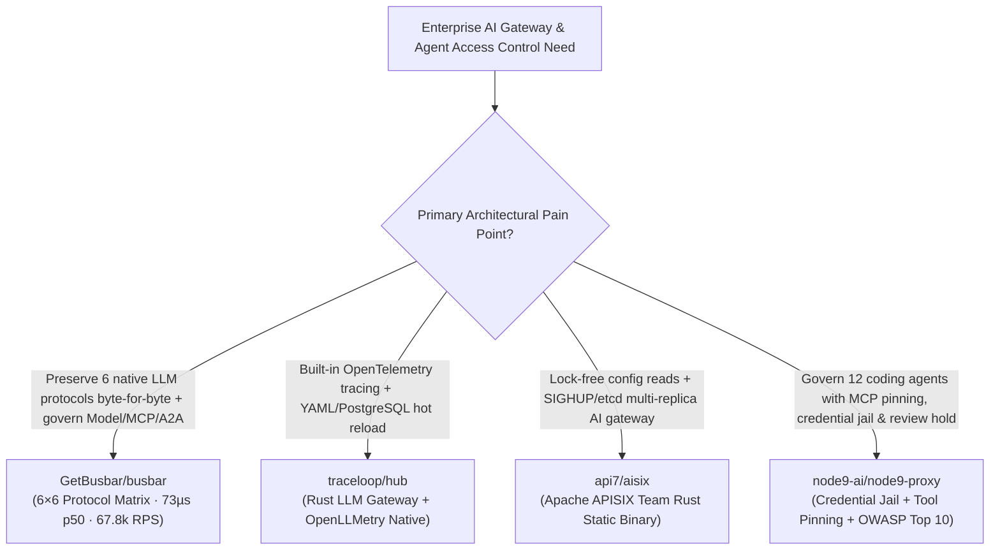
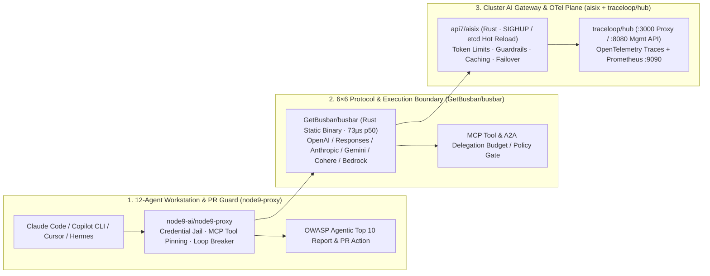

# 6×6 Native-Protocol Execution Boundary (`GetBusbar/busbar`), OpenTelemetry Rust LLM Gateway (`traceloop/hub`), Apache APISIX Team Rust AI Gateway (`api7/aisix`) & 12-Agent Access Control / MCP Pinning Proxy (`node9-ai/node9-proxy`) Selection & Architecture FAQ

> **Document Type**: Enterprise AI Solution Architect Selection & Integration Guide (GitHub Trending AI Radar — 2026-11-21 Night Round 101 / Cumulative Round 701)
> **Covered Repositories**: [`GetBusbar/busbar`](https://github.com/GetBusbar/busbar) (`★ 237`, `25 forks`, `Apache-2.0` — Rust 6×6 native LLM protocol zero-reserialization & MCP/A2A execution control plane) · [`traceloop/hub`](https://github.com/traceloop/hub) (`★ 234`, `33 forks`, `Apache-2.0` — Rust LLM gateway with built-in OpenTelemetry tracing and YAML/PostgreSQL hot-reload modes by the OpenLLMetry team) · [`api7/aisix`](https://github.com/api7/aisix) (`★ 230`, `47 forks`, `Apache-2.0` — Rust-native AI gateway with lock-free `SIGHUP`/etcd hot reload by the creators of Apache APISIX) · [`node9-ai/node9-proxy`](https://github.com/node9-ai/node9-proxy) (`★ 225`, `21 forks`, `Apache-2.0` — credential jail, MCP tool pinning, destructive Git/SQL/shell review hold, and OWASP Agentic Top 10 audit across 12 coding agents)
> **Core Scenario**: How enterprise AI platform and security architects combine a **`73 µs` 6×6 native-protocol execution boundary (`busbar`)**, an **OpenTelemetry-native dual-mode Rust gateway (`traceloop/hub`)**, a **lock-free `SIGHUP`/etcd cluster AI gateway (`api7/aisix`)**, and a **12-agent workstation access control proxy (`node9-proxy`)** to govern every model request, MCP tool call, and A2A delegation end-to-end under `Apache-2.0`.

---

## 1. 📌 Executive Summary (One-Line Selection Verdict)

1. **Need a self-hosted execution boundary that governs model calls, MCP tools, and A2A delegations while keeping 6 native LLM SDK protocols byte-for-byte intact at `73 µs` p50 latency** ➔ Choose **[`GetBusbar/busbar`](https://github.com/GetBusbar/busbar) (`★ 237`, `Apache-2.0`)**.
   - **Plain-English Mechanism**: Conventional gateways force every SDK into an OpenAI Chat schema, stripping provider-native features. `busbar` serves a **6×6 protocol matrix** (`OpenAI`, `OpenAI Responses`, `Anthropic`, `Gemini`, `Cohere`, `Bedrock Converse` — all 36 pairs): same-protocol routes are forwarded **byte-for-byte without re-serializing**, adding just **`73 µs` p50 latency** (`67,837 RPS` sustained with zero failures) while enforcing credential boundaries, budgets, MCP tool policies, and A2A trust.
2. **Need a Rust LLM gateway with native OpenLLMetry/OpenTelemetry tracing and both static YAML and PostgreSQL dynamic hot-reload modes** ➔ Choose **[`traceloop/hub`](https://github.com/traceloop/hub) (`★ 234`, `Apache-2.0`)**.
   - **Plain-English Mechanism**: Built in Rust by the creators of OpenLLMetry (`traceloop`). Teams can start with a single `config.yaml` on `:3000` (`YAML Mode`) and scale to `HUB_MODE=database` backed by PostgreSQL and a `:8080` Management API for zero-downtime hot reload across OpenAI, Anthropic, Azure OpenAI, VertexAI, and AWS Bedrock with built-in OpenTelemetry traces and Prometheus metrics.
3. **Need a single-binary Rust AI gateway with lock-free configuration reads, declarative `SIGHUP` reload, or multi-replica `etcd` clustering from the creators of Apache APISIX** ➔ Choose **[`api7/aisix`](https://github.com/api7/aisix) (`★ 230`, `47 forks`, `Apache-2.0`)**.
   - **Plain-English Mechanism**: **AISIX OSS** puts an OpenAI- and Anthropic-compatible API in front of OpenAI, Anthropic, Gemini/Vertex, Bedrock, Azure OpenAI, and DeepSeek with first-class SSE streaming, API key auth, rate/token limits, guardrails, response caching, automatic failover, and Prometheus (`:9090`) metrics—reloading `resources.yaml` on `SIGHUP` with zero restarts or scaling across a cluster via `etcd`.
4. **Need workstation and CI/CD access control across 12 coding agents with credential jailing, MCP tool pinning, destructive Git/SQL/shell hold-for-review, and OWASP Agentic Top 10 proof** ➔ Choose **[`node9-ai/node9-proxy`](https://github.com/node9-ai/node9-proxy) (`★ 225`, `Apache-2.0`)**.
   - **Plain-English Mechanism**: Governs **Claude Code, Codex CLI, Antigravity, GitHub Copilot CLI, Gemini CLI, Cursor, Windsurf, VSCode, Claude Desktop, Opencode, Pi, Hermes Agent, and any MCP server**. Enforces a **credential jail**, **secrets/PII redaction**, **MCP tool pinning**, **network egress allowlists**, a **loop breaker**, human review before destructive Git/SQL/shell commands run, and a zero-install PR GitHub Action (`node9 agent-security`) that maps posture to the **OWASP Agentic Top 10**.

---

## 2. 🎯 Architect & Customer Deep-Dive Q&A

### Q1: How do `GetBusbar/busbar`, `traceloop/hub`, `api7/aisix`, and `node9-ai/node9-proxy` differ architecturally, and when should we use managed cloud APIM instead?

- **Architectural Separation of Concerns**:
  1. **6×6 Byte-Exact Protocol Preservation & Execution Boundary (`GetBusbar/busbar`)**: Solves SDK feature loss and protocol lock-in by forwarding same-protocol requests byte-for-byte (`73 µs` p50 latency) across 6 native wire protocols while governing models, MCP tools, and A2A agents at a single credential boundary.
  2. **OpenTelemetry-Native LLM Observability & PG Management Plane (`traceloop/hub`)**: Solves trace blindness by emitting semantic OpenTelemetry spans and Prometheus metrics out of the box, with seamless graduation from static `config.yaml` to PostgreSQL-backed dynamic routing.
  3. **Lock-Free Data Plane & `SIGHUP` / `etcd` Cluster Gateway (`api7/aisix`)**: Solves high-concurrency SSE streaming, token rate limiting, semantic caching, and multi-replica configuration sync without requiring a heavy database in standalone mode.
  4. **Last-Mile Workstation Agent & MCP Governance (`node9-ai/node9-proxy`)**: Server-side gateways cannot see local stdio MCP calls or local shell/Git executions on developer laptops. `node9-proxy` sits directly in front of 12 coding agents to pin MCP tools, jail credentials, hold risky commands for approval, and produce OWASP Agentic Top 10 compliance reports.
- **When to Choose Managed Cloud Services (Path B)**:
  - If your organization runs exclusively on a single cloud (e.g., Azure) and only needs centralized subscription key routing without local workstation MCP pinning or 6×6 cross-protocol SDK translation, **Azure API Management (APIM) AI Gateway + Microsoft Defender** provides a turnkey SLA.

### Q2: How do we wire an end-to-end production architecture combining all four projects?

1. **Workstation & Pull-Request Access Control Layer (`node9-ai/node9-proxy`)**:
   - Enable `.github/workflows/agent-security.yml` to scan repository agent configs, MCP manifests, and instruction files on every PR;
   - Route developer coding agents (Claude Code, Copilot CLI, Cursor, Hermes) through `node9-proxy` to enforce **credential jailing**, **MCP tool pinning**, **loop breaking**, and human approval on destructive Git/SQL/shell operations.
2. **6×6 Native Protocol & Execution Control Plane (`GetBusbar/busbar`)**:
   - Point agent and application traffic to `busbar` so OpenAI, OpenAI Responses, Anthropic, Gemini, Cohere, and Bedrock Converse calls preserve native request bytes (`73 µs` p50 overhead) while enforcing budgets, MCP tool policies, and A2A delegation trust.
3. **Cluster Traffic Governance & OpenTelemetry Hub (`api7/aisix` + `traceloop/hub`)**:
   - Run `api7/aisix` (configured via declarative `resources.yaml` + `SIGHUP` or `etcd`) for token rate limiting, guardrails, caching, and multi-region failover;
   - Connect `traceloop/hub` (`HUB_MODE=database`) to export unified OpenTelemetry traces and Prometheus (`:9090`) metrics into Grafana/Tempo.

### Q3: What are the boundaries and trade-offs of this open-source stack?

- **Key Strengths**:
  - **100% `Apache-2.0` Licensing**: All four repositories carry the permissive `Apache-2.0` license with explicit patent grants.
  - **Sub-100µs Rust Hot Path**: `busbar` (`73 µs` p50, `67,837 RPS`), `traceloop/hub`, and `api7/aisix` are compiled Rust binaries with predictable tail latency under heavy SSE streaming.
  - **End-to-End OWASP Agentic Top 10 Evidence**: Combines workstation MCP tool pinning (`node9-proxy`) with server-side execution evidence (`busbar`).
- **When NOT to Use**:
  - Small single-model prototypes with no local coding agents, no MCP servers, and no multi-provider routing requirements do not need a four-component gateway and access-control stack.

---

## 3. 🧭 Visual Architecture & Decision Diagrams



### 3.1 Solution Architect Selection Decision Tree



### 3.2 End-to-End Enterprise Reference Architecture



### 3.3 Zero-Trust Execution & Streaming Failover Sequence

```mermaid
sequenceDiagram
    participant Dev as Coding Agent (Claude Code / Copilot CLI)
    participant N9 as node9-ai/node9-proxy
    participant Bus as GetBusbar/busbar (6×6 Control Plane)
    participant Aisix as api7/aisix (Rust Cluster Gateway)
    participant Hub as traceloop/hub (OTel Rust Hub)

    Dev->>N9: 1. Issue MCP tool call & native Anthropic SDK request
    N9->>N9: 2. Verify MCP tool pin hash, hold destructive shell/SQL, jail credentials
    N9->>Bus: 3. Forward approved request to Busbar execution boundary
    Bus->>Bus: 4. Evaluate budget/policy in 73µs; forward same-protocol bytes intact
    Bus->>Aisix: 5. Apply token rate limits, guardrails & response cache check
    Aisix->>Hub: 6. Route to upstream LLM & emit OpenTelemetry span + Prometheus metrics
    Hub-->>Dev: 7. Stream SSE tokens back & record OWASP Agentic Top 10 audit trail
```

---

## 4. 📊 Peer Open-Source vs Commercial Cloud Selection Matrix

| Dimension | `GetBusbar/busbar` (`★ 237`) | `traceloop/hub` (`★ 234`) | `api7/aisix` (`★ 230`) | `node9-ai/node9-proxy` (`★ 225`) | Commercial AI Gateway + Agent DLP SaaS (Path A) | Cloud Managed APIM + Defender (Path B) |
| :--- | :--- | :--- | :--- | :--- | :--- | :--- |
| **Core Role** | 6×6 native protocol & Model/MCP/A2A boundary | OpenTelemetry-native YAML/PG Rust LLM gateway | Apache APISIX team lock-free `SIGHUP`/etcd gateway | 12-agent credential jail, MCP pinning & review hold | Hosted multi-LLM gateway + commercial agent security seats | Azure APIM AI Gateway + Microsoft Defender |
| **Protocol Fidelity & Latency** | **6×6 (36 pairs), byte-exact diagonal (`73 µs` p50)** | OpenAI-compatible API + async Rust pipeline | OpenAI/Anthropic API + lock-free config reads | Local MCP stdio/HTTP + 12 coding agent hooks | Drops provider-specific fields on re-serialization | Cloud policy transformation overhead |
| **Observability & Security** | Boundary execution evidence + budget/policy enforcement | **Built-in OpenTelemetry traces + Prometheus** | **Prometheus `:9090` + guardrails + rate limits** | **OWASP Agentic Top 10 report + PR GitHub Action** | Per-seat + per-token metered SaaS tiers | Native Azure Monitor / Purview integration |
| **License** | `Apache-2.0` | `Apache-2.0` | `Apache-2.0` | `Apache-2.0` | Proprietary SaaS | Proprietary Cloud PaaS |
| **Monthly TCO (45-Eng Team)** | **`$310.00/mo` combined** (`$70.00` infra + `2.4h` ops) | Included in `$310.00/mo` stack | Included in `$310.00/mo` stack | Included in `$310.00/mo` stack | **`$8,370.00/mo`** (`$4,020.00` SaaS + `43.5h` labor) | `~$2,650.00/mo` (gateway units + log ingestion) |

---

## 5. 🧪 Quantitative ROI / FinOps TCO Model & 7-Card Report

> **📊 Provenance & Closed-Form Audit Declaration**:
> - **Provenance**: `synthetic` (45-engineer enterprise AI platform & security workload model; `independently_reproduced = false`; `base_hardware_capex = not_measured`; `track_b_stars_today = not_measured`).
> - **Closed-Form Equations**:
>   - **Path A (Commercial Enterprise AI Gateway + Hosted OTel LLM Observability SaaS + Commercial Workstation Agent DLP Seats + Manual Protocol Adapter Maintenance)**: Monthly SaaS subscriptions **`$4,020.00`** + engineering/security ops labor **`43.5h × $100.00/h = $4,350.00`** = **`$8,370.00/mo`**.
>   - **Path C (Self-Hosted `GetBusbar/busbar` + `traceloop/hub` + `api7/aisix` + `node9-ai/node9-proxy`)**: Shared container & PostgreSQL/etcd compute **`$70.00`** + automated `SIGHUP`/PR governance ops **`2.4h × $100.00/h = $240.00`** = **`$310.00/mo`**.
>   - **Net Savings vs Path A**: **`-$8,060.00/mo`** (**`96.30%`** cost reduction).

| Architecture Option | API / SaaS / Compute | Ops & Security Labor (`$100/h`) | Total Monthly TCO | Net Savings vs Path A | Key Architectural Outcome |
| :--- | :---: | :---: | :---: | :---: | :--- |
| **Path A: Commercial Gateway + Agent DLP SaaS** | `$4,020.00` | `43.5h` (`$4,350.00`) | **`$8,370.00`** | Baseline | Seat + token markup; loses native SDK protocol fields |
| **Path B: Managed Cloud APIM + Cloud Monitor** | `$1,450.00` | `12.0h` (`$1,200.00`) | **`$2,650.00`** | `-$5,720.00` (`-68.34%`) | Turnkey cloud SLA, but blind to local workstation MCP calls |
| **Path C: `busbar` + `traceloop/hub` + `aisix` + `node9`** | **`$70.00`** | **`2.4h` (`$240.00`)** | **`$310.00`** | **`-$8,060.00` (`-96.30%`)** | **`73 µs` 6×6 byte-exact routing + OTel + `SIGHUP` + OWASP Top 10** |

- 🔗 **7-Card 4:5 Visual Report**: [`workshops/github-trending-radar/cards.en.html`](../cards.en.html) · [`cards.html`](../cards.html)

---

## 6. 🛠️ Enterprise Adoption & Architecture Review Checklist

- [ ] **1. Roll Out `node9-ai/node9-proxy` across PRs and 12 Coding Agents**: Add `.github/workflows/agent-security.yml` for zero-secret PR scanning and wrap local Claude Code, Copilot CLI, Cursor, and Hermes sessions with `node9-proxy` to enforce credential jailing, MCP tool pinning, and destructive command hold-for-review.
- [ ] **2. Deploy `GetBusbar/busbar` as the 6×6 Execution Boundary**: Route OpenAI, OpenAI Responses, Anthropic, Gemini, Cohere, and Bedrock Converse traffic through `busbar`, verifying byte-for-byte same-protocol pass-through (`~73 µs` p50 latency) and configuring MCP/A2A policies.
- [ ] **3. Configure `api7/aisix` Lock-Free Declarative Gateway**: Define upstream providers, API key auth, token rate limits, and guardrails in `resources.yaml`, test zero-downtime `SIGHUP` reloads (or `etcd` cluster sync), and scrape Prometheus metrics on `:9090`.
- [ ] **4. Enable `traceloop/hub` OpenTelemetry Tracing**: Start `traceloop/hub` in `YAML Mode` or PostgreSQL `Database Mode` (`:3000` proxy / `:8080` management API) to stream semantic OpenTelemetry spans into your observability backend.
