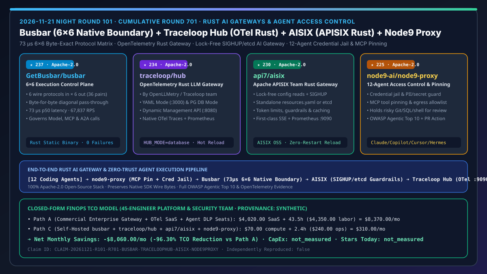
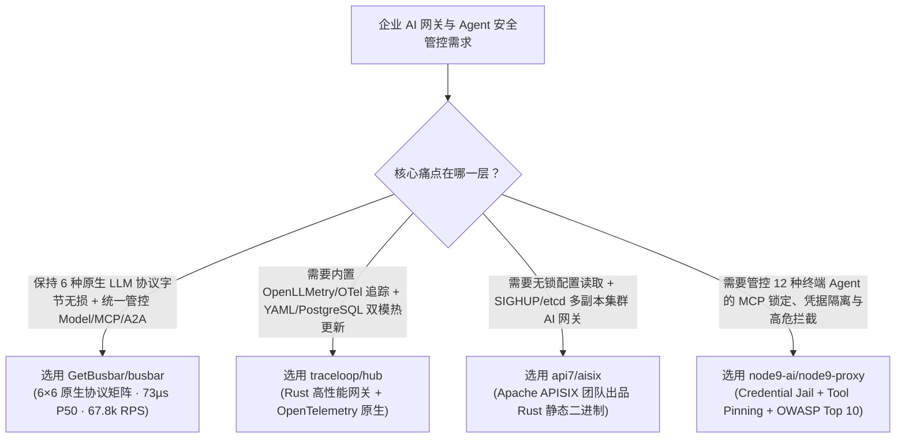
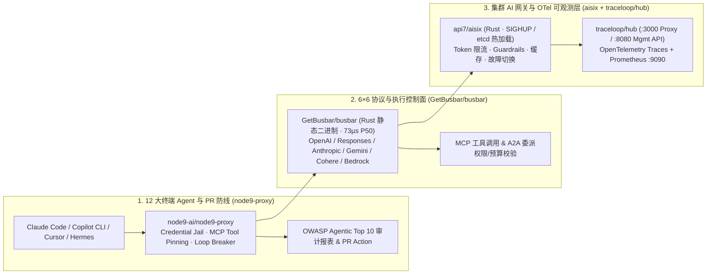
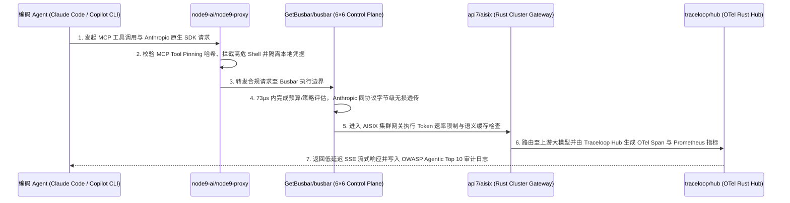

# 6×6 原生协议边界网关（`GetBusbar/busbar`）、OpenTelemetry 原生 Rust 网关（`traceloop/hub`）、Apache APISIX 团队 Rust AI 网关（`api7/aisix`）与 12 大 Agent 权限及 MCP 锁定代理（`node9-ai/node9-proxy`）选型与集成架构 FAQ

> **文档类型**：企业 AI 解决方案架构师（AI Solution Architect）选型决策指南（GitHub Trending AI 雷达 2026-11-21 Night Round 101 / 累计第 701 轮）
> **覆盖项目**：[`GetBusbar/busbar`](https://github.com/GetBusbar/busbar)（`★ 237`、`25 forks`、`Apache-2.0`，Rust 6×6 原生大模型协议零重序列化与 MCP/A2A 执行控制面）· [`traceloop/hub`](https://github.com/traceloop/hub)（`★ 234`、`33 forks`、`Apache-2.0`，OpenLLMetry 团队打造的内置 OpenTelemetry 追踪与双模式热加载 Rust LLM 网关）· [`api7/aisix`](https://github.com/api7/aisix)（`★ 230`、`47 forks`、`Apache-2.0`，Apache APISIX 原班团队打造的 `SIGHUP`/etcd 无锁热更新 Rust AI 网关）· [`node9-ai/node9-proxy`](https://github.com/node9-ai/node9-proxy)（`★ 225`、`21 forks`、`Apache-2.0`，横跨 12 大编码 Agent 的凭据监狱、MCP 工具指纹锁定、高危 Git/SQL 拦截与 OWASP Agentic Top 10 审计代理）
> **核心场景**：当企业安全与平台架构团队既需要**在模型、MCP 工具与 A2A 委派边界保持 6 种原生 SDK 协议字节级无损透传且延迟低于 `73 µs`**，又需要**将大模型调用链路直接接入 OpenTelemetry/Prometheus 全链路可观测与无锁 `SIGHUP`/etcd 集群配置热加载**，同时还要**在研发终端对 Claude Code / Copilot CLI / Cursor / Hermes 等 12 种 Agent 实施 MCP 工具防篡改锁定（Tool Pinning）、凭据隔离与 OWASP Agentic Top 10 合规审计**时，如何用这四个 `Apache-2.0` 开源利器组建端到端 Rust AI 网关与终端访问控制防线？

---

## 一、📌 核心结论速览（选型一句话结论）

1. **想在不改写任何原生 SDK（Anthropic / OpenAI Responses / Bedrock Converse / Gemini 等）的前提下，统一管控模型调用、MCP 工具与 A2A 跨 Agent 委派** ➔ 选 **[`GetBusbar/busbar`](https://github.com/GetBusbar/busbar)（`★ 237`，`Apache-2.0`）**。
   - **通俗原理**：绝大多数 AI 网关强制把所有入站请求转换成 OpenAI Chat 兼容格式，导致 Anthropic Extended Thinking、OpenAI Responses API 或 Bedrock Converse 的原生字段丢失。`busbar` 实现了 **6×6 全矩阵原生协议互通**（OpenAI、OpenAI Responses、Anthropic、Gemini、Cohere、Bedrock Converse 共 36 种组合）：同协议路由**字节级原样透传（不重新序列化）**，跨协议路由精准映射；单次请求网关 P50 附加延迟仅 **`73 µs`**（单核可持续支撑 **67,837 RPS** 零失败），并在同一边界管控模型预算、MCP 工具权限与 A2A 信任委托。
2. **想要与 OpenLLMetry / OpenTelemetry 生态深度融合，且支持单文件 `config.yaml` 与 PostgreSQL 动态管理 API 双模式平滑演进的 Rust LLM 网关** ➔ 选 **[`traceloop/hub`](https://github.com/traceloop/hub)（`★ 234`，`Apache-2.0`）**。
   - **通俗原理**：由可观测性开源项目 OpenLLMetry 背后的 Traceloop 团队用 Rust 编写。起步阶段只需挂载一个 `config.yaml`（YAML Mode）即可监听 `:3000` 统一代理 OpenAI、Anthropic、Azure OpenAI、VertexAI 与 Bedrock；进入多租户生产阶段后，开启 `HUB_MODE=database` 挂载 PostgreSQL 与 `:8080` Management API 即可实现动态路由热更新，且原生输出标准 OpenTelemetry Traces 与 Prometheus 指标。
3. **已有 Apache APISIX / Kubernetes 云原生网关经验，需要单静态二进制、无锁读取、`SIGHUP` 声明式热重载或 `etcd` 多副本集群同步的企业级 Rust AI 网关** ➔ 选 **[`api7/aisix`](https://github.com/api7/aisix)（`★ 230`，`47 forks`，`Apache-2.0`）**。
   - **通俗原理**：由 Apache APISIX 原创团队（API7.ai）用 Rust 专门为大模型与 Agent 流量重写的开源网关 **AISIX OSS**。无需数据库即可通过单个声明式 `resources.yaml` 并在收到 `SIGHUP` 信号时零停机无锁重载配置，或连接 `etcd` 组建高可用多副本集群；原生内置 API Key 鉴权、Token 速率限制、内容护栏（Guardrails）、响应缓存、故障自动切换与 `:9090` Prometheus 监控。
4. **要在研发终端与 CI/CD 流水线中管控 12 种主流 AI 编码 Agent（防凭据泄露、防 MCP 工具投毒、拦截破坏性 Git/SQL/Shell 命令并生成 OWASP Agentic Top 10 报告）** ➔ 选 **[`node9-ai/node9-proxy`](https://github.com/node9-ai/node9-proxy)（`★ 225`，`Apache-2.0`）**。
   - **通俗原理**：Agent 能访问 Slack、GitHub、邮件和生产数据库，一旦遭遇提示词注入或 MCP 工具描述被篡改（Rug Pull），后果不堪设想。`node9-proxy` 横跨 **Claude Code、Codex CLI、GitHub Copilot CLI、Gemini CLI、Cursor、Windsurf、VSCode、Claude Desktop、Opencode、Pi、Hermes Agent 等 12 大工具**，提供 **凭据监狱（Credential Jail）**、**MCP 工具哈希锁定（Tool Pinning）**、**高危 Git/SQL/Shell 挂起人工审批**、**死循环熔断器（Loop Breaker）** 以及零安装 PR 安全扫描 Action，自动汇总 **OWASP Agentic Top 10** 合规报表。

---

## 二、🎯 客户与架构师灵魂拷问 Q&A（深度架构拆解）

### Q1：我们已经在看 Rust/Go 编写的高性能 AI 网关了，`GetBusbar/busbar`、`traceloop/hub`、`api7/aisix` 与 `node9-ai/node9-proxy` 各自解决的架构痛点有什么本质区别？和云托管 APIM 怎么选？

- **痛点拆分**：
  1. **原生 SDK 字段丢失 vs 6×6 协议无损矩阵（`GetBusbar/busbar`）**：研发团队使用 Anthropic SDK 的缓存断点、OpenAI Responses API 的状态 ID 或 AWS Bedrock Converse 时，传统“OpenAI 格式一刀切”网关会把非标字段吃掉。`busbar` 的 6×6 协议矩阵对角线采用**零重序列化字节透传（`73 µs` P50 延迟）**，同时把模型调用、MCP 工具与 A2A 委派收敛到同一个自托管静态 Rust 边界。
  2. **LLM 可观测性割裂 vs OpenTelemetry 原生双模网关（`traceloop/hub`）**：很多网关只统计 HTTP 状态码，看不见 Prompt/Completion Token 分布和子树 Span。`traceloop/hub` 原生集成 OpenLLMetry / OpenTelemetry 语义约定，支持从单文件 YAML 平滑升级到 PostgreSQL 动态热更新管理面。
  3. **多副本集群同步与网关生态（`api7/aisix`）**：对于追求云原生无锁数据面（Lock-free Config Reads）与 `etcd` 多节点配置同步的平台工程团队，Apache APISIX 团队出品的 `aisix` 提供了工业级 SSE 流式转发、Token 限流与 `SIGHUP`/etcd 热重载。
  4. **终端 Agent 工具调用失控（`node9-ai/node9-proxy`）**：服务端网关管不到开发者笔记本上本地启动的 stdio MCP Server 或本地 Shell/Git 操作。`node9-proxy` 专门卡在本地 12 大 Agent 与 MCP/Shell/网络出站之间，拦截破坏性命令并输出 OWASP Agentic Top 10 审计记录。
- **何时直接用云厂商托管方案（Path B）？**
  - 若企业全部部署在单一云（如全栈 Azure），且只需基础的订阅密钥分发与配额管理，直接使用 **Azure API Management (APIM) AI Gateway + Microsoft Defender for Cloud** 即可免运维交付。

### Q2：典型企业级“终端 Agent 安全准入 + 6×6 原生协议控制面 + OTel/APISIX 高可用网关”生产参考架构怎么搭？

1. **终端与 PR 准入层（`node9-ai/node9-proxy`）**：
   - 在 GitHub 仓库启用 `node9 agent-security` Action 扫描 PR 中的 `.mcp.json`、Agent 指令与工作流权限风险；
   - 在工程师终端将 Claude Code、GitHub Copilot CLI、Cursor、Hermes Agent 接入 `node9-proxy`，开启 **MCP Tool Pinning**（防止远端 MCP 偷偷修改工具签名）、**Credential Jail**（隔离本地 `.env`/SSH 私钥）与高危 `git push --force` / `DROP TABLE` 人工确认拦截。
2. **Agent 执行边界与 6×6 协议控制面（`GetBusbar/busbar`）**：
   - 所有 Agent 发出的模型请求（6 种原生协议）、远端 MCP 工具调用与跨部门 A2A 委派统一经过 `busbar`，在 **`73 µs`** 内完成预算扣减、策略校验、同协议字节级透传或跨协议转换，并留存不可篡改的执行证据。
3. **多模型集群流量调度与 OTel 可观测层（`api7/aisix` + `traceloop/hub`）**：
   - 边缘接入层部署 `api7/aisix`（基于 `resources.yaml` 或 `etcd` 多副本集群）执行全局 Token 速率限制、语义缓存与跨云主备切换；
   - 核心可观测与动态路由层配合 `traceloop/hub`（`HUB_MODE=database`），将全量大模型调用 Span 实时推送至企业 OpenTelemetry Collector 与 Grafana/Prometheus（`:9090`）。

### Q3：这四个开源项目的优缺点边界是什么？什么情况下不该自建？

- **核心优势**：
  - **全部采用 `Apache-2.0` 宽松商业友好协议**：四大项目无一例外均为 `Apache-2.0` 开源，企业内部魔改、私有化打包或嵌入商业产品均无传染风险。
  - **Rust 极致性能与零 GC 抖动**：`busbar`（`73 µs` P50 / `67,837 RPS`）、`traceloop/hub` 与 `api7/aisix` 全部采用 Rust 构建，彻底消除 Python/Node.js 网关在高并发 SSE 流式输出下的内存膨胀与 GC 毛刺。
  - **覆盖 OWASP Agentic Top 10 终端盲区**：`node9-proxy` 补齐了云端 AI 网关无法触达的本地 12 大编码 Agent 与 stdio MCP 安全管控闭环。
- **不适用边界（何时不选）**：
  - 若团队只有 2–3 名开发者、只调用单一 OpenAI 接口且不涉及多协议 SDK、MCP 工具或合规审计，直接用官方 SDK 即可，无需额外部署四层网关与代理。

---

## 三、🧭 直观可视化图解（Mermaid 决策树 + 集成架构 + 时序图）

### 3.1 架构师选型决策树

### 3.2 企业端到端生产集成参考架构图

### 3.3 全链路零信任执行与多模型流式转发时序图

---

## 四、📊 同类开源与商业云服务横向选型决策矩阵

| 对比维度 | `GetBusbar/busbar` (`★ 237`) | `traceloop/hub` (`★ 234`) | `api7/aisix` (`★ 230`) | `node9-ai/node9-proxy` (`★ 225`) | 商业网关 + Agent DLP SaaS (Path A) | 云原生托管 APIM + Defender (Path B) |
| :--- | :--- | :--- | :--- | :--- | :--- | :--- |
| **核心架构定位** | 6×6 原生协议矩阵与 Model/MCP/A2A 执行边界 | 内置 OpenTelemetry 的 YAML/PG 双模 Rust 网关 | Apache APISIX 团队无锁 `SIGHUP`/etcd Rust 网关 | 12 大 Agent 凭据监狱、MCP 锁定与高危动作审批 | 商业托管多模型网关 + 商业终端 Agent 安全审计 | Azure APIM AI Gateway + Microsoft Defender |
| **协议保真度与延迟** | **6×6 共 36 种组合，同协议字节透传（`73 µs` P50）** | OpenAI 兼容统一接口 + Rust 异步流水线 | OpenAI/Anthropic 兼容 + 无锁配置热重载 | 本地 MCP stdio/HTTP + 12 种 Agent 工具拦截 | 常因重序列化丢失原生扩展字段 | 依赖云网关策略转换策略 |
| **可观测性与安全审计** | 边界执行证据留存 + 预算/权限策略 | **原生 OpenTelemetry Tracing + Prometheus** | **Prometheus `:9090` + Guardrails + 限流** | **OWASP Agentic Top 10 报表 + PR 静态扫描** | 按 Seat / Token 阶梯高额收费 | 原生集成 Azure Monitor / Purview |
| **开源协议** | `Apache-2.0` | `Apache-2.0` | `Apache-2.0` | `Apache-2.0` | 闭源商业 SaaS | 闭源云厂商 PaaS |
| **月度 TCO（45 人团队）** | **组合仅 `$310.00/月`**（含共享容器与 2.4h 运维） | 同左（`$70.00` 算力 + `$240.00` 人工） | 同左（静态 Rust 二进制零外部依赖） | 同左（本地代理 + GitHub Action 零费用） | **`$8,370.00/月`**（`$4,020.00` 订阅 + `43.5h` 人工） | 约 `$2,650.00/月`（按网关实例与日志量计费） |

---

## 五、🧪 应用落地定量收益/TCO 对比与 7-Card 报告

> **📊 数据来源与闭式核算声明（Provenance & Closed-Form Schema）**：
> - ** provenance**: `synthetic`（基于 45 人企业 AI 平台与安全团队工作负载模型：`independently_reproduced = false`；硬件采购基线 `base_hardware_capex = not_measured`；Track B 单日增量 `track_b_stars_today = not_measured`）。
> - **核算公式**：
>   - **Path A（商业多协议 AI 网关企业版 + 商业 OTel LLM 追踪 SaaS + 商业终端 Agent DLP 席位费 + 手工跨协议适配与安全排障）**：月度 SaaS 订阅费 **`$4,020.00`** + 人工维护与排障 **`43.5h × $100.00/h = $4,350.00`** = **`$8,370.00/月`**。
>   - **Path C（自建 `GetBusbar/busbar` + `traceloop/hub` + `api7/aisix` + `node9-ai/node9-proxy` 开源组合）**：轻量容器与 PostgreSQL/etcd 共享算力 **`$70.00`** + 自动化配置热加载与 PR 审计维护 **`2.4h × $100.00/h = $240.00`** = **`$310.00/月`**。
>   - **净节省（Net Savings vs Path A）**：**`-$8,060.00/月`**（成本降低 **`96.30%`**）。

| 评估方案 | API / SaaS / 算力成本 | 工程与安全运维人工（`$100/h`） | 月度总 TCO | 相对 Path A 净节省 | 关键架构交付指标 |
| :--- | :---: | :---: | :---: | :---: | :--- |
| **Path A：商业 AI 网关 + 商业 Agent DLP SaaS** | `$4,020.00` | `43.5h` (`$4,350.00`) | **`$8,370.00`** | Baseline | 跨协议字段易丢失、按席位与日志量双重涨价 |
| **Path B：云厂商托管 APIM + 云原生监控** | `$1,450.00` | `12.0h` (`$1,200.00`) | **`$2,650.00`** | `-$5,720.00` (`-68.34%`) | 云内闭环省心，但难以管控本地 12 种终端 Agent |
| **Path C：`busbar` + `traceloop/hub` + `aisix` + `node9`** | **`$70.00`** | **`2.4h` (`$240.00`)** | **`$310.00`** | **`-$8,060.00` (`-96.30%`)** | **`73 µs` 6×6 字节透传 + OTel 追踪 + `SIGHUP` 热加载 + OWASP Top 10** |

- 🔗 **关联 7-Card 4:5 视觉评测报告**：[`workshops/github-trending-radar/cards.html`](../cards.html) · [`cards.en.html`](../cards.en.html)

---

## 六、🛠️ 企业引入与架构评审 Checklist

- [ ] **1. 启用 `node9-ai/node9-proxy` 终端防护与 PR 扫描**：在核心代码库添加 `.github/workflows/agent-security.yml` 自动扫描 PR 中的 Agent/MCP 配置，并在研发终端开启 **MCP Tool Pinning**、**Credential Jail** 与高危 SQL/Git/Shell 人工确认，定期导出 **OWASP Agentic Top 10** 报告。
- [ ] **2. 部署 `GetBusbar/busbar` 守住 6×6 原生协议与执行边界**：将 OpenAI、OpenAI Responses、Anthropic、Gemini、Cohere 与 Bedrock Converse 请求统一路由至 `busbar`，验证同协议对角线字节级透传（P50 延迟 `~73 µs`）并配置模型预算、MCP 工具白名单与 A2A 委派策略。
- [ ] **3. 配置 `api7/aisix` 声明式无锁网关与 `SIGHUP`/etcd 热重载**：编写 `resources.yaml` 定义上游模型权重、API Key 鉴权、Token 速率限制与内容护栏（Guardrails），通过 `SIGHUP` 或 `etcd` 验证零停机配置热更新，并采集 `:9090` Prometheus 指标。
- [ ] **4. 接入 `traceloop/hub` 全链路 OpenTelemetry 追踪**：在生产环境开启 `HUB_MODE=database` 连接 PostgreSQL 与 `:8080` Management API，将 `:3000` 代理层产生的标准 OpenTelemetry Traces 汇聚至企业可观测平台。
