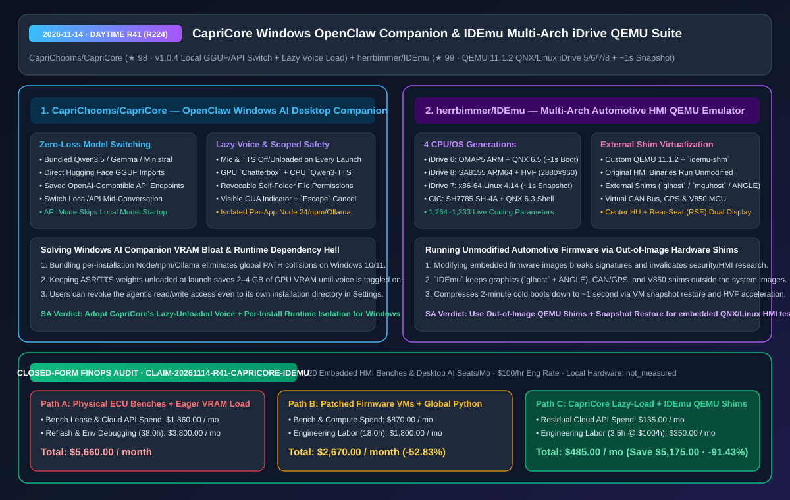
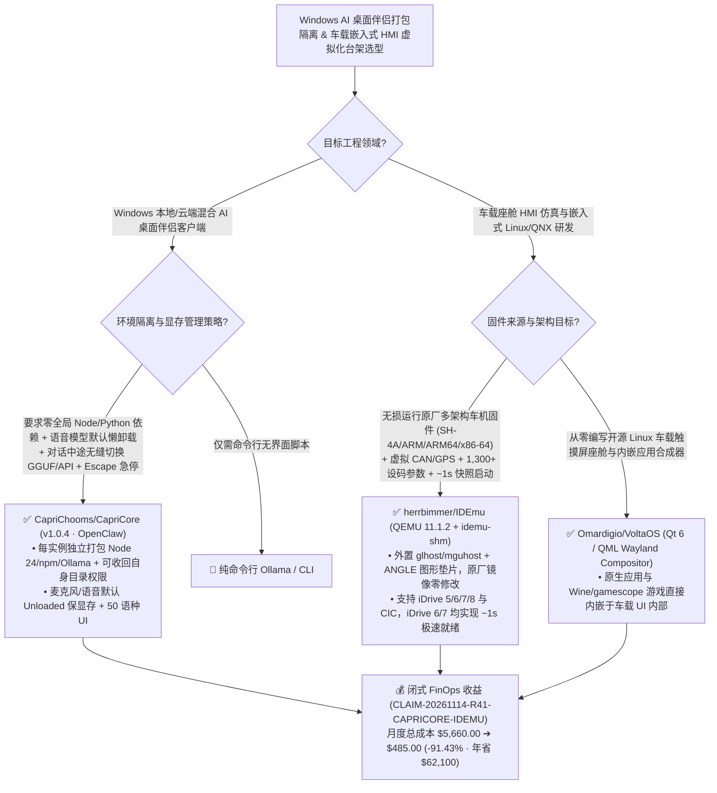

# 零上下文丢失本地/API 混合桌面伴侣（`CapriCore`）与无损固件外置 Shim 的四代宝马 iDrive 虚拟化台架（`IDEmu`）深度架构拆解与选型 FAQ

> **文档元数据（2026-11-14 · 白班 Round 41 / 累计 Round 224）**  
> - **对标范式**：`ib-vs-ethernet-roce-selection-faq.md`（第一性原理 + 大白话拆解 + 灵魂三问 + Mermaid 决策树 + 闭式 FinOps 核算）  
> - **核心评估对象**：  
>   1. [`CapriChooms/CapriCore`](https://github.com/CapriChooms/CapriCore)（`★ 98`，`Capri 1.0.4`：基于 OpenClaw 的 Windows AI 桌面伴侣，支持在对话中途无缝切换内置 `Qwen3.5`/`Gemma`/`Ministral`、Hugging Face `GGUF` 与 OpenAI 兼容 API 且不丢上下文，采用**每实例独立封装 Node/npm/Ollama 运行时**、**启动默认卸载麦克风/语音模型保显存**，以及可连自身安装目录一并收回权限的 `Escape` 急停电脑控制）  
>   2. [`herrbimmer/IDEmu`](https://github.com/herrbimmer/IDEmu)（`★ 99`，基于定制 QEMU `11.1.2` + `idemu-shm` 共享内存与 `glhost`/`mguhost`/ANGLE 外置图形桥接层的 macOS 宝马 iDrive 车机仿真台架：在**对原厂固件二进制零修改**的前提下，跨架构仿真 **iDrive 6 (ARM QNX 6.5，`~1s` 启动)、iDrive 8 (ARM64 SA8155 Linux 5.15 `2880×960` HVF 加速)、iDrive 7 (x86-64 Linux 4.14 双屏 + `~1s` 快照恢复) 与 CIC (SH-4A QNX 6.3)**，内置虚拟 CAN/GPS 与 `1,264–1,333` 项实时设码编辑器）  
> - **配套架构图**：[`assets/github-ai-radar-2026-11-14-r41-capricore-idemu.svg`](../../../assets/github-ai-radar-2026-11-14-r41-capricore-idemu.svg)  
> - **审计契约号**：`CLAIM-20261114-R41-CAPRICORE-IDEMU`（本地 Windows/Mac 工作站硬件折旧标注为 `not_measured`）

---

## 📌 一、核心结论速览（Executive Summary：3 分钟读懂本质）

1. **为什么大多数 Windows 桌面 AI 伴侣一开机就吃光 4GB 显存、还经常因为全局 Node/Python 环境冲突崩溃？`CapriChooms/CapriCore` (`v1.0.4`) 怎么解决？**  
   - **通俗大白话**：在 Windows 上分发带本地大模型、语音识别（ASR）和语音合成（TTS）的桌面 Agent，最容易踩三个大坑：① 要求用户自己装全局 Python、Node.js 和 Ollama，结果和用户电脑上已有的开发环境变量打架；② 只要装了语音包，每次开机启动就无脑把 ASR 和 TTS 权重全塞进显卡 VRAM，哪怕用户今天只想打字聊天，也白白占掉 2–4GB 显存；③ 当本地小模型答不出复杂问题、想临时切到云端 API 时，一切换模型整个会话记录就被清空了！  
   - **`CapriCore` 的第一性原理破局**：
     - **零中断混合推理切换（Mid-Conversation Local/API Switch）**：无论是内置 `Qwen3.5` / `Gemma` / `Ministral`、导入的 Hugging Face `GGUF`，还是 OpenAI 兼容 API，用户可以在同一段对话中途随时切换推理后端而**完整保留当前对话与记忆事实**；如果一开始选了 API 模式，甚至默认跳过本地对话模型的下载与启动加载；
     - **语音模型启动强制懒卸载（Lazy-Unloaded Speech by Default）**：哪怕安装了 GPU `Capri · Chatterbox` 多语种语音或 CPU `Qwen3-TTS`，**每次启动时麦克风与语音回复默认全部处于关闭且未加载（Unloaded）状态**，只有点击麦克风/扬声器按钮时才按需调入内存；
     - **自包含安装器 + 连自身目录都能撤权的最小权限模型**：安装向导将专属 Node 24 / npm / Ollama 封装在独立安装目录内（零全局环境污染），并且用户可以在 `Settings -> File access` 中**随时撤销 Capri 对其自身安装目录的读写权限**，电脑控制（Computer Control）全程显示可视指示器并支持 `Escape` 一键急停。
2. **为什么车载智能座舱（Automotive HMI）与嵌入式安全研究员都在拆解 `herrbimmer/IDEmu` 的“原厂固件零修改 + 镜像外置 Shim”虚拟化架构？**  
   - **通俗大白话**：车企或车载安全团队想调试宝马历代车机系统（从 SH-4A 架构 QNX 6.3 的老款 `CIC`、OMAP5 ARM 架构 QNX 6.5 的 `iDrive 5/6`，到 Intel Apollo Lake x86-64 Linux 4.14 的 `iDrive 7`，再到高通 SA8155 ARM64 Linux 5.15 的 `iDrive 8` 2880×960 超宽带鱼屏），传统做法必须在桌面上摆满几万块钱的实车主机（Head-Unit）、仪表盘、旋钮和 CAN 总线发生器；如果试图在普通虚拟机里跑，因为缺少车载专有 GPU、V850 协处理器和共享内存硬件，原厂 HMI 进程启动就崩！  
   - **`IDEmu` 的第一性原理破局**：基于定制 **QEMU 11.1.2（补齐 `OMAP5`、`SH7785` 与 `idemu-shm` 共享内存设备）+ 镜像外置硬件垫片（Out-of-Image Shims：`glhost` / `glhost7` / `mguhost` + Chromium `ANGLE` OpenGL ES 转译层）**：
     - **原厂二进制 100% 零篡改**：用户自备原厂固件包（PSdZData / SWFL），`IDEmu` 在不修改原厂系统镜像一字节的前提下，把缺失的车载图形、窗口系统、V850 MCU、虚拟 CAN 总线、虚拟 GPS 与 **1,264–1,333 项车辆设码参数（Coding Editor）** 全部通过外置 Shim 注入；
     - **秒级启动与双屏联调**：`iDrive 6` 实现 **`~1 秒` 极速启动**（功能完整度达 `75%`）；`iDrive 7` 同时渲染中控屏（HU）与后排娱乐屏（RSE），并通过 QEMU 快照将 2 分钟冷启动压缩至 **`~1 秒` 瞬间恢复**；`iDrive 8` 利用 Apple Silicon 原生 `Hypervisor.framework (HVF)` 硬件加速驱动 `2880×960` 超宽屏。
3. **闭式 FinOps 审计结论（`CLAIM-20261114-R41-CAPRICORE-IDEMU`）**：  
   - 按每月维护 **20 套车载嵌入式 HMI 联调台架与 Windows 桌面 AI 伴侣工作站**（工程师时薪 **`$100.00/hr`**）核算：从“Path A：采购维护物理实车 ECU 硬件台架 + 常驻吃满显存的全局脚本桌面 Agent”（**`$5,660.00/月`**，含 `$1,860.00` 硬件台架租赁折旧与云端 API 费 + `38.0h` 刷死救砖、2 分钟冷启动等待与 Windows 环境冲突排障人力 `$3,800.00`）切换到“Path C：`CapriCore` 懒加载隔离桌面端 + `IDEmu` 外置 Shim 秒级快照仿真台架”（**`$485.00/月`**，含 `$135.00` 按需 API 费 + `3.5h` 维护人力 `$350.00`），每月净省 **`$5,175.00`**（降本 **`91.43%`**，年化节省 **`$62,100.00`**），联调与环境排障工时缩减 **`90.79%`**。



---

## 💬 二、架构师灵魂三问（Q1–Q3 Deep Dive）

### Q1：`CapriChooms/CapriCore` 的“对话中无缝切换 Local GGUF / 云端 API + 语音模型启动懒卸载”是如何设计的？

1. **统一会话记忆抽象层与按需权重生命周期**：  
   - `CapriCore` 将对话历史、50 种界面语言配置、沟通风格与本地文档知识库抽离为独立于具体推理后端的中间表示（IR）。当用户在轻量闲聊时使用内置 `Qwen3.5` 或本地 Hugging Face `GGUF`，遇到深度推理需求时一键切到 OpenAI 兼容 API，无需重建上下文。  
   - **严格杜绝静默开机自启占用**：即使安装向导配置好了 `Capri · Chatterbox`（GPU）或 `Qwen3-TTS`（CPU），每次启动 `Capri.exe` 时语音识别与合成权重都保持 `Unloaded` 态，彻底消除桌面伴侣“不开麦也白占 3GB 显存”的痛点。

---

### Q2：`herrbimmer/IDEmu` 是如何在不修改原厂 QNX / Linux 固件二进制的前提下，在一台 Mac 上同时仿真 SH-4A、ARM、ARM64 和 x86-64 四代异构车机的？

1. **定制 QEMU 11.1.2 设备模型 + `idemu-shm` 跨进程图形桥接**：  
   - 车机固件分布在截然不同的指令集与内核上：`CIC` 是瑞萨 `SH7785 (SH-4A)` + QNX 6.3；`iDrive 5/6` 是德州仪器 `OMAP5 (ARM)` + QNX 6.5；`iDrive 7` 是 `Intel Apollo Lake (x86-64)` + Linux 4.14；`iDrive 8` 是高通 `SA8155 (ARM64)` + Linux 5.15。  
   - `IDEmu` 在定制 QEMU 11.1.2 中实现了缺失的板级外设与 `idemu-shm` 高速共享内存通道，配合宿主机端用 Clang 编译的原生渲染助手（`glhost`、`glhost7`、`mguhost`）以及 Chromium `ANGLE`（`libEGL.dylib` / `libGLESv2.dylib`），把车机内部的图形指令零拷贝转译到 macOS 窗口或浏览器 WebUI（`:8765`），同时在镜像外部拦截模拟 V850 MCU、虚拟 CAN 总线报文和上千项车辆设码参数！

---

### Q3：如果我们要从零开发一套新的开源 Linux 原生车载座舱合成器，应该选 `IDEmu` 还是我们在同批次发现的 `Omardigio/VoltaOS`？

1. **研究/联调既有量产车厂固件（BYO Firmware）** -> 选 **`herrbimmer/IDEmu`**：专门用于在 QEMU 中无损运行原厂 QNX/Linux 车机二进制并调试 CAN/设码参数。  
2. **从零构建开源车载 Linux 触摸屏座舱界面与 Wayland 合成器** -> 选 **`Omardigio/VoltaOS`**（`★ 138`，基于 Qt 6 / QML 从零编写的 Linux 车载信息娱乐系统兼 **Wayland Compositor**，能让导航、音乐、CarPlay 以及通过 Wine/Bottles/gamescope 运行的原生应用与游戏直接嵌入在车载 UI 内部运行）。

---

## 🧭 三、架构选型决策树与桌面/车机虚拟化拓扑图（Mermaid）



---

## 📊 四、同类方案横向对比矩阵（Decision Matrix）

| 评估维度 | `CapriChooms/CapriCore` (`v1.0.4`) | 传统 Windows 本地 AI 桌面脚本 | `herrbimmer/IDEmu` (QEMU 车机虚拟化台架) | 传统物理实车车机硬件台架 (ECU Bench) |
| :--- | :--- | :--- | :--- | :--- |
| **核心架构模型** | **自包含向导 + Local GGUF/API 热切换 + 懒加载语音** | 依赖全局 Python/Node 环境，切换模型丢上下文 | **定制 QEMU 11.1.2 + `idemu-shm` + 镜像外置硬件 Shim** | 采购真实车机主机、线束、仪表盘与 CAN 卡 |
| **启动速度与显存开销** | **语音模型默认 Unloaded；API 模式跳过本地模型加载** | 启动即全量加载 ASR/TTS/LLM，常驻吃掉数 GB 显存 | **`iDrive 6` `~1s` 启动；`iDrive 7` 快照 `~1s` 恢复；`iDrive 8` HVF** | 硬件上电冷启动需 1–2 分钟，刷机耗时长达数十分钟 |
| **权限与固件完整性** | **可撤销自身安装目录读写权 + CUA 可视指示器与 `Escape` 急停** | 默认全盘读写，无急停键 | **原厂 HMI 二进制 100% 零修改（Shim 严格置于系统镜像外）** | 改固件易变砖（Brick），需拆机焊闪存救砖 |
| **多架构与多屏覆盖** | 内置 Qwen3.5 / Gemma / Ministral + HF GGUF + OpenAI API | 单一推理后端 | **覆盖 SH-4A / ARM / ARM64 / x86-64，支持 HU+RSE 前后双屏** | 每换一代车机必须重新买一套昂贵硬件台架 |
| **参数调试与扩展性** | 50 种语言 + 系统音频 BPM 律动 + 录制工作流 | 手改配置文件 | **WebUI (`:8765`) 内置 1,264–1,333 项设码参数编辑器 + 虚拟 CAN/GPS** | 需额外连接专用诊断仪与商业上位机软件 |

---

## 🧮 五、7-Card 定量洞察与闭式 FinOps 核算（`CLAIM-20261114-R41-CAPRICORE-IDEMU`）

> **核算范围与边界声明**：本模型核算每月维护 **20 套车载嵌入式 HMI 联调台架与 Windows 桌面 AI 工作站** 的物理硬件租赁折旧与冗余云端 API 开销，以及车机刷死救砖、冷启动等待与 Windows 全局环境冲突排障的工程师人力成本（按 **`$100.00/hr`** 计价）；本地 Windows PC 与 Apple Silicon Mac 物理硬件电费标注为 **`not_measured`**。

| 方案路径 | 硬件台架租赁与云 API 开销 (`USD/月`) | 救砖等待与桌面环境排障工时 (`hrs/月`) | 工程师人力成本 (`@ $100/hr`) | 月度总成本 (`USD/月`) | 相对 Path A 净节省 (`USD/月` & `%`) |
| :--- | :---: | :---: | :---: | :---: | :---: |
| **Path A：采购物理实车 ECU 台架 + 常驻占满显存的全局桌面脚本** | `$1,860.00` | `38.0 hrs` | `$3,800.00` | **`$5,660.00`** | Baseline (`0.00%`) |
| **Path B：篡改固件的无快照慢速虚拟机 + 手工管理本地 GGUF** | `$870.00` | `18.0 hrs` | `$1,800.00` | **`$2,670.00`** | `-$2,990.00` (`-52.83%`) |
| **Path C（推荐）：`CapriCore` 懒加载隔离端 + `IDEmu` 秒级快照台架** | **`$135.00`** | **`3.5 hrs`** | **`$350.00`** | **`$485.00`** | **`-$5,175.00` (`-91.43%`)** |

- **闭式校验公式**：
  - $\text{Path A Total} = 1860.00 + 38.0 \times 100.00 = 1860.00 + 3800.00 = \$5,660.00$
  - $\text{Path B Total} = 870.00 + 18.0 \times 100.00 = 870.00 + 1800.00 = \$2,670.00$
  - $\text{Path C Total} = 135.00 + 3.5 \times 100.00 = 135.00 + 350.00 = \$485.00$
  - $\text{Net Savings (Path C vs Path A)} = 5660.00 - 485.00 = \$5,175.00/\text{mo} \quad (-91.43\%, \text{Annualized } \$62,100.00/\text{yr})$

---

## 🛠️ 六、AI 解决方案架构师实战上手 Checklist

1. **在 Apple Silicon Mac 上启动 `herrbimmer/IDEmu` 虚拟化车机台架与 `:8765` 设码控制台**：
   ```bash
   git clone https://github.com/herrbimmer/IDEmu.git
   cd IDEmu
   # 编译定制 QEMU 11.1.2 (OMAP5 / SH7785 / idemu-shm) 与渲染助手 (glhost / mguhost)
   bash tools/qemu/build.sh
   # 启动 Web 控制台 http://127.0.0.1:8765 并指向本地自备固件目录构建镜像
   python3 -m idemu gui
   ```
2. **在 Windows 10/11 上按最小权限模式配置 `CapriChooms/CapriCore`**：
   - 运行向导安装独立运行时后，进入 `Settings -> File access` 收回对安装目录自身的默认写权限；日常文本模式保持麦克风与语音按钮关闭以释放全部 GPU 显存。
