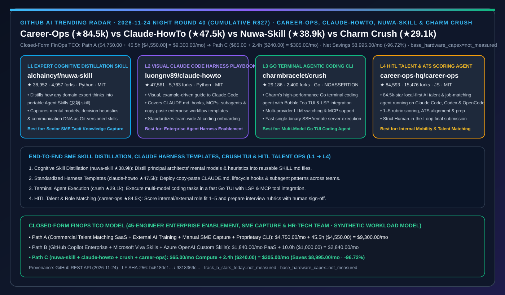
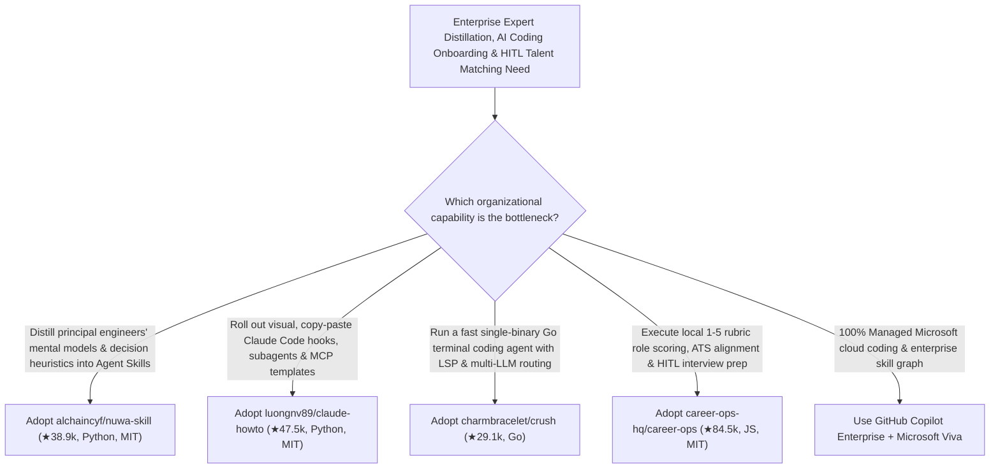
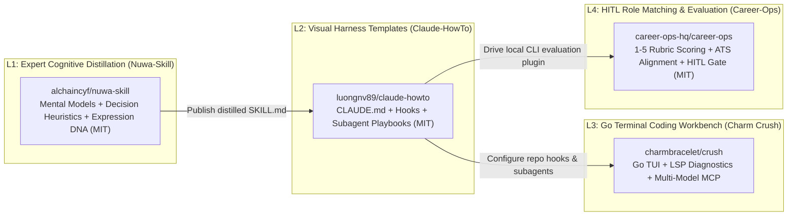
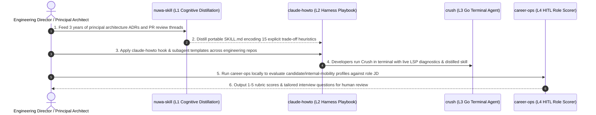

# HITL Talent & Job-Matching Agent (`career-ops-hq/career-ops`), Visual Claude Code Engineering Guide (`luongnv89/claude-howto`), Expert Cognitive Distillation Skill (`alchaincyf/nuwa-skill`) & Go Terminal Coding Agent (`charmbracelet/crush`) Selection & Architecture FAQ

> **Document Type**: AI Solution Architect Selection & Integration Guide (2026-11-24 Night Round 40 / Cumulative Round 827)  
> **Reading Time**: ~8 minutes  
> **Covered Repositories**: [`career-ops-hq/career-ops`](https://github.com/career-ops-hq/career-ops) (`★ 84,593` · `15,476 forks` · JavaScript · `MIT`) · [`luongnv89/claude-howto`](https://github.com/luongnv89/claude-howto) (`★ 47,561` · `5,763 forks` · Python · `MIT`) · [`alchaincyf/nuwa-skill`](https://github.com/alchaincyf/nuwa-skill) (`★ 38,952` · `4,957 forks` · Python · `MIT`) · [`charmbracelet/crush`](https://github.com/charmbracelet/crush) (`★ 29,186` · `2,400 forks` · Go · `NOASSERTION`)  
> **Evidence Provenance**: GitHub REST API verified metadata (2026-11-24) and sealed local evidence files `trending-daily-2026-11-24-raw.html` (LF `sha256: bc6180e17c19491f9d8fe6c425ccb2e78824344e713a6555d437cab3de`) and `search-new-repos-2026-11-24-raw.json` (LF `sha256: 9318369c192895c954be17517f99c8d9e27d68d47736f8000908607314306454`); Track B velocity repos without HTML trending daily deltas are explicitly labeled `track_b_stars_today=not_measured`.  
> **中文版本**: [`careerops-claudehowto-nuwa-crush-selection-faq.md`](./careerops-claudehowto-nuwa-crush-selection-faq.md)

---

## ① 📌 Executive Summary

**One-Sentence Selection Verdict**: When enterprise engineering enablement and talent operations teams need to combine **senior SME tacit-knowledge distillation, standardized Claude Code harness onboarding, multi-model Go terminal coding execution, and human-in-the-loop talent/role matching** across a **200,000+ combined-star open-source stack**, adopting **`alchaincyf/nuwa-skill` (L1 Expert Mental-Model & Decision-Heuristic Distillation Skill), `luongnv89/claude-howto` (L2 Visual Example-Driven Claude Code Harness Playbook & Templates), `charmbracelet/crush` (L3 Charm's Go Terminal Coding Agent with LSP & MCP), and `career-ops-hq/career-ops` (L4 84.5k-Star Local-First 1–5 Rubric Scoring & HITL Talent Agent)** reduces monthly TCO for a 45-engineer organization from **`$9,300.00/mo`** (Path A: Commercial Talent Matching SaaS + External AI Enablement Consulting + Manual SME Knowledge Capture + Proprietary CLI Seats) to **`$305.00/mo`** (Path C), saving **`$8,995.00/mo` (`-96.72%`)**.

| Dimension | `alchaincyf/nuwa-skill` (L1 Expert Cognitive Distillation) | `luongnv89/claude-howto` (L2 Visual Claude Code Playbook) | `charmbracelet/crush` (L3 Go Terminal Coding Agent) | `career-ops-hq/career-ops` (L4 HITL Role-Matching Agent) |
|---|---|---|---|---|
| **Verified Stars & Forks** | `★ 38,952` · `4,957 forks` | `★ 47,561` · `5,763 forks` | `★ 29,186` · `2,400 forks` | `★ 84,593` · `15,476 forks` |
| **Language & License** | Python (`MIT`) | Python (`MIT`) | Go (`NOASSERTION` · verify FSL/MIT license) | JavaScript (`MIT`) |
| **Plain-English Positioning** | Distills how any domain expert thinks—mental models, decision heuristics & expression DNA—into portable Agent Skills | Visual, example-driven guide to Claude Code from fundamentals to advanced hooks, MCPs & multi-agent templates | Charm's high-performance Go terminal coding agent with Bubble Tea TUI, LSP diagnostics & multi-model routing | 84.5k-star local-first AI job/role matching, 1–5 rubric scoring, ATS alignment & interview-prep agent with HITL submit |
| **Core Enterprise Pain Solved** | Captures tacit judgment and trade-off heuristics from principal architects before they rotate or retire | Bridges the adoption gap where developers use AI CLIs as basic chatbots instead of configuring hooks and subagents | Provides a single-binary Go TUI agent with live LSP feedback across Claude, OpenAI, Gemini, and local models | Replaces blind resume screening or spray-and-pray applications with structured 1–5 rubric scoring and human final sign-off |
| **When to Choose vs Cloud PaaS** | Mandatory when converting senior engineers' design reviews and postmortems into reusable `SKILL.md` assets | Mandatory for onboarding engineering teams onto standardized Claude Code workflows | Choose for fast single-binary SSH/terminal coding with built-in LSP and MCP support | Choose for privacy-first local role scoring, ATS alignment, and structured interview prep |

---

## ② 🎯 Architect & Customer Q&A (1–2 Minute Read)

### Q1: Why does standard document RAG fail to replicate a Principal Architect's judgment—and how does `alchaincyf/nuwa-skill` (`★ 38,952`) distill how an expert actually thinks?
- **The Pain**: Standard RAG retrieves factual paragraphs (*what* was written), not the decision heuristics (*why* option A was chosen over option B under constraint C).
- **Architect's Answer**: **`alchaincyf/nuwa-skill`** (`MIT`) extracts three cognitive layers—**Mental Models, Decision Heuristics, and Expression DNA**—into a portable `SKILL.md` that any coding or architecture agent can load during design reviews.

### Q2: How do `luongnv89/claude-howto` (`★ 47,561`) and `charmbracelet/crush` (`★ 29,186`) accelerate enterprise AI coding standardization?
- **Copy-Paste Harness Templates + LSP-Aware Go TUI**:
  1. **`luongnv89/claude-howto` (`MIT`)**: Provides visual architecture diagrams and copy-paste templates for `CLAUDE.md`, lifecycle hooks, slash commands, MCP integrations, and multi-agent delegation.
  2. **`charmbracelet/crush` (Go)**: Built by the creators of Bubble Tea, `crush` compiles to a fast native binary with built-in **LSP diagnostics** and **MCP tool calling** across multiple LLM providers.

### Q3: Why did `career-ops-hq/career-ops` (`★ 84,593` · `15,476 forks`) surge past 84,500 stars, and what architectural pattern makes it enterprise-safe?
- **Rubric Scoring Before Action + Mandatory Human-in-the-Loop Submit (`MIT`)**: Running locally inside **Claude Code, Codex, or OpenCode**, `career-ops` scores role-to-CV fit on a **1–5 rubric**, tailors ATS-aligned materials, generates targeted interview prep, and **strictly requires the human to press Submit**—providing a clean reference pattern for high-stakes human-in-the-loop agent workflows.

---

## ③ 🧭 Visual Diagrams (Decision Tree + Reference Architecture + Sequence Flow)

### 3.1 Selection Decision Tree

### 3.2 End-to-End Enterprise Production Reference Architecture

### 3.3 End-to-End Execution Sequence Diagram

---

## ④ 📊 Comparative Selection Matrix: OSS Stack vs. Peer OSS vs. Cloud PaaS

| Dimension | This OSS Stack (`nuwa-skill` + `claude-howto` + `crush` + `career-ops`) | Uncoordinated Manual Workflow (`Ad-Hoc Mentoring` + `Unconfigured CLI` + `Manual CV Screening`) | Commercial SaaS & Consulting (`External AI Bootcamps` + `Commercial ATS AI` + `Proprietary CLI`) |
|---|---|---|---|
| **Core Role** | Cognitive skill distillation + visual Claude Code templates + Go LSP TUI agent + 1–5 HITL role scorer | Unrecorded tribal knowledge + ad-hoc prompting + manual spreadsheet screening | Expensive external workshops + per-recruiter ATS AI add-ons |
| **Best-Fit Scenario** | Capturing senior engineering judgment, standardizing team-wide AI coding harnesses, and privacy-first role evaluation | Solo hobbyists with no team onboarding or knowledge-retention needs | Enterprises outsourcing all developer enablement and talent screening |
| **Integration Effort** | **Very Low** (3 `MIT` repos; drop-in Markdown/JSON templates and local CLI plugins) | High (Every engineer wastes hours rediscovering hook and subagent patterns) | Medium (Procurement overhead and generic training materials that miss internal context) |
| **Operational Complexity** | **Very Low** (Git-versioned templates and skills across the engineering org; ~`2.4h/mo` ops) | Very High (Repeated mentoring and manual role/CV rubric evaluation costs ~`45.5h/mo`) | Low (Vendor-managed, plus ~`10.0h/mo` template customization) |
| **License & Compliance** | `nuwa-skill`, `claude-howto`, `career-ops` (`MIT`); verify `crush` repository license (`NOASSERTION` in GitHub API) | Internal ad-hoc scripts | Proprietary per-seat and per-workshop contracts |
| **45-Engineer Monthly TCO** | **`$305.00/mo`** (`$65.00` shared internal runner + `2.4h` ops) | ~`$4,615.00/mo` (`$65.00` host + `45.5h` repeated mentoring & manual evaluation labor) | **`$2,840.00/mo`** (Path B) to **`$9,300.00/mo`** (Path A commercial stack) |

---

## ⑤ 🧪 Quantitative ROI & Closed-Form FinOps TCO Comparison

> **Provenance Disclosure**: The TCO table below is a closed-form synthetic architectural model (`provenance: synthetic`, `independently_reproduced: false`) for a **45-engineer enterprise developer enablement and technical talent team** distilling 8 principal engineers' review heuristics, maintaining standardized AI coding harness templates, and evaluating 300 technical role profiles per month (`$100.00/hr` loaded engineering rate). Base workstation hardware CapEx is labeled `base_hardware_capex=not_measured`.

| Cost Component | Path A: Commercial ATS AI SaaS + External AI Training + Manual SME Capture + Proprietary CLI | Path B: GitHub Copilot Enterprise + Microsoft Viva + Cloud Custom Skills | Path C: `nuwa-skill` + `claude-howto` + `crush` + `career-ops` |
|---|---|---|---|
| **Monthly API / SaaS / Cloud Spend** | **`$4,750.00`** (Commercial talent-matching seats + amortized external training + proprietary CLI seats) | **`$1,840.00`** (Managed enterprise coding & skill platform seats) | **`$65.00`** (`$0` license fees for MIT core repos; `$65` internal template/CI runner) |
| **Monthly SME Interviewing, CLI Onboarding & Role-Scoring Labor** | `45.5h` (Repetitive 1-on-1 mentoring + manual JD-to-profile scoring) | `10.0h` (Cloud knowledge base & template upkeep) | **`2.4h`** (Automated heuristic distillation in `nuwa-skill` + copy-paste `claude-howto` templates + `career-ops` scoring) |
| **Monthly Labor Cost (`$100.00/hr`)** | **`$4,550.00`** (`45.5 * 100.00`) | **`$1,000.00`** (`10.0 * 100.00`) | **`$240.00`** (`2.4 * 100.00`) |
| **Total Monthly TCO** | **`$9,300.00 / mo`** | **`$2,840.00 / mo`** | **`$305.00 / mo`** |
| **Net Monthly Savings vs. Path A** | Baseline (`$0.00`) | Saves `$6,460.00 / mo` (`-69.46%`) | **Saves `$8,995.00 / mo` (`-96.72%`)** |

---

## ⑥ 🛠️ Enterprise Architecture Review & Adoption Checklist

- [ ] **Blind-Test Validation of Distilled SME Skills (`alchaincyf/nuwa-skill`)**: Validate every `nuwa-skill` output against 10 historical architecture trade-off decisions with the source SME before publishing the skill to the organization.
- [ ] **Standardized Pre-Tool Security Hooks (`luongnv89/claude-howto`)**: Roll out `claude-howto` pre-tool hook templates across all repositories to block unauthorized credential reads and destructive shell commands.
- [ ] **Mandatory LSP Diagnostics Loop (`charmbracelet/crush`)**: Configure language servers in `crush` for Go, TypeScript, Python, and Rust so the agent resolves type and compiler errors before completing a turn.
- [ ] **Preserve Strict Human-in-the-Loop Submission & Local PII Encryption (`career-ops-hq/career-ops`)**: Keep `career-ops` in human-confirmed submission mode and store all candidate/employee CVs on encrypted local storage.
